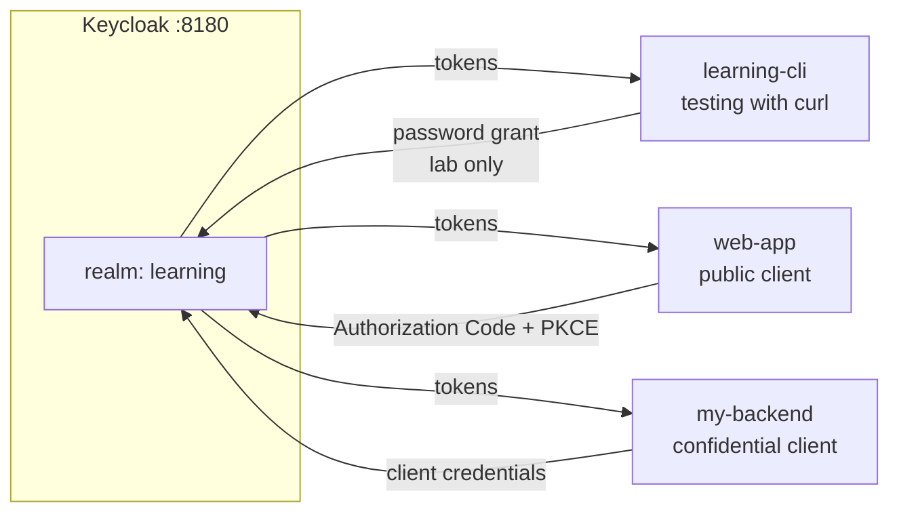
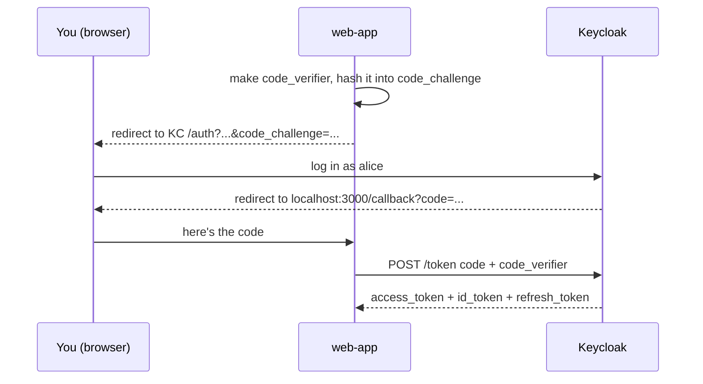

# Keycloak from scratch: a hands-on guide

> **Do phases 4–6 of the [roadmap](ROADMAP.md) first** (tokens, OAuth 2.0, OpenID Connect). This guide shows you the *real thing*, and it only makes sense once you know the rules Keycloak follows.

**Verified:** every command below was run against **Keycloak 26.8.0** (Docker image `quay.io/keycloak/keycloak:latest`, October 2026), and every output block is the real output. IDs, timestamps, and token values will differ on your machine; the shape will be the same.

**Admin console vs CLI:** you can click through the admin console *or* run commands. This guide gives the click path for understanding and a `kcadm.sh` command for repeatability. Button names can move slightly between versions; the commands are what was verified.

---

## What you'll build



| Lesson | You learn |
|---|---|
| K1 | Start Keycloak |
| K2 | Realms |
| K3 | Users |
| K4 | Roles |
| K5 | The discovery document |
| K6 | Your first token (and reading it) |
| K7 | Calling an endpoint with a token |
| K8 | Machine-to-machine: client credentials |
| K9 | The real login flow: Authorization Code + PKCE |
| K10 | Refresh tokens |
| K11 | Audience: making a token "for" a specific API |
| K12 | Exporting your realm as code |
| K13 | What's next: production |

**You need:** Docker, `curl`, `jq`, `openssl` (already on macOS/Linux).

---

## K1: Start Keycloak

**Why:** Keycloak is a server program. Docker lets you run it with one command and throw it away just as easily.

```bash
docker run --rm --name keycloak -p 8180:8080 \
  -e KC_BOOTSTRAP_ADMIN_USERNAME=admin \
  -e KC_BOOTSTRAP_ADMIN_PASSWORD=admin \
  quay.io/keycloak/keycloak:latest start-dev
```

| Part | Why |
|---|---|
| `--rm` | Delete the container when it stops. `start-dev` keeps data inside the container, so **stopping it wipes everything**. That's fine for learning |
| `-p 8180:8080` | Keycloak listens on 8080 *inside* the container; we reach it on 8180 on your laptop (8080 is often already taken) |
| `KC_BOOTSTRAP_ADMIN_*` | Creates a temporary first admin user |
| `start-dev` | Development mode: plain HTTP, built-in database. **Never use it in production** |

Wait for this line in the output:

```
Keycloak 26.8.0 on JVM (powered by Quarkus 3.40.1) started in 5.491s. Listening on: http://0.0.0.0:8080
```

Open **http://localhost:8180/admin** and log in with `admin` / `admin`.

Leave this terminal running. Open a **second terminal** for everything below.

### Log the CLI in

`kcadm.sh` is Keycloak's admin command-line tool. It's inside the container, so we run it with `docker exec`:

```bash
alias kcadm='docker exec keycloak /opt/keycloak/bin/kcadm.sh'
kcadm config credentials --server http://localhost:8080 --realm master --user admin --password admin
```

```
Logging into http://localhost:8080 as user admin of realm master
```

(It says `8080` because the command runs *inside* the container, where Keycloak really is on 8080.)

---

## K2: Realms

**Idea:** A **realm** is a separate world: its own users, apps, roles, login page, and settings. Users in one realm can't log into another. Think of separate buildings, each with its own front desk.

Keycloak starts with one realm, **`master`**. It is for **Keycloak admins only**. Never put your apps or normal users in `master`.

**Click path:** left menu → realm list (**Manage realms**) → **Create realm** → name `learning` → Create.

**Command:**

```bash
kcadm create realms -s realm=learning -s enabled=true
```

```
Created new realm with id 'learning'
```

---

## K3: Users

**Idea:** A **user** is a person who can log in. Keycloak stores their password **hashed** (phase 1), so even Keycloak admins can't see it.

**Click path:** realm `learning` → **Users** → **Add user** → fill in the fields → Create → **Credentials** tab → **Set password** (turn **Temporary** off).

**Command:**

```bash
kcadm create users -r learning -s username=alice -s enabled=true \
  -s email=alice@example.com -s emailVerified=true \
  -s firstName=Alice -s lastName=Smith
kcadm set-password -r learning --username alice --new-password alice123
kcadm get users -r learning -q username=alice --fields username,email,enabled
```

```
Created new user with id '3c6f01fa-2557-440e-bd66-1f8030536090'
[ {
  "username" : "alice",
  "email" : "alice@example.com",
  "enabled" : true
} ]
```

**Try this:** set a password with **Temporary on** in the UI, then log in at http://localhost:8180/realms/learning/account. Keycloak forces a password change first. That's a **required action**.

---

## K4: Roles

**Idea:** A **role** is a label like `admin` or `viewer`. Your app reads roles from the token and decides what the user may do (phase 3, RBAC).

- **Realm role**: means the same thing everywhere in the realm.
- **Client role**: only meaningful to one app (e.g. `approver` in the expenses app).

**Click path:** **Realm roles** → **Create role** → `admin`. Then **Users** → alice → **Role mapping** → **Assign role**.

**Command:**

```bash
kcadm create roles -r learning -s name=admin
kcadm add-roles -r learning --uusername alice --rolename admin
```

```
Created new role with id 'admin'
```

**Try this:** create a **group** `admins`, give the group the `admin` role, and put alice in the group instead. In real companies you assign roles to groups, not to individual people.

---

## K5: The discovery document

**Idea:** Every OpenID Connect server publishes a "menu" of its endpoints at a standard address. Libraries read this so you only ever configure one URL: the **issuer**.

```bash
curl -s http://localhost:8180/realms/learning/.well-known/openid-configuration \
  | jq '{issuer, authorization_endpoint, token_endpoint, jwks_uri, userinfo_endpoint}'
```

```json
{
  "issuer": "http://localhost:8180/realms/learning",
  "authorization_endpoint": "http://localhost:8180/realms/learning/protocol/openid-connect/auth",
  "token_endpoint": "http://localhost:8180/realms/learning/protocol/openid-connect/token",
  "jwks_uri": "http://localhost:8180/realms/learning/protocol/openid-connect/certs",
  "userinfo_endpoint": "http://localhost:8180/realms/learning/protocol/openid-connect/userinfo"
}
```

| Endpoint | Used for |
|---|---|
| `issuer` | The realm's identity. Must match the `iss` claim in every token |
| `authorization_endpoint` | Where the **browser** goes to log in |
| `token_endpoint` | Where the **app** swaps codes/credentials for tokens |
| `jwks_uri` | The **public keys**. APIs use these to verify token signatures |
| `userinfo_endpoint` | Returns the logged-in user's profile |

---

## K6: Your first token

**Idea:** To get a token, you need a **client**: an app registered with Keycloak. For this first test we create a client that allows the **password grant** (sending the username and password straight to the token endpoint).

> ⚠️ The password grant is **deprecated** and must never be used in real apps. The real app never sees the password; that's the whole point of OAuth. We use it here *only* because it's the fastest way to see a token with `curl`. K9 shows the real flow.

```bash
kcadm create clients -r learning -s clientId=learning-cli -s publicClient=true \
  -s directAccessGrantsEnabled=true -s standardFlowEnabled=false

TOKENS=$(curl -s -X POST http://localhost:8180/realms/learning/protocol/openid-connect/token \
  -d grant_type=password -d client_id=learning-cli \
  -d username=alice -d password=alice123 -d scope=openid)

echo "$TOKENS" | jq '{token_type, expires_in, refresh_expires_in, scope}'
```

```json
{
  "token_type": "Bearer",
  "expires_in": 300,
  "refresh_expires_in": 1800,
  "scope": "openid email profile"
}
```

The access token lives **300 seconds** (5 minutes). The refresh token lives **1800 seconds** (30 minutes).

### Read what's inside

A JWT's middle part is just Base64 (phase 4). This helper decodes it:

```bash
jwt_payload() {
  echo "$1" | jq -R 'split(".")[1] | gsub("-";"+") | gsub("_";"/")
    | . + ("=" * ((4 - length % 4) % 4)) | @base64d | fromjson'
}

ACCESS_TOKEN=$(echo "$TOKENS" | jq -r .access_token)
jwt_payload "$ACCESS_TOKEN" | jq '{iss, sub, typ, azp, preferred_username, email, realm_access, scope, exp, iat}'
```

```json
{
  "iss": "http://localhost:8180/realms/learning",
  "sub": "3c6f01fa-2557-440e-bd66-1f8030536090",
  "typ": "Bearer",
  "azp": "learning-cli",
  "preferred_username": "alice",
  "email": "alice@example.com",
  "realm_access": {
    "roles": [
      "default-roles-learning",
      "offline_access",
      "admin",
      "uma_authorization"
    ]
  },
  "scope": "openid email profile",
  "exp": 1791309477,
  "iat": 1791309177
}
```

| Claim | Meaning |
|---|---|
| `iss` | Issuer: which realm made this token |
| `sub` | Subject: alice's permanent user ID. Use this, not the username, as the key in your database |
| `typ` | `Bearer`: this is an access token |
| `azp` | Authorized party: which client asked for it |
| `realm_access.roles` | alice's realm roles. There's our `admin` from K4 |
| `exp` / `iat` | Expires at / issued at (seconds since 1970). `exp − iat = 300` |

**Notice:** anyone holding this token can read all of this. **Signed, not encrypted.**

**Wrong password:**

```bash
curl -s -X POST http://localhost:8180/realms/learning/protocol/openid-connect/token \
  -d grant_type=password -d client_id=learning-cli -d username=alice -d password=wrong | jq .
```

```json
{
  "error": "invalid_grant",
  "error_description": "Invalid user credentials"
}
```

---

## K7: Calling an endpoint with a token

**Idea:** You send an access token in the `Authorization` header as a **Bearer** token. Keycloak's own `userinfo` endpoint is a protected API, so let's call it.

```bash
curl -s http://localhost:8180/realms/learning/protocol/openid-connect/userinfo \
  -H "Authorization: Bearer $ACCESS_TOKEN" | jq .
```

```json
{
  "sub": "3c6f01fa-2557-440e-bd66-1f8030536090",
  "email_verified": true,
  "name": "Alice Smith",
  "preferred_username": "alice",
  "given_name": "Alice",
  "family_name": "Smith",
  "email": "alice@example.com"
}
```

With a fake token:

```bash
curl -s -o /dev/null -w '%{http_code}\n' \
  http://localhost:8180/realms/learning/protocol/openid-connect/userinfo \
  -H "Authorization: Bearer garbage"
```

```
401
```

**Try this:** wait 5 minutes and call `userinfo` again with the same token. It expires.

---

## K8: Machine-to-machine: client credentials

**Idea:** A nightly batch job has no human to log in. It authenticates **as itself** with a **client ID + client secret**. Keycloak gives every such client a **service account**, a robot user.

- **Confidential client** (`publicClient=false`): runs on a server, can keep a secret.
- **Public client**: runs in a browser or phone, can't keep a secret, so it has none.

```bash
kcadm create clients -r learning -s clientId=my-backend -s secret=my-secret \
  -s publicClient=false -s serviceAccountsEnabled=true -s standardFlowEnabled=false

SVC=$(curl -s -X POST http://localhost:8180/realms/learning/protocol/openid-connect/token \
  -d grant_type=client_credentials -d client_id=my-backend -d client_secret=my-secret)

echo "$SVC" | jq '{token_type, expires_in, scope, refresh_token}'
jwt_payload "$(echo "$SVC" | jq -r .access_token)" | jq '{azp, preferred_username, sub}'
```

```json
{
  "token_type": "Bearer",
  "expires_in": 300,
  "scope": "profile email",
  "refresh_token": null
}
{
  "azp": "my-backend",
  "preferred_username": "service-account-my-backend",
  "sub": "31475660-9feb-499d-bdef-6bbc74a6e8a9"
}
```

**Notice:** no refresh token. A machine can just ask again with its secret. The token's user is the robot `service-account-my-backend`.

**Wrong secret:**

```json
{
  "error": "unauthorized_client",
  "error_description": "Invalid client or Invalid client credentials"
}
```

> We set the secret to `my-secret` so this guide is repeatable. In real life, let Keycloak generate it (**Clients → my-backend → Credentials**) and store it in a secret manager, never in git.

---

## K9: The real login flow: Authorization Code + PKCE

**Idea:** This is how every real web and mobile app logs users in (phase 5). The app **never sees the password**. The browser goes to Keycloak, the user logs in *there*, and the app receives a one-time **code** that it swaps for tokens.

**PKCE** protects that code: the app invents a random secret (`code_verifier`), sends only its hash (`code_challenge`) at the start, and must show the original secret at the end. A thief who steals the code doesn't have the verifier.



### 1. Register the app

```bash
kcadm create clients -r learning -s clientId=web-app -s publicClient=true \
  -s standardFlowEnabled=true -s directAccessGrantsEnabled=false \
  -s 'redirectUris=["http://localhost:3000/callback"]' \
  -s 'attributes."pkce.code.challenge.method"=S256'
```

| Setting | Why |
|---|---|
| `publicClient=true` | A browser app can't keep a secret |
| `standardFlowEnabled=true` | "Standard flow" is Keycloak's name for Authorization Code |
| `redirectUris` | The **only** place Keycloak will send codes. Exact URLs; avoid wildcards |
| `pkce.code.challenge.method=S256` | **Require** PKCE for this client |

### 2. Be the app: make the PKCE pair

```bash
CODE_VERIFIER=$(openssl rand -hex 32)
CODE_CHALLENGE=$(printf '%s' "$CODE_VERIFIER" | openssl dgst -sha256 -binary \
  | openssl base64 -A | tr '+/' '-_' | tr -d '=')

echo "http://localhost:8180/realms/learning/protocol/openid-connect/auth?client_id=web-app&response_type=code&scope=openid&redirect_uri=http://localhost:3000/callback&state=xyz123&code_challenge=$CODE_CHALLENGE&code_challenge_method=S256"
```

### 3. Be the user: log in

Open the printed URL in your browser and log in as `alice` / `alice123`.

Your browser lands on `http://localhost:3000/callback?...` and shows **"can't connect."** That's expected: no app is running there. **Look at the address bar.** It looks like this:

```
http://localhost:3000/callback?state=xyz123&session_state=qB34STIcSNm6x7OLoaztIwSm&iss=http%3A%2F%2Flocalhost%3A8180%2Frealms%2Flearning&code=<CODE>
```

- `state=xyz123` came back unchanged. A real app checks this to block CSRF.
- `code=...` is the one-time code. Copy it.

### 4. Be the app again: swap the code for tokens

Do this quickly. Codes expire within about a minute.

```bash
CODE='paste-the-code-here'

R=$(curl -s -X POST http://localhost:8180/realms/learning/protocol/openid-connect/token \
  -d grant_type=authorization_code -d client_id=web-app -d code="$CODE" \
  -d redirect_uri=http://localhost:3000/callback -d code_verifier="$CODE_VERIFIER")

echo "$R" | jq 'keys'
jwt_payload "$(echo "$R" | jq -r .id_token)" | jq '{iss, aud, sub, typ, azp, preferred_username, email, name}'
```

```json
[
  "access_token",
  "expires_in",
  "id_token",
  "not-before-policy",
  "refresh_expires_in",
  "refresh_token",
  "scope",
  "session_state",
  "token_type"
]
{
  "iss": "http://localhost:8180/realms/learning",
  "aud": "web-app",
  "sub": "3c6f01fa-2557-440e-bd66-1f8030536090",
  "typ": "ID",
  "azp": "web-app",
  "preferred_username": "alice",
  "email": "alice@example.com",
  "name": "Alice Smith"
}
```

The **ID token** (`typ: ID`) is addressed to the app (`aud: web-app`). It tells the app *who logged in*. The app sends the **access token**, not this one, to APIs.

### 5. See the protections work

**Use the same code twice:**

```json
{
  "error": "invalid_grant",
  "error_description": "Code not valid"
}
```

**Start a login without PKCE.** Keycloak refuses and redirects back with an error:

```
http://localhost:3000/callback?error=invalid_request&error_description=Missing+parameter%3A+code_challenge_method&state=xyz123&iss=...
```

**Try this:** go back to the login URL in the same browser. You're sent straight to the callback with **no password prompt**. That's **SSO**: Keycloak remembers you with its own cookie.

---

## K10: Refresh tokens

**Idea:** Access tokens die after 5 minutes on purpose (a stolen one is useful only briefly). The app uses the **refresh token** to get a fresh one without asking the user to log in again.

```bash
curl -s -X POST http://localhost:8180/realms/learning/protocol/openid-connect/token \
  -d grant_type=refresh_token -d client_id=learning-cli \
  -d refresh_token="$(echo "$TOKENS" | jq -r .refresh_token)" | jq '{token_type, expires_in}'
```

```json
{
  "token_type": "Bearer",
  "expires_in": 300
}
```

Lifetimes live under **Realm settings → Sessions** and **Realm settings → Tokens**.

---

## K11: Audience: making a token "for" a specific API

**Idea:** Suppose you have an `orders-api`. It should only accept tokens that were **meant for it**. Otherwise a token issued for some unrelated app could be replayed against your API. The `aud` (audience) claim says who a token is for.

Right now alice's access token says:

```bash
ACCESS_TOKEN=$(curl -s -X POST http://localhost:8180/realms/learning/protocol/openid-connect/token \
  -d grant_type=password -d client_id=learning-cli -d username=alice -d password=alice123 | jq -r .access_token)
jwt_payload "$ACCESS_TOKEN" | jq '{aud}'
```

```json
{
  "aud": "account"
}
```

(`account` is Keycloak's built-in account console; alice gets it through her default roles.)

Add an **audience mapper**. A **protocol mapper** is a rule that writes a claim into tokens:

```bash
CID=$(kcadm get clients -r learning -q clientId=learning-cli --fields id --format csv --noquotes)

kcadm create clients/$CID/protocol-mappers/models -r learning \
  -s name=orders-api-audience -s protocol=openid-connect \
  -s protocolMapper=oidc-audience-mapper \
  -s 'config."included.custom.audience"=orders-api' \
  -s 'config."access.token.claim"=true'
```

Get a new token and look again:

```json
{
  "aud": [
    "orders-api",
    "account"
  ]
}
```

Now `orders-api` must **reject** any token whose `aud` doesn't contain `orders-api`.

> In real setups you usually put the mapper in a **client scope** (Client scopes → Create → Mappers) and attach that scope to every client allowed to call the API, rather than adding it to each client one at a time.

---

## K12: Exporting your realm as code

**Idea:** Clicking around the console is fine for learning, but at work the realm configuration should live **in git**, so you can review changes and rebuild an environment exactly.

```bash
kcadm create realms/learning/partial-export \
  -q exportClients=true -q exportGroupsAndRoles=true -o > learning-realm.json

jq '{realm, clients: [.clients[].clientId], roles: [.roles.realm[].name]}' learning-realm.json
```

```json
{
  "realm": "learning",
  "clients": [
    "account",
    "account-console",
    "admin-cli",
    "broker",
    "learning-cli",
    "my-backend",
    "realm-management",
    "security-admin-console",
    "web-app"
  ],
  "roles": [
    "default-roles-learning",
    "offline_access",
    "uma_authorization",
    "admin"
  ]
}
```

**Notes:**
- Partial export **does not include normal users or passwords**. That's good: users are data, not configuration. (It does include service-account users like `service-account-my-backend`.) Client secrets are masked as `**********`.
- `kc.sh export` (a full export, including users) only works while the server is **stopped**. Running it next to a live `start-dev` server fails with `Database may be already in use`.
- To start Keycloak with a realm already loaded, mount JSON files into `/opt/keycloak/data/import` and add `--import-realm` to the start command.

**Clean up:** press `Ctrl+C` in the first terminal. Because of `--rm` and `start-dev`, everything is gone.

---

## K13: What's next: running Keycloak for real

Everything above used `start-dev`. Production is different. Learn these next, using the official [server guides](https://www.keycloak.org/guides#server):

| Topic | What changes |
|---|---|
| `start` instead of `start-dev` | Production mode: HTTPS and a hostname are required |
| Hostname | `--hostname=https://auth.company.com`, so `iss` is the same for everyone |
| TLS | Real certificates, or TLS ending at a reverse proxy |
| Database | PostgreSQL (`--db=postgres`, `--db-url`, ...) instead of the built-in dev database |
| Reverse proxy | `--proxy-headers=xforwarded` when behind nginx / a load balancer |
| Health & metrics | `--health-enabled=true --metrics-enabled=true` |
| High availability | 2+ nodes sharing a database, with distributed caches |
| Optimized image | Build a custom image with `kc.sh build` so startup is fast |
| Admin access | Replace the temporary bootstrap admin with a real admin; restrict the admin console |
| Upgrades | Read the upgrade guide for every version; test on a copy first |

Then continue with the Keycloak projects (P11–P16) in [`projects/README.md`](projects/README.md).
