# Security & Identity Mastery

A path from **"I don't understand anything about security"** to **"I can run Keycloak at work and explain every token it issues."**

This is for someone starting at zero. Every idea comes in plain words first, with an everyday analogy, before any code.

---

## The whole thing in one picture

Think of an office building.

| Real life | Security world |
|---|---|
| Showing your ID card at the front desk | **Authentication**: proving who you are |
| Your badge opens some doors but not others | **Authorization**: what you are allowed to do |
| The badge itself | **Token**: a signed piece of data that says who you are and what you can do |
| The rulebook for how badges get handed out | **OAuth 2.0 / OpenID Connect**: the standard rules (protocols) |
| Your company's own front desk | **Keycloak**: a server you run yourself that hands out tokens |
| A front desk you rent from another company | **Auth0**: the same job, as a paid cloud service |
| Thieves trying to sneak in | **Web attacks** (XSS, CSRF, SQL injection, ...): what all of this protects against |

```mermaid
flowchart LR
  P0[0 How the web works] --> P1[1 Crypto basics]
  P1 --> P2[2 Login & sessions]
  P2 --> P3[3 Permissions]
  P3 --> P4[4 Tokens & JWT]
  P4 --> P5[5 OAuth 2.0]
  P5 --> P6[6 OpenID Connect & SSO]
  P6 --> P7[7 Keycloak]
  P7 --> P8[8 Auth0 & other providers]
  P8 --> P9[9 Web attacks / OWASP]
  P9 --> P10[10 API & service security]
  P10 --> P11[11 Enterprise identity]
  P11 --> P12[12 Security operations]
  P12 --> P13[13 Capstones]
```

## Start here

1. **[`ROADMAP.md`](ROADMAP.md)**: the main document. 14 phases, each with plain-words explanations, a jargon table, "the one trap", and what you must build before moving on.
2. **[`KEYCLOAK.md`](KEYCLOAK.md)**: Keycloak from scratch, hands-on. Every command in it was run against a real Keycloak 26.8.0 server, and the outputs are the real ones.
3. **[`projects/README.md`](projects/README.md)**: 24 projects, from tiny to capstone, mapped to phases.
4. **[`GLOSSARY.md`](GLOSSARY.md)**: every word and acronym in plain English.
5. **[`LEARNING.md`](LEARNING.md)**: your progress tracker. Tick things off as you go.

## The 14 phases

| Phase | Topic | The question it answers |
|---|---|---|
| 0 | How the web works | What actually travels between my browser and a server? |
| 1 | Cryptography basics | How can data be secret, unchangeable, and proven to come from someone? |
| 2 | Authentication: login, passwords, sessions, MFA | How does a website know it's really me? |
| 3 | Authorization: roles and permissions | Now that it knows me, what am I allowed to do? |
| 4 | Tokens & JWT | How do I carry "who I am" to many servers without a shared database? |
| 5 | OAuth 2.0 | How can an app act for me without ever seeing my password? |
| 6 | OpenID Connect & SSO | How do I log in once and use ten apps? |
| 7 | **Keycloak** | How do I run my own login server for a whole company? |
| 8 | Auth0 & other providers | What changes when the login server is rented, not owned? |
| 9 | Web application security (OWASP Top 10) | How do attackers actually break in, and how do I stop them? |
| 10 | API & service-to-service security | How do my backend services trust each other? |
| 11 | Enterprise identity (SAML, LDAP, Active Directory, SCIM) | How do big companies connect all their old and new systems? |
| 12 | Security operations | How do I know if I'm being attacked, and what do I do then? |
| 13 | Capstones | Can I prove all of this with real, working systems? |

## How to use this repo

- **Don't skip phases 0–6 to get to Keycloak faster.** Keycloak is just a tool that follows the rules from phases 4–6. If you know the rules, Keycloak is easy. If you don't, it's a screen full of confusing buttons.
- **Learn 1 hour, build 2 hours.** Reading about security without breaking and fixing things doesn't stick.
- **Each phase ends with something you built.** No artifact, phase not done.
- **Suggested pace:** 8–10 hours a week takes about **5–6 months** to finish. Phase 7 (Keycloak) is the biggest; give it 4–5 weeks.

## Tools you will need

| Tool | Why |
|---|---|
| A browser with DevTools (Chrome/Firefox) | To see every request, cookie, and header |
| `curl` and `jq` | To send requests by hand and read JSON |
| Docker | To run Keycloak, databases, and practice apps locally |
| One backend language (Python/FastAPI or Java/Spring Boot) | To build the apps you will protect |
| [jwt.io](https://jwt.io) | To look inside tokens. Only paste practice tokens, never real ones |
