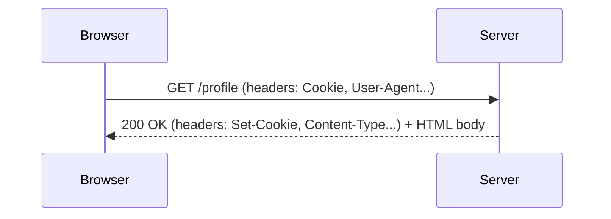
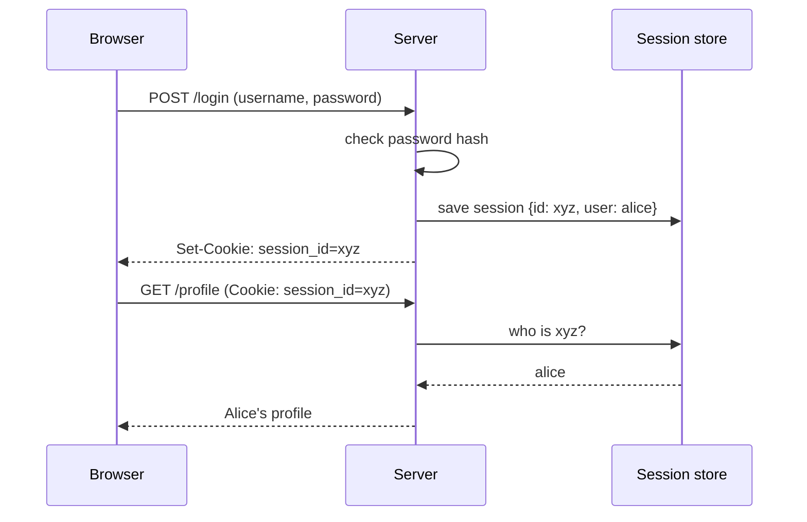
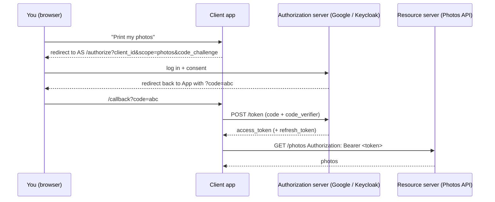
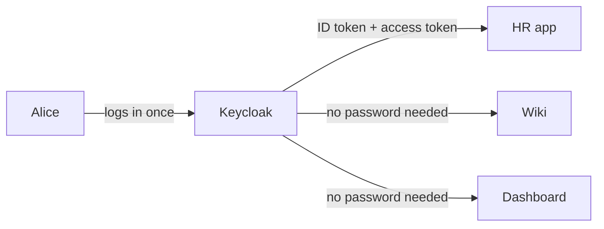
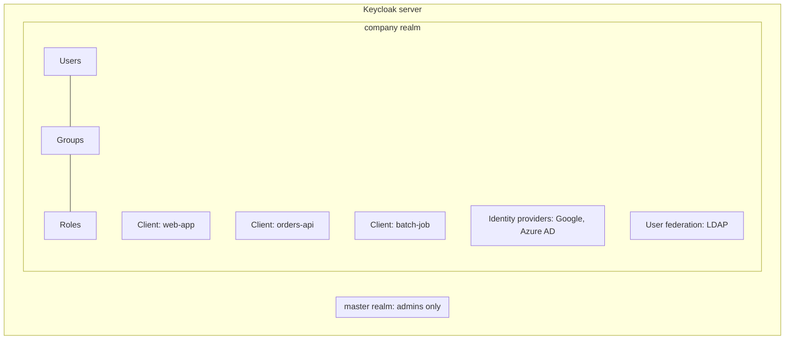

# The Roadmap

Every phase has the same shape:

- **The question**: what this phase answers.
- **In plain words**: the idea, with an everyday analogy.
- **What to learn**: a checklist.
- **Jargon**: the new words, explained.
- **The one trap**: the mistake almost everyone makes.
- **Exit artifact**: what you must build before moving on.
- **Resources**: the best places to read more.

Projects (`P1`, `P2`, ...) are described in [`projects/README.md`](projects/README.md). Keycloak projects (`KP1`, ...) and the capstones are in [`keycloak/PROJECTS.md`](keycloak/PROJECTS.md).

---

## Phase 0: How the web works (1 week)

**The question:** What actually travels between my browser and a server?

**In plain words:** When you open a website, your browser sends a **request** (a letter) to a server, and the server sends back a **response** (a reply letter). Each letter has an envelope with labels on it (**headers**) and the content inside (**body**). Every security idea later in this roadmap is about what goes on those envelopes and who is allowed to read them.



**What to learn:**
- [ ] What a URL is made of: scheme, host, port, path, query string
- [ ] DNS: how `google.com` becomes an IP address
- [ ] HTTP methods: `GET`, `POST`, `PUT`, `DELETE`
- [ ] Status codes, especially `200`, `301/302` (redirect), `401` vs `403`, `404`, `500`
- [ ] Headers: `Content-Type`, `Authorization`, `Cookie`, `Set-Cookie`, `Location`
- [ ] Cookies: what they are and how the browser sends them back automatically
- [ ] Redirects: how a server can send your browser to another site (OAuth depends on this)
- [ ] HTTP vs HTTPS at a high level (details in phase 1)
- [ ] Using browser DevTools → Network tab, and `curl -v`

**Jargon:**

| Word | Plain meaning | Example |
|---|---|---|
| Request / Response | The letter you send / the reply | `GET /home` → `200 OK` |
| Header | A label on the envelope | `Authorization: Bearer abc123` |
| Cookie | A small note the server asks your browser to keep and show again on every visit | `session_id=xyz` |
| Redirect | The server says "go to this other address instead" | `302` + `Location: https://login.example.com` |
| Stateless | HTTP forgets you after each request; cookies and tokens are how it "remembers" | |

**The one trap:** `401 Unauthorized` actually means *"I don't know who you are"* (an authentication problem). `403 Forbidden` means *"I know who you are, and you're not allowed"* (an authorization problem). The names are misleading, and people mix them up all the time.

**Exit artifact:** P1. A tiny server, plus screenshots of its requests in DevTools with every header explained in your own words.

**Resources:**
- [MDN: An overview of HTTP](https://developer.mozilla.org/en-US/docs/Web/HTTP/Overview)
- [MDN: Using HTTP cookies](https://developer.mozilla.org/en-US/docs/Web/HTTP/Cookies)
- *HTTP: The Definitive Guide* (Gourley & Totty), chapters 1–3

---

## Phase 1: Cryptography basics (2 weeks)

**The question:** How can data be kept secret, protected from changes, and proven to come from a specific person?

**In plain words:** Cryptography gives you three superpowers:

1. **Hiding** (encryption): lock a message in a box so only someone with the key can open it.
2. **Fingerprinting** (hashing): turn any data into a short fingerprint. Change one letter and the fingerprint is completely different. You can't turn the fingerprint back into the data.
3. **Signing** (digital signatures): stamp a message with your personal seal. Anyone can check the seal is yours, but nobody else can make it.

Tokens (phase 4) use **signing**. HTTPS uses **all three**. Password storage uses **hashing**.

**What to learn:**
- [ ] Hashing: SHA-256; why it's one-way
- [ ] Password hashing: why plain SHA-256 is wrong for passwords; **salt**; slow hashes (bcrypt, Argon2)
- [ ] HMAC: a hash plus a shared secret, which proves a message wasn't changed
- [ ] Symmetric encryption (one shared key, AES) vs asymmetric encryption (public + private key, RSA / elliptic curves)
- [ ] Digital signatures: sign with the private key, verify with the public key
- [ ] Certificates: a signed document saying "this public key belongs to example.com"
- [ ] Certificate Authorities (CAs) and the chain of trust
- [ ] TLS/HTTPS: how the browser and server agree on a secret key over a public network
- [ ] Encoding is NOT encryption: Base64 hides nothing

**Jargon:**

| Word | Full name | Plain meaning | Example |
|---|---|---|---|
| Hash | — | One-way fingerprint of data | `sha256("hi")` → `8f43...` |
| Salt | — | Random extra data added before hashing, so two equal passwords get different hashes | |
| HMAC | Hash-based Message Authentication Code | Fingerprint that needs a secret key | Used in HS256 JWTs |
| AES | Advanced Encryption Standard | Symmetric encryption: one key locks and unlocks | Disk encryption |
| RSA / ECDSA | (names of algorithms) | Asymmetric: a public key and a private key | RS256 JWTs |
| Public key | — | Shared with everyone; used to verify signatures | Like a published seal pattern |
| Private key | — | Never shared; used to create signatures | Like the physical seal |
| Certificate | X.509 certificate | "This public key belongs to this website," signed by a CA | The padlock in your browser |
| TLS | Transport Layer Security | The "S" in HTTPS | |

**The one trap:** **Base64 is not encryption.** The middle part of a JWT looks like gibberish, but anyone can decode it in one second. Never put secrets inside a token payload.

**Exit artifact:** P2 (password hasher) and P3 (sign and verify with a key pair).

**Resources:**
- *Real-World Cryptography* (David Wong): the best beginner-friendly book
- [Cryptopals challenges](https://cryptopals.com/) (sets 1–2) for when you want to go deep
- [How HTTPS works (comic)](https://howhttps.works/)

---

## Phase 2: Authentication: login, passwords, sessions, MFA (2 weeks)

**The question:** How does a website know it's really me?

**In plain words:** **Authentication** (often written **AuthN**) means proving who you are. Classic websites do it like this:

1. You type a username and password.
2. The server checks the password against a stored hash.
3. The server creates a **session** (a record saying "this visitor is Alice") and gives your browser a **session cookie** (a ticket number).
4. On every later request, the browser automatically shows the ticket, and the server looks it up.



**What to learn:**
- [ ] The three "factors": something you **know** (password), **have** (phone), **are** (fingerprint)
- [ ] Storing passwords safely (from phase 1)
- [ ] Sessions and session cookies
- [ ] Cookie security flags: `HttpOnly`, `Secure`, `SameSite`
- [ ] Logout: really destroying the session
- [ ] Session fixation and session timeout
- [ ] MFA / 2FA, TOTP (the 6-digit authenticator app codes)
- [ ] Passkeys / WebAuthn: logging in with no password at all
- [ ] Brute force, credential stuffing, rate limiting, account lockout
- [ ] Password reset flows, and why they're a favourite attack target

**Jargon:**

| Word | Full name | Plain meaning |
|---|---|---|
| AuthN | Authentication | Proving who you are |
| Session | — | The server's memory that "ticket xyz = Alice" |
| MFA / 2FA | Multi-Factor / Two-Factor Authentication | Needing two different kinds of proof |
| TOTP | Time-based One-Time Password | The 6-digit code that changes every 30 seconds |
| WebAuthn / Passkey | Web Authentication | Login with your device's fingerprint or face, using public-key crypto |
| Credential stuffing | — | Attackers try passwords leaked from other sites |

**The one trap:** A session cookie **is** your identity. Whoever has the cookie *is* you, with no password needed. That's why `HttpOnly` (JavaScript can't read it) and `Secure` (only sent over HTTPS) matter so much.

**Exit artifact:** P4. A login system built by hand, then P5 (add TOTP).

**Resources:**
- [OWASP Authentication Cheat Sheet](https://cheatsheetseries.owasp.org/cheatsheets/Authentication_Cheat_Sheet.html)
- [OWASP Session Management Cheat Sheet](https://cheatsheetseries.owasp.org/cheatsheets/Session_Management_Cheat_Sheet.html)
- [OWASP Password Storage Cheat Sheet](https://cheatsheetseries.owasp.org/cheatsheets/Password_Storage_Cheat_Sheet.html)

---

## Phase 3: Authorization: roles and permissions (1 week)

**The question:** Now that the server knows who I am, what am I allowed to do?

**In plain words:** **Authorization** (**AuthZ**) is about permissions. In a hospital, everyone is "logged in" with a badge, but only doctors can open the medicine cabinet. There are a few common ways to decide who can do what:

- **RBAC** (role-based): give people roles (`doctor`, `nurse`) and give roles permissions. This is the most common, and it's what Keycloak roles are.
- **ABAC** (attribute-based): decide using facts, e.g. "a doctor can read a patient's file *only if* they're in the same department and it's working hours."
- **ReBAC** (relationship-based): "you can edit this document because you're its owner" (Google Docs sharing).

**What to learn:**
- [ ] Authentication vs authorization (the #1 interview question)
- [ ] RBAC, roles, groups, permissions
- [ ] ABAC and policies
- [ ] ReBAC (Google Zanzibar, OpenFGA)
- [ ] Principle of least privilege
- [ ] Where to enforce checks: **always on the server**, never only in the UI
- [ ] IDOR: changing `/orders/101` to `/orders/102` and seeing someone else's order

**Jargon:**

| Word | Full name | Plain meaning |
|---|---|---|
| AuthZ | Authorization | Deciding what you're allowed to do |
| RBAC | Role-Based Access Control | Permissions come from your roles |
| ABAC | Attribute-Based Access Control | Permissions come from rules about facts |
| ReBAC | Relationship-Based Access Control | Permissions come from relationships ("owner of") |
| Least privilege | — | Give only the minimum access needed |
| IDOR | Insecure Direct Object Reference | Forgetting to check that this object belongs to this user |

**The one trap:** Hiding a button in the UI is **not** security. If the server doesn't check the permission, an attacker just sends the request with `curl`.

**Exit artifact:** P6. Add roles to your P4 app, then try to break it with `curl`.

**Resources:**
- [OWASP Authorization Cheat Sheet](https://cheatsheetseries.owasp.org/cheatsheets/Authorization_Cheat_Sheet.html)
- [OpenFGA concepts](https://openfga.dev/docs/concepts)

---

## Phase 4: Tokens & JWT (1–2 weeks)

**The question:** How do I carry "who I am" to many servers without them all sharing one session database?

**In plain words:** A session cookie is a ticket number: the server has to look it up somewhere. A **token** (especially a **JWT**) is more like a **signed ID card**. All the information is written on the card itself, and it's stamped with a seal. Any server that knows the seal can trust the card *without calling anyone*. That's why tokens are used everywhere in modern systems, and why Keycloak hands out JWTs.

A JWT is three Base64 pieces joined by dots: `header.payload.signature`

```
eyJhbGciOiJSUzI1NiJ9 . eyJzdWIiOiJhbGljZSIsImV4cCI6MTcwMDAwMDAwMH0 . Sflk...signature
      header                          payload (claims)                     seal
```

**What to learn:**
- [ ] JWT structure: header, payload (claims), signature
- [ ] Standard claims: `iss` (who issued it), `sub` (who it's about), `aud` (who it's for), `exp` (expiry), `iat` (issued at)
- [ ] Signing algorithms: HS256 (shared secret) vs RS256/ES256 (key pair). Why identity providers use key pairs
- [ ] JWKS: the public URL where a server publishes its public keys
- [ ] Validating a token properly: signature, `exp`, `iss`, `aud`. All four, every time
- [ ] Access tokens vs refresh tokens vs ID tokens
- [ ] Short-lived access tokens, and why you can't easily "cancel" a JWT
- [ ] Opaque tokens and token introspection (asking the issuer "is this still valid?")
- [ ] Where to store tokens in a browser, and the risks of each option
- [ ] Classic JWT attacks: `alg: none`, algorithm confusion, missing `aud` check

**Jargon:**

| Word | Full name | Plain meaning |
|---|---|---|
| JWT | JSON Web Token (say "jot") | A signed ID card in text form |
| Claim | — | One fact written on the card, like `"email": "a@b.com"` |
| JWS / JWE | JSON Web Signature / Encryption | Signed JWT (normal) / encrypted JWT (rare) |
| JWKS | JSON Web Key Set | The public page listing the issuer's public keys |
| Bearer token | — | "Whoever *bears* (holds) this token gets access," like cash |
| Introspection | — | Asking the issuer whether a token is still valid |

**The one trap:** A JWT is **signed, not encrypted**. Anyone who has it can read every claim. The signature only stops people from *changing* it.

**Exit artifact:** P7. Build a JWT by hand, verify it, then tamper with it and watch verification fail.

**Resources:**
- [jwt.io introduction](https://jwt.io/introduction)
- [RFC 7519: JSON Web Token](https://datatracker.ietf.org/doc/html/rfc7519) (read sections 1–4)
- [PortSwigger: JWT attacks](https://portswigger.net/web-security/jwt) (free labs)

---

## Phase 5: OAuth 2.0 (2–3 weeks)

**The question:** How can an app act for me without ever seeing my password?

**In plain words:** Think of a **hotel key card**. You prove who you are at the front desk *once*. The desk gives you a card that opens **only your room**, **only until checkout**. You never give your passport to the room door.

OAuth 2.0 works the same way. When a photo-printing app wants your Google Photos, you don't give it your Google password. Instead:

1. The app sends you to **Google's** login page.
2. You log in **at Google** and click "Allow access to photos."
3. Google sends you back to the app with a one-time **code**.
4. The app swaps that code (secretly, server to server) for an **access token** that can *only* read photos, and *only* for a while.



**What to learn:**
- [ ] The four roles: resource owner (you), client (the app), authorization server (Keycloak/Google), resource server (the API)
- [ ] **Authorization Code flow + PKCE**: the one to use for almost every app with a user
- [ ] **Client Credentials flow**: machine to machine, with no user involved
- [ ] **Device Code flow**: TVs and command-line tools ("go to this URL and type this code")
- [ ] **Refresh tokens**: getting a new access token without logging in again
- [ ] Deprecated flows and *why*: Implicit, Resource Owner Password
- [ ] Scopes and consent
- [ ] `redirect_uri` exact matching and the `state` parameter (CSRF protection)
- [ ] Public clients (browser/mobile, can't keep secrets) vs confidential clients (servers, can)
- [ ] OAuth 2.1 and the Security Best Current Practice (RFC 9700)

**Jargon:**

| Word | Full name | Plain meaning |
|---|---|---|
| Client | — | The app that wants access (not the user!) |
| Authorization server | AS | The front desk that issues tokens: Keycloak, Auth0, Google |
| Resource server | RS | The API holding the data; it checks tokens |
| Scope | — | What the token is allowed to do: `read:photos` |
| Grant / Flow | — | A recipe for getting a token |
| PKCE | Proof Key for Code Exchange (say "pixy") | Stops a stolen `code` from being useful to a thief |
| Client secret | — | A password for the *app itself* (only confidential clients have one) |
| Redirect URI | — | Where the AS sends the browser back after login |

**The one trap:** **OAuth is about authorization, not authentication.** An OAuth access token says *"this app may read photos,"* not *"this user is Alice."* Using plain OAuth for login caused many real breaches. That's exactly why **OpenID Connect** (phase 6) was invented.

**Exit artifact:** P8 (Login with GitHub, built by hand without an OAuth library) and P9 (client credentials between two services).

**Resources:**
- [OAuth 2.0 Simplified](https://www.oauth.com/) (Aaron Parecki): the best starting point
- *OAuth 2 in Action* (Richer & Sanso): the classic book
- [OAuth 2.0 Playground](https://www.oauth.com/playground/): click through each flow
- [RFC 6749](https://datatracker.ietf.org/doc/html/rfc6749), [RFC 7636 (PKCE)](https://datatracker.ietf.org/doc/html/rfc7636), [RFC 9700 (Security BCP)](https://datatracker.ietf.org/doc/html/rfc9700)

---

## Phase 6: OpenID Connect & Single Sign-On (2 weeks)

**The question:** How do I log in once and use ten apps?

**In plain words:** **OpenID Connect (OIDC)** is a thin layer on top of OAuth 2.0 that adds the missing piece: **who the user is**. Ask for the `openid` scope and, along with the access token, you get an **ID token**: a JWT that says *"this is Alice, she logged in at 9:02, and this token is meant for your app."*

**SSO (Single Sign-On)** is the result. You log in at the company login page once. When you open the second app, it redirects to the same login page, which already remembers you (via its own cookie) and sends you straight back, with no password prompt. That company login page is **Keycloak**.



**What to learn:**
- [ ] ID token vs access token: who reads which one
- [ ] Standard OIDC claims: `sub`, `name`, `email`, `email_verified`, `nonce`
- [ ] The `/userinfo` endpoint
- [ ] **Discovery**: `/.well-known/openid-configuration` lists every endpoint
- [ ] `nonce` (stops a replayed ID token)
- [ ] How SSO really works: the identity provider's own session cookie
- [ ] Logout: RP-initiated, front-channel, back-channel, and why logout is hard
- [ ] Identity brokering: "Log in with Google" *through* Keycloak
- [ ] A first look at SAML (deep dive in phase 11)

**Jargon:**

| Word | Full name | Plain meaning |
|---|---|---|
| OIDC | OpenID Connect | OAuth + "who the user is" |
| IdP / OP | Identity Provider / OpenID Provider | The login server: Keycloak, Auth0, Okta |
| RP | Relying Party | An app that trusts the IdP for login |
| ID token | — | JWT that proves *who logged in*. For the app, not for APIs |
| SSO | Single Sign-On | Log in once, use many apps |
| SLO | Single Logout | Log out once, out of all apps (hard to get right) |
| Discovery document | — | The JSON at `/.well-known/openid-configuration` |

**The one trap:** **Never send the ID token to your API.** The ID token is for the *app* to learn who logged in. The *API* should only accept the **access token**.

**Exit artifact:** P10. Two different apps sharing one login (you'll do it with Keycloak in phase 7).

**Resources:**
- [OpenID Connect Core 1.0](https://openid.net/specs/openid-connect-core-1_0.html), sections 1–3 and 5
- [An Illustrated Guide to OAuth and OpenID Connect (Okta)](https://developer.okta.com/blog/2019/10/21/illustrated-guide-to-oauth-and-oidc)
- *Solving Identity Management in Modern Applications* (Wilson & Hingnikar)

---

## Phase 7: Keycloak (4–5 weeks), the one your company uses

**The question:** How do I run my own login server for a whole company?

**In plain words:** Keycloak is a free, open-source **identity provider**: a ready-made front desk that does everything from phases 2–6 for you: login pages, password storage, MFA, sessions, OAuth 2.0, OpenID Connect, SAML, SSO, roles, and "Log in with Google." Your apps stop handling passwords at all. They send users to Keycloak and trust the tokens it hands back.

> **Hands-on course:** [`keycloak/README.md`](keycloak/README.md) teaches all of this in 22 modules, basics to advanced, with Python apps and real commands and outputs.



**What to learn (in this order):**

*Week 1: core concepts*
- [ ] Run Keycloak in Docker (`start-dev`)
- [ ] **Realm**: a separate world of users and apps. Don't put your apps in `master`
- [ ] **Client**: an app registered with Keycloak. Public vs confidential ("Client authentication" on/off)
- [ ] **Users**, credentials, required actions (e.g. "must change password")
- [ ] **Roles**: realm roles vs client roles, composite roles, default roles
- [ ] **Groups**: give roles to groups, put users in groups
- [ ] Get tokens with `curl` and read them on jwt.io

*Week 2: tokens and apps*
- [ ] Endpoints: discovery, `auth`, `token`, `userinfo`, `certs` (JWKS), `logout`, introspection
- [ ] **Client scopes** and **protocol mappers**: controlling what claims go in the token
- [ ] Audience (`aud`) mapping so an API only accepts tokens meant for it
- [ ] Protect a web app (Authorization Code + PKCE)
- [ ] Protect a backend API (validate the JWT using the JWKS)
- [ ] **Service accounts** (client credentials) for machine-to-machine calls
- [ ] Token lifetimes, refresh tokens, offline tokens, sessions

*Week 3: login experience and integration*
- [ ] **Authentication flows**: the step-by-step recipe Keycloak follows at login
- [ ] MFA: OTP and WebAuthn/passkeys
- [ ] Identity brokering: "Log in with Google/GitHub/Azure AD"
- [ ] User federation: connecting to LDAP / Active Directory
- [ ] Themes: making the login page look like your company
- [ ] Email settings, password policies, brute-force detection
- [ ] Organizations (multi-tenant B2B)

*Week 4: running it for real*
- [ ] Admin REST API and `kcadm.sh` (automate everything; never click the same thing twice)
- [ ] Realm export/import and "configuration as code"
- [ ] Production mode: `start` instead of `start-dev`, hostname, TLS, a real database (PostgreSQL)
- [ ] Running behind a reverse proxy
- [ ] Clustering / high availability, health and metrics endpoints
- [ ] Events and audit logs
- [ ] Upgrading Keycloak versions safely

*Week 5 (advanced, optional):*
- [ ] Authorization Services (fine-grained permissions, UMA)
- [ ] Token exchange
- [ ] Writing a custom SPI (extension in Java), e.g. a custom authenticator
- [ ] Fine-grained admin permissions

**Jargon:**

| Word | Plain meaning | Office analogy |
|---|---|---|
| Realm | An isolated space with its own users, apps, and settings | A separate building |
| `master` realm | The admin-only realm for managing Keycloak itself | The building manager's office |
| Client | An app or API registered with Keycloak | A department that accepts badges |
| Public client | Runs in a browser/phone; can't keep a secret | A kiosk in the lobby |
| Confidential client | Runs on a server; has a client secret | A locked back-office |
| Realm role | A role valid across the whole realm | "Employee" |
| Client role | A role only meaningful to one client | "Approver" in the expenses app only |
| Composite role | A role that contains other roles | "Manager" = Employee + Approver |
| Group | A set of users that share roles | "Finance team" |
| Client scope | A reusable bundle of claims/mappers | "Add email to badge" |
| Protocol mapper | A rule that writes a specific claim into tokens | "Print department on badge" |
| Service account | A "user" that represents an app itself (client credentials) | A robot with its own badge |
| Identity provider (in Keycloak) | An *outside* login Keycloak trusts (Google, Azure AD) | Accepting a partner company's badge |
| User federation | Reading users from an existing directory (LDAP/AD) | Using HR's staff list instead of a new one |
| Authentication flow | The sequence of login steps | ID check → PIN → fingerprint |
| Required action | Something the user must do at next login | "Change your password" |
| SPI | Service Provider Interface | A plug-in point for custom Java code |

**The one trap:** Keycloak sets the token's `iss` (issuer) from **the URL you used to reach it**. If your app reaches Keycloak as `http://keycloak:8080` (inside Docker) but the browser uses `http://localhost:8180`, the tokens won't match and validation fails with confusing errors. Set the **hostname** option correctly, and know which URL each part of your system uses.

**Exit artifact:** KP1–KP12 in [`keycloak/PROJECTS.md`](keycloak/PROJECTS.md). At minimum: a web app plus an API, both protected by Keycloak, with roles checked on the API, and your realm in git.

**Resources:**
- [Keycloak Getting Started (Docker)](https://www.keycloak.org/getting-started/getting-started-docker)
- [Keycloak Server Administration Guide](https://www.keycloak.org/docs/latest/server_admin/)
- [Keycloak Server guides (configuration, production, hostname, TLS, DB)](https://www.keycloak.org/guides#server)
- [Securing Applications and Services Guide](https://www.keycloak.org/docs/latest/securing_apps/)
- *Keycloak: Identity and Access Management for Modern Applications*, 2nd ed. (Thorgersen & Silva, Packt). Written by Keycloak's creators
- [Keycloak GitHub discussions](https://github.com/keycloak/keycloak/discussions)

---

## Phase 8: Auth0 & other identity providers (1 week)

**The question:** What changes when the login server is rented, not owned?

**In plain words:** Auth0 (owned by Okta) does the same job as Keycloak, but **they** run the servers. You don't patch, scale, back up, or upgrade anything; you pay per user instead. Because both follow OAuth 2.0 and OIDC, **your app code barely changes** when you switch. Only the URLs and settings do. That's the payoff of learning the standards first.

**What to learn:**
- [ ] Auth0 vocabulary → Keycloak vocabulary (table below)
- [ ] Universal Login, Applications, APIs, Connections
- [ ] Auth0 Actions (custom code during login), the Keycloak equivalent being SPIs / mappers
- [ ] Organizations (B2B multi-tenant)
- [ ] Other providers you'll hear about: Okta, Microsoft Entra ID (Azure AD), AWS Cognito, Google Identity, Ory, Zitadel, Authentik
- [ ] Build vs buy: cost, control, compliance, operations effort

| Auth0 | Keycloak |
|---|---|
| Tenant | Realm |
| Application | Client |
| API (with an identifier) | Client + audience mapper |
| Connection (database, social, enterprise) | User storage / identity provider / user federation |
| Rules / Actions | Authentication flows, mappers, SPIs |
| Organizations | Organizations |
| Universal Login | Keycloak login theme |

**The one trap:** Thinking "we use Auth0, so we're secure." The provider secures the *login*. **Your API still has to validate tokens correctly and check permissions.** Most breaches happen in your code, not theirs.

**Exit artifact:** P11. Move your Keycloak-protected app to Auth0, changing only configuration.

**Resources:**
- [Auth0 docs: Get Started](https://auth0.com/docs/get-started)
- [Auth0: Which OAuth 2.0 flow should I use?](https://auth0.com/docs/get-started/authentication-and-authorization-flow/which-oauth-2-0-flow-should-i-use)

---

## Phase 9: Web application security, the OWASP Top 10 (3–4 weeks)

**The question:** How do attackers actually break in, and how do I stop them?

**In plain words:** A perfect login system doesn't help if the app behind it has holes. The **OWASP Top 10** is a list, maintained by a non-profit, of the most common ways web apps get broken. You learn each attack by **doing it** on a practice app built to be broken, then fixing the same bug in your own code.

**What to learn:**
- [ ] **Broken access control / IDOR**: the #1 risk (from phase 3)
- [ ] **Injection**: SQL injection, command injection. Fix: parameterized queries
- [ ] **XSS** (Cross-Site Scripting): attacker's JavaScript runs in your page. Fix: output encoding, CSP
- [ ] **CSRF** (Cross-Site Request Forgery): another site makes your browser send a request with your cookies. Fix: `SameSite` cookies, CSRF tokens
- [ ] **SSRF** (Server-Side Request Forgery): tricking your server into calling internal URLs
- [ ] **CORS**: what it is (a browser rule about reading responses), and what it is NOT (a server firewall)
- [ ] Security headers: `Content-Security-Policy`, `Strict-Transport-Security`, `X-Frame-Options`
- [ ] Clickjacking, open redirects (very relevant to OAuth `redirect_uri`)
- [ ] Insecure deserialization, file upload attacks, path traversal
- [ ] Secrets management: never commit secrets to git; use env vars or a vault
- [ ] Vulnerable dependencies: `npm audit`, `pip-audit`, Dependabot, and what a CVE is
- [ ] Security misconfiguration and logging failures

**Jargon:**

| Word | Full name | Plain meaning |
|---|---|---|
| OWASP | Open Worldwide Application Security Project | Non-profit that publishes free security guides |
| XSS | Cross-Site Scripting | Attacker's script runs inside your site |
| CSRF | Cross-Site Request Forgery | Another site makes your browser act as you |
| SQLi | SQL Injection | User input becomes part of a database command |
| SSRF | Server-Side Request Forgery | Your server is tricked into calling places it shouldn't |
| CORS | Cross-Origin Resource Sharing | Browser rule: may site A's JavaScript read site B's response? |
| CSP | Content Security Policy | A header that says which scripts the browser may run |
| CVE | Common Vulnerabilities and Exposures | A public ID for a known bug, like `CVE-2021-44228` (Log4Shell) |

**The one trap:** **CORS does not protect your API.** It only stops *browsers* from letting other websites' JavaScript read responses. `curl`, Postman, and attackers' scripts ignore CORS completely. Your API still needs authentication.

**Exit artifact:** P12 (hack OWASP Juice Shop, with write-ups) and P13 (security-review and fix your own earlier projects).

**Resources:**
- [PortSwigger Web Security Academy](https://portswigger.net/web-security): free, and the best hands-on labs available
- [OWASP Top 10](https://owasp.org/www-project-top-ten/)
- [OWASP Juice Shop](https://owasp.org/www-project-juice-shop/): an intentionally broken app to practise on
- [OWASP Cheat Sheet Series](https://cheatsheetseries.owasp.org/)

---

## Phase 10: API & service-to-service security (2 weeks)

**The question:** When there's no human, how do my backend services trust each other?

**In plain words:** In a company, services call other services all day: `orders` calls `payments`, which calls `fraud-check`. No user is typing a password. Each service needs its own identity (like a robot with its own badge) and every call must be checked. **Zero trust** means: *never assume a request is safe just because it came from inside the network.*

**What to learn:**
- [ ] Client credentials flow (Keycloak service accounts) for service identity
- [ ] Passing user identity through a chain of services: token forwarding vs **token exchange**
- [ ] Validating tokens in every service vs at an **API gateway**
- [ ] **mTLS** (mutual TLS): both sides show certificates
- [ ] Service mesh basics (Istio, Linkerd) for automatic mTLS
- [ ] API keys: when they're fine and when they're not
- [ ] Rate limiting and abuse protection
- [ ] Secrets management: HashiCorp Vault, cloud secret managers, rotating secrets
- [ ] Zero trust architecture
- [ ] OWASP API Security Top 10 (BOLA, mass assignment, ...)

**Jargon:**

| Word | Full name | Plain meaning |
|---|---|---|
| mTLS | Mutual TLS | Both client and server prove their identity with certificates |
| API gateway | — | A front door that checks tokens before requests reach services |
| Token exchange | RFC 8693 | Swap one token for another with a different audience/scope |
| Service mesh | — | Infrastructure that handles service-to-service security for you |
| Zero trust | — | Verify every request, even from "inside" |
| BOLA | Broken Object Level Authorization | The API version of IDOR |

**The one trap:** "It's an internal service, so it doesn't need authentication." Once an attacker gets into *one* machine, every unprotected internal API is wide open. That's how small breaches become huge ones.

**Exit artifact:** P14. A three-service chain secured with Keycloak service accounts, with each service checking audience and roles.

**Resources:**
- [OWASP API Security Top 10](https://owasp.org/www-project-api-security/)
- [RFC 8693: OAuth 2.0 Token Exchange](https://datatracker.ietf.org/doc/html/rfc8693)
- [NIST SP 800-207: Zero Trust Architecture](https://csrc.nist.gov/pubs/sp/800/207/final)

---

## Phase 11: Enterprise identity: SAML, LDAP, Active Directory, SCIM (2 weeks)

**The question:** How do big companies connect all their old and new systems?

**In plain words:** Big companies already had a staff directory (**Active Directory / LDAP**) and older apps that speak **SAML** (an older, XML-based cousin of OIDC) long before Keycloak arrived. Keycloak's job in a company is often to be the **bridge**: read users from AD, log them in once, and speak OIDC to new apps and SAML to old ones. **SCIM** is a standard for automatically creating and removing user accounts in other apps when someone joins or leaves.

**What to learn:**
- [ ] LDAP basics: directory tree, DN, bind, search
- [ ] Active Directory and how Keycloak federates it (sync vs import, read-only vs writable)
- [ ] Kerberos / SPNEGO at a high level ("Windows desktop auto-login")
- [ ] SAML 2.0: assertions, IdP vs SP, metadata, signed XML
- [ ] SAML vs OIDC: when you'll see each
- [ ] SCIM: automatic user provisioning and de-provisioning
- [ ] Joiner / mover / leaver processes

**Jargon:**

| Word | Full name | Plain meaning |
|---|---|---|
| LDAP | Lightweight Directory Access Protocol | The way to query a company phonebook/directory |
| AD | Active Directory | Microsoft's directory; most companies have one |
| Entra ID | (formerly Azure AD) | Microsoft's cloud identity service |
| DN | Distinguished Name | A user's full "address" in the directory: `cn=alice,ou=people,dc=corp,dc=com` |
| SAML | Security Assertion Markup Language | Older XML-based SSO standard |
| SP | Service Provider | SAML's name for an app (OIDC calls it an RP) |
| SCIM | System for Cross-domain Identity Management | Standard API to create/update/delete users in other apps |

**The one trap:** Forgetting **de-provisioning**. When someone leaves, disabling them in AD doesn't help if an app has its own copy of the account or a long-lived offline token. Leavers with live access are a top audit finding.

**Exit artifact:** P15. Keycloak federating users from an OpenLDAP container, plus one SAML app.

**Resources:**
- [Keycloak: User federation (LDAP)](https://www.keycloak.org/docs/latest/server_admin/#_ldap)
- [SAML explained (Okta developer)](https://developer.okta.com/docs/concepts/saml/)
- [SCIM overview](https://scim.cloud/)

---

## Phase 12: Security operations (2 weeks)

**The question:** How do I know if I'm being attacked, and what do I do then?

**In plain words:** Building secure systems is half the job. The other half is **watching** them (logs, alerts), **thinking like an attacker before building** (threat modeling), and **knowing what to do** when something goes wrong (incident response).

**What to learn:**
- [ ] Threat modeling with **STRIDE**: Spoofing, Tampering, Repudiation, Information disclosure, Denial of service, Elevation of privilege
- [ ] Security logging: what to log (logins, failures, permission changes) and what NOT to log (passwords, tokens)
- [ ] Keycloak login events and admin events, and alerting on brute force
- [ ] SIEM basics: collecting logs in one place
- [ ] Vulnerability scanning: SAST, DAST, dependency and container scanning
- [ ] Penetration testing basics with Burp Suite / OWASP ZAP
- [ ] Incident response: detect → contain → fix → learn
- [ ] Rotating keys and secrets (including Keycloak realm keys) without downtime
- [ ] Compliance words you'll hear: SOC 2, ISO 27001, GDPR, PCI DSS

**Jargon:**

| Word | Full name | Plain meaning |
|---|---|---|
| STRIDE | (the six threat types) | A checklist for "what could go wrong?" |
| SIEM | Security Information and Event Management | One place to collect and search security logs |
| SAST / DAST | Static / Dynamic Application Security Testing | Scanning code / attacking the running app |
| Pentest | Penetration test | Authorized fake attack to find holes |
| Key rotation | — | Replacing keys regularly so a leaked key stops working |

**The one trap:** Logging tokens. An access token in a log file is a working key for anyone who can read the logs. Log the token's `sub` and `jti`, never the token itself.

**Exit artifact:** P16. A threat model document plus an alert that fires on brute-force login attempts in Keycloak.

**Resources:**
- [OWASP Threat Modeling Cheat Sheet](https://cheatsheetseries.owasp.org/cheatsheets/Threat_Modeling_Cheat_Sheet.html)
- [OWASP Logging Cheat Sheet](https://cheatsheetseries.owasp.org/cheatsheets/Logging_Cheat_Sheet.html)
- *Threat Modeling: Designing for Security* (Adam Shostack)
- [TryHackMe](https://tryhackme.com/): beginner-friendly guided security rooms

---

## Phase 13: Capstones (3–4 weeks)

Pick at least one. Both are in [`keycloak/PROJECTS.md`](keycloak/PROJECTS.md).

- **KP13: Company identity platform.** Keycloak in production mode with PostgreSQL, TLS, a reverse proxy, LDAP federation, MFA, a themed login page, a gateway plus three Python services, a web app and a batch job, realm config in git, event alerts, and a runbook.
- **KP14: Break it and fix it.** Ten real-world Keycloak/OAuth mistakes, an exploit for each, then a fix for each, with before/after evidence.

When you can explain every step of KP13 to a colleague, *including every claim in every token*, you've mastered this roadmap.
