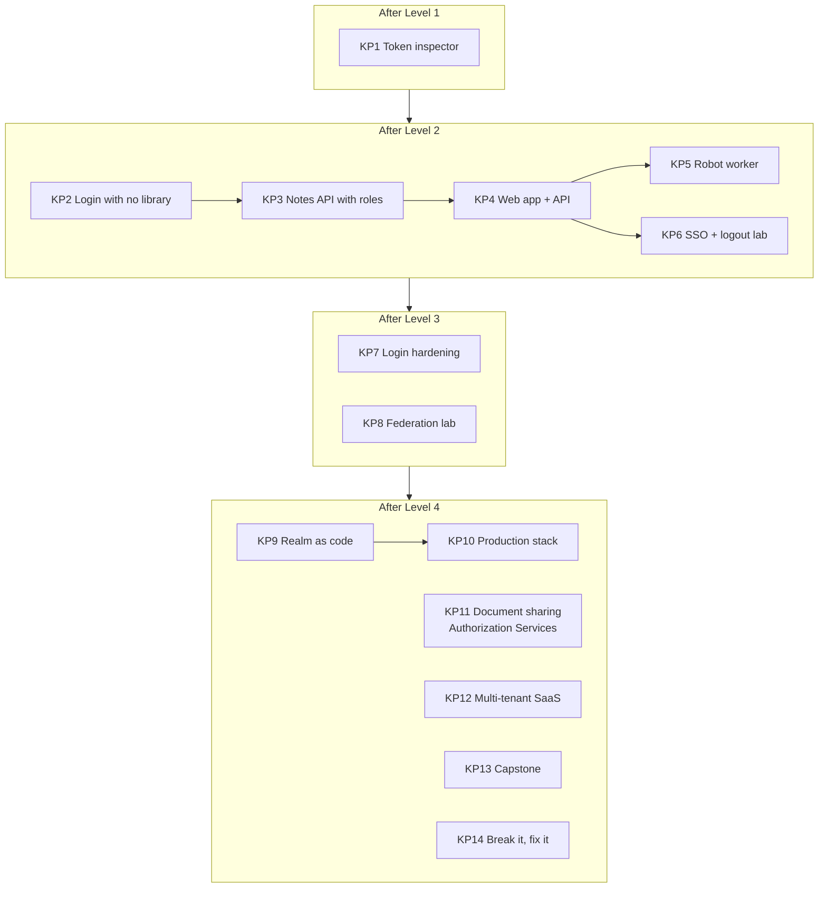

# Keycloak projects (Python)

14 projects that make you **see how Keycloak works from the inside**. Each says what you'll build, what it teaches, and when it's done. **Nothing is pre-built: you write all the code.** The modules show the techniques; the projects make you combine them on your own.

**Rules:**
- One folder per project inside your own workspace, e.g. `kp01-token-inspector/`, created with `uv init`.
- Same style as the course: plain `for` loops, named variables, a `#` comment above each line.
- Every project has a `NOTES.md`: what you built, what broke, what surprised you, and one diagram.
- **Attack your own project before calling it done:** no token, garbage token, expired token, wrong audience, another user's data, wrong role.

| Size | Meaning |
|---|---|
| S | an evening (2–3 h) |
| M | a weekend (1–2 days) |
| L | a week |
| XL | 2–3 weeks |

---

## KP1: Token inspector CLI (S): after Module 06

A command-line tool: `uv run inspect.py --user alice`

1. Reads the **discovery document** and prints the endpoints it found.
2. Gets a token for the user (lab password grant via `learning-cli`).
3. Decodes the header and payload **by hand** (Base64URL + `json`, no JWT library), and prints every claim with a plain-English explanation next to it (`exp` also as a human date, and "expires in N seconds").
4. Downloads the **JWKS**, finds the key with the matching `kid`, and verifies the signature with PyJWT.
5. Flag `--tamper`: changes one letter of the payload and shows verification failing.

**You'll understand:** what a token really is, where Keycloak's public keys live, and why a changed token is rejected.

**Done when:** the output for alice shows her `admin` role and the `notes-api` client roles; `--tamper` fails with a clear message; running it for `bob` shows the differences.

---

## KP2: Login with no OIDC library (M): after Module 07

A tiny FastAPI app (port 8000) that does **Authorization Code + PKCE completely by hand** with `httpx`, using the `web-app` client:
- `/login` makes `state`, `nonce`, `code_verifier`, `code_challenge`, stores them in a cookie-backed session, and redirects to Keycloak.
- `/auth/callback` checks `state`, swaps the code (sending `code_verifier` + client secret), verifies the **ID token** (signature, `iss`, `aud`, `exp`, `nonce`), and shows the user's name.
- `/logout` calls Keycloak's end-session endpoint.

**You'll understand:** exactly what Authlib/Spring/every OIDC library does for you, step by step.

**Done when:** login works; a tampered `state` is rejected; a replayed callback URL fails (`Code not valid`); a mismatched `nonce` is rejected. `NOTES.md` has the real sequence of requests you observed in DevTools.

---

## KP3: Notes API with roles (M): after Module 08

`notes-api` (FastAPI, port 8001) accepting only Keycloak access tokens.
- Checks signature, `exp`, `iss`, **`aud = notes-api`**.
- `GET /notes` needs `notes:read`; `POST /notes` and `DELETE /notes/{id}` need `notes:write`.
- Users only see **their own** notes (keyed by `sub`); add `GET /admin/notes`, which needs realm role `admin` and shows everyone's notes.
- A `test_security.sh` (or pytest) that proves every rule.

**You'll understand:** that Keycloak hands out badges, but **your API is the door that checks them**.

**Done when:** the test script shows 401 (no token / garbage / expired / wrong `aud`), 403 (bob writing, bob on `/admin/notes`), 404 or 403 (bob deleting alice's note), and 200 for the allowed cases.

---

## KP4: Web app + API (M): after Modules 09 and 11

A FastAPI + Authlib web app (port 8000) that logs users in and calls KP3 with their access token.
- Home page shows name, email, roles, and **seconds until the access token expires**.
- Refreshes the access token automatically when it's about to expire.
- Add a user attribute `department` in Keycloak, map it into the token with a protocol mapper, and show it on the page.
- Buttons are hidden for users without `notes:write`, but KP3 still enforces it (prove it with `curl`).

**You'll understand:** the full real-world loop: browser → Keycloak → app → API.

**Done when:** alice can add notes, bob can only read, both see their department, and the page keeps working past the 5-minute token lifetime.

---

## KP5: Robot worker (S): after Module 10

`report-worker`: a Python script that runs every 30 seconds, gets a token with **client credentials**, **caches it until shortly before expiry**, and calls `GET /admin/report` on KP3 (a new route that only accepts the role `notes:report`, given only to the service account).

**You'll understand:** machine identity, service accounts, and why you cache tokens instead of fetching one per request.

**Done when:** logs show one token fetch every ~5 minutes rather than every 30 seconds; alice's and bob's user tokens get 403 on `/admin/report`; the worker gets 200.

---

## KP6: SSO and logout lab (M): after Module 12

Two web apps (ports 8000 and 8002, two Keycloak clients) plus KP3.
- Log into app A → open app B → logged in with no password (SSO).
- Implement **back-channel logout** in both apps (Keycloak calls your app's endpoint with a `logout_token`; your app deletes that session).
- Log out from app A → app B's session is gone too.
- Use **token introspection** in KP3 for `DELETE` requests only, and explain why not for every request.

**You'll understand:** SSO sessions vs app sessions, and why logout is the hardest part of identity.

**Done when:** you can demo both directions, and `NOTES.md` explains what happens to an access token that was issued *before* logout.

---

## KP7: Login hardening (M): after Modules 13 and 15

Configure the `learning` realm like a security-conscious company, then **prove each setting with a script or screenshot**:
- OTP **required only for users with the `admin` role** (conditional flow).
- Password policy: 12+ characters, a digit, not the username, not the last 3 passwords.
- Brute-force detection: lock after 5 failures, for 5 minutes.
- Email verification and forgot-password via mailpit.
- A branded login theme (your logo, your text).
- A Python script that tries 6 wrong passwords and shows the lockout.

**You'll understand:** authentication flows, required actions, and where login security really happens.

**Done when:** every bullet has evidence in `NOTES.md`, and a bob login still works with no OTP while alice is forced to set it up.

---

## KP8: Federation lab (M): after Module 14

- OpenLDAP container with 5 users in 2 LDAP groups (`engineering`, `finance`).
- Keycloak reads them (read-only federation), and an LDAP group mapper turns them into Keycloak groups with roles.
- A second realm `partner` acts as an outside identity provider (brokering), and partner users get a `partner` role automatically through an IdP mapper.
- Your KP4 app works for all three kinds of user: local, LDAP, and partner.

**You'll understand:** where users and passwords *actually* live, and how Keycloak bridges several sources.

**Done when:** `NOTES.md` has a table "user → where the password is checked → how they got their roles", filled from what you observed; disabling a user in LDAP blocks their next login.

---

## KP9: Realm as code (M): after Module 16

A Python CLI `realmctl` using the **admin REST API** (with a least-privilege service account, not the master admin):
- `realmctl apply realm.yaml` creates or updates roles, groups, clients, and users from a YAML file. It is **idempotent**: running it twice changes nothing the second time.
- `realmctl diff realm.yaml` shows what would change.
- `realmctl export` saves a partial export to git.
- A CI job (GitHub Actions) that starts Keycloak in Docker, runs `apply`, then runs KP3's security tests.

**You'll understand:** the admin API, least privilege for automation, and why companies keep Keycloak config in git.

**Done when:** `docker volume rm keycloak-data` → start Keycloak → `realmctl apply` → everything works again with zero clicks, and CI is green.

---

## KP10: Production-like stack (L): after Module 17

`docker compose up` gives you:
- Keycloak in **production mode** (`start`, optimized image built with `kc.sh build`), **2 nodes**
- PostgreSQL
- nginx terminating **TLS** with a local certificate (e.g. `mkcert`), with a correct `hostname`
- Health checks on the management port, Prometheus scraping `/metrics`, and a Grafana dashboard
- Scripts: `backup.sh` (database dump), `restore.sh`, and an **upgrade rehearsal** (go from one Keycloak version to the next on a copy)

**You'll understand:** what changes between a laptop demo and a company deployment.

**Done when:** you can kill one Keycloak node while logged in and keep working; a restore brings back a deleted user; `NOTES.md` is a short runbook.

---

## KP11: Document sharing with Authorization Services (L): after Module 18

A "mini Google Docs" API in FastAPI where Keycloak decides access:
- Every document is a Keycloak **resource** owned by its creator (created via the Protection API).
- Policies: owners can edit; the `staff` group can view; admins can do anything; one "only during working hours" time policy.
- The API asks Keycloak for a decision (UMA ticket grant / `response_mode=decision`) before each action.
- Compare with KP3, which uses roles in the token: write down when each approach is the right one.

**You'll understand:** resources, scopes, policies, permissions, and the cost of asking Keycloak on every request.

**Done when:** an automated test shows the allow/deny matrix for alice, bob, and an owner.

---

## KP12: Multi-tenant SaaS (L): after Module 19

A notes SaaS used by two customer companies, `acme` and `globex`, built with Keycloak **Organizations**:
- The `organization` claim in the token decides which tenant's data the API returns. **No cross-tenant reads, ever** (prove it with tests).
- A gateway service receives the user's token and uses **token exchange** to get a token with `aud = notes-api` before calling it.
- Each tenant can have its own login identity provider (simulate one with a second realm).

**You'll understand:** multi-tenancy, organizations, and passing user identity safely across services.

**Done when:** a test suite proves tenant isolation and that the API rejects the gateway's *original* token (wrong `aud`).

---

## KP13: Capstone: company identity platform (XL): after all modules

Your company setup in miniature, in Python:
- Gateway + 3 FastAPI services (`orders`, `payments`, `reports`) + 1 web app + 1 batch job
- Keycloak from KP10 (production mode), realm from KP9 (in git), MFA rules from KP7, LDAP from KP8
- Every service validates `iss`, `aud`, `exp`, and signature, and checks roles; service-to-service via token exchange or service accounts
- Login and admin **events** shipped to a log tool, with an alert on brute force and on anyone gaining the `admin` role
- Realm key rotation done live with no downtime (show the JWKS with two keys)
- A **runbook**: onboard a new service, rotate a client secret, rotate realm keys, upgrade Keycloak, restore from backup

**You'll understand:** how all the pieces fit at a real company, i.e. the job you'll be doing.

**Done when:** a friend can onboard a brand-new service using only your runbook, and you can explain every claim in every token in the system.

---

## KP14: Break it, then fix it (L): after Module 22

Make a `vulnerable` branch of KP4 + KP3 with these real-world mistakes, write an **exploit script** for each, then fix them on a `fixed` branch:

1. Wildcard redirect URI (`*`) → steal a code via an open redirect
2. No PKCE on a public client
3. API doesn't check `aud` → a token for another app works
4. API trusts the **ID token** instead of the access token
5. Access token stored in `localStorage` + an XSS bug
6. Tokens written to logs
7. Access token lifetime of 1 day, with no way to revoke it
8. Direct access grants left on for the web app
9. Roles checked only in the UI
10. Admin console reachable from the public internet

**You'll understand:** how attackers think about Keycloak setups, which is the best way to remember the rules.

**Done when:** every exploit works on `vulnerable` and fails on `fixed`, and `NOTES.md` explains each one in two sentences.

---

## Progress

| # | Project | After module | Status |
|---|---|---|---|
| KP1 | Token inspector CLI | 06 | ⬜ |
| KP2 | Login with no OIDC library | 07 | ⬜ |
| KP3 | Notes API with roles | 08 | ⬜ |
| KP4 | Web app + API | 09, 11 | ⬜ |
| KP5 | Robot worker | 10 | ⬜ |
| KP6 | SSO and logout lab | 12 | ⬜ |
| KP7 | Login hardening | 13, 15 | ⬜ |
| KP8 | Federation lab | 14 | ⬜ |
| KP9 | Realm as code | 16 | ⬜ |
| KP10 | Production-like stack | 17 | ⬜ |
| KP11 | Document sharing (Authorization Services) | 18 | ⬜ |
| KP12 | Multi-tenant SaaS | 19 | ⬜ |
| KP13 | Capstone: company identity platform | all | ⬜ |
| KP14 | Break it, then fix it | 22 | ⬜ |
