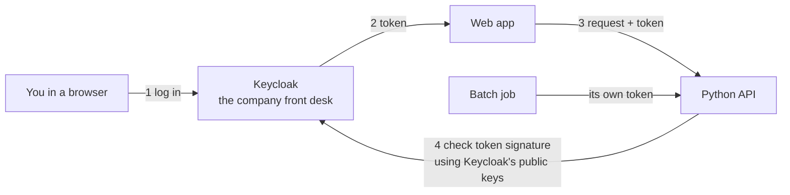
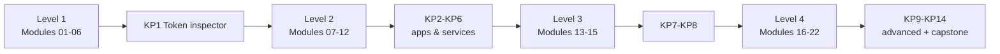

# Keycloak course: basics to advanced, in simple words

You'll learn Keycloak **first**, before the rest of the [roadmap](../ROADMAP.md). That's why every module explains the background it needs (HTTP, tokens, OAuth, OpenID Connect) right where you need it.

**By the end you can:** run Keycloak, design realms/clients/roles for real services, protect Python apps and APIs with it, make it secure, run it in production, automate it, and debug it when something breaks.

---

## The big picture



Keycloak is like the **front desk of an office building**. You show your ID there once, and you get a **badge** (a token). Every door (app or API) checks the badge. The doors never see your password. They only trust the badge, because the front desk signed it.

---

## The course map

### Level 1: Basics (week 1–2): *what Keycloak is and what it gives you*

| # | Module | You'll learn |
|---|---|---|
| 01 | [What is Keycloak?](level-1-basics/01-what-is-keycloak.md) | The problem it solves, plus just-enough HTTP, tokens, OAuth, OIDC, SSO |
| 02 | [Run it and take a tour](level-1-basics/02-run-and-tour.md) | Docker, `start-dev`, the admin console, `kcadm` |
| 03 | [Realms and users](level-1-basics/03-realms-and-users.md) | Separate worlds, people, passwords, required actions |
| 04 | [Clients](level-1-basics/04-clients.md) | Registering apps: public vs confidential, redirect URIs |
| 05 | [Roles and groups](level-1-basics/05-roles-and-groups.md) | Who can do what, and how it lands in the token |
| 06 | [Tokens](level-1-basics/06-tokens.md) | Every claim explained; verifying a token in Python |
| — | [Catch-up](catch-up.md) | Recreate the whole Level 1 setup in one copy-paste |

### Level 2: Apps (week 3–5): *protecting real Python services*

| # | Module | You'll learn |
|---|---|---|
| 07 | [OAuth flows by hand](level-2-apps/07-oauth-flows.md) | Auth Code + PKCE, Client Credentials, Refresh, Device flow, with `curl` |
| 08 | [Protect a Python API](level-2-apps/08-protect-a-python-api.md) | FastAPI `notes-api`: checking signature, `iss`, `aud`, roles |
| 09 | [Python web app login](level-2-apps/09-python-web-app-login.md) | FastAPI + Authlib: login, logout, calling the API |
| 10 | [Service to service](level-2-apps/10-service-to-service.md) | A robot (service account) calling your API |
| 11 | [Client scopes and mappers](level-2-apps/11-client-scopes-and-mappers.md) | Controlling exactly what goes into tokens |
| 12 | [Sessions and logout](level-2-apps/12-sessions-and-logout.md) | Lifetimes, refresh, offline tokens, introspection, back-channel logout |

### Level 3: Login experience (week 6–7): *how users actually log in*

| # | Module | You'll learn |
|---|---|---|
| 13 | [Authentication flows and MFA](level-3-login-experience/13-authentication-flows-and-mfa.md) | Login recipes, OTP for admins only, password policy, brute-force protection |
| 14 | [Brokering and federation](level-3-login-experience/14-brokering-and-federation.md) | "Log in with another provider", and users from LDAP |
| 15 | [Themes and emails](level-3-login-experience/15-themes-and-emails.md) | Email verification, forgot password, a branded login page |

### Level 4: Advanced (week 8–11): *running it for a company*

| # | Module | You'll learn |
|---|---|---|
| 16 | [Admin API and realm as code](level-4-advanced/16-admin-api-and-realm-as-code.md) | Automating Keycloak from Python; config in git |
| 17 | [Production](level-4-advanced/17-production.md) | `start`, PostgreSQL, hostname, TLS, reverse proxy, health, HA, upgrades |
| 18 | [Authorization Services](level-4-advanced/18-authorization-services.md) | Fine-grained permissions decided by Keycloak |
| 19 | [Token exchange and Organizations](level-4-advanced/19-token-exchange-and-organizations.md) | Passing user identity between services; multi-tenant B2B |
| 20 | [Events, monitoring, and hardening](level-4-advanced/20-events-monitoring-and-hardening.md) | Audit logs, metrics, key rotation, a security checklist |
| 21 | [Extending Keycloak](level-4-advanced/21-extending-keycloak.md) | SPIs: plugging your own Java code into Keycloak |
| 22 | [Troubleshooting](level-4-advanced/22-troubleshooting.md) | Real error messages, why they happen, how to fix them |

### Projects

**[`PROJECTS.md`](PROJECTS.md)**: 14 Python projects that make you *see* how Keycloak works, from a token inspector to a full company identity platform. Do the matching project after each group of modules.



---

## Setup you need once

| Tool | Check it works |
|---|---|
| Docker Desktop | `docker --version` |
| `curl` and `jq` | `jq --version` (install with `brew install jq`) |
| `uv` (Python tool) | `uv --version` |
| A browser | For the admin console and login pages |

## Rules used everywhere in this course

| Thing | Value |
|---|---|
| Keycloak version | `26.8.0` (pinned) |
| Keycloak address | `http://localhost:8180` (port 8080 is busy on this Mac) |
| Admin login | `admin` / `admin` (lab only) |
| Practice realm | `learning` |
| Practice users | `alice` / `alice123` (an admin), `bob` / `bob123` (staff) |
| Python web app port | `8000` |
| Python API (`notes-api`) port | `8001` |
| Extra Python services | `8002` and up |

Start Keycloak like this. Module 02 explains every part:

```bash
docker run -d --name keycloak -p 8180:8080 \
  -v keycloak-data:/opt/keycloak/data \
  -e KC_BOOTSTRAP_ADMIN_USERNAME=admin -e KC_BOOTSTRAP_ADMIN_PASSWORD=admin \
  quay.io/keycloak/keycloak:26.8.0 start-dev
```

## How to study each module

1. Read **"The idea in simple words"** first. Don't touch the keyboard yet.
2. Do the **hands-on** steps yourself. **Type** the commands and code; don't copy-paste. Compare your output with the output in the module.
3. Answer **"Check yourself"** out loud before opening the answers.
4. Do at least one **"Try this"** experiment. Breaking things on purpose is how this sticks.
5. Write one line in [`../LEARNING.md`](../LEARNING.md): what clicked and what's still confusing.

## About the outputs

Every command and every Python program in this course was run against a real Keycloak 26.8.0 container, and the outputs shown are the real captured outputs. While the course was being written, several Keycloak containers ran side by side on different ports. The only change made to the captured output is that the port number was set to `8180` and the container name to `keycloak` everywhere. Your IDs, timestamps, and token values will differ; the shape will be the same. Anything that could not be run here (for example, it needs a real GitHub app or a phone authenticator) is marked **not verified here** in the module.
