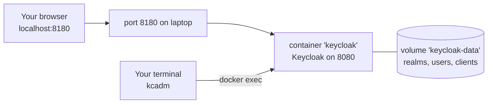

# Module 02: Run Keycloak and take the tour

**You'll learn:** just enough Docker, how to start/stop/reset Keycloak, what `start-dev` means, a tour of the admin console, how to log in the `kcadm` command-line tool, and where the account console is.

**Before this:** [Module 01](01-what-is-keycloak.md).

**Starting state:** Docker Desktop installed and running. Nothing else. (If you ever need to rebuild the whole Level 1 setup in one go, see [`../catch-up.md`](../catch-up.md).)

---

## The idea in simple words

Keycloak is a server program, like a database. Installing it by hand takes Java and many settings. **Docker** lets you run it as a ready-made box with one command.

Docker in 5 lines:

1. An **image** is a ready-made box, downloaded once (`quay.io/keycloak/keycloak:26.8.0`).
2. A **container** is a running copy of that image (we name ours `keycloak`).
3. `-p 8180:8080` connects port 8180 on your laptop to port 8080 inside the box.
4. A **volume** is a folder Docker keeps for you, so data survives restarts.
5. `docker stop` pauses the box, `docker start` resumes it, `docker rm` throws it away.



---

## Jargon table

| Word | Plain meaning | Example |
|---|---|---|
| Image | A ready-made box you download | `quay.io/keycloak/keycloak:26.8.0` |
| Container | A running copy of an image | `keycloak` |
| Port mapping | Laptop port → container port | `-p 8180:8080` |
| Volume | Storage that survives restarts | `keycloak-data` |
| `start-dev` | Keycloak's easy "development mode" | Plain HTTP, built-in database |
| Realm | A separate world of users and apps (Module 03) | `master`, `learning` |
| Admin console | Keycloak's web UI for admins | `http://localhost:8180/admin` |
| Account console | The web page where a normal user manages their own account | `/realms/<realm>/account` |
| `kcadm` | Keycloak's admin command-line tool | `kcadm get realms` |

---

## Hands-on

### Step 1: Start Keycloak

**Why:** you need a running Keycloak for everything else.

```bash
docker run -d --name keycloak -p 8180:8080 \
  -v keycloak-data:/opt/keycloak/data \
  -e KC_BOOTSTRAP_ADMIN_USERNAME=admin -e KC_BOOTSTRAP_ADMIN_PASSWORD=admin \
  quay.io/keycloak/keycloak:26.8.0 start-dev
```

The first time, Docker downloads the image, then prints the new container's ID:

```
Unable to find image 'quay.io/keycloak/keycloak:26.8.0' locally
26.8.0: Pulling from keycloak/keycloak
Digest: sha256:b0f60d489d51c5d113390bdf5461d4c06e6051be026c05549f2e1e10ec352bcc
Status: Downloaded newer image for quay.io/keycloak/keycloak:26.8.0
a459b415ceacdfa2fa2b11571252a3ad6ccfc118862151c71d0f33ee40e1a801
```

| Part | Why |
|---|---|
| `-d` | Run in the background, give the terminal back |
| `--name keycloak` | A name so later commands can say `keycloak` |
| `-p 8180:8080` | Keycloak listens on 8080 inside; you reach it on 8180 (8080 is often taken on laptops) |
| `-v keycloak-data:/opt/keycloak/data` | Keep Keycloak's database in a named volume, so stopping doesn't wipe your work |
| `KC_BOOTSTRAP_ADMIN_*` | Create a first admin user `admin` / `admin` |
| `26.8.0` | A pinned version, so this course always matches what you see |
| `start-dev` | Development mode (see below) |

**What `start-dev` means:** an easy mode for your laptop. It uses plain HTTP (no certificates), a small built-in database (stored in that volume), and relaxed caching. **Never use it in production.** Production uses `start`, HTTPS, and a real database like PostgreSQL (Level 4).

### Step 2: Wait for the "started" line

**Why:** Keycloak needs about 10 seconds to boot. Calls before that fail.

```bash
docker logs -f keycloak
```

Wait for this line (press `Ctrl+C` to stop watching; Keycloak keeps running):

```
2026-10-06 18:03:47,059 INFO  [io.quarkus] (main) Keycloak 26.8.0 on JVM (powered by Quarkus 3.40.1) started in 9.884s. Listening on: http://0.0.0.0:8080
```

A few `WARN` lines about deprecated features are normal in dev mode.

### Step 3: Open the admin console

**Why:** this is where you'll click around to understand things.

Open **http://localhost:8180/admin** and log in with `admin` / `admin`. (Visiting `/admin/` answers with a `302` redirect to the login page; that's normal.)

### Step 4: The tour

**Why:** know where things live before you need them.

Top left is the **realm selector**. It shows **master** right now. `master` is a special realm **for Keycloak admins only**. In Module 03 you'll create your own realm `learning`; never put apps or normal users in `master`. To switch or create realms, use the selector (it opens **Manage realms**).

The left menu, in the order you'll use it in this course:

| Menu item | What lives there | Module |
|---|---|---|
| **Clients** | The apps that use Keycloak (`web-app`, `notes-api`...) | 04 |
| **Client scopes** | Reusable bundles of claims added to tokens (e.g. `email`, `profile`, `roles`) | 06, Level 2 |
| **Realm roles** | Roles shared by the whole realm (`admin`, `user`) | 05 |
| **Users** | People who can log in, their passwords, roles, groups, sessions | 03 |
| **Groups** | Teams; give a group roles and every member gets them | 05 |
| **Sessions** | Who is logged in right now; you can sign people out | Level 2 |
| **Events** | A log of logins, failed logins, admin changes (off by default) | Level 4 |
| **Realm settings** | Realm name, login options, email, themes, keys, token lifetimes | 03, 06 |
| **Authentication** | The login steps (password, OTP, passkeys) and password rules | Level 3 |
| **Identity providers** | "Log in with Google/GitHub/another Keycloak" | Level 3 |
| **User federation** | Read users from a company directory (LDAP / Active Directory) | Level 4 |

(Button and menu labels can shift slightly between versions. The commands in this course are what was verified.)

### Step 5: Log in the command-line tool

**Why:** clicking is great for learning; commands are repeatable and copy-pasteable. Every step in this course gives both.

`kcadm.sh` lives inside the container, so we run it with `docker exec`. Make a short alias:

```bash
alias kcadm='docker exec keycloak /opt/keycloak/bin/kcadm.sh'
kcadm config credentials --server http://localhost:8080 --realm master --user admin --password admin
```

```
Logging into http://localhost:8080 as user admin of realm master
```

Why `8080` and not `8180`? The command runs **inside** the container, where Keycloak really is on 8080.

Test it:

```bash
kcadm get realms --fields realm,enabled
```

```
[ {
  "realm" : "master",
  "enabled" : true
} ]
```

The alias only lives in this terminal. Add the `alias` line to your `~/.zshrc` to keep it. The login is saved inside the container (it even survived a `docker stop`/`docker start` here), but it expires eventually and is lost on a full reset; if a command ever says it isn't authorized, run the `config credentials` line again.

### Step 6: Peek at the discovery document

**Why:** every realm publishes its addresses in one public JSON page (Module 01). You'll use it constantly.

```bash
curl -s http://localhost:8180/realms/master/.well-known/openid-configuration \
  | jq '{issuer, authorization_endpoint, token_endpoint, jwks_uri, userinfo_endpoint}'
```

```
{
  "issuer": "http://localhost:8180/realms/master",
  "authorization_endpoint": "http://localhost:8180/realms/master/protocol/openid-connect/auth",
  "token_endpoint": "http://localhost:8180/realms/master/protocol/openid-connect/token",
  "jwks_uri": "http://localhost:8180/realms/master/protocol/openid-connect/certs",
  "userinfo_endpoint": "http://localhost:8180/realms/master/protocol/openid-connect/userinfo"
}
```

(`jq` pretty-prints JSON. Install with `brew install jq` if missing.)

### Step 7: Stop, start, reset

**Why:** you'll do this often.

```bash
docker stop keycloak     # pause; data stays in the volume
docker start keycloak    # resume (wait ~10s for the "started" line)
```

Verified: after `docker stop keycloak && docker start keycloak`, the data is still there:

```bash
docker ps --filter name=keycloak --format '{{.Names}}\t{{.Status}}\t{{.Ports}}'
kcadm get realms --fields realm
```

```
keycloak	Up 4 seconds	0.0.0.0:8180->8080/tcp, [::]:8180->8080/tcp
[ {
  "realm" : "master"
}, {
  "realm" : "learning"
} ]
```

(The `learning` realm appears once you've done Module 03.)

**Full reset** (throws away everything: realms, users, clients):

```bash
docker rm -f keycloak && docker volume rm keycloak-data
```

Then run the Step 1 command again, and the `kcadm config credentials` line again. To get back to the end of Level 1 quickly, use [`../catch-up.md`](../catch-up.md).

### Step 8: The account console

**Why:** Keycloak also gives normal users a self-service page (change password, see devices, set up 2FA).

Every realm has one at `http://localhost:8180/realms/<realm>/account`. For now try the master one: **http://localhost:8180/realms/master/account** (it answers `200` and shows a sign-in page). You'll use the `learning` realm's account console with alice in Module 03.

---

## The one trap

**Forgetting the volume, or using `--rm`.** Without `-v keycloak-data:/opt/keycloak/data`, `start-dev` stores everything inside the container. Remove the container and all your realms, users and clients are gone. The course command keeps a named volume; only `docker volume rm keycloak-data` really deletes your data.

A close second: **doing your work in the `master` realm.** It's for Keycloak's own admins. Create a separate realm (next module).

---

## Check yourself

1. Why does `kcadm` use port 8080 but your browser uses 8180?
2. What's the difference between `docker stop keycloak` and `docker rm -f keycloak && docker volume rm keycloak-data`?
3. Name three things `start-dev` does that production must not.
4. Which menu item would you open to see who is logged in right now?
5. What is the `master` realm for?

<details>
<summary>Answers</summary>

1. `kcadm` runs inside the container (Keycloak is on 8080 there). Your browser is on the laptop, which reaches it through the `8180→8080` port mapping.
2. `stop` pauses; data stays. `rm` + `volume rm` deletes the container and its data for good.
3. Plain HTTP (no TLS), built-in dev database, relaxed settings meant for one laptop.
4. **Sessions**.
5. Administering Keycloak itself (the `admin` user lives there). Not for your apps or users.

</details>

---

## Try this

1. Run `docker logs keycloak | grep started` after a restart and compare the start-up time.
2. In the admin console, open **Realm settings** of `master` and find where the realm's display name is set. Don't change it.
3. Run `kcadm get serverinfo | jq .systemInfo.version`. It should print `"26.8.0"`.

Next: [Module 03: Realms and users](03-realms-and-users.md).
