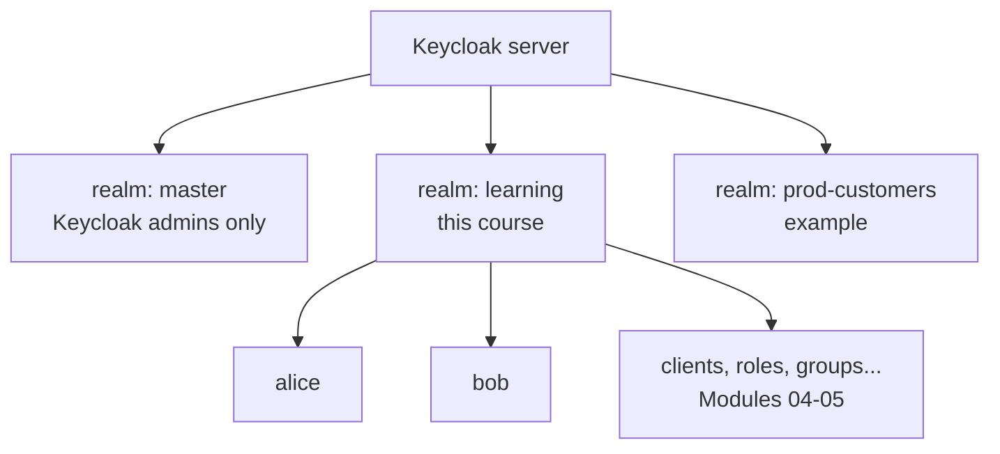

# Module 03: Realms and users

**You'll learn:** what a realm is and why you never use `master` for apps, the basic realm login settings, and everything about users: creating them, passwords, temporary passwords, required actions, attributes, enable/disable, email verified, impersonation, and the account console. You'll create `alice` and `bob`.

**Before this:** [Module 02](02-run-and-tour.md).

**Starting state:** Keycloak running (Module 02), `kcadm` alias set and logged in. Nothing created yet. (Starting fresh later? [`../catch-up.md`](../catch-up.md) rebuilds all of Level 1.)

---

## The idea in simple words

A **realm** is a separate building with its own front desk. Each building has its own list of people, its own apps, its own login page, its own rules. Somebody registered in building A can't badge into building B.

Keycloak starts with one building, **`master`**. That's the building for the people who run Keycloak itself (the `admin` you logged in as). You never put your company's apps or employees there, for two reasons:

- Anyone with power in `master` can change **every** realm. Keep that list tiny.
- Mixing your app users with Keycloak admins is how accidents happen.

So you create your own realm. When do companies make **several** realms?

- **Per environment:** `dev`, `staging`, `prod` (often on separate Keycloak servers too).
- **Per customer** (B2B SaaS): `acme`, `globex`, each with its own users and login rules.
- **Per user type:** `employees` and `customers` with very different security rules.

Inside a realm live the **users**: the people who can log in. Keycloak stores their passwords **hashed** (turned into a one-way fingerprint), so not even admins can read them.



---

## Jargon table

| Word | Plain meaning | Example |
|---|---|---|
| Realm | A separate world of users, apps and settings | `learning` |
| `master` realm | The realm for Keycloak's own admins | where `admin` lives |
| Display name | The friendly name shown on the login page | `Learning Realm` |
| User | A person who can log in | `alice` |
| Credential | Something a user proves themselves with | password, OTP device, passkey |
| Temporary password | A password the user must change at first login | given to new hires |
| Required action | A task Keycloak forces at the next login | `UPDATE_PASSWORD`, `VERIFY_EMAIL` |
| User attribute | An extra fact stored on a user | `department = finance` |
| User profile | The realm's list of allowed user fields | `username`, `email`, `firstName`, `lastName` |
| Email verified | Keycloak trusts this email really belongs to the user | `emailVerified: true` |
| Enabled / disabled | Whether the user may log in at all | `enabled: false` blocks login |
| Impersonation | An admin logs in "as" a user to see what they see | debugging a user's problem |
| Account console | The user's own self-service page | `/realms/learning/account` |

---

## Hands-on

### Step 1: Create the `learning` realm

**Why:** your own building, separate from `master`.

**Click path:** realm selector (top left) → **Manage realms** → **Create realm** → Realm name `learning` → Create. Then **Realm settings** → General → Display name `Learning Realm` → Save.

**Command:**

```bash
kcadm create realms -s realm=learning -s enabled=true -s displayName='Learning Realm'
```

```
Created new realm with id 'learning'
```

The realm name `learning` becomes part of every URL (`/realms/learning/...`) and of every token's `iss` claim. Pick it carefully; renaming later breaks apps.

### Step 2: Login settings

**Why:** these switches decide what the login page offers.

**Click path:** **Realm settings** → **Login** tab.

| Switch | What it does | Our choice |
|---|---|---|
| User registration | Shows a "Register" link so anyone can sign up | **Off** (only admins create users) |
| Forgot password | Shows "Forgot password?" which emails a reset link | **On** (needs email settings to actually send) |
| Remember me | A checkbox that keeps you logged in after the browser closes | **On** |
| Email as username | Users log in with their email; no separate username | **Off** |
| Login with email | Users may type either username or email | On (default) |

**Command:**

```bash
kcadm update realms/learning -s registrationAllowed=false -s resetPasswordAllowed=true \
  -s rememberMe=true -s registrationEmailAsUsername=false -s loginWithEmailAllowed=true
kcadm get realms/learning --fields realm,displayName,registrationAllowed,resetPasswordAllowed,rememberMe,registrationEmailAsUsername,loginWithEmailAllowed,duplicateEmailsAllowed,sslRequired
```

```
{
  "realm" : "learning",
  "displayName" : "Learning Realm",
  "sslRequired" : "external",
  "registrationAllowed" : false,
  "registrationEmailAsUsername" : false,
  "rememberMe" : true,
  "loginWithEmailAllowed" : true,
  "duplicateEmailsAllowed" : false,
  "resetPasswordAllowed" : true
}
```

(`update` prints nothing when it works.) `sslRequired: external` means "HTTPS required, except from localhost and private networks", which is why plain HTTP works on your laptop.

### Step 3: Create alice and bob

**Why:** you need people to log in. These two are used for the rest of the course.

**Click path:** realm `learning` → **Users** → **Add user** → Username `alice`, Email `alice@example.com`, turn on **Email verified**, First name `Alice`, Last name `Smith` → Create → **Credentials** tab → **Set password** → `alice123`, turn **Temporary off** → Save. Repeat for bob.

**Command:**

```bash
kcadm create users -r learning -s username=alice -s enabled=true \
  -s firstName=Alice -s lastName=Smith -s email=alice@example.com -s emailVerified=true
kcadm set-password -r learning --username alice --new-password alice123

kcadm create users -r learning -s username=bob -s enabled=true \
  -s firstName=Bob -s lastName=Jones -s email=bob@example.com -s emailVerified=true
kcadm set-password -r learning --username bob --new-password bob123
```

```
Created new user with id 'edb20313-d73d-48c6-8ca4-a0e8f1d99e8b'
Created new user with id 'aa57d32d-2f41-475b-9dc7-64f20fda5db7'
```

That long ID is the user's permanent identity. It will show up as the `sub` claim in tokens (Module 06). Usernames can change; this ID never does. Your IDs will be different.

```bash
kcadm get users -r learning --fields username,firstName,lastName,email,emailVerified,enabled
```

```
[ {
  "username" : "alice",
  "firstName" : "Alice",
  "lastName" : "Smith",
  "email" : "alice@example.com",
  "emailVerified" : true,
  "enabled" : true
}, {
  "username" : "bob",
  "firstName" : "Bob",
  "lastName" : "Jones",
  "email" : "bob@example.com",
  "emailVerified" : true,
  "enabled" : true
} ]
```

**Email verified** means "Keycloak trusts this address belongs to this person." We set it by hand because there's no mail server here. In real life Keycloak sends a verification email and flips it on when the user clicks the link.

### Step 4: A temporary password and required actions (with a test user)

**Why:** new employees should choose their own password. A **temporary** password forces that at first login.

We use a throwaway user `carol` for experiments, so alice and bob stay clean. (You'll try logging in as carol in [Module 04](04-clients.md), then delete her.)

**Click path:** **Users** → **Add user** `carol` → Credentials → Set password `carol123`, **Temporary on**.

```bash
kcadm create users -r learning -s username=carol -s enabled=true \
  -s firstName=Carol -s lastName=Test -s email=carol@example.com
kcadm set-password -r learning --username carol --new-password carol123 --temporary
kcadm get users -r learning -q username=carol --fields username,emailVerified,requiredActions
```

```
Created new user with id '5cd07cf6-61b8-4fe3-9a4f-1384cef30513'
[ {
  "username" : "carol",
  "emailVerified" : false,
  "requiredActions" : [ "UPDATE_PASSWORD" ]
} ]
```

The temporary password simply added a **required action**: `UPDATE_PASSWORD`. Required actions are tasks Keycloak forces at the next login before handing out any token. Others you'll see on the user's page under **Required user actions**: `VERIFY_EMAIL`, `CONFIGURE_TOTP` (set up a phone code app), `UPDATE_PROFILE`, `TERMS_AND_CONDITIONS`, and more.

### Step 5: User attributes

**Why:** sometimes you need extra facts about a user, like their department or employee number.

Since Keycloak 24, every realm has a **user profile**: a list of known fields (`username`, `email`, `firstName`, `lastName`). Anything else is an "unmanaged attribute", and by default **Keycloak silently ignores it**. Watch:

```bash
CAROL_ID=$(kcadm get users -r learning -q username=carol --fields id --format csv --noquotes)
kcadm update users/$CAROL_ID -r learning -s 'attributes.team=["blue"]'
kcadm get users/$CAROL_ID -r learning | jq '{username,attributes}'
```

```
{
  "username": "carol",
  "attributes": null
}
```

No error, and no attribute. Two ways to fix it:

- **The proper way:** **Realm settings** → **User profile** → **Create attribute** `department`. Then it's a real field with a label, validation and permissions.
- **The quick lab way:** allow unmanaged attributes. **Realm settings** → General → **Unmanaged attributes** → *Only administrators can write* (in the API this value is called `ADMIN_EDIT`).

We'll do the quick way from the command line. The user profile is one JSON document; we download it, change one field with `jq`, and upload it (note `docker exec -i`, because we feed it a file):

```bash
kcadm get users/profile -r learning > /tmp/up.json
jq '.unmanagedAttributePolicy="ADMIN_EDIT"' /tmp/up.json > /tmp/up2.json
docker exec -i keycloak /opt/keycloak/bin/kcadm.sh update users/profile -r learning -f - < /tmp/up2.json
kcadm get users/profile -r learning --fields unmanagedAttributePolicy
```

```
{
  "unmanagedAttributePolicy" : "ADMIN_EDIT"
}
```

Now try again:

```bash
kcadm update users/$CAROL_ID -r learning -s 'attributes.department=["finance"]'
kcadm get users/$CAROL_ID -r learning | jq '{username,attributes}'
```

```
{
  "username": "carol",
  "attributes": {
    "department": [
      "finance"
    ]
  }
}
```

Attributes are lists of strings (a user may have several values). They don't appear in tokens automatically; putting them there takes a **mapper** (Level 2).

### Step 6: Disable a user

**Why:** when someone leaves, you flip one switch and they can't log in to **any** app. This is the "leavers keep access" fix from Module 01.

**Click path:** **Users** → carol → **Enabled** switch off.

```bash
kcadm update users/$CAROL_ID -r learning -s enabled=false
kcadm get users -r learning -q username=carol --fields username,enabled
```

```
[ {
  "username" : "carol",
  "enabled" : false
} ]
```

Disabling stops **new** logins. Tokens already handed out keep working until they expire (5 minutes by default; Module 06). To also end her current logins, use **Users** → carol → **Sessions** → Sign out.

### Step 7: Impersonation (just know it exists)

**Why:** a user says "my screen looks wrong." An admin can **impersonate** them: log in as that user, without their password, to see exactly what they see.

**Click path:** **Users** → alice → **Action** menu (top right) → **Impersonate**. Keycloak opens alice's account console as alice.

Impersonation is powerful, so in real companies only a few admins get the `impersonation` permission, and every use can be recorded in the admin events log (Level 4). (Not walked through here: it needs a browser session; the click path is from the Keycloak 26 admin console.)

### Step 8: The account console (self-service)

**Why:** users can fix their own stuff without calling IT.

Open **http://localhost:8180/realms/learning/account** (it answers `200` with a sign-in page) and log in as `alice` / `alice123`. Alice can:

- edit her name and email (**Personal info**),
- change her password and set up 2FA (**Account security → Signing in**),
- see where she's logged in and sign out remote devices (**Device activity**),
- see which apps she has used (**Applications**).

Log out again when done.

---

## The one trap

**Using the `master` realm for your apps.** It works, so people do it. Then every app user lives next to the Keycloak super-admins, and one wrong role mapping hands out control of the whole server. Always create your own realm. `master` is only for administering Keycloak.

---

## Check yourself

1. Give two reasons a company might have more than one realm.
2. You set a password with **Temporary on**. What does Keycloak add to the user, and what happens at their next login?
3. You set `attributes.team` on a user and it vanished. Why?
4. Alice leaves the company. What do you switch off, and do her existing tokens stop at once?
5. What does impersonation let an admin do?

<details>
<summary>Answers</summary>

1. Any two: separate environments (dev/staging/prod); separate customers; separate user types (employees vs customers) with different rules.
2. The required action `UPDATE_PASSWORD`. At next login she must choose a new password before getting any token.
3. Since Keycloak 24, fields not in the user profile are ignored unless you add them to the profile or enable unmanaged attributes.
4. **Enabled** off. New logins stop at once; existing access tokens keep working until they expire (minutes), unless you also sign out her sessions.
5. Log in as a user without their password, to see what they see. Restricted and audited.

</details>

---

## Try this

1. Turn **User registration** on (Realm settings → Login), open `http://localhost:8180/realms/learning/account`, and look for the "Register" link on the sign-in page. Turn it off again.
2. Set **Email as username** on, look at the Add user form, then turn it off again.
3. Add the required action **Update profile** to bob (Users → bob → Required user actions), log into the account console as bob, and see the form Keycloak forces. Then remove it.

Next: [Module 04: Clients](04-clients.md).
