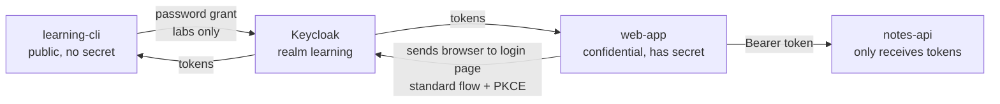

# Module 04: Clients (the apps that use Keycloak)

**You'll learn:** what a client is; public vs confidential vs "receives tokens only"; what each capability switch means (Standard flow, Direct access grants, Service accounts, Device grant); redirect URIs, post-logout redirect URIs, web origins; client secrets; PKCE. You'll create `learning-cli`, `web-app` and `notes-api`.

**Before this:** [Module 03](03-realms-and-users.md).

**Starting state:** realm `learning` with users `alice` and `bob` (and the test user `carol` from Module 03, deleted at the end of this module). Behind? See [`../catch-up.md`](../catch-up.md).

---

## The idea in simple words

The front desk (Keycloak) doesn't hand badges to just anyone who asks. It keeps a list of **known apps**. Each app on the list is a **client**. For each client, the desk writes down:

- **its name** (the client ID, like `web-app`),
- **can it keep a secret?** A server in your data centre can hide a password. A phone app or a browser page can't: anyone can open it and read what's inside.
- **how may it ask for badges?** Only by sending people to the login page? By sending passwords directly? For itself, with no person involved?
- **where may the desk send people back to after login?** (The redirect address.) This is the most important safety rule of all.

Three kinds of clients in this course:

| Kind | Real-life picture | Our example |
|---|---|---|
| **Public** client | A kiosk in the lobby: anyone can look inside, so it holds no secret | `learning-cli` (curl in your terminal) |
| **Confidential** client | A back-office server with a locked drawer: it keeps a secret | `web-app` (Python server) |
| **Receives tokens only** | A door that only checks badges; it never asks for one | `notes-api` (an API) |



Why does `notes-api` need to be a client at all, if it never asks for tokens? Because it **owns roles** (`notes:read`, `notes:write`, Module 05), and tokens name it as their audience (`aud`, Module 06). It's the badge-checking door, registered so the desk can print "valid for the notes door" on badges.

---

## Jargon table

| Word | Plain meaning | Example |
|---|---|---|
| Client | An app registered in Keycloak | `web-app` |
| Client ID | The client's name | `notes-api` |
| Public client | Can't keep a secret (browser, mobile, CLI) | `learning-cli` |
| Confidential client | Can keep a secret (runs on a server) | `web-app` |
| Client authentication | The switch that makes a client confidential | On = needs a secret |
| Client secret | The confidential client's password | `web-app-secret` |
| Grant / flow | A way of getting a token | password grant, authorization code |
| Standard flow | "Send the user to Keycloak's login page, get a code back, swap it for tokens" (Authorization Code flow) | web apps |
| Direct access grants | The app collects the password itself and sends it to Keycloak (Password grant) | labs only, **deprecated** |
| Service accounts | The app gets a token **for itself**, no user (Client Credentials flow) | a nightly job |
| Device grant | "Go to this URL on your phone and type this code" (Device Authorization flow) | smart TV, CLI tools |
| Redirect URI | Where Keycloak may send the browser back after login | `http://localhost:8000/auth/callback` |
| Post-logout redirect URI | Where Keycloak may send the browser after logout | `http://localhost:8000/` |
| Web origins (CORS) | Which websites' JavaScript may call Keycloak from the browser | `http://localhost:8000` |
| PKCE | A one-time secret that proves the app that started login is the one finishing it | `S256` |

---

## The capability switches, in plain words

Open any client → **Settings** → **Capability config**. You'll see:

| Switch | Plain words | When ON |
|---|---|---|
| **Client authentication** | "This app has a secret." On = confidential, Off = public | Server-side apps, APIs |
| **Standard flow** | Login happens on Keycloak's page; the app gets a short code and swaps it for tokens. The user's password never touches the app | Every app with a human user (the default choice) |
| **Direct access grants** | The app asks for the username/password itself and forwards them. The app sees the password, MFA can't work | Quick lab tests only. Deprecated in OAuth 2.1 |
| **Implicit flow** | Old way of putting tokens straight into the URL | Never. Leave off |
| **Service accounts roles** | The app can get a token for itself (no user) | Machine-to-machine, Level 2 |
| **OAuth 2.0 Device Authorization Grant** | For devices with no keyboard: shows a code, you log in on your phone | TVs, CLIs, Level 4 |

---

## Hands-on

### Step 1: `learning-cli`, a public client for lab tests

**Why:** you want to get tokens with `curl` in the next modules, without building a web app first. The **password grant** (Direct access grants) lets you do that. It is **deprecated** (OAuth 2.1 removes it): the app sees the user's password and MFA can't work. Use it **only** on your laptop for learning. Real apps use the standard flow (Level 2).

**Click path:** **Clients** → **Create client** → Client type OpenID Connect, Client ID `learning-cli` → Next → Client authentication **Off**, Standard flow **off**, Direct access grants **on** → Next → Save.

```bash
kcadm create clients -r learning -s clientId=learning-cli -s publicClient=true \
  -s directAccessGrantsEnabled=true -s standardFlowEnabled=false
kcadm get clients -r learning -q clientId=learning-cli \
  --fields clientId,publicClient,standardFlowEnabled,directAccessGrantsEnabled,serviceAccountsEnabled,implicitFlowEnabled
```

```
Created new client with id '2d505829-ff63-415c-9197-72c060480dc3'
[ {
  "clientId" : "learning-cli",
  "standardFlowEnabled" : false,
  "implicitFlowEnabled" : false,
  "directAccessGrantsEnabled" : true,
  "serviceAccountsEnabled" : false,
  "publicClient" : true
} ]
```

Note: in the UI the switch is **Client authentication**; in the API it's the opposite word, `publicClient`. Client authentication **off** = `publicClient: true`.

Quick test, alice gets tokens:

```bash
curl -s -X POST http://localhost:8180/realms/learning/protocol/openid-connect/token \
  -d grant_type=password -d client_id=learning-cli \
  -d username=alice -d password=alice123 \
  | jq '{token_type, expires_in, refresh_expires_in, scope}'
```

```
{
  "token_type": "Bearer",
  "expires_in": 300,
  "refresh_expires_in": 1800,
  "scope": "email profile"
}
```

It works. You'll open the tokens up in [Module 06](06-tokens.md).

### Step 2: `web-app`, a confidential client for a Python web app

**Why:** in Level 2 you'll build a Python web app on `http://localhost:8000` that logs users in properly. It runs on a server, so it can keep a secret.

Settings, and why:

| Setting | Value | Why |
|---|---|---|
| Client authentication | On, secret `web-app-secret` | A server can hide a secret. (A fixed, easy secret is for this course only; normally let Keycloak generate one) |
| Standard flow | On | The proper login flow |
| Direct access grants | Off | The app must never see passwords |
| Valid redirect URIs | `http://localhost:8000/auth/callback` | The **only** place Keycloak may send the login code |
| Valid post logout redirect URIs | `http://localhost:8000/` | Where users land after logging out |
| Web origins | `http://localhost:8000` | Browser JavaScript from this site may call Keycloak (CORS) |
| PKCE method | S256 | Extra protection for the login code (below) |

**Click path:** **Clients** → **Create client** → Client ID `web-app` → Next → Client authentication **On**, Standard flow on, Direct access grants off → Next → Valid redirect URIs `http://localhost:8000/auth/callback`, Valid post logout redirect URIs `http://localhost:8000/`, Web origins `http://localhost:8000` → Save. Then **Advanced** tab → **Proof Key for Code Exchange Code Challenge Method** `S256` → Save. **Credentials** tab shows the secret (the UI generates a random one; the command below sets ours).

```bash
kcadm create clients -r learning -s clientId=web-app -s publicClient=false \
  -s secret=web-app-secret -s standardFlowEnabled=true -s directAccessGrantsEnabled=false \
  -s 'redirectUris=["http://localhost:8000/auth/callback"]' \
  -s 'webOrigins=["http://localhost:8000"]' \
  -s 'attributes."post.logout.redirect.uris"=http://localhost:8000/' \
  -s 'attributes."pkce.code.challenge.method"=S256'
```

```
Created new client with id '35457468-cb57-46e4-b25e-5550fabd8832'
```

Check it:

```bash
kcadm get clients -r learning -q clientId=web-app | jq '.[0] | {clientId, publicClient, standardFlowEnabled, directAccessGrantsEnabled, serviceAccountsEnabled, redirectUris, webOrigins, postLogout: .attributes["post.logout.redirect.uris"], pkce: .attributes["pkce.code.challenge.method"]}'
```

```
{
  "clientId": "web-app",
  "publicClient": false,
  "standardFlowEnabled": true,
  "directAccessGrantsEnabled": false,
  "serviceAccountsEnabled": false,
  "redirectUris": [
    "http://localhost:8000/auth/callback"
  ],
  "webOrigins": [
    "http://localhost:8000"
  ],
  "postLogout": "http://localhost:8000/",
  "pkce": "S256"
}
```

Read the secret back (an admin can always do this; that's why the admin console must be protected):

```bash
WEB_ID=$(kcadm get clients -r learning -q clientId=web-app --fields id --format csv --noquotes)
kcadm get clients/$WEB_ID/client-secret -r learning
```

```
{
  "type" : "secret",
  "value" : "web-app-secret"
}
```

**What PKCE is, in plain words:** when the app starts a login, it makes up a random secret, keeps it, and sends Keycloak only a **fingerprint** of it (`code_challenge`). After login Keycloak gives back a code. To swap the code for tokens, the app must show the **original** secret. A thief who steals the code from the URL doesn't have that secret, so the code is useless to them. `S256` means the fingerprint is made with SHA-256. Setting it on the client makes PKCE **required**:

```bash
curl -s 'http://localhost:8180/realms/learning/protocol/openid-connect/auth?client_id=web-app&response_type=code&scope=openid&redirect_uri=http://localhost:8000/auth/callback' \
  -o /dev/null -w '%{http_code} %{redirect_url}\n'
```

```
302 http://localhost:8000/auth/callback?error=invalid_request&error_description=Missing+parameter%3A+code_challenge_method&iss=http%3A%2F%2Flocalhost%3A8180%2Frealms%2Flearning
```

No PKCE, no login: Keycloak sends the browser back with an error. With a `code_challenge` it shows the login page (`200`):

```bash
curl -s -o /dev/null -w '%{http_code}\n' 'http://localhost:8180/realms/learning/protocol/openid-connect/auth?client_id=web-app&response_type=code&scope=openid&redirect_uri=http://localhost:8000/auth/callback&code_challenge=E9Melhoa2OwvFrEMTJguCHaoeK1t8URWbuGJSstw-cM&code_challenge_method=S256'
```

```
200
```

And because Direct access grants is off, `web-app` can't use the password grant even with the right secret:

```bash
curl -s -X POST http://localhost:8180/realms/learning/protocol/openid-connect/token \
  -d grant_type=password -d client_id=web-app -d client_secret=web-app-secret \
  -d username=alice -d password=alice123
```

```
{"error":"unauthorized_client","error_description":"Client not allowed for direct access grants"}
```

With a wrong secret, Keycloak refuses the client before anything else:

```bash
curl -s -X POST http://localhost:8180/realms/learning/protocol/openid-connect/token \
  -d grant_type=password -d client_id=web-app -d client_secret=wrong \
  -d username=alice -d password=alice123
```

```
{"error":"unauthorized_client","error_description":"Invalid client or Invalid client credentials"}
```

### Step 3: `notes-api`, a client that only receives tokens

**Why:** the notes API (Level 2) never logs anyone in. It only checks tokens that others send it. It still needs to be a client so it can own roles and be named as a token's audience.

**Click path:** **Clients** → **Create client** → Client ID `notes-api` → Next → Client authentication **On**, and turn **off** Standard flow, Direct access grants, Implicit flow, Service accounts → Save.

```bash
kcadm create clients -r learning -s clientId=notes-api -s publicClient=false \
  -s standardFlowEnabled=false -s directAccessGrantsEnabled=false \
  -s serviceAccountsEnabled=false -s implicitFlowEnabled=false
kcadm get clients -r learning -q clientId=notes-api \
  --fields clientId,publicClient,standardFlowEnabled,directAccessGrantsEnabled,serviceAccountsEnabled,implicitFlowEnabled
```

```
Created new client with id 'fabbf699-a5ea-400a-942e-f9abece409a0'
[ {
  "clientId" : "notes-api",
  "standardFlowEnabled" : false,
  "implicitFlowEnabled" : false,
  "directAccessGrantsEnabled" : false,
  "serviceAccountsEnabled" : false,
  "publicClient" : false
} ]
```

All flows off = it can't get tokens at all. That's the point: less power, less risk.

### Step 4: See all clients

```bash
kcadm get clients -r learning --fields clientId
```

```
[ {
  "clientId" : "account"
}, {
  "clientId" : "account-console"
}, {
  "clientId" : "admin-cli"
}, {
  "clientId" : "broker"
}, {
  "clientId" : "learning-cli"
}, {
  "clientId" : "notes-api"
}, {
  "clientId" : "realm-management"
}, {
  "clientId" : "security-admin-console"
}, {
  "clientId" : "web-app"
} ]
```

Keycloak creates six built-in clients in every realm. `account-console` is the self-service page from Module 03; `realm-management` holds the admin permissions; `admin-cli` is what `kcadm` uses. Don't delete them.

### Step 5: What carol gets at login (then clean up)

**Why:** see the effect of the Module 03 settings through a real token request.

carol is disabled:

```bash
curl -s -X POST http://localhost:8180/realms/learning/protocol/openid-connect/token \
  -d grant_type=password -d client_id=learning-cli -d username=carol -d password=carol123
```

```
{"error":"invalid_grant","error_description":"Account disabled"}
```

Enable her. Now her temporary password (required action `UPDATE_PASSWORD`) blocks the token, because the password grant has no screen to show the "choose a new password" form:

```bash
CAROL_ID=$(kcadm get users -r learning -q username=carol --fields id --format csv --noquotes)
kcadm update users/$CAROL_ID -r learning -s enabled=true
curl -s -X POST http://localhost:8180/realms/learning/protocol/openid-connect/token \
  -d grant_type=password -d client_id=learning-cli -d username=carol -d password=carol123
```

```
{"error":"invalid_grant","error_description":"Account is not fully set up"}
```

A wrong password gives the same vague message for every user, on purpose (so attackers can't learn which usernames exist):

```bash
curl -s -X POST http://localhost:8180/realms/learning/protocol/openid-connect/token \
  -d grant_type=password -d client_id=learning-cli -d username=alice -d password=wrong
```

```
{"error":"invalid_grant","error_description":"Invalid user credentials"}
```

Now delete carol so the realm matches the Level 1 baseline:

```bash
kcadm delete users/$CAROL_ID -r learning
kcadm get users -r learning --fields username
```

```
[ {
  "username" : "alice"
}, {
  "username" : "bob"
} ]
```

---

## The one trap

**Wildcard redirect URIs**, like `*` or `http://localhost:8000/*` or `https://*.example.com/*`.

The redirect URI is where Keycloak sends the **login code** after the user logs in. If the list allows "anything", an attacker sends a victim a login link with `redirect_uri=https://evil.example.com/steal`, the victim logs in normally on the real Keycloak page, and Keycloak hands the code to the attacker. Keep the list **exact**. Here is Keycloak refusing an address that isn't on `web-app`'s list:

```bash
curl -s 'http://localhost:8180/realms/learning/protocol/openid-connect/auth?client_id=web-app&response_type=code&scope=openid&redirect_uri=https://evil.example.com/steal&code_challenge=E9Melhoa2OwvFrEMTJguCHaoeK1t8URWbuGJSstw-cM&code_challenge_method=S256' \
  | grep -o 'Invalid parameter[^<]*'
```

```
Invalid parameter: redirect_uri
```

That error page is a good thing. A `*` would have sent the code to evil.example.com.

---

## Check yourself

1. Your app is a React single-page app running in the browser. Public or confidential? Why?
2. Which capability switch should almost every app with a human user use?
3. Why is the password grant (Direct access grants) deprecated?
4. `notes-api` has every flow off. Why is it a client at all?
5. What does PKCE stop?

<details>
<summary>Answers</summary>

1. Public. Anything shipped to a browser can be read by the user, so it can't hide a secret.
2. **Standard flow** (Authorization Code), with PKCE.
3. The app sees the user's password, and the login can't include MFA, consent or any Keycloak login screen.
4. It owns client roles (`notes:read`/`notes:write`) and is the audience of tokens meant for it.
5. A stolen login code being swapped for tokens by someone who didn't start the login.

</details>

---

## Try this

1. Add `http://localhost:8000/*` to `web-app`'s redirect URIs, rerun the evil-redirect command with `redirect_uri=http://localhost:8000/anything`, and see it accepted (`200`). Then remove the wildcard.
2. Turn on **Direct access grants** for `web-app` and rerun the password-grant command with the right secret. Then turn it off again.
3. Regenerate the `web-app` secret in **Credentials**, and see the old secret fail. Then set it back with `kcadm update clients/$WEB_ID -r learning -s secret=web-app-secret`.

Next: [Module 05: Roles and groups](05-roles-and-groups.md).
