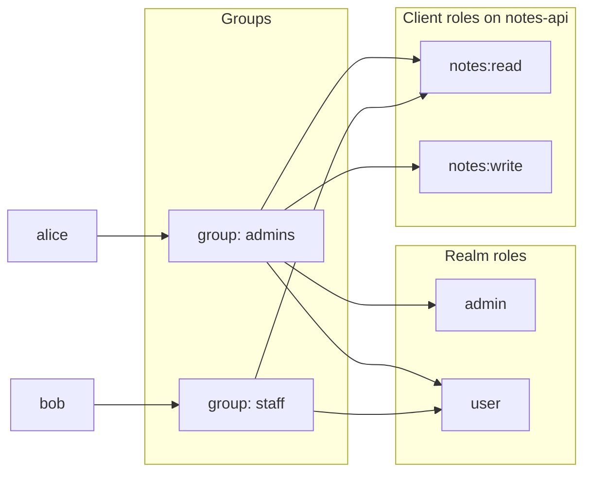

# Module 05: Roles and groups

**You'll learn:** realm roles vs client roles, composite roles, the default roles every user gets, groups and subgroups, giving roles to groups, effective roles, and how roles show up inside tokens (`realm_access`, `resource_access`). You'll finish the Level 1 baseline.

**Before this:** [Module 04](04-clients.md).

**Starting state:** realm `learning` with users `alice`, `bob` and clients `learning-cli`, `web-app`, `notes-api`. Behind? See [`../catch-up.md`](../catch-up.md).

---

## The idea in simple words

A **role** is a label printed on the badge: "admin", "user", "may read notes". Keycloak only prints the labels. **Your app** reads them and decides what to allow (Module 01: Keycloak does not guard your API).

Two kinds of labels:

- **Realm roles** mean something across the whole company: `admin`, `user`. Like "employee" or "manager".
- **Client roles** belong to one app and only make sense there: `notes:read` on `notes-api`. Like "can open the supply cupboard on floor 3".

Giving roles to people one by one gets messy fast. So you use **groups**: teams. Give the team its roles once; everyone who joins the team gets them; leaving the team removes them. Alice joins `admins`, Bob joins `staff`, and the roles follow.

A user's **effective roles** are everything they end up with: roles given directly + roles from their groups (and parent groups) + roles hidden inside **composite** roles + the realm's **default roles**.



---

## Jargon table

| Word | Plain meaning | Example |
|---|---|---|
| Role | A permission label your app checks | `admin` |
| Realm role | A label for the whole realm | `user` |
| Client role | A label that belongs to one client | `notes-api` → `notes:read` |
| Composite role | A role that contains other roles; having it gives you all of them | `power-user` = `user` + `notes:read` |
| Default roles | Roles every new user gets automatically | `default-roles-learning` |
| Group | A team; members inherit the group's roles | `admins` |
| Subgroup | A team inside a team; members inherit the parent's roles too | `/staff/interns` |
| Role mapping | "This user/group has this role" | `admins` → `admin` |
| Effective roles | Every role a user really has, from all sources | what ends up in the token |
| `realm_access` | Token claim listing realm roles | `{"roles": ["admin","user"]}` |
| `resource_access` | Token claim listing client roles, per client | `{"notes-api": {"roles": [...]}}` |

---

## Hands-on

### Step 1: Realm roles `admin` and `user`

**Why:** company-wide labels every app can understand.

**Click path:** **Realm roles** → **Create role** → Role name `admin`, description → Save. Same for `user`.

```bash
kcadm create roles -r learning -s name=admin -s 'description=Can manage everything'
kcadm create roles -r learning -s name=user -s 'description=A normal signed-in user'
kcadm get roles -r learning --fields name,composite
```

```
Created new role with id 'admin'
Created new role with id 'user'
[ {
  "name" : "user",
  "composite" : false
}, {
  "name" : "offline_access",
  "composite" : false
}, {
  "name" : "default-roles-learning",
  "composite" : true
}, {
  "name" : "uma_authorization",
  "composite" : false
}, {
  "name" : "admin",
  "composite" : false
} ]
```

You made two; Keycloak made three when it created the realm:

| Built-in role | Meaning |
|---|---|
| `default-roles-learning` | A **composite** role every user gets automatically (see Step 4) |
| `offline_access` | Allows "offline" refresh tokens that outlive the login session (Level 4) |
| `uma_authorization` | For Keycloak's advanced permission system (UMA). Ignore it |

### Step 2: Client roles on `notes-api`

**Why:** "read notes" and "write notes" only mean something to the notes API. Keeping them on that client keeps the realm tidy, and each app's roles appear in their own corner of the token.

**Click path:** **Clients** → `notes-api` → **Roles** tab → **Create role** → `notes:read` → Save. Same for `notes:write`.

Client-role commands need the client's internal ID (the UUID, not the name), so look it up first:

```bash
NOTES_ID=$(kcadm get clients -r learning -q clientId=notes-api --fields id --format csv --noquotes)
kcadm create clients/$NOTES_ID/roles -r learning -s name=notes:read -s 'description=Read notes'
kcadm create clients/$NOTES_ID/roles -r learning -s name=notes:write -s 'description=Create and edit notes'
kcadm get clients/$NOTES_ID/roles -r learning --fields name,clientRole
```

```
Created new role with id 'notes:read'
Created new role with id 'notes:write'
[ {
  "name" : "notes:write",
  "clientRole" : true
}, {
  "name" : "notes:read",
  "clientRole" : true
} ]
```

The colon in `notes:read` is just a naming habit ("resource:action"); Keycloak doesn't care.

### Step 3: Groups, and the roles they give

**Why:** you manage teams, not individuals.

**Click path:** **Groups** → **Create group** `admins` → open it → **Role mapping** tab → **Assign role** → filter by realm roles → tick `admin`, `user` → Assign. Assign role again → filter by clients → tick `notes-api notes:read` and `notes:write` → Assign. Do the same for `staff` with `user` and `notes:read`.

```bash
kcadm create groups -r learning -s name=admins
kcadm create groups -r learning -s name=staff
kcadm add-roles -r learning --gname admins --rolename admin --rolename user
kcadm add-roles -r learning --gname staff --rolename user
kcadm add-roles -r learning --gname admins --cclientid notes-api --rolename notes:read --rolename notes:write
kcadm add-roles -r learning --gname staff --cclientid notes-api --rolename notes:read
```

```
Created new group with id '2c99f27a-d8d2-4e40-8577-c90f6d6e222f'
Created new group with id '5a2bbfc7-3970-441b-b1df-4369c49a94b4'
```

(`add-roles` prints nothing when it works.) Check what `admins` gives:

```bash
kcadm get-roles -r learning --gname admins
```

```
[ {
  "id" : "75120922-cd3e-47f3-896a-d35d771c6d3e",
  "name" : "user",
  "description" : "A normal signed-in user",
  "composite" : false,
  "clientRole" : false,
  "containerId" : "839dd077-505d-481a-962f-67bdaa34abaa"
}, {
  "id" : "3275a35d-c751-4b11-b3c4-15d2d66759fa",
  "name" : "admin",
  "description" : "Can manage everything",
  "composite" : false,
  "clientRole" : false,
  "containerId" : "839dd077-505d-481a-962f-67bdaa34abaa"
} ]
```

```bash
kcadm get-roles -r learning --gname admins --cclientid notes-api
```

```
[ {
  "id" : "06eaeafa-989e-4618-99a3-8123c10560b2",
  "name" : "notes:write",
  "description" : "Create and edit notes",
  "composite" : false,
  "clientRole" : true,
  "containerId" : "fabbf699-a5ea-400a-942e-f9abece409a0"
}, {
  "id" : "e7f6231c-d7d0-450f-bd0e-492a5a5b56e7",
  "name" : "notes:read",
  "description" : "Read notes",
  "composite" : false,
  "clientRole" : true,
  "containerId" : "fabbf699-a5ea-400a-942e-f9abece409a0"
} ]
```

Notice `containerId`: for realm roles it's the realm's ID, for client roles it's `notes-api`'s ID. That's the whole difference between the two kinds.

### Step 4: Put alice and bob in their groups

**Why:** this is the moment they get their roles.

**Click path:** **Users** → alice → **Groups** tab → **Join group** → tick `admins` → Join. bob → `staff`.

```bash
ALICE_ID=$(kcadm get users -r learning -q username=alice -q exact=true --fields id --format csv --noquotes)
BOB_ID=$(kcadm get users -r learning -q username=bob -q exact=true --fields id --format csv --noquotes)
ADMINS_ID=$(kcadm get groups -r learning -q search=admins --fields id --format csv --noquotes)
STAFF_ID=$(kcadm get groups -r learning -q search=staff --fields id --format csv --noquotes)
kcadm update users/$ALICE_ID/groups/$ADMINS_ID -r learning -n
kcadm update users/$BOB_ID/groups/$STAFF_ID -r learning -n
kcadm get users/$ALICE_ID/groups -r learning --fields name,path
```

```
[ {
  "name" : "admins",
  "path" : "/admins"
} ]
```

(`-n` means "send no body"; joining a group is just a `PUT` to that address.)

### Step 5: Direct roles vs effective roles

**Why:** "which roles does alice have?" has two answers, and only one of them ends up in the token.

**Directly assigned** to alice (Users → alice → **Role mapping** tab, with "Hide inherited roles" ticked):

```bash
kcadm get-roles -r learning --uusername alice
```

```
[ {
  "id" : "e7f33436-494a-4107-abb6-863e941c1e46",
  "name" : "default-roles-learning",
  "description" : "${role_default-roles}",
  "composite" : true,
  "clientRole" : false,
  "containerId" : "839dd077-505d-481a-962f-67bdaa34abaa"
} ]
```

Only the default role! `admin` is not on alice herself; it comes through her group.

**Effective** roles (untick "Hide inherited roles" in the UI):

```bash
kcadm get-roles -r learning --uusername alice --effective --fields name
```

```
[ {
  "name" : "user"
}, {
  "name" : "offline_access"
}, {
  "name" : "default-roles-learning"
}, {
  "name" : "uma_authorization"
}, {
  "name" : "admin"
} ]
```

```bash
kcadm get-roles -r learning --uusername bob --effective --fields name
```

```
[ {
  "name" : "user"
}, {
  "name" : "offline_access"
}, {
  "name" : "default-roles-learning"
}, {
  "name" : "uma_authorization"
} ]
```

And the client roles on `notes-api`:

```bash
kcadm get-roles -r learning --uusername alice --cclientid notes-api --effective --fields name
kcadm get-roles -r learning --uusername bob --cclientid notes-api --effective --fields name
```

```
[ {
  "name" : "notes:write"
}, {
  "name" : "notes:read"
} ]
[ {
  "name" : "notes:read"
} ]
```

### Step 6: Default roles

**Why:** some roles every user should have from day one.

`default-roles-learning` is a composite role that Keycloak gives every new user. Look inside (**Realm settings** → **User registration** tab → Default roles):

```bash
kcadm get roles/default-roles-learning/composites -r learning --fields name,clientRole
```

```
[ {
  "name" : "view-profile",
  "clientRole" : true
}, {
  "name" : "offline_access",
  "clientRole" : false
}, {
  "name" : "uma_authorization",
  "clientRole" : false
}, {
  "name" : "manage-account",
  "clientRole" : true
} ]
```

`view-profile` and `manage-account` are client roles of the built-in `account` client; they let users use the account console. You could add `user` here so that every new person gets it automatically; in this course we give it through groups instead.

### Step 7: Composite roles (demo, then delete)

**Why:** bundle roles. Give one role, get several.

**Click path:** **Realm roles** → Create role `power-user` → open it → **Action** → **Add associated roles** → pick `user` and `notes-api notes:read`.

```bash
kcadm create roles -r learning -s name=power-user
kcadm add-roles -r learning --rname power-user --rolename user
kcadm add-roles -r learning --rname power-user --cclientid notes-api --rolename notes:read
kcadm get roles/power-user -r learning --fields name,composite
kcadm get roles/power-user/composites -r learning --fields name,clientRole
```

```
Created new role with id 'power-user'
{
  "name" : "power-user",
  "composite" : true
}
[ {
  "name" : "user",
  "clientRole" : false
}, {
  "name" : "notes:read",
  "clientRole" : true
} ]
```

Realm roles and client roles must be added in **separate** `add-roles` calls; mixing `--rolename user` with `--cclientid notes-api` in one command fails with `Role not found for name: user`.

Composite roles are handy but hide where a permission really comes from. Prefer groups. Delete the demo role to keep the baseline clean:

```bash
kcadm delete roles/power-user -r learning
```

### Step 8: Subgroups (demo, then delete)

**Why:** organisations are trees: `staff` → `interns`. A subgroup's members get the parent group's roles too.

**Click path:** **Groups** → `staff` → **Child groups** tab → **Create group** `interns`.

```bash
kcadm create groups/$STAFF_ID/children -r learning -s name=interns
kcadm get groups -r learning -q search=interns | jq '.[0] | {name, subGroups: [.subGroups[] | .path]}'
```

```
Created new children with id '699700eb-196c-4089-8cb4-d1164e1b2cf4'
{
  "name": "staff",
  "subGroups": [
    "/staff/interns"
  ]
}
```

A user in `/staff/interns` would get `user` and `notes:read` from `staff`, plus anything given to `interns`. Delete it again:

```bash
kcadm delete groups/699700eb-196c-4089-8cb4-d1164e1b2cf4 -r learning
kcadm get groups -r learning --fields name,subGroupCount
```

```
[ {
  "name" : "admins",
  "subGroupCount" : 0
}, {
  "name" : "staff",
  "subGroupCount" : 0
} ]
```

(Use the ID your `create` printed.)

### Step 9: Roles inside the token

**Why:** this is what your Python services will actually read.

Get alice's token and decode only the role claims. The `jwt_payload` helper turns the middle part of a JWT into JSON (it's explained in [Module 06](06-tokens.md); paste it into your terminal now):

```bash
jwt_payload() {
  echo "$1" | jq -R 'split(".")[1] | gsub("-";"+") | gsub("_";"/")
    | . + ("=" * ((4 - length % 4) % 4)) | @base64d | fromjson'
}
TOKEN=$(curl -s -X POST http://localhost:8180/realms/learning/protocol/openid-connect/token \
  -d grant_type=password -d client_id=learning-cli \
  -d username=bob -d password=bob123 | jq -r .access_token)
jwt_payload "$TOKEN" | jq '{preferred_username, realm_access, resource_access}'
```

```
{
  "preferred_username": "bob",
  "realm_access": {
    "roles": [
      "default-roles-learning",
      "offline_access",
      "uma_authorization",
      "user"
    ]
  },
  "resource_access": {
    "account": {
      "roles": [
        "manage-account",
        "manage-account-links",
        "view-profile"
      ]
    },
    "notes-api": {
      "roles": [
        "notes:read"
      ]
    }
  }
}
```

- `realm_access.roles` = bob's effective **realm** roles.
- `resource_access.<client>.roles` = his effective **client** roles, one box per client.

So the notes API will check: "is `notes:write` in `resource_access["notes-api"].roles`?" Bob: no → `403`. Alice: yes. (Alice's full token is in Module 06.)

The Level 1 baseline is now complete.

---

## The one trap

**Checking roles in the wrong place, or checking the wrong kind.** Two classic mistakes:

1. Looking for `notes:write` in `realm_access` (it's a **client** role, so it's under `resource_access["notes-api"]`).
2. Changing alice's roles and expecting her current token to change. Roles are **copied into the token when it's made**. Changes show up only in the **next** token (after refresh or new login), up to 5 minutes later.

---

## Check yourself

1. `notes:read` is a client role on `notes-api`. Where exactly is it in the token?
2. `kcadm get-roles --uusername alice` shows only `default-roles-learning`. Is alice an admin?
3. Why use groups instead of giving roles to users directly?
4. What is a composite role?
5. You remove bob from `staff`. Does the token he got 1 minute ago still say `notes:read`?

<details>
<summary>Answers</summary>

1. `resource_access["notes-api"].roles`.
2. Yes. `admin` comes through the `admins` group; add `--effective` to see it.
3. Manage teams once; joining/leaving a group adds/removes all its roles. Fewer mistakes.
4. A role that contains other roles; having it gives you all of them.
5. Yes, until it expires. Tokens are snapshots.

</details>

---

## Try this

1. Remove alice from `admins` (Users → alice → Groups → Leave), get a new token, and see `admin` and `notes:write` disappear. Put her back.
2. Add realm role `user` to `default-roles-learning`, create a test user, and check their effective roles. Then undo and delete the test user.
3. In the admin console, open **Users** → bob → **Role mapping** and toggle "Hide inherited roles" to see direct vs effective roles.

Next: [Module 06: Tokens](06-tokens.md).
