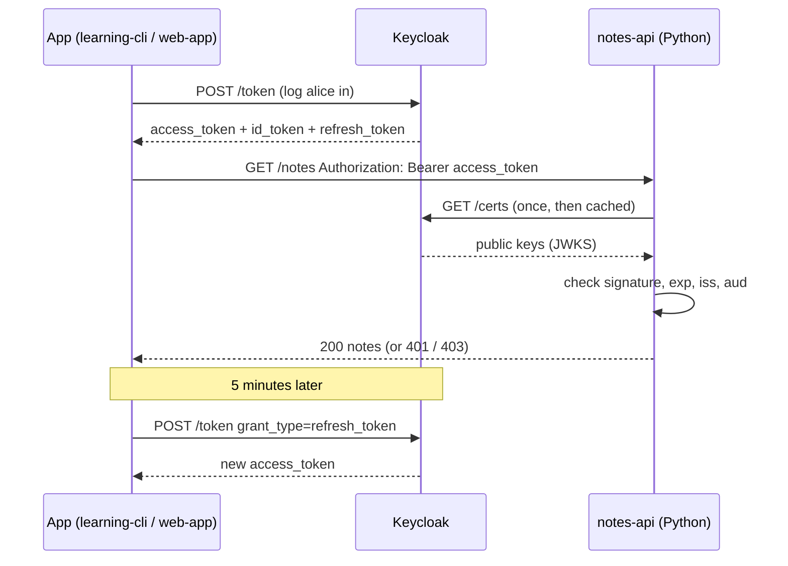

# Module 06: Tokens, opened up

**You'll learn:** how to get tokens (lab way), the three token types and who reads each, every claim in alice's access and ID tokens, the discovery document, the JWKS keys and `kid`, a Python script that **verifies** a token properly (and fails on tampered, wrong-issuer and expired tokens), the userinfo endpoint, and the default token lifetimes.

**Before this:** [Module 05](05-roles-and-groups.md).

**Starting state:** the full Level 1 baseline (realm `learning`, alice in `admins`, bob in `staff`, clients `learning-cli`, `web-app`, `notes-api`, roles). Behind? Run [`../catch-up.md`](../catch-up.md).

---

## The idea in simple words

When you log in, the front desk gives you **up to three cards**:

| Card | Real-life picture | Who reads it |
|---|---|---|
| **Access token** | The key card for doors | **APIs** (like `notes-api`). Sent in `Authorization: Bearer ...` |
| **ID token** | A name tag: "Hello, I'm Alice" | **Only the app that logged you in** (e.g. `web-app`), to show your name |
| **Refresh token** | A voucher: "give me a new key card without logging in again" | **Only Keycloak**. The app sends it back to Keycloak; nobody else |

The access token is short-lived (5 minutes) so a stolen one is soon useless. The refresh token lives longer (30 minutes) and is used to get fresh access tokens quietly.

Every token is a **JWT**: readable by anyone, but **signed** by Keycloak's private key. Any service can check the signature with Keycloak's **public** key, which Keycloak publishes at a public address (the **JWKS**). No need to call Keycloak for every request.



---

## Jargon table

| Word | Plain meaning | Example |
|---|---|---|
| Access token | The card an API checks | `Authorization: Bearer eyJ...` |
| ID token | Proof of who logged in, for the app only | Shows "Hi Alice" |
| Refresh token | Voucher to get new access tokens from Keycloak | `grant_type=refresh_token` |
| Claim | One fact in a token | `"email": "alice@example.com"` |
| Issuer (`iss`) | Who made the token | `http://localhost:8180/realms/learning` |
| Subject (`sub`) | Who the token is about (permanent user ID) | `edb20313-...` |
| Audience (`aud`) | Who the token is meant for | `notes-api` |
| Authorized party (`azp`) | Which client asked for it | `learning-cli` |
| Scope | Which bundles of info were requested | `openid email profile` |
| Session ID (`sid`) | Which Keycloak login session it belongs to | `xHfnfdO9...` |
| Epoch seconds | Time as "seconds since 1 Jan 1970", used by `exp`/`iat` | `1791310303` |
| Discovery document | Public JSON listing the realm's addresses | `/.well-known/openid-configuration` |
| JWKS | Public JSON listing the realm's public keys | `/protocol/openid-connect/certs` |
| `kid` | Key ID: which key signed this token | `VmHCAnrY_...` |
| RS256 | Signing with an RSA key pair + SHA-256 | the default in Keycloak |
| Userinfo endpoint | Address that returns the user's profile for an access token | `/protocol/openid-connect/userinfo` |

---

## Hands-on

### Step 1: Get alice's tokens (lab way)

**Why:** you need real tokens to look at. We use `learning-cli` and the **password grant**. Reminder: this grant is **deprecated** and for labs only; real apps use the standard flow (Level 2).

We add `scope=openid` to ask for OpenID Connect, which is what makes Keycloak include an **ID token**.

```bash
RESP=$(curl -s -X POST http://localhost:8180/realms/learning/protocol/openid-connect/token \
  -d grant_type=password -d client_id=learning-cli \
  -d username=alice -d password=alice123 -d scope=openid)
echo "$RESP" | jq 'del(.access_token,.id_token,.refresh_token)'
```

```
{
  "scope": "openid email profile",
  "expires_in": 300,
  "refresh_expires_in": 1800,
  "not-before-policy": 0,
  "token_type": "Bearer",
  "session_state": "xHfnfdO9ADgQuVR7iL3QlD1t"
}
```

(We hid the three long tokens.) `expires_in: 300` = the access token lives 5 minutes; `refresh_expires_in: 1800` = the refresh token lives 30 minutes.

Save them:

```bash
ACCESS=$(echo "$RESP" | jq -r .access_token)
ID_TOKEN=$(echo "$RESP" | jq -r .id_token)
REFRESH=$(echo "$RESP" | jq -r .refresh_token)
echo "$ACCESS" | cut -c1-80
```

```
eyJhbGciOiJSUzI1NiIsInR5cCIgOiAiSldUIiwia2lkIiA6ICJWbUhDQW5yWV81YzkxaTFFQ1hQaVFJ
```

### Step 2: Decode a JWT in the terminal

**Why:** a JWT is `header.payload.signature`, each part Base64url-encoded. Decoding is not "hacking"; anyone can do it.

Paste these helpers into your terminal:

```bash
jwt_payload() {
  echo "$1" | jq -R 'split(".")[1] | gsub("-";"+") | gsub("_";"/")
    | . + ("=" * ((4 - length % 4) % 4)) | @base64d | fromjson'
}
jwt_header() {
  echo "$1" | jq -R 'split(".")[0] | gsub("-";"+") | gsub("_";"/")
    | . + ("=" * ((4 - length % 4) % 4)) | @base64d | fromjson'
}
```

What they do: take part 1 (or 0), turn Base64**url** letters (`-`, `_`) back into normal Base64 (`+`, `/`), add the `=` padding that JWTs leave off, decode, and parse as JSON.

The header:

```bash
jwt_header "$ACCESS"
```

```
{
  "alg": "RS256",
  "typ": "JWT",
  "kid": "VmHCAnrY_5c91i1ECXPiQIgUSG9mU45gng4T2dOh8nc"
}
```

`alg: RS256` = signed with an RSA private key. `kid` = which of Keycloak's keys did it (you'll find this key in Step 5).

### Step 3: Every claim in alice's access token

```bash
jwt_payload "$ACCESS"
```

```
{
  "exp": 1791310303,
  "iat": 1791310003,
  "jti": "onrtro:a70dbbf2-11de-5141-798f-b2b57a56b96f",
  "iss": "http://localhost:8180/realms/learning",
  "aud": [
    "notes-api",
    "account"
  ],
  "sub": "edb20313-d73d-48c6-8ca4-a0e8f1d99e8b",
  "typ": "Bearer",
  "azp": "learning-cli",
  "sid": "xHfnfdO9ADgQuVR7iL3QlD1t",
  "acr": "1",
  "realm_access": {
    "roles": [
      "default-roles-learning",
      "offline_access",
      "admin",
      "uma_authorization",
      "user"
    ]
  },
  "resource_access": {
    "notes-api": {
      "roles": [
        "notes:read",
        "notes:write"
      ]
    },
    "account": {
      "roles": [
        "manage-account",
        "manage-account-links",
        "view-profile"
      ]
    }
  },
  "scope": "openid email profile",
  "email_verified": true,
  "name": "Alice Smith",
  "preferred_username": "alice",
  "given_name": "Alice",
  "family_name": "Smith",
  "email": "alice@example.com"
}
```

| Claim | Plain meaning | Alice's value | Who cares |
|---|---|---|---|
| `exp` | Expires at (epoch seconds) | `1791310303` | Every API: reject if past |
| `iat` | Issued at | `1791310003` (exactly 300 s before `exp`) | Debugging |
| `jti` | Unique ID of this token | `onrtro:a70d...` | Logs, replay detection |
| `iss` | Issuer: the realm's address | `http://localhost:8180/realms/learning` | Every API: must match exactly |
| `aud` | Audience: who it's for | `notes-api`, `account` | Each API checks its own name is here |
| `sub` | Subject: alice's permanent user ID | `edb20313-...` | Use this as the user key in your database, not the username |
| `typ` | Token type | `Bearer` (an access token) | Reject ID/refresh tokens at APIs |
| `azp` | Authorized party: the client that asked | `learning-cli` | Auditing, per-app rules |
| `sid` | Keycloak session ID | `xHfn...` | Logout handling (Level 2) |
| `acr` | How strong the login was | `1` (normal login) | Step-up auth (Level 3) |
| `realm_access` | Effective realm roles | includes `admin`, `user` | Your role checks |
| `resource_access` | Effective client roles, per client | `notes-api`: `notes:read`, `notes:write` | The notes API |
| `scope` | Scopes granted | `openid email profile` | Coarse permission checks |
| `email_verified`, `email` | From the `email` scope | `true`, `alice@example.com` | Display, contact |
| `name`, `given_name`, `family_name`, `preferred_username` | From the `profile` scope | Alice Smith, alice | Display |

Two things worth noticing:

- **Why is `notes-api` in `aud`?** Alice has client roles on `notes-api`, and Keycloak's built-in `roles` scope automatically adds any client whose roles are in the token to the audience. (`account` is there for the same reason.) Level 2 covers controlling `aud` precisely.
- **Turn epoch seconds into a date:** `date -r 1791310303` on macOS (`date -d @1791310303` on Linux).

### Step 4: The ID token and the refresh token

```bash
jwt_payload "$ID_TOKEN"
```

```
{
  "exp": 1791310303,
  "iat": 1791310003,
  "jti": "48665793-9f6a-7d8d-61c1-a02e604c3087",
  "iss": "http://localhost:8180/realms/learning",
  "aud": "learning-cli",
  "sub": "edb20313-d73d-48c6-8ca4-a0e8f1d99e8b",
  "typ": "ID",
  "azp": "learning-cli",
  "sid": "xHfnfdO9ADgQuVR7iL3QlD1t",
  "at_hash": "sUL8EC2uz8DkQeS9en1t4Q",
  "acr": "1",
  "email_verified": true,
  "name": "Alice Smith",
  "preferred_username": "alice",
  "given_name": "Alice",
  "family_name": "Smith",
  "email": "alice@example.com"
}
```

| Difference from the access token | Meaning |
|---|---|
| `typ: "ID"` | It's a name tag, not a key card |
| `aud: "learning-cli"` | Meant for the **client app** that logged in, not for any API |
| No `realm_access` / `resource_access` / `scope` | It says **who** you are, not what you may do |
| `at_hash` | A fingerprint of the access token issued with it, so the app can check they belong together |

The refresh token (read it only out of curiosity; apps should treat it as an opaque string):

```bash
jwt_payload "$REFRESH"
```

```
{
  "exp": 1791311803,
  "iat": 1791310003,
  "jti": "7071cf3d-d48a-c0fc-4cc3-9dd394da1bad",
  "iss": "http://localhost:8180/realms/learning",
  "aud": "http://localhost:8180/realms/learning",
  "sub": "edb20313-d73d-48c6-8ca4-a0e8f1d99e8b",
  "typ": "Refresh",
  "azp": "learning-cli",
  "sid": "xHfnfdO9ADgQuVR7iL3QlD1t",
  "scope": "openid roles acr web-origins email profile basic",
  "aud_x": [
    "notes-api",
    "account"
  ],
  "prov": "default"
}
```

Its audience is Keycloak itself (`aud` = the realm address): only Keycloak accepts it. It lives 1800 s (30 minutes). Use it:

```bash
curl -s -X POST http://localhost:8180/realms/learning/protocol/openid-connect/token \
  -d grant_type=refresh_token -d client_id=learning-cli -d refresh_token="$REFRESH" \
  | jq '{token_type, expires_in, refresh_expires_in, has_new_access_token: (.access_token != null)}'
```

```
{
  "token_type": "Bearer",
  "expires_in": 300,
  "refresh_expires_in": 1800,
  "has_new_access_token": true
}
```

A new access token, no password typed.

### Step 5: Discovery document and JWKS

**Why:** your code should never hard-code Keycloak's addresses or keys. It reads them from these two public pages.

**Discovery document:**

```bash
curl -s http://localhost:8180/realms/learning/.well-known/openid-configuration \
  | jq '{issuer, authorization_endpoint, token_endpoint, userinfo_endpoint, jwks_uri, end_session_endpoint, introspection_endpoint, grant_types_supported, id_token_signing_alg_values_supported, code_challenge_methods_supported}'
```

```
{
  "issuer": "http://localhost:8180/realms/learning",
  "authorization_endpoint": "http://localhost:8180/realms/learning/protocol/openid-connect/auth",
  "token_endpoint": "http://localhost:8180/realms/learning/protocol/openid-connect/token",
  "userinfo_endpoint": "http://localhost:8180/realms/learning/protocol/openid-connect/userinfo",
  "jwks_uri": "http://localhost:8180/realms/learning/protocol/openid-connect/certs",
  "end_session_endpoint": "http://localhost:8180/realms/learning/protocol/openid-connect/logout",
  "introspection_endpoint": "http://localhost:8180/realms/learning/protocol/openid-connect/token/introspect",
  "grant_types_supported": [
    "authorization_code",
    "client_credentials",
    "implicit",
    "password",
    "refresh_token",
    "urn:ietf:params:oauth:grant-type:device_code",
    "urn:ietf:params:oauth:grant-type:jwt-bearer",
    "urn:ietf:params:oauth:grant-type:token-exchange",
    "urn:ietf:params:oauth:grant-type:uma-ticket",
    "urn:openid:params:grant-type:ciba"
  ],
  "id_token_signing_alg_values_supported": [
    "PS384",
    "RS384",
    "EdDSA",
    "ES384",
    "HS256",
    "HS512",
    "ES256",
    "RS256",
    "HS384",
    "ES512",
    "PS256",
    "PS512",
    "RS512"
  ],
  "code_challenge_methods_supported": [
    "plain",
    "S256"
  ]
}
```

`issuer` here is **exactly** the `iss` in every token. `token_endpoint` is what you've been calling. `jwks_uri` is where the keys are.

**JWKS (the public keys):**

```bash
curl -s http://localhost:8180/realms/learning/protocol/openid-connect/certs \
  | jq '.keys[] | {kid, kty, alg, use, n: (.n[0:20]+"..."), e}'
```

```
{
  "kid": "-RIymv-Z_ezm9AAiRXVs9b8xAQt-PQOLoLeppiFgWKI",
  "kty": "RSA",
  "alg": "RSA-OAEP",
  "use": "enc",
  "n": "sDlJkuf5paZUeBDe1JII...",
  "e": "AQAB"
}
{
  "kid": "VmHCAnrY_5c91i1ECXPiQIgUSG9mU45gng4T2dOh8nc",
  "kty": "RSA",
  "alg": "RS256",
  "use": "sig",
  "n": "1PMRLpxklCHAsMmT1E4k...",
  "e": "AQAB"
}
```

Two keys: one for **encryption** (`use: enc`, not used for normal tokens) and one for **signing** (`use: sig`, `alg: RS256`). The signing key's `kid` is `VmHCAnrY_...`, the **same** as in the token header from Step 2. That's how a verifier picks the right key: read `kid` from the token, find it in the JWKS. (`n` and `e` are the RSA public key numbers; we cut `n` short.) When Keycloak rotates keys, a new `kid` appears here and libraries pick it up automatically.

### Step 6: Verify a token in Python

**Why:** this is the check every one of your services must do (Module 01: Keycloak doesn't protect your API; **your code** does). We check four things: the **signature** (with the JWKS key), **`exp`**, **`iss`** and **`aud`**.

Create a project (Python 3.12 via `uv`):

```bash
uv init --python 3.12 verify-token
cd verify-token
uv add "pyjwt[crypto]"
```

```
Initialized project `verify-token` at `/private/tmp/kc-course-l1/verify-token`
Using CPython 3.12.13
...
 + cffi==2.1.1
 + cryptography==50.0.2
 + pycparser==3.0
 + pyjwt==2.15.1
```

(`[crypto]` pulls in `cryptography`, which PyJWT needs for RS256. The `...` hides uv's progress lines.)

Create `verify_token.py`:

```python
# sys lets us read the token from the command line
import sys

# jwt is the PyJWT library; it can decode and verify JWTs
import jwt

# The realm address. Every token from this realm has this exact "iss" value.
ISSUER = "http://localhost:8180/realms/learning"

# The page where Keycloak publishes its public keys (from the discovery document)
JWKS_URL = ISSUER + "/protocol/openid-connect/certs"

# The API this token must be meant for (the "aud" claim must contain it)
AUDIENCE = "notes-api"


# Verify a JWT token by checking signature, expiry, issuer, and audience.
def verify(token, expected_issuer):
    # A helper that downloads the JWKS page (it fetches the keys the first time it needs them)
    jwks_client = jwt.PyJWKClient(JWKS_URL)

    # Read the "kid" in the token header and pick the matching public key
    signing_key = jwks_client.get_signing_key_from_jwt(token)

    # Check the signature, the expiry (exp), the issuer (iss) and the audience (aud).
    # algorithms=["RS256"] means: refuse any other algorithm (never trust the token's own "alg").
    claims = jwt.decode(
        token,
        signing_key.key,
        algorithms=["RS256"],
        issuer=expected_issuer,
        audience=AUDIENCE,
    )

    # Only reached when every check passed
    return claims


# Entry point of the script.
def main():
    # The token is the first word after the script name
    token = sys.argv[1]

    # By default we expect our realm as the issuer
    expected_issuer = ISSUER
    # An optional second word lets us pretend we expect a different issuer
    if len(sys.argv) > 2:
        expected_issuer = sys.argv[2]

    # If any check fails, PyJWT raises an error and we jump to "except"
    try:
        # Try to verify the token
        claims = verify(token, expected_issuer)
    except jwt.PyJWTError as error:
        # Any failed check lands here; print which one
        print("REJECTED:", type(error).__name__, "-", error)
        # Exit code 1 tells the shell "this failed"
        sys.exit(1)

    # Print a few facts from the verified token
    print("VALID token")
    print("user:   ", claims["preferred_username"])
    # Print the issuer claim from the verified token.
    print("issuer: ", claims["iss"])
    # Print the realm roles from the verified token.
    print("roles:  ", claims["realm_access"]["roles"])


# Run main() only when this file is started directly
if __name__ == "__main__":
    main()
```

**Test 1: a good token.**

```bash
TOKEN=$(curl -s -X POST http://localhost:8180/realms/learning/protocol/openid-connect/token \
  -d grant_type=password -d client_id=learning-cli \
  -d username=alice -d password=alice123 | jq -r .access_token)
uv run verify_token.py "$TOKEN"
```

```
VALID token
user:    alice
issuer:  http://localhost:8180/realms/learning
roles:   ['default-roles-learning', 'offline_access', 'admin', 'uma_authorization', 'user']
```

**Test 2: a tampered token.** Mallory takes alice's token, changes `preferred_username` to `mallory`, re-encodes the payload, and keeps the original header and signature:

```bash
HEADER=$(echo "$TOKEN" | cut -d. -f1)
SIG=$(echo "$TOKEN" | cut -d. -f3)
FAKE=$(jwt_payload "$TOKEN" | jq -c '.preferred_username="mallory"' | base64 | tr '+/' '-_' | tr -d '=\n')
uv run verify_token.py "$HEADER.$FAKE.$SIG"
```

```
REJECTED: InvalidSignatureError - Signature verification failed
```

One changed letter, and the signature no longer matches. She can't re-sign it because she doesn't have Keycloak's private key.

**Test 3: wrong issuer.** Pretend our service expects tokens from another realm:

```bash
uv run verify_token.py "$TOKEN" http://localhost:8180/realms/other
```

```
REJECTED: InvalidIssuerError - Invalid issuer
```

**Test 4: an ID token sent to the API.**

```bash
IDT=$(curl -s -X POST http://localhost:8180/realms/learning/protocol/openid-connect/token \
  -d grant_type=password -d client_id=learning-cli \
  -d username=alice -d password=alice123 -d scope=openid | jq -r .id_token)
uv run verify_token.py "$IDT"
```

```
REJECTED: InvalidAudienceError - Audience doesn't match
```

The ID token's `aud` is `learning-cli`, not `notes-api`. The audience check stops it.

**Test 5: an expired token.** We shortened the realm's access token lifespan to 10 seconds, got a token, waited 12 seconds, and put it back to 300:

```bash
kcadm update realms/learning -s accessTokenLifespan=10
TOKEN=$(curl -s -X POST http://localhost:8180/realms/learning/protocol/openid-connect/token \
  -d grant_type=password -d client_id=learning-cli \
  -d username=alice -d password=alice123 | jq -r .access_token)
sleep 12
uv run verify_token.py "$TOKEN"
kcadm update realms/learning -s accessTokenLifespan=300
```

```
REJECTED: ExpiredSignatureError - Signature has expired
```

**Test 6: garbage.**

```bash
uv run verify_token.py "hello.world.x"
```

```
REJECTED: DecodeError - Invalid header padding
```

In a real API you'd create the `PyJWKClient` **once** at start-up (it caches keys) instead of on every call. You'll do that in Level 2.

### Step 7: The userinfo endpoint

**Why:** an app holding an access token can ask Keycloak "who is this?" and get the profile back.

```bash
curl -s http://localhost:8180/realms/learning/protocol/openid-connect/userinfo \
  -H "Authorization: Bearer $ACCESS" | jq .
```

```
{
  "sub": "edb20313-d73d-48c6-8ca4-a0e8f1d99e8b",
  "email_verified": true,
  "name": "Alice Smith",
  "preferred_username": "alice",
  "given_name": "Alice",
  "family_name": "Smith",
  "email": "alice@example.com"
}
```

(This needs `$ACCESS` from Step 1 to still be valid; if it's older than 5 minutes, redo Step 1.) Userinfo wants an **access** token. Give it the ID token and it refuses:

```bash
curl -s -w "\nHTTP %{http_code}\n" http://localhost:8180/realms/learning/protocol/openid-connect/userinfo \
  -H "Authorization: Bearer $ID_TOKEN"
```

```

HTTP 401
```

### Step 8: Default token lifetimes

**Why:** know how long things live before you change them.

**Click path:** **Realm settings** → **Sessions** tab and **Tokens** tab.

```bash
kcadm get realms/learning --fields accessTokenLifespan,ssoSessionIdleTimeout,ssoSessionMaxLifespan,accessCodeLifespan,accessCodeLifespanLogin,offlineSessionIdleTimeout
```

```
{
  "accessTokenLifespan" : 300,
  "ssoSessionIdleTimeout" : 1800,
  "ssoSessionMaxLifespan" : 36000,
  "offlineSessionIdleTimeout" : 2592000,
  "accessCodeLifespan" : 60,
  "accessCodeLifespanLogin" : 1800
}
```

| Setting (seconds) | Default | Plain meaning |
|---|---|---|
| `accessTokenLifespan` | 300 = 5 min | How long an access token works |
| `ssoSessionIdleTimeout` | 1800 = 30 min | Login session ends after 30 min of no activity. The refresh token's life (`refresh_expires_in: 1800`) follows this |
| `ssoSessionMaxLifespan` | 36000 = 10 h | Even if active, you must log in again after 10 hours |
| `accessCodeLifespan` | 60 = 1 min | How long the one-time login code (standard flow) is valid |
| `accessCodeLifespanLogin` | 1800 = 30 min | How long a user may sit on the login page |
| `offlineSessionIdleTimeout` | 2592000 = 30 days | Idle limit for "offline" refresh tokens (Level 4) |

Short access tokens are the safety net: since a JWT can't easily be "cancelled", you keep its life short.

---

## The one trap

**A JWT is signed, not encrypted.** You just read every claim with `jq`; so can anyone who gets hold of a token. Never put secrets in a token. The signature only stops **changes**.

And its twin: **the ID token never goes to an API.** It's for the app that logged the user in. APIs accept **access tokens** only, and check `aud` so that a token meant for someone else (like an ID token with `aud: learning-cli`) is rejected, exactly as Test 4 showed.

---

## Check yourself

1. Which token does the notes API receive? Which one does only Keycloak accept?
2. Name the four checks every API must do on an access token.
3. How does a verifier know which public key to use?
4. Alice's username changes to `alice.smith`. Which claim should your database have used as her ID?
5. Why are access tokens only 5 minutes long?

<details>
<summary>Answers</summary>

1. The access token. The refresh token (its `aud` is Keycloak's realm address).
2. Signature (with the JWKS key, fixed algorithm), `exp`, `iss`, `aud`.
3. The `kid` in the token header matches a `kid` in the JWKS.
4. `sub` (the permanent user ID).
5. A JWT stays valid until it expires and can't easily be revoked; a short life limits the damage if one is stolen, and role changes show up quickly.

</details>

---

## Try this

1. Paste alice's access token into [jwt.io](https://jwt.io) (fine for a lab token, **never** for a real one) and compare with your `jwt_payload` output.
2. Get bob's token and run it through `verify_token.py`. Then change `AUDIENCE` to `"billing-api"` and run it again.
3. Replace `"RS256"` in `algorithms` with `"HS256"` and run a real token through it. You should get `REJECTED: InvalidAlgorithmError - The specified alg value is not allowed`. Why is it good that your code, not the token, decides the algorithm?

Next: Level 2 (Modules 07–12), listed in the [course map](../README.md). If you need to rebuild this level's setup, use [`../catch-up.md`](../catch-up.md).
