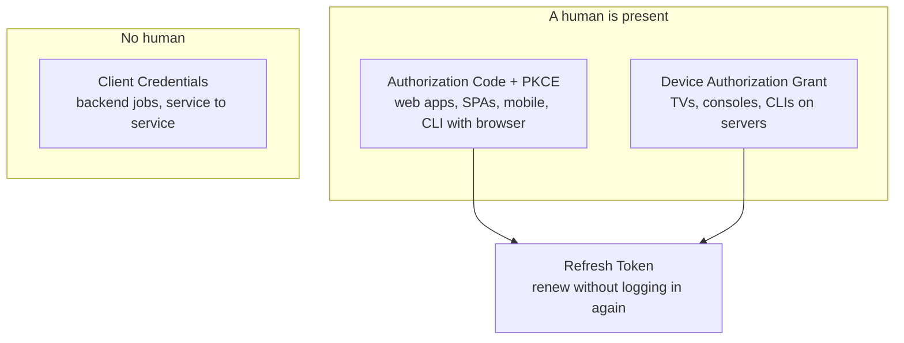
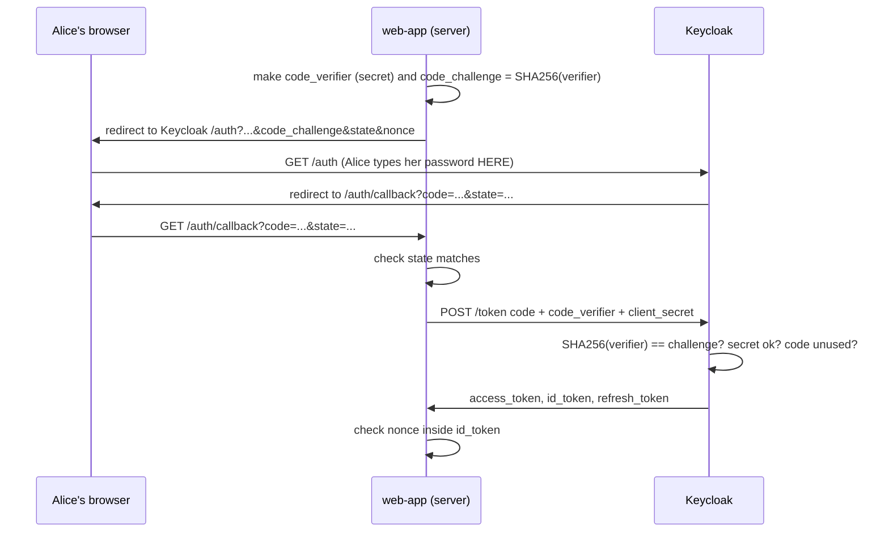
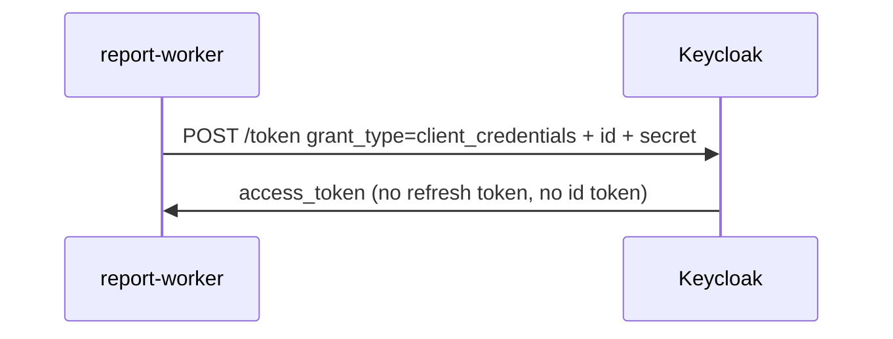
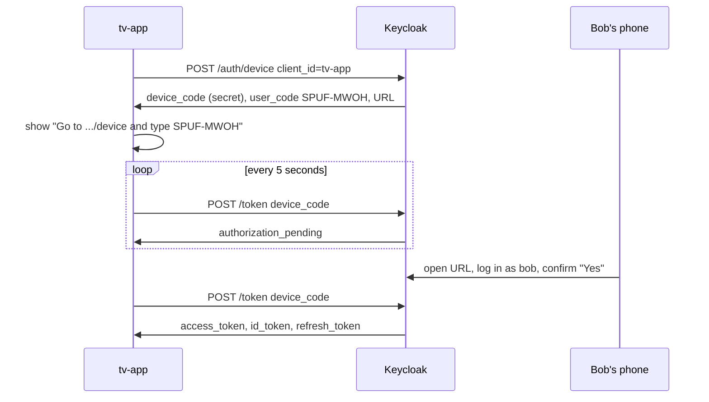

# Module 07: The ways an app can get a token (OAuth flows)

**You'll learn:** the 4 flows you will really use (Authorization Code + PKCE, Client Credentials, Refresh Token, Device), how to do each one by hand with `curl`, and which flow to pick for which kind of app.

**Before this:** [Module 06](../level-1-basics/06-tokens.md)

**Starting state:** the Level 1 end state: realm `learning` with users `alice` and `bob`, and clients `learning-cli`, `web-app` and `notes-api`. Lost it? Run [`../catch-up.md`](../catch-up.md). This module also creates two new clients: `report-worker` and `tv-app`.

---

## The idea in simple words

Think of Keycloak as the **front desk of an office building**. Nobody gets past the gate without a **visitor badge** (a token). There are a few different ways to get a badge, because visitors are different:

- **A person with a web browser** walks to the desk, shows ID *to the desk* (not to the company they're visiting), and gets a short ticket. The company swaps the ticket for a badge. → **Authorization Code + PKCE**
- **A delivery robot** has no face and no password in its head. It shows its own company ID card. → **Client Credentials**
- **A visitor whose badge ran out** shows the "renewal slip" they got earlier and gets a new badge without showing ID again. → **Refresh Token**
- **A smart TV** has no keyboard. It shows a short code on screen; you type that code on your phone and say "yes, let the TV in". → **Device Authorization Grant**

Each of these is called a **flow** (or **grant**). Same desk, same badges, different way of asking.

You learned in Module 06 how to *read* a token. This module is about how an app *gets* one.

### Jargon table

| Word | Plain meaning | Example |
|---|---|---|
| **OAuth 2.0** | The rulebook for "how does an app get a token". Keycloak follows it | Every flow in this module comes from OAuth |
| **OpenID Connect (OIDC)** | An add-on to OAuth that also tells the app *who the user is* (the ID token) | `scope=openid` turns it on |
| **Flow / grant** | One recipe for getting a token | "client credentials flow" |
| **Client** | An app registered in Keycloak | `web-app`, `report-worker` |
| **Public client** | An app that **cannot** keep a secret (code runs on the user's device) | Browser JavaScript, mobile app, TV app, CLI |
| **Confidential client** | An app that **can** keep a secret (code runs on your server) | `web-app` (Python server), `report-worker` |
| **Client secret** | The app's password | `web-app-secret` |
| **Authorization endpoint** | The Keycloak page the *browser* is sent to, to log in | `.../protocol/openid-connect/auth` |
| **Token endpoint** | The Keycloak address the *app* calls (server to server) to get tokens | `.../protocol/openid-connect/token` |
| **Redirect URI** | Where Keycloak sends the browser back after login. Must be on the client's allow-list | `http://localhost:8000/auth/callback` |
| **Authorization code** | A one-time ticket, valid for about a minute, swapped for tokens | `efbdde1c-a4ac-...` |
| **PKCE** (say "pixie") | Proof that the app swapping the code is the same app that started the login | `code_verifier` + `code_challenge` |
| **state** | A random value the app sends and checks when the browser comes back. Stops a forged callback (CSRF) | `1935b98b...` |
| **nonce** | A random value that Keycloak copies into the ID token. Stops an old ID token being replayed | `cbb0de2a...` |
| **Service account** | A robot user that belongs to a client | `service-account-report-worker` |
| **Scope** | A list of "what I'm asking for" | `openid profile email` |

---

## The 4 flows in one picture



Keycloak's discovery document lists every grant it supports. Check it:

```bash
curl -s http://localhost:8180/realms/learning/.well-known/openid-configuration \
  | jq '{token_endpoint, device_authorization_endpoint, grant_types_supported}'
```

```
{
  "token_endpoint": "http://localhost:8180/realms/learning/protocol/openid-connect/token",
  "device_authorization_endpoint": "http://localhost:8180/realms/learning/protocol/openid-connect/auth/device",
  "grant_types_supported": [
    "authorization_code",
    "client_credentials",
    "implicit",
    "password",
    "refresh_token",
    "urn:ietf:params:oauth:grant-type:device_code",
    "urn:ietf:params:oauth:grant-type:jwt-bearer",
    "urn:ietf:params:oauth:grant-type:token-exchange",
    "urn:ietf:params:oauth:grant-type:uma-ticket",
    "urn:openid:params:grant-type:ciba"
  ]
}
```

`implicit` and `password` are still on the list for old apps. You will see below why you should not use them.

---

## Hands-on

Set up your terminal first (same as Level 1):

```bash
alias kcadm='docker exec keycloak /opt/keycloak/bin/kcadm.sh'
kcadm config credentials --server http://localhost:8080 --realm master --user admin --password admin

jwt_payload() {
  echo "$1" | jq -R 'split(".")[1] | gsub("-";"+") | gsub("_";"/")
    | . + ("=" * ((4 - length % 4) % 4)) | @base64d | fromjson'
}
```

### Flow 1: Authorization Code + PKCE (the main one)

This is how almost every real login works. The app **never sees the password**.



You will now play **both** parts: the app (in the terminal) and the user (in the browser). `web-app` is a confidential client with secret `web-app-secret`, and it **requires** PKCE with method S256 (we set that in Level 1).

#### Step 1. Be the app: make the PKCE pair, the state and the nonce

**Why:** the `code_verifier` stays secret inside the app. Only its hash (the `code_challenge`) goes through the browser. Later, only someone who knows the original verifier can swap the code. A thief who steals the code from the address bar can't.

```bash
CODE_VERIFIER=$(openssl rand -base64 60 | tr -d '\n=+/' | cut -c1-64)
CODE_CHALLENGE=$(printf '%s' "$CODE_VERIFIER" | openssl dgst -sha256 -binary \
  | openssl base64 -A | tr '+/' '-_' | tr -d '=')
STATE=$(openssl rand -hex 16)
NONCE=$(openssl rand -hex 16)
echo "verifier:  $CODE_VERIFIER"; echo "challenge: $CODE_CHALLENGE"
echo "state:     $STATE";         echo "nonce:     $NONCE"
```

```
verifier:  sS8tA27AcJuP51pIzW8Wj5GzrIGdpglstFsr7fjIt38lhd4qJQDPPMcknmezljXD
challenge: HmIuxKwRF6vjjzdBzGHLiV0OXMhcnkhcXmO2FcZQ7Ys
state:     1935b98bba7e8091824cc317cf824d67
nonce:     cbb0de2a9b6ad8fb1672f4f22ac9812f
```

The verifier must be 43–128 characters. The `tr '+/' '-_' | tr -d '='` part turns normal Base64 into **Base64URL** (safe inside a URL), which PKCE requires.

#### Step 2. Build the login URL

```bash
echo "http://localhost:8180/realms/learning/protocol/openid-connect/auth?client_id=web-app&response_type=code&scope=openid&redirect_uri=http://localhost:8000/auth/callback&state=$STATE&nonce=$NONCE&code_challenge=$CODE_CHALLENGE&code_challenge_method=S256"
```

```
http://localhost:8180/realms/learning/protocol/openid-connect/auth?client_id=web-app&response_type=code&scope=openid&redirect_uri=http://localhost:8000/auth/callback&state=1935b98bba7e8091824cc317cf824d67&nonce=cbb0de2a9b6ad8fb1672f4f22ac9812f&code_challenge=HmIuxKwRF6vjjzdBzGHLiV0OXMhcnkhcXmO2FcZQ7Ys&code_challenge_method=S256
```

| Part | Meaning |
|---|---|
| `response_type=code` | "Give me an authorization code" (this is what makes it the code flow) |
| `scope=openid` | "I also want an ID token" (OIDC) |
| `redirect_uri` | Must match the client's allow-list **exactly** |
| `state`, `nonce` | Your random values from step 1 |
| `code_challenge`, `code_challenge_method=S256` | The PKCE hash and the hash method |

#### Step 3. Be the user: log in and copy the code

Open the URL in a **private browser window** and log in as `alice` / `alice123`. The browser is then sent to `http://localhost:8000/auth/callback?...`. Nothing runs on port 8000 yet, so the page shows an error. **That's fine**: the code is in the **address bar**. It looked like this:

```
http://localhost:8000/auth/callback?state=1935b98bba7e8091824cc317cf824d67&session_state=EJynKryhaNizojl5NFCHb1v1&iss=http%3A%2F%2Flocalhost%3A8180%2Frealms%2Flearning&code=efbdde1c-a4ac-a44b-d3cd-c1ca22aa4f23.EJynKryhaNizojl5NFCHb1v1.6bc41ad6-706b-4006-b245-5f8dc69618fe
```

Look at it:

- `state` is **the same** value you sent. A real app **must** compare it and stop if it differs. (Keycloak just echoes it; checking it is the app's job.)
- `iss` tells you which server sent the code (helps against "mix-up" attacks when an app talks to several servers).
- `code` is the one-time ticket.

Copy the code into a variable. **Be quick: the code expires after 60 seconds.**

```bash
CODE='efbdde1c-a4ac-a44b-d3cd-c1ca22aa4f23.EJynKryhaNizojl5NFCHb1v1.6bc41ad6-706b-4006-b245-5f8dc69618fe'
```

#### Step 4. Be the app again: swap the code for tokens

**Why:** this call goes straight from the app to Keycloak (not through the browser). It carries the three proofs: the code, the PKCE verifier, and the client secret.

```bash
curl -s http://localhost:8180/realms/learning/protocol/openid-connect/token \
  -d grant_type=authorization_code \
  -d client_id=web-app -d client_secret=web-app-secret \
  -d "code=$CODE" \
  -d redirect_uri=http://localhost:8000/auth/callback \
  -d "code_verifier=$CODE_VERIFIER" > tok.json

jq '{access_token: (.access_token[0:30]+"..."), expires_in, refresh_expires_in,
     refresh_token: (.refresh_token[0:30]+"..."), token_type,
     id_token: (.id_token[0:30]+"..."), scope}' tok.json
```

```
{
  "access_token": "eyJhbGciOiJSUzI1NiIsInR5cCIgOi...",
  "expires_in": 300,
  "refresh_expires_in": 1800,
  "refresh_token": "eyJhbGciOiJIUzUxMiIsInR5cCIgOi...",
  "token_type": "Bearer",
  "id_token": "eyJhbGciOiJSUzI1NiIsInR5cCIgOi...",
  "scope": "openid profile email"
}
```

Three tokens: **access token** (5 minutes, for calling APIs), **ID token** (who logged in), **refresh token** (30 minutes, for renewing).

#### Step 5. Check the nonce

**Why:** the app must check the `nonce` inside the ID token equals the one it generated in step 1.

```bash
jwt_payload $(jq -r .id_token tok.json) | jq '{iss,aud,sub,typ,azp,nonce,preferred_username,email}'
```

```
{
  "iss": "http://localhost:8180/realms/learning",
  "aud": "web-app",
  "sub": "5aa6155e-d489-4918-b323-3f491ddd7ca0",
  "typ": "ID",
  "azp": "web-app",
  "nonce": "cbb0de2a9b6ad8fb1672f4f22ac9812f",
  "preferred_username": "alice",
  "email": "alice@example.com"
}
```

Same nonce as step 1. The ID token's `aud` is `web-app`: an ID token is a message **to the app**, not a key for APIs.

#### Step 6. Watch the protections work

**Use the same code twice** (an attacker replaying a stolen code):

```bash
curl -s http://localhost:8180/realms/learning/protocol/openid-connect/token \
  -d grant_type=authorization_code -d client_id=web-app -d client_secret=web-app-secret \
  -d "code=$CODE" -d redirect_uri=http://localhost:8000/auth/callback -d "code_verifier=$CODE_VERIFIER"
```

```
{"error":"invalid_grant","error_description":"Code not valid"}
```

**Wrong verifier** (an attacker who stole a fresh code but not the verifier):

```
{"error":"invalid_grant","error_description":"PKCE verification failed: Code mismatch"}
```

**No PKCE at all** (leave out `code_challenge` and `code_challenge_method`). Keycloak refuses to even show the login page and sends the browser back with an error:

```
http://localhost:8000/auth/callback?error=invalid_request&error_description=Missing+parameter%3A+code_challenge_method&state=abc&iss=http%3A%2F%2Flocalhost%3A8180%2Frealms%2Flearning
```

**A redirect URI that is not on the allow-list** (`redirect_uri=http://evil.example.com/cb`): Keycloak shows an error page (HTTP 400) with the text `Invalid parameter: redirect_uri` and never sends a code anywhere.

### Flow 2: Client Credentials (robots, no human)

**Why:** a nightly report job has nobody to type a password. It logs in **as itself** with its client ID and secret. Keycloak gives such a client a **service account** (a robot user).



#### Step 7. Create the `report-worker` client

**Click path:** Clients → **Create client** → Client ID `report-worker` → Next → **Client authentication** ON, tick only **Service accounts roles** (untick Standard flow and Direct access grants) → Next → Save. Then **Credentials** tab shows the secret.

```bash
kcadm create clients -r learning -s clientId=report-worker -s publicClient=false \
  -s secret=report-worker-secret -s serviceAccountsEnabled=true \
  -s standardFlowEnabled=false -s directAccessGrantsEnabled=false
kcadm get clients -r learning -q clientId=report-worker \
  --fields clientId,publicClient,serviceAccountsEnabled,standardFlowEnabled,directAccessGrantsEnabled
```

```
Created new client with id '9beb6755-927e-4ed4-9a05-1ee661594c16'
[ {
  "clientId" : "report-worker",
  "standardFlowEnabled" : false,
  "directAccessGrantsEnabled" : false,
  "serviceAccountsEnabled" : true,
  "publicClient" : false
} ]
```

(Setting `secret=` yourself keeps the lab simple. In real life let Keycloak generate it and copy it from the Credentials tab.)

#### Step 8. Get a token as the robot

```bash
curl -s http://localhost:8180/realms/learning/protocol/openid-connect/token \
  -d grant_type=client_credentials \
  -d client_id=report-worker -d client_secret=report-worker-secret > cc.json
jq '{access_token: (.access_token[0:30]+"..."), expires_in, refresh_expires_in, token_type, scope, refresh_token}' cc.json
jwt_payload $(jq -r .access_token cc.json) | jq '{iss, aud, sub, typ, azp, preferred_username, client_id, realm_access, scope}'
```

```
{
  "access_token": "eyJhbGciOiJSUzI1NiIsInR5cCIgOi...",
  "expires_in": 300,
  "refresh_expires_in": 0,
  "token_type": "Bearer",
  "scope": "profile email",
  "refresh_token": null
}
{
  "iss": "http://localhost:8180/realms/learning",
  "aud": "account",
  "sub": "838b5a22-180c-4653-9c45-fd465f9aca80",
  "typ": "Bearer",
  "azp": "report-worker",
  "preferred_username": "service-account-report-worker",
  "client_id": "report-worker",
  "realm_access": {
    "roles": [
      "default-roles-learning",
      "offline_access",
      "uma_authorization"
    ]
  },
  "scope": "profile email"
}
```

Notice:

- **No refresh token.** The robot still has its secret, so it simply asks again when the token expires.
- `preferred_username` is `service-account-report-worker`: the robot user.
- No `openid` in scope, no ID token: there is no human to identify.

Wrong secret:

```
{"error":"unauthorized_client","error_description":"Invalid client or Invalid client credentials"}
```

You'll use this client properly in [Module 10](10-service-to-service.md).

### Flow 3: Refresh Token (renew without logging in)

**Why:** access tokens live only 5 minutes on purpose (a stolen one is useful only briefly). Asking Alice for her password every 5 minutes would be terrible, so the app trades the refresh token for a fresh access token.

#### Step 9. Use the refresh token from Flow 1

Run this within 30 minutes of step 4 (if it is later, repeat steps 1–4 first):

```bash
RT=$(jq -r .refresh_token tok.json)
curl -s http://localhost:8180/realms/learning/protocol/openid-connect/token \
  -d grant_type=refresh_token \
  -d client_id=web-app -d client_secret=web-app-secret \
  -d "refresh_token=$RT" > tok2.json
jq '{access_token: (.access_token[0:30]+"..."), expires_in, refresh_expires_in,
     refresh_token: (.refresh_token[0:30]+"..."), token_type, scope}' tok2.json
```

```
{
  "access_token": "eyJhbGciOiJSUzI1NiIsInR5cCIgOi...",
  "expires_in": 300,
  "refresh_expires_in": 1800,
  "refresh_token": "eyJhbGciOiJIUzUxMiIsInR5cCIgOi...",
  "token_type": "Bearer",
  "scope": "openid profile email"
}
```

A new access token **and a new refresh token**. Always store the newest one.

Peek inside a refresh token (you never send it to APIs; only Keycloak reads it):

```bash
jwt_payload "$RT" | jq '{typ, exp, iat, azp, sid, scope}'
```

```
{
  "typ": "Refresh",
  "exp": 1791311698,
  "iat": 1791309898,
  "azp": "web-app",
  "sid": "EJynKryhaNizojl5NFCHb1v1",
  "scope": "openid web-origins profile basic roles acr email"
}
```

`exp - iat` = 1800 seconds = 30 minutes. `sid` links it to Alice's login session: when that session ends, the refresh token dies with it ([Module 12](12-sessions-and-logout.md)).

> **Observed:** by default the *old* refresh token still worked once more after refreshing. Keycloak only kills old refresh tokens if you turn on **Revoke Refresh Token** (rotation). Module 12 shows that switch.

### Flow 4: Device Authorization Grant (TVs and keyboard-less devices)

**Why:** a smart TV or a CLI on a remote server can't easily show a login page. It shows a short code; you approve it on your phone or laptop.



#### Step 10. Create the `tv-app` client

**Click path:** Clients → Create client → Client ID `tv-app` → Next → Client authentication **OFF** (public), untick Standard flow and Direct access grants, tick **OAuth 2.0 Device Authorization Grant** → Next → Save.

```bash
kcadm create clients -r learning -s clientId=tv-app -s publicClient=true \
  -s standardFlowEnabled=false -s directAccessGrantsEnabled=false \
  -s 'attributes."oauth2.device.authorization.grant.enabled"=true'
```

```
Created new client with id '99e465c7-3bd0-4de2-8435-2b35431d2566'
```

#### Step 11. Be the TV: ask for a code

```bash
curl -s http://localhost:8180/realms/learning/protocol/openid-connect/auth/device \
  -d client_id=tv-app -d scope=openid > dev.json
jq . dev.json
```

```
{
  "device_code": "Tjq0_yYE9GAQtNfaC_N1lZojoHGP8jqM5j9HwvDpcfg",
  "user_code": "SPUF-MWOH",
  "verification_uri": "http://localhost:8180/realms/learning/device",
  "verification_uri_complete": "http://localhost:8180/realms/learning/device?user_code=SPUF-MWOH",
  "expires_in": 600,
  "interval": 5
}
```

| Field | Meaning |
|---|---|
| `device_code` | Secret, stays on the TV. Used for polling |
| `user_code` | Short code shown on screen for the human to type |
| `verification_uri` | Where the human goes |
| `verification_uri_complete` | Same, with the code already filled in (good for a QR code) |
| `interval` | Wait at least this many seconds between polls |

#### Step 12. Be the TV: poll (before anyone approved)

```bash
DC=$(jq -r .device_code dev.json)
curl -s http://localhost:8180/realms/learning/protocol/openid-connect/token \
  -d grant_type=urn:ietf:params:oauth:grant-type:device_code \
  -d client_id=tv-app -d device_code=$DC
```

```
{"error":"authorization_pending","error_description":"The authorization request is still pending"}
```

Run it again immediately (faster than `interval`):

```
{"error":"slow_down","error_description":"Slow down"}
```

A real TV app loops: wait `interval` seconds, poll, repeat; on `slow_down` it waits longer.

#### Step 13. Be Bob on his phone: approve

Open `verification_uri_complete` in a private browser window. Log in as `bob` / `bob123`. Keycloak shows a consent page **"Grant Access to tv-app"** asking *"Do you grant these access privileges?"* with *User profile*, *User roles*, *Email address*. Click **Yes**. The page says:

```
Device Login Successful
You may close this browser window and go back to your device.
```

#### Step 14. Be the TV: poll again

```bash
curl -s http://localhost:8180/realms/learning/protocol/openid-connect/token \
  -d grant_type=urn:ietf:params:oauth:grant-type:device_code \
  -d client_id=tv-app -d device_code=$DC > devtok.json
jq '{access_token: (.access_token[0:30]+"..."), expires_in, refresh_expires_in, token_type, id_token: (.id_token[0:30]+"..."), scope}' devtok.json
jwt_payload $(jq -r .access_token devtok.json) | jq '{azp, preferred_username, scope}'
```

```
{
  "access_token": "eyJhbGciOiJSUzI1NiIsInR5cCIgOi...",
  "expires_in": 300,
  "refresh_expires_in": 1800,
  "token_type": "Bearer",
  "id_token": "eyJhbGciOiJSUzI1NiIsInR5cCIgOi...",
  "scope": "openid profile email"
}
{
  "azp": "tv-app",
  "preferred_username": "bob",
  "scope": "openid profile email"
}
```

The TV is now logged in **as Bob**, and Bob never typed his password on the TV. Poll once more with the same device code and it is used up:

```
{"error":"invalid_grant","error_description":"Device code not valid"}
```

### The two old flows: Implicit and Password (don't use them)

**Implicit flow** (`response_type=token`): the access token came back directly in the browser's address bar. Anything that can read the URL (browser history, extensions, logs, the `Referer` header) can steal it, and there is no PKCE or refresh. The current OAuth security advice ([RFC 9700](https://datatracker.ietf.org/doc/html/rfc9700)) says: don't use it; use Authorization Code + PKCE, even for single-page apps. It is off on our clients:

```bash
# open in a browser, or:
curl -s -o /dev/null -w '%{redirect_url}\n' \
  "http://localhost:8180/realms/learning/protocol/openid-connect/auth?client_id=web-app&response_type=token&redirect_uri=http://localhost:8000/auth/callback"
```

```
http://localhost:8000/auth/callback#error=unauthorized_client&error_description=Client+is+not+allowed+to+initiate+browser+login+with+given+response_type.+Implicit+flow+is+disabled+for+the+client.&iss=http%3A%2F%2Flocalhost%3A8180%2Frealms%2Flearning
```

**Password grant** (Keycloak calls it **Direct Access Grants**, `grant_type=password`): the app collects the user's password itself and sends it to Keycloak. That defeats the whole point: the app sees the password, and it can't do MFA, social login or passkeys. It is **deprecated** (RFC 9700 says it must not be used). We keep it on `learning-cli` **only** because it's handy for quick labs:

```bash
curl -s http://localhost:8180/realms/learning/protocol/openid-connect/token \
  -d grant_type=password -d client_id=learning-cli -d username=alice -d password=alice123 \
  | jq '{expires_in, token_type, scope}'
```

```
{
  "expires_in": 300,
  "token_type": "Bearer",
  "scope": "profile email"
}
```

On `web-app` it's off, as it should be:

```
{"error":"unauthorized_client","error_description":"Client not allowed for direct access grants"}
```

---

## Which flow should I use?

| Kind of app | Flow | Client type | Notes |
|---|---|---|---|
| Server-side web app (Python FastAPI/Django, Java Spring, ...) | Authorization Code + PKCE | Confidential | Our `web-app`. Module 09 |
| Single-page app (React/Angular in the browser) | Authorization Code + PKCE | Public | No secret possible; PKCE is the protection. Better still: a small backend that holds the tokens ("BFF") |
| Mobile app | Authorization Code + PKCE | Public | Use the system browser, not an embedded web view |
| CLI on your laptop | Authorization Code + PKCE (opens browser, redirect to `localhost`) or Device | Public | Like `gh auth login`, `az login` |
| CLI on a remote server / SSH | Device Authorization Grant | Public | No browser on that machine |
| Smart TV, console, IoT | Device Authorization Grant | Public | Our `tv-app` |
| Backend job, cron, service to service | Client Credentials | Confidential | Our `report-worker`. Module 10 |
| Renewing any user token | Refresh Token | (same client) | Not a login flow by itself |
| Anything new | ~~Implicit~~ ~~Password~~ | | Deprecated |

---

## The one trap

**Treating the redirect URI and `state` as boring details.** The redirect URI allow-list is what stops Keycloak from handing Alice's code to an attacker's site, so register **exact** URIs (`http://localhost:8000/auth/callback`), never wildcards like `*` or `http://localhost:8000/*` in real setups. And `state` only protects you if your app **checks** it when the browser comes back. Keycloak just echoes it. Good libraries (Authlib in Module 09) do both checks for you; hand-written code often forgets.

---

## Check yourself

1. In the code flow, which two secrets prove that the app swapping the code is the real `web-app`?
2. Why does the client credentials response have no refresh token?
3. What does `authorization_pending` mean, and what should the TV do when it gets `slow_down`?
4. Why is the implicit flow unsafe even though it is simpler?
5. Which flow would you pick for a Go microservice that calls another microservice every minute?

<details>
<summary>Answers</summary>

1. The `client_secret` (only the server knows it) and the PKCE `code_verifier` (only the app instance that started this login knows it). For a public client there is no secret, so PKCE alone does the job.
2. The robot still has its client secret, so it can simply ask for a new token. A refresh token would be one more secret to protect for no gain.
3. The human hasn't approved yet; keep polling. On `slow_down`, increase the wait between polls (the spec says add 5 seconds).
4. The access token travels in the URL, where history, extensions, logs and `Referer` headers can leak it. There is no PKCE and no way to bind the token to the app.
5. Client Credentials, with a confidential client for the Go service.

</details>

---

## Try this

1. Repeat steps 1–4 but wait more than 60 seconds before step 4. What error does the token endpoint return?
2. In step 2 change `state` to a value of your own. Does Keycloak complain? (It doesn't. Who must check it?)
3. Request a device code, then open the verification page and click **No** on the consent page. Poll the token endpoint: what error do you get now?
