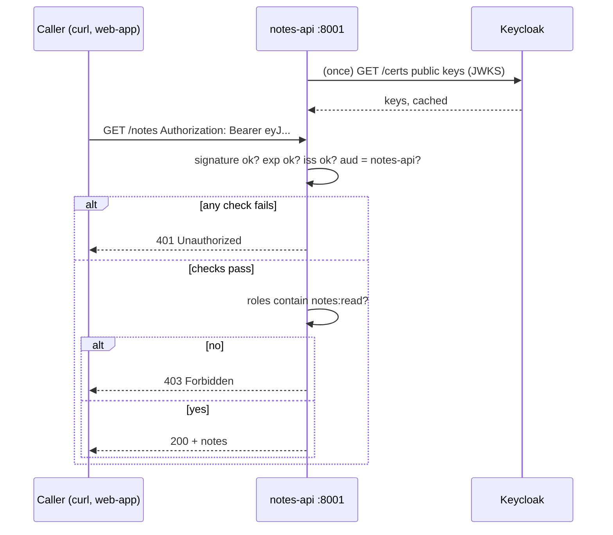

# Module 08: Protect a Python API with Keycloak tokens

**You'll learn:** how to build `notes-api` in FastAPI so that it accepts only real, fresh tokens that were made for it, and how to use client roles (`notes:read`, `notes:write`) to decide what each caller may do.

**Before this:** [Module 07](07-oauth-flows.md)

**Starting state:** the Level 1 end state (realm `learning`, users `alice`/`bob`, clients `learning-cli`, `web-app`, `notes-api` with roles `notes:read`/`notes:write`; see [`../catch-up.md`](../catch-up.md)), plus client `report-worker` from Module 07 (step 7).

---

## The idea in simple words

An API is like a **club with a bouncer**. Guests show a wristband (the access token). A good bouncer checks four things:

1. **Is the wristband real?** Not drawn with a marker. → the **signature**
2. **Is it from tonight?** Not last week's. → **`exp`** (expiry time)
3. **Is it from our ticket office?** Not from the club next door. → **`iss`** (issuer)
4. **Is it for this club?** A wristband for the cinema doesn't get you in. → **`aud`** (audience)

Then, inside, the bouncer looks at the **colour** of the wristband: green may look around (`notes:read`), gold may also write on the wall (`notes:write`). → **roles**

The important part: the bouncer **never phones the ticket office**. Keycloak signs each token with its **private key**; your API checks the signature with Keycloak's **public key**, which it downloads once. So checking a token is fast and works even if Keycloak is busy.



### Jargon table

| Word | Plain meaning | Example |
|---|---|---|
| **Resource server** | OAuth's name for an API that receives tokens | `notes-api` |
| **Bearer token** | "Whoever holds this token may use it", like cash. Sent in a header | `Authorization: Bearer eyJ...` |
| **JWKS** | JSON Web Key Set: Keycloak's list of public keys | `/protocol/openid-connect/certs` |
| **`kid`** | Key ID in the token header; says which key from the JWKS signed it | `sfp7MNeRYDbjZMLLR6sIND...` |
| **RS256** | The signing method Keycloak uses by default: RSA + SHA-256 | `"alg": "RS256"` |
| **`aud`** | Audience: who the token is for | `["notes-api", "account"]` |
| **`sub`** | Subject: the user's permanent ID (never changes, unlike username) | `5aa6155e-d489-...` |
| **Client role** | A role that belongs to one client, stored under `resource_access` | `notes-api` → `notes:read` |
| **401 Unauthorized** | "I don't know who you are" (no token or bad token) | missing header |
| **403 Forbidden** | "I know who you are, but you may not do this" | bob tries to write |
| **Client scope** | A reusable bundle of claims you can attach to clients (Module 11 goes deep) | `notes-api-audience` |
| **Audience mapper** | A rule that adds a name to `aud` | adds `notes-api` |

---

## Hands-on

Terminal setup as in [Module 07](07-oauth-flows.md#hands-on) (`kcadm` alias, logged in, and the `jwt_payload` helper).

### Step 1. Look at what's in a token today

**Why:** before writing code, see what the API will receive. Get a token for Bob with the lab client:

```bash
TOKEN=$(curl -s http://localhost:8180/realms/learning/protocol/openid-connect/token \
  -d grant_type=password -d client_id=learning-cli -d username=bob -d password=bob123 \
  | jq -r .access_token)
jwt_payload $TOKEN | jq '{aud, azp, resource_access}'
```

```
{
  "aud": [
    "account",
    "notes-api"
  ],
  "azp": "learning-cli",
  "resource_access": {
    "account": {
      "roles": [
        "manage-account",
        "manage-account-links",
        "view-profile"
      ]
    },
    "notes-api": {
      "roles": [
        "notes:read"
      ]
    }
  }
}
```

Two things to notice:

- Bob's client roles for `notes-api` are under `resource_access.notes-api.roles`. That's what our API will read.
- `notes-api` is **already** in `aud`. Why? The built-in `roles` client scope contains a mapper called **audience resolve**: it adds a client to `aud` **whenever the token carries that client's roles**. Bob has `notes:read`, so `notes-api` sneaks in.

### Step 2. Make the audience explicit

**Why the audience matters:** in your company, Keycloak serves many services. If `orders-api` accepted any token from the realm, then a token issued for, say, a harmless reporting tool could be replayed against `orders-api`. Each API must accept only tokens **meant for it**. That's the `aud` check.

**Why not rely on "audience resolve"?** It only works by accident: a user with no `notes-api` roles gets no `notes-api` audience (they'd get 401 "not for you" instead of a clean 403), and once you start trimming roles out of tokens (Module 11) the audience can vanish. An explicit **audience mapper** says on purpose: "tokens for these apps are meant for `notes-api`".

**Click path:** **Client scopes** → **Create client scope** → Name `notes-api-audience`, Type *None*, **Include in token scope** OFF → Save → **Mappers** tab → **Configure a new mapper** → **Audience** → Name `notes-api-audience`, **Included Client Audience** `notes-api`, **Add to access token** ON, **Add to ID token** OFF → Save. Then **Clients** → `learning-cli` → **Client scopes** tab → **Add client scope** → tick `notes-api-audience` → **Add** → *Default*. Repeat for `web-app`.

```bash
# 1. the client scope
kcadm create client-scopes -r learning -s name=notes-api-audience -s protocol=openid-connect \
  -s 'attributes."include.in.token.scope"=false' \
  -s 'attributes."display.on.consent.screen"=false'

# 2. find its id
SCOPE_ID=$(kcadm get client-scopes -r learning --fields id,name --format csv --noquotes \
  | grep ',notes-api-audience$' | cut -d, -f1)

# 3. the audience mapper inside it
kcadm create client-scopes/$SCOPE_ID/protocol-mappers/models -r learning \
  -s name=notes-api-audience -s protocol=openid-connect \
  -s protocolMapper=oidc-audience-mapper \
  -s 'config."included.client.audience"=notes-api' \
  -s 'config."access.token.claim"=true' \
  -s 'config."id.token.claim"=false' \
  -s 'config."introspection.token.claim"=true'

# 4. attach it as a DEFAULT scope to the two apps that call notes-api
for C in learning-cli web-app; do
  CID=$(kcadm get clients -r learning -q clientId=$C --fields id --format csv --noquotes)
  kcadm update clients/$CID/default-client-scopes/$SCOPE_ID -r learning
done

# 5. check
CID=$(kcadm get clients -r learning -q clientId=learning-cli --fields id --format csv --noquotes)
kcadm get clients/$CID/default-client-scopes -r learning --fields name
```

```
Created new client-scope with id '37a7350f-d5a1-4596-b5cb-97eb1a71b690'
Created new model with id '5613f412-f301-4caf-942e-3bfc5e728ca1'
[ {
  "name" : "web-origins"
}, {
  "name" : "acr"
}, {
  "name" : "notes-api-audience"
}, {
  "name" : "profile"
}, {
  "name" : "roles"
}, {
  "name" : "basic"
}, {
  "name" : "email"
} ]
```

Get a new token and look again:

```bash
TOKEN=$(curl -s http://localhost:8180/realms/learning/protocol/openid-connect/token \
  -d grant_type=password -d client_id=learning-cli -d username=bob -d password=bob123 \
  | jq -r .access_token)
jwt_payload $TOKEN | jq '{aud, azp, scope}'
```

```
{
  "aud": [
    "notes-api",
    "account"
  ],
  "azp": "learning-cli",
  "scope": "profile email"
}
```

`notes-api` is now there because of our mapper (first in the list), not by luck. "Include in token scope" OFF keeps the scope name out of the `scope` claim; it's plumbing, not something the user asked for.

### Step 3. Create the project

```bash
uv init notes-api
cd notes-api
uv add fastapi uvicorn httpx "pyjwt[crypto]" authlib itsdangerous
rm main.py
```

(`pyjwt[crypto]` pulls in the `cryptography` package, which RS256 needs. `authlib` and `itsdangerous` are for Module 09; installing the same set everywhere keeps things simple.)

### Step 4. Write the security code: `auth.py`

This file does the bouncer's job. Type it in full:

```python
# PyJWT: the library that checks and decodes JWTs
import jwt
# Depends chains FastAPI dependencies; Header reads one HTTP header
from fastapi import Depends, Header, HTTPException

# The realm that issues our tokens. Must equal the token's "iss" claim exactly
ISSUER = "http://localhost:8180/realms/learning"
# The address where Keycloak publishes its public signing keys (the JWKS)
JWKS_URL = ISSUER + "/protocol/openid-connect/certs"
# Our own name. A token must have "notes-api" in "aud", or it was not meant for us
AUDIENCE = "notes-api"
# The client whose roles we care about inside "resource_access"
CLIENT_ID = "notes-api"

# Downloads Keycloak's public keys the first time they are needed, then caches them
jwks_client = jwt.PyJWKClient(JWKS_URL)


def unauthorized(reason):
    # 401 = "I don't know who you are". The header tells the caller to send a Bearer token
    return HTTPException(status_code=401, detail=reason, headers={"WWW-Authenticate": "Bearer"})


def read_bearer_token(authorization):
    # No Authorization header at all: the caller did not even try
    if authorization is None:
        raise unauthorized("missing Authorization header")
    # The header should look like: "Bearer eyJhbGciOi..."
    parts = authorization.split(" ")
    # Exactly two pieces, and the first one must be the word "Bearer"
    if len(parts) != 2 or parts[0].lower() != "bearer":
        raise unauthorized("Authorization header must be: Bearer <token>")
    # The second piece is the token itself
    return parts[1]


def verify_token(token):
    try:
        # Read the "kid" (key id) from the token header and pick the matching public key
        signing_key = jwks_client.get_signing_key_from_jwt(token)
        # Check signature, expiry, issuer and audience in one call. Only allow RS256
        claims = jwt.decode(
            token,
            signing_key.key,
            algorithms=["RS256"],
            audience=AUDIENCE,
            issuer=ISSUER,
            options={"require": ["exp", "iat", "iss", "aud", "sub"]},
        )
    # The token was real but its time is up
    except jwt.ExpiredSignatureError:
        raise unauthorized("token expired")
    # The token was made for some other API
    except jwt.InvalidAudienceError:
        raise unauthorized("token is not meant for notes-api (wrong aud)")
    # Anything else: bad signature, garbage, wrong issuer, missing claim...
    except jwt.PyJWTError as error:
        raise unauthorized("invalid token: " + str(error))
    # Everything checked out
    return claims


def read_client_roles(claims):
    # Keycloak puts client roles under resource_access -> <client id> -> roles
    resource_access = claims.get("resource_access", {})
    # Pick only our own client's part. Missing means "no roles for notes-api"
    our_part = resource_access.get(CLIENT_ID, {})
    # The list of role names, for example ["notes:read", "notes:write"]
    roles = our_part.get("roles", [])
    return roles


def get_current_user(authorization: str | None = Header(default=None)):
    # Step 1: pull the token out of the header
    token = read_bearer_token(authorization)
    # Step 2: prove the token is genuine, fresh and meant for us
    claims = verify_token(token)
    # Step 3: collect what our API needs about the caller
    user = {}
    # "sub" is the user's permanent id. Usernames can change; sub does not
    user["sub"] = claims["sub"]
    # A friendly name, only for showing
    user["username"] = claims.get("preferred_username", "")
    # Our client roles
    user["roles"] = read_client_roles(claims)
    return user


def require_role(role_name):
    # This builds a dependency that demands one role
    def check_role(user: dict = Depends(get_current_user)):
        # 403 = "I know who you are, but you are not allowed"
        if role_name not in user["roles"]:
            raise HTTPException(status_code=403, detail="missing role " + role_name)
        return user

    # FastAPI will call check_role for every request to the route
    return check_role
```

What each piece guards against:

| Line | Stops |
|---|---|
| `algorithms=["RS256"]` | The "alg confusion" attack: a token claiming `alg: none` or `HS256`. **Always** pass an explicit list |
| `get_signing_key_from_jwt` | Tokens signed by anyone other than this realm (a token from the `master` realm has a `kid` we don't know) |
| `exp` (checked automatically) | Old, stolen tokens |
| `issuer=ISSUER` | Tokens from another Keycloak or realm |
| `audience=AUDIENCE` | Tokens meant for another API |
| `options={"require": [...]}` | Tokens that simply leave a claim out |

`PyJWKClient` caches the keys. When Keycloak rotates keys, a token arrives with an unknown `kid`, and PyJWT fetches the JWKS again.

### Step 5. Write the routes: `main.py`

```python
# FastAPI builds the web API; Depends plugs our security checks into routes
from fastapi import Depends, FastAPI
# BaseModel describes the JSON body we expect
from pydantic import BaseModel

# Our security code from auth.py
from auth import require_role

# The web application object that uvicorn runs
app = FastAPI(title="notes-api")

# All notes, kept in memory: { user sub: [note text, ...] }. Lost on restart
notes_by_user = {}


# The JSON body for a new note: {"text": "..."}
class NewNote(BaseModel):
    text: str


# Anyone with the notes:read role may list their own notes
@app.get("/notes")
def list_notes(user: dict = Depends(require_role("notes:read"))):
    # Find this user's list; an unknown user simply has no notes yet
    my_notes = notes_by_user.get(user["sub"], [])
    # Send back who we think the caller is, plus their notes
    return {"user": user["username"], "notes": my_notes}


# Only callers with notes:write may add a note
@app.post("/notes")
def add_note(new_note: NewNote, user: dict = Depends(require_role("notes:write"))):
    # Make sure this user has a list to add to
    if user["sub"] not in notes_by_user:
        notes_by_user[user["sub"]] = []
    # Store the note under the user's permanent id
    notes_by_user[user["sub"]].append(new_note.text)
    # Confirm what was saved
    return {"user": user["username"], "saved": new_note.text, "count": len(notes_by_user[user["sub"]])}
```

Notes are stored per `sub`, so each user sees only their own notes. That is **data-level** authorization done by your code; roles only decide *which actions* are allowed.

### Step 6. Run it

```bash
uv run uvicorn main:app --port 8001
```

```
INFO:     Started server process [97655]
INFO:     Waiting for application startup.
INFO:     Application startup complete.
INFO:     Uvicorn running on http://127.0.0.1:8001 (Press CTRL+C to quit)
```

Leave it running. Use a second terminal for the tests.

### Step 7. Prove every check works

A small helper to get user tokens (lab only, password grant):

```bash
get_token() {
  curl -s http://localhost:8180/realms/learning/protocol/openid-connect/token \
    -d grant_type=password -d client_id=learning-cli -d username=$1 -d password=$2 \
    | jq -r .access_token
}
BOB=$(get_token bob bob123)
ALICE=$(get_token alice alice123)
```

**No token → 401**

```bash
curl -s -i http://localhost:8001/notes
```

```
HTTP/1.1 401 Unauthorized
www-authenticate: Bearer
{"detail":"missing Authorization header"}
```

(Output trimmed to the status line, the auth header and the body.)

**Garbage token → 401**

```bash
curl -s -w '\n%{http_code}\n' http://localhost:8001/notes -H 'Authorization: Bearer hello'
```

```
{"detail":"invalid token: Not enough segments"}
401
```

**Tampered token → 401** (change the last 5 characters of the signature):

```bash
curl -s -w '\n%{http_code}\n' http://localhost:8001/notes -H "Authorization: Bearer ${BOB%?????}AAAAA"
```

```
{"detail":"invalid token: Signature verification failed"}
401
```

**Wrong audience → 401.** `report-worker`'s token (Module 07) is not for `notes-api`:

```bash
RW=$(curl -s http://localhost:8180/realms/learning/protocol/openid-connect/token \
  -d grant_type=client_credentials -d client_id=report-worker -d client_secret=report-worker-secret \
  | jq -r .access_token)
jwt_payload $RW | jq -c '{aud}'
curl -s -w '\n%{http_code}\n' http://localhost:8001/notes -H "Authorization: Bearer $RW"
```

```
{"aud":"account"}
{"detail":"token is not meant for notes-api (wrong aud)"}
401
```

**Token from another realm → 401** (the `master` realm's admin token):

```bash
MT=$(curl -s http://localhost:8180/realms/master/protocol/openid-connect/token \
  -d grant_type=password -d client_id=admin-cli -d username=admin -d password=admin | jq -r .access_token)
curl -s -w '\n%{http_code}\n' http://localhost:8001/notes -H "Authorization: Bearer $MT"
```

```
{"detail":"invalid token: Unable to find a signing key that matches: \"hbukSzMUtRNbBH4uKFONTUrMW2fVSOFOpg_N4DbuNEE\""}
401
```

**Expired token → 401.** Save a token, wait more than 5 minutes, use it:

```bash
get_token bob bob123 > old_token.txt
# ... wait 5+ minutes ...
curl -s -w '\n%{http_code}\n' http://localhost:8001/notes -H "Authorization: Bearer $(cat old_token.txt)"
```

Before expiry it worked (`{"user":"bob","notes":[]}` / `200`). After:

```
{"detail":"token expired"}
401
```

**Bob writes → 403** (he only has `notes:read`):

```bash
curl -s -w '\n%{http_code}\n' -X POST http://localhost:8001/notes \
  -H "Authorization: Bearer $BOB" -H 'Content-Type: application/json' -d '{"text":"bob was here"}'
```

```
{"detail":"missing role notes:write"}
403
```

**Bob reads → 200**

```bash
curl -s -w '\n%{http_code}\n' http://localhost:8001/notes -H "Authorization: Bearer $BOB"
```

```
{"user":"bob","notes":[]}
200
```

**Alice writes → 200, then reads her notes**

```bash
curl -s -w '\n%{http_code}\n' -X POST http://localhost:8001/notes \
  -H "Authorization: Bearer $ALICE" -H 'Content-Type: application/json' -d '{"text":"buy milk"}'
curl -s -w '\n%{http_code}\n' -X POST http://localhost:8001/notes \
  -H "Authorization: Bearer $ALICE" -H 'Content-Type: application/json' -d '{"text":"learn keycloak"}'
curl -s -w '\n%{http_code}\n' http://localhost:8001/notes -H "Authorization: Bearer $ALICE"
```

```
{"user":"alice","saved":"buy milk","count":1}
200
{"user":"alice","saved":"learn keycloak","count":2}
200
{"user":"alice","notes":["buy milk","learn keycloak"]}
200
```

Bob still sees an empty list: notes are per `sub`.

```
{"user":"bob","notes":[]}
200
```

**Keep `notes-api` running**: Modules 09 and 10 call it. (It keeps notes in memory, so a restart empties them.)

### The same in other languages

Your company's services in Java, Go or Node do **exactly the same five checks**; only the library changes (Spring Security `oauth2ResourceServer().jwt()` with `issuer-uri`, Go `coreos/go-oidc`, Node `jose`). Give each service its issuer URL and its audience name, and read roles from `resource_access.<client>.roles`.

---

## The one trap

**Decoding without verifying.** `jwt.decode(token, options={"verify_signature": False})` and `jwt_payload` in the shell happily show you the claims of *any* token, including one an attacker typed by hand. Reading claims is fine for debugging; for decisions, always verify signature + `exp` + `iss` + `aud` with an explicit `algorithms=["RS256"]`. The second half of the trap: turning the audience check off (`options={"verify_aud": False}`) "because it got in the way". Your API then accepts tokens meant for every other service in the company. PyJWT is strict by default (see Try this 1); libraries in other languages often are not, so check that your services set an audience.

---

## Check yourself

1. What is the difference between 401 and 403? Give one example of each from this module.
2. Why does the API not need to call Keycloak on every request?
3. Bob's token already had `notes-api` in `aud` before step 2. Why, and why did we add a mapper anyway?
4. Where in the token are `notes-api`'s client roles?
5. Why store notes by `sub` and not by `preferred_username`?

<details>
<summary>Answers</summary>

1. 401: we can't trust who you are (no token, garbage, expired, wrong audience). 403: the token is fine but you lack the role (Bob POSTing without `notes:write`).
2. It verifies the signature with Keycloak's public key, which `PyJWKClient` downloaded once and caches.
3. The `audience resolve` mapper in the built-in `roles` scope adds any client whose roles are in the token. That depends on the user having roles and on which roles end up in the token, so we made it explicit and deliberate.
4. `resource_access` → `notes-api` → `roles`.
5. `sub` never changes; a username can be renamed (and in some setups reused by another person).

</details>

---

## Try this

1. Remove `audience=AUDIENCE` from `jwt.decode` and restart. Now even Alice's good token gets `401 token is not meant for notes-api (wrong aud)`: PyJWT refuses a token that has an `aud` claim when you didn't say which audience you expect. A safe default. Put the line back.
2. Change `ISSUER` to `http://127.0.0.1:8180/realms/learning` and restart. Tokens from `localhost:8180` now fail. Read the error: issuer strings must match exactly.
3. In the admin console add group `staff` to the `notes:write` role (Groups → staff → Role mapping). Get a **new** token for Bob and POST again. Then try the **old** token: roles inside a token never change until it is re-issued.
