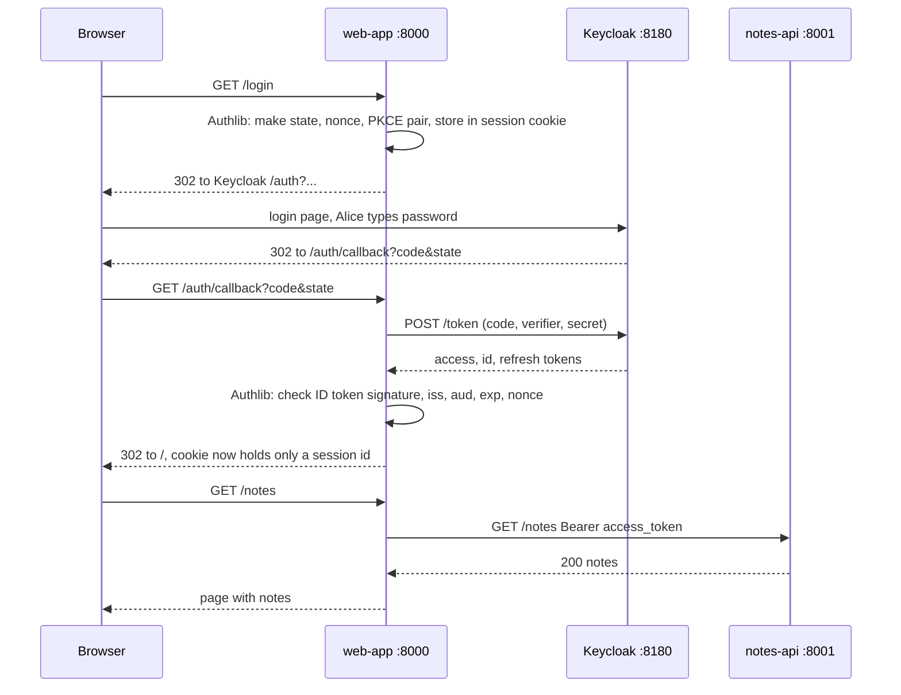

# Module 09: Log users into a Python web app

**You'll learn:** how to build `web-app` in FastAPI with Authlib so that users log in through Keycloak, see their name, call `notes-api` with their token, and log out properly. Then you'll see Single Sign-On between two apps.

**Before this:** [Module 08](08-protect-a-python-api.md)

**Starting state:** the Level 1 end state ([`../catch-up.md`](../catch-up.md)), plus the `notes-api-audience` client scope from Module 08 (attached to `web-app`), and `notes-api` **running on port 8001**.

---

## The idea in simple words

In Module 07 you did the login dance by hand: make a PKCE pair, build a URL, copy a code, swap it, check the nonce. A real web app does exactly that **for every user**, every time. Nobody writes it by hand; a library does it. For Python that library is **Authlib**.

Think of Authlib as a **travel agent**: you say "log this person in", and it books the flights (redirects), keeps the tickets (state, nonce, PKCE verifier) in the user's session, checks the boarding passes when they come back (state, ID token signature, nonce), and hands you the result: a dictionary of tokens and the user's details.

Your app keeps a small **session** per browser so it remembers "this browser belongs to Alice" between page loads. That's a cookie.



### Jargon table

| Word | Plain meaning | Example |
|---|---|---|
| **Authlib** | Python library that speaks OAuth and OIDC for you | `oauth.keycloak.authorize_redirect(...)` |
| **Relying Party (RP)** | OIDC's name for an app that lets Keycloak log users in | `web-app` |
| **Session** | Memory the server keeps per browser | "this browser is Alice" |
| **Session cookie** | The small cookie that links a browser to its session | `web_app_session` |
| **`SessionMiddleware`** | Starlette's session: stores the session data in a **signed** cookie | needs `itsdangerous` |
| **Signed (not encrypted)** | Nobody can *change* it without the key, but anyone holding it can *read* it | base64 you can decode |
| **Discovery / metadata URL** | The `.well-known/openid-configuration` document; Authlib reads all endpoints from it | `server_metadata_url=...` |
| **`userinfo`** | In Authlib's result: the checked claims of the ID token | `{"name": "Alice Smith", ...}` |
| **RP-initiated logout** | The app sends the browser to Keycloak's logout endpoint to end the Keycloak session too | `/protocol/openid-connect/logout?id_token_hint=...` |
| **`id_token_hint`** | The ID token you got at login, sent at logout so Keycloak knows whose session to end, without asking | `eyJ...` |
| **`post_logout_redirect_uri`** | Where Keycloak sends the browser after logout. Must be registered | `http://localhost:8000/` |
| **SSO (Single Sign-On)** | Log in once, and every app in the realm lets you in | web-app then other-app |

---

## Hands-on

`notes-api` from Module 08 must be running on port 8001 in one terminal. Use a new terminal for this module.

### Step 1. Check the client settings

**Why:** the code below must match what Keycloak has registered: client id, secret, redirect URI, post-logout redirect URI, PKCE.

**Click path:** Clients → `web-app` → **Settings** (Valid redirect URIs, Valid post logout redirect URIs, Web origins) and **Advanced** → *Proof Key for Code Exchange Code Challenge Method*.

```bash
kcadm get clients -r learning -q clientId=web-app \
  --fields 'clientId,publicClient,standardFlowEnabled,directAccessGrantsEnabled,redirectUris,webOrigins,attributes(post.logout.redirect.uris,pkce.code.challenge.method)'
```

```
[ {
  "clientId" : "web-app",
  "redirectUris" : [ "http://localhost:8000/auth/callback" ],
  "webOrigins" : [ "http://localhost:8000" ],
  "standardFlowEnabled" : true,
  "directAccessGrantsEnabled" : false,
  "publicClient" : false,
  "attributes" : {
    "post.logout.redirect.uris" : "http://localhost:8000/",
    "pkce.code.challenge.method" : "S256"
  }
} ]
```

### Step 2. Create the project

```bash
uv init web-app
cd web-app
uv add fastapi uvicorn httpx "pyjwt[crypto]" authlib itsdangerous
rm main.py
```

### Step 3. Write `main.py`

One file. Type it in full:

```python
# secrets makes random ids; time tells us when tokens expire
import secrets
import time

# httpx calls the notes-api for us
import httpx
# Authlib's ready-made OAuth/OIDC client for Starlette and FastAPI
from authlib.integrations.starlette_client import OAuth, OAuthError
# FastAPI pieces: the app, the incoming request, and two kinds of answers
from fastapi import FastAPI, Request
from fastapi.responses import HTMLResponse, RedirectResponse
# Keeps a small signed cookie per browser (needs the itsdangerous package)
from starlette.middleware.sessions import SessionMiddleware

# ---- Settings (change these four for a second app) ----
# Our client in Keycloak, and its secret from the Credentials tab
CLIENT_ID = "web-app"
CLIENT_SECRET = "web-app-secret"
# Where this app runs; Keycloak must know BASE_URL + /auth/callback
BASE_URL = "http://localhost:8000"
# Cookie name. Browsers ignore ports, so two apps on localhost need different names
SESSION_COOKIE = "web_app_session"

# The realm, and the API we call
ISSUER = "http://localhost:8180/realms/learning"
NOTES_API_URL = "http://localhost:8001/notes"
# Signs the session cookie so nobody can edit it. Use a long random value in real life
COOKIE_SIGNING_KEY = "change-me-to-a-long-random-string"

# The web app
app = FastAPI(title=CLIENT_ID)
# Every request gets request.session, stored in a signed cookie
app.add_middleware(SessionMiddleware, secret_key=COOKIE_SIGNING_KEY, session_cookie=SESSION_COOKIE)

# Tokens stay on the server, never in the cookie: { session id: token dict }
token_store = {}

# One OAuth registry for the whole app
oauth = OAuth()
# Register Keycloak. Authlib reads all endpoints from the discovery document
oauth.register(
    name="keycloak",
    client_id=CLIENT_ID,
    client_secret=CLIENT_SECRET,
    server_metadata_url=ISSUER + "/.well-known/openid-configuration",
    client_kwargs={"scope": "openid profile email", "code_challenge_method": "S256"},
)


def get_tokens(request):
    # The cookie only holds a random session id
    session_id = request.session.get("sid")
    # Not logged in: no id, or the server forgot it (restart)
    if session_id is None:
        return None
    # Look the tokens up on the server side
    return token_store.get(session_id)


@app.get("/", response_class=HTMLResponse)
async def home(request: Request):
    # Who is logged in? None means nobody
    tokens = get_tokens(request)
    if tokens is None:
        return "<h1>" + CLIENT_ID + "</h1><p>Not logged in.</p><a href='/login'>Log in</a>"
    # "userinfo" holds the checked claims from the ID token
    user = tokens["userinfo"]
    # Build a tiny page
    page = "<h1>" + CLIENT_ID + "</h1>"
    page = page + "<p>Hello " + user["name"] + " (" + user["preferred_username"] + ")</p>"
    page = page + "<p>Email: " + user["email"] + "</p>"
    page = page + "<a href='/notes'>My notes</a> | <a href='/logout'>Log out</a>"
    return page


@app.get("/login")
async def login(request: Request):
    # Where Keycloak sends the browser back. Must be registered on the client
    redirect_uri = BASE_URL + "/auth/callback"
    # Authlib makes state, nonce and the PKCE pair, saves them in the session, redirects
    return await oauth.keycloak.authorize_redirect(request, redirect_uri)


@app.get("/auth/callback")
async def auth_callback(request: Request):
    try:
        # Authlib checks state, swaps code + verifier + secret, validates the ID token and nonce
        tokens = await oauth.keycloak.authorize_access_token(request)
    except OAuthError as error:
        # For example: wrong state, user pressed cancel, code expired
        return HTMLResponse("<p>Login failed: " + str(error) + "</p>", status_code=400)
    # Remember when the access token dies (Authlib adds expires_at)
    print("login ok for", tokens["userinfo"]["preferred_username"], "token expires_at", tokens["expires_at"])
    # A fresh random id for this browser
    session_id = secrets.token_urlsafe(32)
    # Keep the tokens on the server, and only the id in the cookie
    token_store[session_id] = tokens
    request.session["sid"] = session_id
    # Back to the home page
    return RedirectResponse("/")


async def get_fresh_access_token(request):
    # Find the tokens for this browser
    tokens = get_tokens(request)
    if tokens is None:
        return None
    # Still valid for at least 30 more seconds? Use it as it is
    if tokens["expires_at"] - 30 > time.time():
        return tokens["access_token"]
    # Otherwise trade the refresh token for new tokens. This fails if the session is over
    print("access token almost expired, refreshing")
    try:
        new_tokens = await oauth.keycloak.fetch_access_token(
            grant_type="refresh_token", refresh_token=tokens["refresh_token"]
        )
    except OAuthError as error:
        # Keycloak said no: the SSO session ended (logout, timeout, admin). Forget this login
        print("refresh failed:", error)
        del token_store[request.session["sid"]]
        request.session.clear()
        return None
    # A refresh does not return userinfo, so keep the old one
    new_tokens["userinfo"] = tokens["userinfo"]
    # Save the new tokens under the same session id
    token_store[request.session["sid"]] = new_tokens
    return new_tokens["access_token"]


@app.get("/notes", response_class=HTMLResponse)
async def notes_page(request: Request):
    # We need a valid access token to call the API
    access_token = await get_fresh_access_token(request)
    if access_token is None:
        return RedirectResponse("/login")
    # Send it as a Bearer token, exactly like curl did
    headers = {"Authorization": "Bearer " + access_token}
    async with httpx.AsyncClient() as client:
        response = await client.get(NOTES_API_URL, headers=headers)
    # Show the API's answer, whatever it is
    page = "<h1>My notes</h1>"
    page = page + "<p>notes-api answered " + str(response.status_code) + "</p>"
    page = page + "<pre>" + response.text + "</pre><a href='/'>Home</a>"
    return page


@app.get("/logout")
async def logout(request: Request):
    # Find this browser's tokens before we forget them
    tokens = get_tokens(request)
    # Not logged in? Nothing to do
    if tokens is None:
        return RedirectResponse("/")
    # Forget the tokens on our side: server store first, then the cookie
    del token_store[request.session["sid"]]
    request.session.clear()
    # Ask Keycloak to end the SSO session too (RP-initiated logout)
    return await oauth.keycloak.logout_redirect(
        request,
        post_logout_redirect_uri=BASE_URL + "/",
        id_token_hint=tokens["id_token"],
    )
```

### What Authlib does for you

| You call | Authlib does |
|---|---|
| `oauth.register(..., server_metadata_url=...)` | Downloads the discovery document once: auth, token, JWKS, end-session endpoints |
| `authorize_redirect(request, redirect_uri)` | Makes a random **state**, a random **nonce**, a **PKCE** verifier + S256 challenge; saves them in `request.session`; returns a 302 to Keycloak |
| `authorize_access_token(request)` | Reads `code` and `state`; checks **state** matches the saved one; POSTs code + verifier + client secret to the token endpoint; downloads the JWKS and **validates the ID token** (signature, `iss`, `aud` = our client, `exp`, and **nonce**); returns the tokens with `userinfo` and `expires_at` added |
| `fetch_access_token(grant_type="refresh_token", ...)` | A refresh token request with our client credentials |
| `logout_redirect(request, post_logout_redirect_uri, id_token_hint)` | Builds the end-session URL (with its own `state`) and returns a 302 |

What it does **not** do: decide what your pages show, or protect your routes. That's your code.

**Why tokens are not in the cookie:** Starlette's `SessionMiddleware` keeps the session *inside* the cookie, **signed but not encrypted**. Anyone with the cookie can read it. We store the tokens in a server-side dictionary (`token_store`) and put only a random id in the cookie. (A real app would use Redis or a database instead of a dict, so sessions survive restarts and work with several app instances.)

### Step 4. Run it

```bash
uv run uvicorn main:app --port 8000
```

```
/.../web-app/.venv/lib/python3.12/site-packages/authlib/integrations/httpx_client/assertion_client.py:5: AuthlibDeprecationWarning: The httpx module is deprecated; please use httpx2 instead.
  from ._compat import httpx2
INFO:     Started server process [97838]
INFO:     Waiting for application startup.
INFO:     Application startup complete.
INFO:     Uvicorn running on http://127.0.0.1:8000 (Press CTRL+C to quit)
```

The `AuthlibDeprecationWarning` is harmless: Authlib 1.8 prefers a package called `httpx2` and falls back to `httpx`. `uv add httpx2` makes the warning go away (verified); the app works either way.

### Step 5. Log in with your browser

Open **http://localhost:8000** in a private window:

1. The page says *Not logged in.* Click **Log in**.
2. You land on Keycloak's **Sign in to learning** page (port 8180). Log in as `alice` / `alice123`.
3. You're back on port 8000: **Hello Alice Smith (alice)**, *Email: alice@example.com*.
4. Click **My notes**: *notes-api answered 200* and Alice's notes from Module 08 (empty list if you restarted `notes-api`).

### Step 6. What happened under the hood (seen with curl)

**Why:** seeing each hop once makes debugging easy later. This replays the browser with `curl` and a cookie jar (`-b`/`-c`), exactly what was run to verify this module.

**`/login` answers with a redirect to Keycloak**, carrying state, nonce and the PKCE challenge Authlib just made:

```bash
rm -f jar.txt
curl -s -i -b jar.txt -c jar.txt http://localhost:8000/login | grep -iE '^HTTP|^location|^set-cookie'
```

```
HTTP/1.1 302 Found
location: http://localhost:8180/realms/learning/protocol/openid-connect/auth?response_type=code&client_id=web-app&redirect_uri=http%3A%2F%2Flocalhost%3A8000%2Fauth%2Fcallback&scope=openid+profile+email&state=HpNtfrtsisRea2yAtbpBJI1ujg4SwS&nonce=pBSsnL6k16IuufWZWZV1&code_challenge=ARXeHcRZg2nevLO89m1wG_5liD3QexC58HwZ7Rl8UGQ&code_challenge_method=S256
set-cookie: web_app_session=eyJfc3RhdGVfa2V5Y2xvYWtfSHBOdGZydHNp...(shortened)
```

Decode the first part of that cookie (it's just base64) and you see what Authlib saved for the callback, **including the PKCE verifier**:

```
{"_state_keycloak_HpNtfrtsisRea2yAtbpBJI1ujg4SwS": {"data": {"redirect_uri": "http://localhost:8000/auth/callback", "code_verifier": "KeFaRBPjuy16YTgQT2xPCncsCL82P50Gx5Y5QU5l7ak6GZt4", "nonce": "pBSsnL6k16IuufWZWZV1", "url": "http://localhost:8180/realms/learning/protocol/openid...
```

That's fine for a few seconds during login (it's the user's own browser), and it proves the point: **signed is not secret**.

**After the login form, Keycloak sends the browser to our callback:**

```
http://localhost:8000/auth/callback?state=UAwvNMqqp5VP0bi8TZVV17hmK6VtCT&session_state=ofIr67Wjs3B6PrHjn47VY31O&iss=http%3A%2F%2Flocalhost%3A8180%2Frealms%2Flearning&code=dae8d630-5853-a02e-d4e6-e5c2434226c5.ofIr67Wjs3B6PrHjn47VY31O.6bc41ad6-706b-4006-b245-5f8dc69618fe
```

**The callback swaps the code and replaces the cookie** with one that holds only our session id:

```
HTTP/1.1 307 Temporary Redirect
location: /
set-cookie: web_app_session=eyJzaWQiOiAianlYbmgyWkdNM05ZR0k2c205WDVhaUlDb2xtYm44MkNYQ1FNWXBFcWFwOCJ9.asU6hQ.8J4_HaHfXfvuUKt5gKjBmYhEX7g; path=/; Max-Age=1209600; httponly; samesite=lax
```

```bash
echo 'eyJzaWQiOiAianlYbmgyWkdNM05ZR0k2c205WDVhaUlDb2xtYm44MkNYQ1FNWXBFcWFwOCJ9' | base64 -d
```

```
{"sid": "jyXnh2ZGM3NYGI6sm9X5aiIColmbn82CXCQMYpEqap8"}
```

The part after the first dot is a timestamp and the part after the second dot is the **signature** (made with `COOKIE_SIGNING_KEY`). Note `httponly` (JavaScript can't read it) and `samesite=lax` (other sites can't silently send it on POSTs).

**The pages:**

```bash
curl -s -b jar.txt http://localhost:8000/
curl -s -b jar.txt http://localhost:8000/notes
```

```
<h1>web-app</h1><p>Hello Alice Smith (alice)</p><p>Email: alice@example.com</p><a href='/notes'>My notes</a> | <a href='/logout'>Log out</a>
<h1>My notes</h1><p>notes-api answered 200</p><pre>{"user":"alice","notes":["buy milk","learn keycloak"]}</pre><a href='/'>Home</a>
```

`notes-api` accepted the token because it carries `aud: notes-api` (thanks to the `notes-api-audience` scope on `web-app`) and Alice's `notes:read` role.

**The app's own log** (the `print` lines are ours):

```
INFO:     127.0.0.1:56339 - "GET /login HTTP/1.1" 302 Found
login ok for alice token expires_at 1791310769
INFO:     127.0.0.1:56343 - "GET /auth/callback?state=UAwvNMqqp5VP0bi8TZVV17hmK6VtCT&session_state=ofIr67Wjs3B6PrHjn47VY31O&iss=http%3A%2F%2Flocalhost%3A8180%2Frealms%2Flearning&code=dae8d630-5853-a02e-d4e6-e5c2434226c5.ofIr67Wjs3B6PrHjn47VY31O.6bc41ad6-706b-4006-b245-5f8dc69618fe HTTP/1.1" 307 Temporary Redirect
INFO:     127.0.0.1:56347 - "GET / HTTP/1.1" 200 OK
INFO:     127.0.0.1:56349 - "GET /notes HTTP/1.1" 200 OK
```

**Automatic refresh.** Wait about 5 minutes and open **My notes** again. The access token is nearly dead, so `get_fresh_access_token` uses the refresh token first:

```
access token almost expired, refreshing
INFO:     127.0.0.1:56653 - "GET /notes HTTP/1.1" 200 OK
```

### Step 7. Log out (properly)

Click **Log out**. `/logout` deletes our tokens and session, then sends the browser to Keycloak:

```
HTTP/1.1 302 Found
location: http://localhost:8180/realms/learning/protocol/openid-connect/logout?id_token_hint=eyJ...(shortened)&post_logout_redirect_uri=http%3A%2F%2Flocalhost%3A8000%2F&state=onIi15mtARsvEhBTY6YK
```

Keycloak ends Alice's SSO session and, because `id_token_hint` proves who is asking and the `post_logout_redirect_uri` is registered, sends the browser straight back **without a confirmation page**:

```
HTTP/1.1 302 Found
Location: http://localhost:8000/?state=onIi15mtARsvEhBTY6YK
```

The home page says *Not logged in.* Click **Log in** again: Keycloak shows **Sign in to learning** and asks for the password. The Keycloak session is really gone.

> **Seen while verifying:** when only the *app's* session was cleared (the redirect to Keycloak was not followed), clicking **Log in** again logged Alice straight back in **without a password**. Keycloak's own session was still alive. That's the trap below.

### Step 8. SSO: a second app

**Why:** your company has many services. Users log in once; every app trusts the same Keycloak session.

Register a second client, `other-app`, on port 8002:

**Click path:** Clients → Create client → `other-app` → Client authentication ON, Standard flow only → Valid redirect URIs `http://localhost:8002/auth/callback`, Valid post logout redirect URIs `http://localhost:8002/`, Web origins `http://localhost:8002` → Save; Advanced → PKCE method S256; Credentials → note the secret.

```bash
kcadm create clients -r learning -s clientId=other-app -s publicClient=false \
  -s secret=other-app-secret -s standardFlowEnabled=true -s directAccessGrantsEnabled=false \
  -s 'redirectUris=["http://localhost:8002/auth/callback"]' \
  -s 'webOrigins=["http://localhost:8002"]' \
  -s 'attributes."post.logout.redirect.uris"=http://localhost:8002/' \
  -s 'attributes."pkce.code.challenge.method"=S256'
```

```
Created new client with id '124c5f4b-8530-4bc1-9fb2-86fe42f1634e'
```

Copy the app and change the four settings at the top:

```bash
cd ..
cp -r web-app other-app
rm -rf other-app/.venv
```

In `other-app/main.py`:

```python
# Our client in Keycloak, and its secret from the Credentials tab
CLIENT_ID = "other-app"
CLIENT_SECRET = "other-app-secret"
# Where this app runs; Keycloak must know BASE_URL + /auth/callback
BASE_URL = "http://localhost:8002"
# Cookie name. Browsers ignore ports, so two apps on localhost need different names
SESSION_COOKIE = "other_app_session"
```

```bash
cd other-app
uv run uvicorn main:app --port 8002
```

Now, in the **same** browser window where Alice is logged into `web-app`, open **http://localhost:8002** and click **Log in**. You **don't see a login page**: Keycloak recognises its own cookie and answers at once with a redirect carrying a code. Verified with curl:

```
== web-app login
Keycloak showed: <title>Sign in to learning
<h1>web-app</h1><p>Hello Alice Smith (alice)</p><p>Email: alice@example.com</p><a href='/notes'>My notes</a> | <a href='/logout'>Log out</a>
== other-app login
Keycloak answered with a redirect, no login page: http://localhost:8002/auth/callback?state=OLesmQIOy1MP1MgcSKqGaw8h7dNj4K&session_state=OleZWS4xMIXPwEkR9uFUvud3&iss=http%3A%2F%2Flocalhost%3A8180%2Frealms%2Flearning&code=495aeeca-f429-a76f-e3f1-21ed7b8d9583.OleZWS4xMIXPwEkR9uFUvud3.124c5f4b-8530-4bc1-9fb2-86fe42f1634e
<h1>other-app</h1><p>Hello Alice Smith (alice)</p><p>Email: alice@example.com</p><a href='/notes'>My notes</a> | <a href='/logout'>Log out</a>
```

The cookies in the jar afterwards (domain, path, name):

```
localhost / other_app_session
localhost /realms/learning/ KEYCLOAK_SESSION
localhost /realms/learning/ KEYCLOAK_IDENTITY
localhost / web_app_session
localhost /realms/learning/ AUTH_SESSION_ID
localhost /realms/learning/ KC_AUTH_SESSION_HASH
localhost /realms/learning/ KC_RESTART
```

`KEYCLOAK_IDENTITY` / `KEYCLOAK_SESSION` are Keycloak's SSO cookies (for path `/realms/learning/`). Each app has its **own** session cookie. If both apps used the cookie name `session`, they would overwrite each other, because cookies are shared across ports on the same host.

---

## The one trap

**"Logout" that only clears your app's cookie.** If `/logout` just does `request.session.clear()`, the user *looks* logged out, but Keycloak's SSO session is still alive. The next click on **Log in** signs them straight back in with no password (you saw this in step 7). On a shared computer that's a real hole. Always finish logout with the redirect to Keycloak's end-session endpoint, with `id_token_hint` and a registered `post_logout_redirect_uri`. ([Module 12](12-sessions-and-logout.md) covers logging out of *all* apps at once.)

---

## Check yourself

1. Name four things Authlib checks or creates for you during login.
2. Why do we keep tokens in `token_store` instead of in the session cookie?
3. What two parameters do we send to Keycloak's logout endpoint, and why each?
4. Why did `other-app` not show a login page?
5. Why must the two apps use different session cookie names on `localhost`?

<details>
<summary>Answers</summary>

1. Any four of: state (created and checked), nonce (created and checked in the ID token), PKCE verifier and challenge, the code exchange with the client secret, ID token signature / issuer / audience / expiry.
2. `SessionMiddleware` cookies are signed, not encrypted: anyone with the cookie could read the tokens. Also tokens are big and cookies are limited to about 4 KB.
3. `id_token_hint` tells Keycloak which session to end and proves the request comes from an app that had that session (so no confirmation page). `post_logout_redirect_uri` says where to send the browser afterwards; it must be registered on the client.
4. The browser still had Keycloak's SSO cookies (`KEYCLOAK_IDENTITY`), so Keycloak knew Alice was already logged in and issued a code straight away.
5. Browsers don't separate cookies by port. Same name = same cookie = the apps overwrite each other's sessions.

</details>

---

## Try this

1. Log in, then in the browser's developer tools change one character of the `web_app_session` cookie. Reload: you're logged out, because the signature no longer matches.
2. Remove `, "code_challenge_method": "S256"` from `client_kwargs`, restart and click **Log in**. Authlib no longer sends PKCE, Keycloak refuses (the client requires it), and your callback shows `Login failed: invalid_request: Missing parameter: code_challenge_method` with status 400. Put it back.
3. Log into both apps, then log out of `other-app` (follow it all the way to Keycloak). Reload `web-app`: you still see "Hello Alice", and **My notes** still works: its access token is valid for up to 5 more minutes. After that, **My notes** tries a refresh, Keycloak refuses because the SSO session is gone, and you are sent to `/login`. Verified log lines:
   ```
   access token almost expired, refreshing
   refresh failed: invalid_grant: Session not active
   INFO:     127.0.0.1:56958 - "GET /notes HTTP/1.1" 307 Temporary Redirect
   ```
   (Module 12 shows how back-channel logout tells `web-app` at once.)
