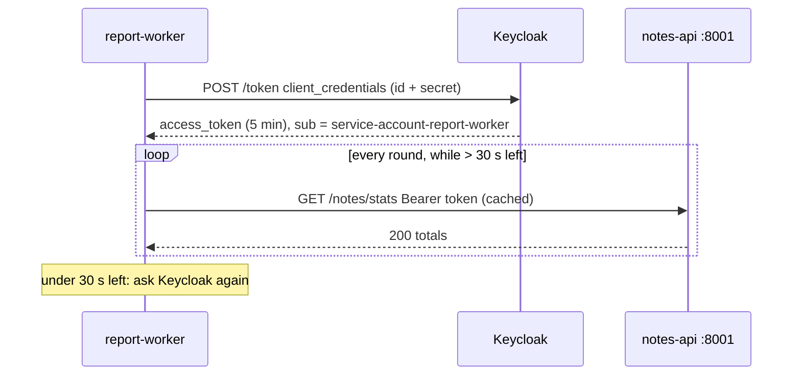

# Module 10: Service to service (machines calling machines)

**You'll learn:** how a backend job (`report-worker`) gets its own token with Client Credentials, caches it until shortly before it expires, and calls `notes-api`; how to give a robot just the roles it needs; and the difference between "acting as a user" and "acting as itself".

**Before this:** [Module 09](09-python-web-app-login.md)

**Starting state:** the Level 1 end state ([`../catch-up.md`](../catch-up.md)), client `report-worker` (Module 07, step 7), client scope `notes-api-audience` (Module 08, step 2), and `notes-api` from Module 08 **running on port 8001**.

---

## The idea in simple words

So far a **person** was always behind the token: Alice in the browser, Bob on his phone. But most traffic inside a company is **machines talking to machines**: a nightly report, a billing service asking the user service, a queue worker.

A machine can't type a password or press "Yes". So it gets its **own identity**: a client in Keycloak with a client secret, and a **service account** (a robot user) behind it. It shows its ID card (client id + secret) at the front desk and gets a badge in its own name.

Two rules make this safe and cheap:

1. **Least privilege.** The robot gets only the roles it needs (`notes:read`, never `notes:write`).
2. **Reuse the badge.** Don't ask Keycloak for a new token for every API call. Keep it and reuse it until it's about to expire.



### Jargon table

| Word | Plain meaning | Example |
|---|---|---|
| **Service account** | A robot user that every client with "Service accounts roles" ON gets automatically | `service-account-report-worker` |
| **Client Credentials grant** | "Give me a token for **myself**", proven with client id + secret | `grant_type=client_credentials` |
| **Machine context** | The token describes a program, not a person | `report-worker` asking for totals |
| **User context** | The token describes a person; an app passes it on for them | `web-app` calling `notes-api` for Alice |
| **`azp`** | "Authorized party": the client the token was issued to | `report-worker` |
| **`client_id` claim** | Added to service-account tokens: which client this robot is | `report-worker` |
| **Token caching** | Keep a token in memory and reuse it until near expiry | 30 seconds safety margin |
| **Least privilege** | Give only the permissions needed, nothing more | `notes:read` only |
| **Token exchange** | Swapping one token for another (for example, a token for a different audience) | Module 19 |

---

## Hands-on

Terminal setup as in [Module 07](07-oauth-flows.md#hands-on).

### Step 1. Add a report route to `notes-api`

**Why:** `GET /notes` returns the *caller's own* notes. A robot has none. A report needs totals across users. Add this at the end of `notes-api/main.py` (from Module 08):

```python


# Totals only, no note text: for reports. Needs notes:read
@app.get("/notes/stats")
def notes_stats(user: dict = Depends(require_role("notes:read"))):
    # Start counting from zero
    total_notes = 0
    # Add up the length of every user's list, one user at a time
    for user_notes in notes_by_user.values():
        total_notes = total_notes + len(user_notes)
    # Who asked, how many users have notes, how many notes exist
    return {"asked_by": user["username"], "users_with_notes": len(notes_by_user), "total_notes": total_notes}
```

Restart `notes-api` (Ctrl+C, then `uv run uvicorn main:app --port 8001`). Notes live in memory, so add two again as Alice:

```bash
get_token() {
  curl -s http://localhost:8180/realms/learning/protocol/openid-connect/token \
    -d grant_type=password -d client_id=learning-cli -d username=$1 -d password=$2 \
    | jq -r .access_token
}
ALICE=$(get_token alice alice123)
curl -s -X POST http://localhost:8001/notes -H "Authorization: Bearer $ALICE" \
  -H 'Content-Type: application/json' -d '{"text":"buy milk"}'; echo
curl -s -X POST http://localhost:8001/notes -H "Authorization: Bearer $ALICE" \
  -H 'Content-Type: application/json' -d '{"text":"learn keycloak"}'; echo
```

```
{"user":"alice","saved":"buy milk","count":1}
{"user":"alice","saved":"learn keycloak","count":2}
```

### Step 2. Write the worker

```bash
uv init report-worker
cd report-worker
uv add fastapi uvicorn httpx "pyjwt[crypto]" authlib itsdangerous
rm main.py
```

(It only needs `httpx`; the rest is our standard set.) Create `report_worker.py`:

```python
# time: to know when the token expires and to pause between rounds
import time

# httpx: makes HTTP calls (to Keycloak and to notes-api)
import httpx

# Keycloak's token endpoint for our realm
TOKEN_URL = "http://localhost:8180/realms/learning/protocol/openid-connect/token"
# Who we are. In real life read the secret from an environment variable or a vault
CLIENT_ID = "report-worker"
CLIENT_SECRET = "report-worker-secret"
# The API route we want to call
STATS_URL = "http://localhost:8001/notes/stats"
# Get a new token when less than this many seconds are left
SAFETY_MARGIN_SECONDS = 30
# How many times to call the API, and how long to wait in between
ROUNDS = 3
PAUSE_SECONDS = 5

# Our token cache: the token itself and the moment it stops working
token_cache = {"access_token": None, "expires_at": 0}


def fetch_new_token():
    # The client credentials form: "I am report-worker, here is my secret"
    form = {
        "grant_type": "client_credentials",
        "client_id": CLIENT_ID,
        "client_secret": CLIENT_SECRET,
    }
    # Remember the time BEFORE asking, so our expiry guess is never too late
    asked_at = time.time()
    # POST the form to Keycloak
    response = httpx.post(TOKEN_URL, data=form)
    # Stop with a clear error if Keycloak said no (wrong secret, client disabled...)
    response.raise_for_status()
    # The JSON answer: access_token, expires_in, token_type...
    body = response.json()
    # Save the token and when it expires
    token_cache["access_token"] = body["access_token"]
    token_cache["expires_at"] = asked_at + body["expires_in"]
    print("  got a new token, valid for", body["expires_in"], "seconds")


def get_token():
    # How many seconds the cached token has left (negative if none or expired)
    seconds_left = token_cache["expires_at"] - time.time()
    # Fetch a new one if we have none or it is about to expire
    if token_cache["access_token"] is None or seconds_left < SAFETY_MARGIN_SECONDS:
        fetch_new_token()
    else:
        print("  reusing cached token,", int(seconds_left), "seconds left")
    return token_cache["access_token"]


def call_stats():
    # Always ask get_token(); it decides whether to reuse or refresh
    token = get_token()
    # Send it as a Bearer token
    headers = {"Authorization": "Bearer " + token}
    response = httpx.get(STATS_URL, headers=headers)
    # Print the status and the body so we can see what happened
    print("  notes-api answered", response.status_code, response.text)


def main():
    # Call the API a few times, pausing in between
    for round_number in range(1, ROUNDS + 1):
        print("round", round_number)
        call_stats()
        # No pause after the last round
        if round_number < ROUNDS:
            time.sleep(PAUSE_SECONDS)


# Run main() only when this file is started directly
if __name__ == "__main__":
    main()
```

Why the **safety margin**? If you reuse a token with 1 second left, it can expire while the request is travelling, and `notes-api` returns 401. Fetching a little early avoids that. Why no refresh token? Client Credentials doesn't give one: the robot still has its secret, so it just asks again.

### Step 3. Run it: first failure (wrong audience)

```bash
uv run python report_worker.py
```

```
round 1
  got a new token, valid for 300 seconds
  notes-api answered 401 {"detail":"token is not meant for notes-api (wrong aud)"}
round 2
  reusing cached token, 294 seconds left
  notes-api answered 401 {"detail":"token is not meant for notes-api (wrong aud)"}
round 3
  reusing cached token, 289 seconds left
  notes-api answered 401 {"detail":"token is not meant for notes-api (wrong aud)"}
```

The caching works (one token, three calls). But the token's `aud` is only `account` (you saw this in Module 07): `report-worker`'s tokens are not meant for `notes-api` yet.

### Step 4. Give the robot the audience

**Click path:** Clients → `report-worker` → **Client scopes** tab → **Add client scope** → `notes-api-audience` → Add → *Default*.

```bash
SCOPE_ID=$(kcadm get client-scopes -r learning --fields id,name --format csv --noquotes \
  | grep ',notes-api-audience$' | cut -d, -f1)
RW_ID=$(kcadm get clients -r learning -q clientId=report-worker --fields id --format csv --noquotes)
kcadm update clients/$RW_ID/default-client-scopes/$SCOPE_ID -r learning
uv run python report_worker.py
```

```
round 1
  got a new token, valid for 300 seconds
  notes-api answered 403 {"detail":"missing role notes:read"}
...
```

Progress: from 401 ("not for me") to 403 ("for me, but you may not"). Now the role.

### Step 5. Give the service account `notes:read` (and nothing else)

**Click path:** Clients → `report-worker` → **Service accounts roles** tab → **Assign role** → filter **by clients** → tick `notes-api` `notes:read` → Assign.

```bash
kcadm add-roles -r learning --uusername service-account-report-worker \
  --cclientid notes-api --rolename notes:read
kcadm get-roles -r learning --uusername service-account-report-worker --cclientid notes-api
```

```
[ {
  "id" : "7690cfba-1500-45d1-a406-be5513516d54",
  "name" : "notes:read",
  "composite" : false,
  "clientRole" : true,
  "containerId" : "ff4e365c-6aac-413e-b6d9-eb3dc6da937e"
} ]
```

The service account is a normal user record behind the scenes, so `--uusername service-account-report-worker` works with `kcadm`. (You can't log in as it; it has no password.)

```bash
uv run python report_worker.py
```

```
round 1
  got a new token, valid for 300 seconds
  notes-api answered 200 {"asked_by":"service-account-report-worker","users_with_notes":1,"total_notes":2}
round 2
  reusing cached token, 294 seconds left
  notes-api answered 200 {"asked_by":"service-account-report-worker","users_with_notes":1,"total_notes":2}
round 3
  reusing cached token, 289 seconds left
  notes-api answered 200 {"asked_by":"service-account-report-worker","users_with_notes":1,"total_notes":2}
```

### Step 6. Look inside the robot's token

```bash
TOKEN=$(curl -s http://localhost:8180/realms/learning/protocol/openid-connect/token \
  -d grant_type=client_credentials -d client_id=report-worker -d client_secret=report-worker-secret \
  | jq -r .access_token)
jwt_payload $TOKEN | jq '{iss, aud, sub, azp, client_id, preferred_username, resource_access, scope}'
```

```
{
  "iss": "http://localhost:8180/realms/learning",
  "aud": [
    "notes-api",
    "account"
  ],
  "sub": "838b5a22-180c-4653-9c45-fd465f9aca80",
  "azp": "report-worker",
  "client_id": "report-worker",
  "preferred_username": "service-account-report-worker",
  "resource_access": {
    "account": {
      "roles": [
        "manage-account",
        "manage-account-links",
        "view-profile"
      ]
    },
    "notes-api": {
      "roles": [
        "notes:read"
      ]
    }
  },
  "scope": "profile email"
}
```

| Claim | Tells notes-api |
|---|---|
| `azp: report-worker` | Which **client** asked for this token |
| `client_id: report-worker` | Present only on service-account tokens: "this is a robot" |
| `preferred_username: service-account-report-worker` | The robot user's name (always `service-account-<client id>`) |
| `sub` | The robot user's permanent id (same in every token) |
| `resource_access.notes-api.roles` | Exactly `notes:read`, nothing more |

### User context vs machine context

Compare with the token `web-app` sent for Alice in Module 09:

| | `web-app` → `notes-api` | `report-worker` → `notes-api` |
|---|---|---|
| Who is the **subject** (`sub`)? | Alice | the robot itself |
| Who is the **client** (`azp`)? | `web-app` | `report-worker` |
| Whose permissions count? | Alice's roles | the robot's roles |
| Flow | Authorization Code (Alice logged in) | Client Credentials |
| Typical use | "Show **my** notes" | "Count **all** notes tonight" |

Ask yourself which one you need: **"am I doing this for a specific person?"** If yes, pass that person's token along (user context), so the API applies *their* permissions and the audit log shows *their* name. If the job runs on its own, with no user, use Client Credentials (machine context).

A dangerous middle ground: a service that receives Alice's request but calls the next API with its **own** powerful robot token. The next API can't tell it's for Alice, and a bug can let Alice see things only the robot should. When a service must call *another* API on behalf of a user, and the user's token isn't meant for that API (`aud`), the clean answer is **token exchange**: the service hands Keycloak Alice's token and gets back a new token, still for Alice, but meant for the next API. Keycloak 26 supports this ("standard token exchange", switched on per client). You'll do it in [Module 19](../level-4-advanced/19-token-exchange-and-organizations.md).

### Your company's other languages

Every language has the same three pieces: POST the form to the token endpoint, cache the token with a margin, send `Authorization: Bearer`. Many HTTP libraries do it for you (Spring's `OAuth2AuthorizedClientManager`, Go's `golang.org/x/oauth2/clientcredentials`, Authlib's `OAuth2Client` in Python).

---

## The one trap

**Fetching a new token on every call.** It works on your laptop, then in production 50 workers × 10 calls per second hammer Keycloak with token requests, slow everyone's logins and fill the logs. Cache the token and reuse it until it is close to `expires_in`. The opposite mistake is just as common: reuse it *past* expiry and get random 401s. Use a safety margin.

A second trap with service accounts: giving the robot `admin` "to make it work". A leaked robot secret is then a leaked admin. Give it only the client roles it needs.

---

## Check yourself

1. Why does Client Credentials not return a refresh token?
2. The worker first got 401 and then 403. What was missing each time?
3. Which claim is only on service-account tokens, and what is the robot's username?
4. A user clicks "Export my notes" in `web-app`; `web-app` calls `notes-api`. User context or machine context?
5. What is the safety margin for, and what happens without it?

<details>
<summary>Answers</summary>

1. The robot can always ask again with its secret; a refresh token would add nothing.
2. 401: `notes-api` was not in `aud` (fixed with the `notes-api-audience` scope). 403: the service account lacked the `notes:read` role.
3. `client_id` (here `report-worker`). Username: `service-account-report-worker`.
4. User context: pass Alice's token so `notes-api` applies her permissions and returns her notes.
5. To get a new token before the old one dies mid-request. Without it, calls made in the last second of a token's life can fail with 401.

</details>

---

## Try this

1. See the cache refresh without waiting 5 minutes. Give `report-worker` short tokens (Clients → `report-worker` → **Advanced** → *Access Token Lifespan* 45 seconds), or:
   ```bash
   kcadm update clients/$RW_ID -r learning -s 'attributes."access.token.lifespan"=45'
   ```
   Set `ROUNDS = 4` and `PAUSE_SECONDS = 10` and run again:
   ```
   round 1
     got a new token, valid for 45 seconds
     notes-api answered 200 {"asked_by":"service-account-report-worker","users_with_notes":1,"total_notes":2}
   round 2
     reusing cached token, 34 seconds left
     notes-api answered 200 {"asked_by":"service-account-report-worker","users_with_notes":1,"total_notes":2}
   round 3
     got a new token, valid for 45 seconds
     notes-api answered 200 {"asked_by":"service-account-report-worker","users_with_notes":1,"total_notes":2}
   round 4
     reusing cached token, 34 seconds left
     notes-api answered 200 {"asked_by":"service-account-report-worker","users_with_notes":1,"total_notes":2}
   ```
   In round 3 only 24 seconds were left (under the 30-second margin), so it fetched a new one. Undo with `kcadm update clients/$RW_ID -r learning -s 'attributes."access.token.lifespan"='` (tokens are 300 seconds again).
2. Change `CLIENT_SECRET` to something wrong. `raise_for_status()` stops the script with an `httpx.HTTPStatusError` for status 401. Good: fail loudly, don't loop.
3. Try to make the robot POST a note (add a `httpx.post` to `http://localhost:8001/notes`). You get 403 `missing role notes:write`: least privilege at work.
