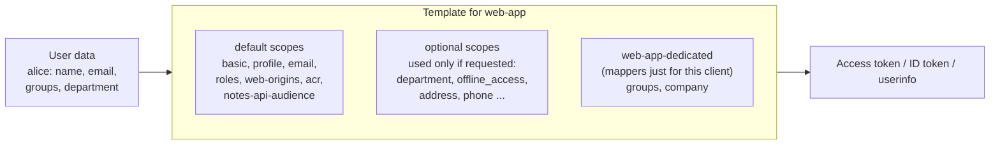

# Module 11: Client scopes and mappers (deciding what goes into a token)

**You'll learn:** what client scopes are (default vs optional, and the `scope` parameter), what the built-in ones do, how protocol mappers put claims into tokens (user attribute, groups, hardcoded value, audience), how to preview a token with **Evaluate**, and how to make tokens smaller with "full scope allowed" OFF and role scope mappings.

**Before this:** [Module 10](10-service-to-service.md)

**Starting state:** the Level 1 end state ([`../catch-up.md`](../catch-up.md)) plus the `notes-api-audience` client scope from [Module 08](08-protect-a-python-api.md) (default on `learning-cli` and `web-app`).

---

## The idea in simple words

A token is like an **ID card that Keycloak prints** for each app. Keycloak doesn't print everything it knows about Alice on every card. It follows a **print template**.

- A **protocol mapper** is one line of the template: "print the user's email here", "print the groups here", "always print `company: Example Corp`".
- A **client scope** is a **named bundle of template lines**, like a stamp. `email` is a stamp with two lines (email, email_verified). `profile` is a stamp with name, username, locale...
- Each app (client) has a list of stamps:
  - **Default** stamps are always used.
  - **Optional** stamps are used only when the app **asks** for them in the `scope` parameter of the login/token request.

That's it. When something is missing from a token (or too much is in it), the answer is always a mapper or a scope.



### Jargon table

| Word | Plain meaning | Example |
|---|---|---|
| **Claim** | One field in a token | `"email": "alice@example.com"` |
| **Protocol mapper** | A rule that adds (or shapes) one claim | "user attribute `department` → claim `department`" |
| **Client scope** | A named, reusable bundle of mappers (and role scopes) | `profile`, `email`, `notes-api-audience` |
| **Default client scope** | Always applied to tokens of that client | `email` on `web-app` |
| **Optional client scope** | Applied only if the request says `scope=<name>` | `department`, `offline_access` |
| **`scope` parameter** | Space-separated list the app sends: "I'd also like these" | `scope=openid department` |
| **Dedicated scope** | Each client's private bundle, shown as `<client>-dedicated`. Mappers placed directly on a client live here | `web-app-dedicated` |
| **User profile** | Keycloak 26's list of allowed user attributes (and who may see/edit them) | `department` |
| **Full scope allowed** | Client switch: ON = put **all** of the user's roles in tokens. Deprecated | OFF on `web-app` after this module |
| **Role scope mapping** | With full scope OFF: the list of roles this client is allowed to see in tokens | `notes-api` → `notes:read`, `notes:write` |
| **Evaluate** | Admin console tool that shows the token a client would get for a user | Clients → web-app → Client scopes → Evaluate |

---

## Hands-on

Terminal setup as in [Module 07](07-oauth-flows.md#hands-on).

### Step 1. See the built-in client scopes

**Click path:** left menu **Client scopes**.

```bash
kcadm get client-scopes -r learning --fields name,protocol --format csv --noquotes
```

```
offline_access,openid-connect
service_account,openid-connect
profile,openid-connect
web-origins,openid-connect
basic,openid-connect
notes-api-audience,openid-connect
microprofile-jwt,openid-connect
organization,openid-connect
address,openid-connect
roles,openid-connect
saml_organization,saml
AuthnContextClassRef,saml
email,openid-connect
role_list,saml
phone,openid-connect
acr,openid-connect
```

The mappers inside the important ones (read with `kcadm get client-scopes/<id>/protocol-mappers/models`):

| Scope | Mappers inside | Puts into tokens |
|---|---|---|
| `basic` | auth_time, sub | `sub`, `auth_time` |
| `profile` | full name, given name, family name, username, locale, ... | `name`, `given_name`, `family_name`, `preferred_username` |
| `email` | email, email verified | `email`, `email_verified` |
| `roles` | realm roles, client roles, audience resolve | `realm_access`, `resource_access`, extra `aud` |
| `web-origins` | allowed web origins | `allowed-origins` (for browser CORS) |
| `acr` | acr loa level | `acr` (how strongly the user logged in; Level 3) |
| `offline_access` | (none) | asks for an **offline token** ([Module 12](12-sessions-and-logout.md)) |
| `service_account` | Client ID, Client Host, Client IP Address | `client_id` etc. on robot tokens (Module 10) |
| `address`, `phone` | address, phone number | standard OIDC claims, if the user has them |
| `organization` | organization | the user's organization (Module 19) |
| `microprofile-jwt` | upn, groups | claims for Java MicroProfile apps |

`openid` is special: it's not a client scope object; asking for it turns on OIDC (ID token).

### Step 2. Default vs optional, realm-wide and per client

New clients copy the **realm's** default lists. **Click path:** Client scopes → the *Assigned type* column. Per client: Clients → `web-app` → **Client scopes** tab.

```bash
kcadm get realms/learning/default-default-client-scopes -r learning --fields name --format csv --noquotes
kcadm get realms/learning/default-optional-client-scopes -r learning --fields name --format csv --noquotes
```

```
role_list
saml_organization
AuthnContextClassRef
profile
email
roles
web-origins
acr
basic
```

```
offline_access
address
phone
microprofile-jwt
organization
```

And for `web-app` (note our `notes-api-audience` from Module 08):

```bash
WEB_ID=$(kcadm get clients -r learning -q clientId=web-app --fields id --format csv --noquotes)
kcadm get clients/$WEB_ID/default-client-scopes -r learning --fields name --format csv --noquotes
kcadm get clients/$WEB_ID/optional-client-scopes -r learning --fields name --format csv --noquotes
```

```
web-origins
acr
notes-api-audience
profile
roles
basic
email
```

```
address
phone
offline_access
organization
microprofile-jwt
```

### Step 3. A user attribute → a claim (`department`)

**Why:** your services often need business data in the token (department, employee number, region).

**3a. Allow the attribute.** Keycloak 26 uses a **user profile**: attributes that are not declared are not stored. **Click path:** Realm settings → **User profile** tab → **Create attribute** → Name `department`, Display name `Department`, *Who can edit* admin, *Who can view* admin + user → Create.

With the CLI, download the profile, add the attribute with `jq`, upload it (note `-i` and `-f -` so the file is read from your terminal):

```bash
kcadm get users/profile -r learning > profile.json
jq '.attributes += [{"name":"department","displayName":"Department",
     "permissions":{"view":["admin","user"],"edit":["admin"]},"multivalued":false}]' \
  profile.json > profile-new.json
docker exec -i keycloak /opt/keycloak/bin/kcadm.sh update users/profile -r learning -f - < profile-new.json
kcadm get users/profile -r learning | jq '.attributes[] | select(.name=="department")'
```

```
{
  "name": "department",
  "displayName": "Department",
  "permissions": {
    "view": [
      "admin",
      "user"
    ],
    "edit": [
      "admin"
    ]
  },
  "multivalued": false
}
```

**3b. Give Alice and Bob a department.** **Click path:** Users → alice → Details → *Department* field → Save.

```bash
ALICE_ID=$(kcadm get users -r learning -q username=alice -q exact=true --fields id --format csv --noquotes)
BOB_ID=$(kcadm get users -r learning -q username=bob -q exact=true --fields id --format csv --noquotes)
kcadm update users/$ALICE_ID -r learning -s 'attributes.department=["engineering"]'
kcadm update users/$BOB_ID -r learning -s 'attributes.department=["support"]'
kcadm get users/$BOB_ID -r learning | jq -c '{username,attributes}'
```

```
{"username":"bob","attributes":{"department":["support"]}}
```

**3c. A client scope with a user-attribute mapper.** We make it **optional**, so apps get `department` only when they ask. **Click path:** Client scopes → Create client scope → Name `department`, Type *None*, Include in token scope ON → Save → Mappers → Configure a new mapper → **User Attribute** → Name `department`, User Attribute `department`, Token Claim Name `department`, Claim JSON Type String, add to access token / ID token / userinfo ON → Save. Then Clients → `learning-cli` (and `web-app`) → Client scopes → Add client scope → `department` → **Optional**.

```bash
kcadm create client-scopes -r learning -s name=department -s protocol=openid-connect \
  -s 'attributes."include.in.token.scope"=true' \
  -s 'attributes."display.on.consent.screen"=true' \
  -s 'attributes."consent.screen.text"=Your department'
DEP_ID=$(kcadm get client-scopes -r learning --fields id,name --format csv --noquotes \
  | grep ',department$' | cut -d, -f1)
kcadm create client-scopes/$DEP_ID/protocol-mappers/models -r learning \
  -s name=department -s protocol=openid-connect -s protocolMapper=oidc-usermodel-attribute-mapper \
  -s 'config."user.attribute"=department' -s 'config."claim.name"=department' \
  -s 'config."jsonType.label"=String' \
  -s 'config."access.token.claim"=true' -s 'config."id.token.claim"=true' \
  -s 'config."userinfo.token.claim"=true' -s 'config."introspection.token.claim"=true'
for C in learning-cli web-app; do
  CID=$(kcadm get clients -r learning -q clientId=$C --fields id --format csv --noquotes)
  kcadm update clients/$CID/optional-client-scopes/$DEP_ID -r learning
done
```

```
Created new client-scope with id '780b2cbe-145c-4349-83f7-22b50deeebed'
Created new model with id 'fdac7e42-1908-4ce5-8244-4e427d8ecc9d'
```

### Step 4. Ask for an optional scope with `scope=`

**Why:** this is the difference between default and optional, live.

```bash
tok() {
  curl -s http://localhost:8180/realms/learning/protocol/openid-connect/token \
    -d grant_type=password -d client_id=learning-cli -d username=alice -d password=alice123 "$@"
}
# 1. no scope parameter
jwt_payload $(tok | jq -r .access_token) | jq '{scope, department}'
# 2. ask for department
jwt_payload $(tok -d scope=department | jq -r .access_token) | jq '{scope, department}'
```

```
{
  "scope": "profile email",
  "department": null
}
{
  "scope": "department profile email",
  "department": "engineering"
}
```

With `openid` too, it's also in the ID token:

```bash
tok -d 'scope=openid department' > t.json
jq '{scope}' t.json
jwt_payload $(jq -r .id_token t.json) | jq '{typ, name, department}'
```

```
{
  "scope": "openid department profile email"
}
{
  "typ": "ID",
  "name": "Alice Smith",
  "department": "engineering"
}
```

Asking for a scope the client doesn't have is an error:

```bash
tok -d 'scope=openid nonsense' | jq '{error, error_description}'
```

```
{
  "error": "invalid_scope",
  "error_description": "Invalid scopes: openid nonsense"
}
```

In Authlib (Module 09) you'd ask for it with `client_kwargs={"scope": "openid profile email department", ...}`.

### Step 5. Mappers just for one client: groups and a hardcoded claim

**Why:** sometimes only one app needs a claim. Put the mapper on the client itself; it lands in the client's **dedicated** scope.

**Click path:** Clients → `web-app` → **Client scopes** tab → `web-app-dedicated` → **Configure a new mapper** (or *Add mapper → By configuration*):

- **Group Membership**: Name `groups`, Token Claim Name `groups`, **Full group path OFF**, add to access/ID/userinfo ON.
- **Hardcoded claim**: Name `company`, Token Claim Name `company`, Claim value `Example Corp`, type String, add to access token ON, ID token OFF.

```bash
WEB_ID=$(kcadm get clients -r learning -q clientId=web-app --fields id --format csv --noquotes)
kcadm create clients/$WEB_ID/protocol-mappers/models -r learning \
  -s name=groups -s protocol=openid-connect -s protocolMapper=oidc-group-membership-mapper \
  -s 'config."claim.name"=groups' -s 'config."full.path"=false' \
  -s 'config."access.token.claim"=true' -s 'config."id.token.claim"=true' \
  -s 'config."userinfo.token.claim"=true' -s 'config."introspection.token.claim"=true'
kcadm create clients/$WEB_ID/protocol-mappers/models -r learning \
  -s name=company -s protocol=openid-connect -s protocolMapper=oidc-hardcoded-claim-mapper \
  -s 'config."claim.name"=company' -s 'config."claim.value"=Example Corp' -s 'config."jsonType.label"=String' \
  -s 'config."access.token.claim"=true' -s 'config."id.token.claim"=false' \
  -s 'config."userinfo.token.claim"=false' -s 'config."introspection.token.claim"=true'
kcadm get clients/$WEB_ID/protocol-mappers/models -r learning --fields name,protocolMapper
```

```
Created new model with id 'fe969199-f873-441b-8ee5-a9eef88f84ce'
Created new model with id '5f5e46e6-4bfd-494e-91f1-07254a4c4d74'
[ {
  "name" : "groups",
  "protocolMapper" : "oidc-group-membership-mapper"
}, {
  "name" : "company",
  "protocolMapper" : "oidc-hardcoded-claim-mapper"
} ]
```

With **Full group path ON** the claim would be `/admins` (with the parent path for subgroups); OFF gives just `admins`.

The fourth mapper type you already know: the **audience** mapper (Module 08, `notes-api-audience`). Every mapper type is in the console's *Configure a new mapper* list; the most used are User Attribute, User Property, Group Membership, User Realm Role, User Client Role, Audience, Hardcoded claim, Hardcoded role.

### Step 6. Preview the token with Evaluate

**Why:** instead of logging in as Alice to see what `web-app` would receive, ask Keycloak to **generate an example**. This is the fastest way to debug "why is claim X missing?".

**Click path:** Clients → `web-app` → **Client scopes** tab → **Evaluate** sub-tab → *Users*: alice → (optional scopes: pick `department`) → **Generated access token** (also: Generated ID token, Generated user info, Effective protocol mappers, Effective role scope mappings).

The same through the admin REST API:

```bash
kcadm get clients/$WEB_ID/evaluate-scopes/generate-example-access-token -r learning \
  -q scope=openid -q userId=$ALICE_ID \
  | jq '{aud, azp, scope, preferred_username, groups, company, department, realm_access, resource_access}'
```

```
{
  "aud": [
    "notes-api",
    "account"
  ],
  "azp": "web-app",
  "scope": "openid profile email",
  "preferred_username": "alice",
  "groups": [
    "admins"
  ],
  "company": "Example Corp",
  "department": null,
  "realm_access": {
    "roles": [
      "default-roles-learning",
      "offline_access",
      "admin",
      "uma_authorization",
      "user"
    ]
  },
  "resource_access": {
    "account": {
      "roles": [
        "manage-account",
        "manage-account-links",
        "view-profile"
      ]
    },
    "notes-api": {
      "roles": [
        "notes:read",
        "notes:write"
      ]
    }
  }
}
```

With the optional scope requested:

```bash
kcadm get clients/$WEB_ID/evaluate-scopes/generate-example-access-token -r learning \
  -q 'scope=openid department' -q userId=$ALICE_ID | jq '{scope, groups, company, department}'
```

```
{
  "scope": "openid department profile email",
  "groups": [
    "admins"
  ],
  "company": "Example Corp",
  "department": "engineering"
}
```

**Which mappers will run, and from which scope?** (the console's *Effective protocol mappers*):

```bash
kcadm get clients/$WEB_ID/evaluate-scopes/protocol-mappers -r learning -q scope=openid \
  | jq -r '.[] | "\(.containerName)\t\(.mapperName)"' | sort
```

```

acr	acr loa level
basic	auth_time
basic	sub
	company
email	email
email	email verified
	groups
notes-api-audience	notes-api-audience
profile	birthdate
profile	family name
profile	full name
profile	gender
profile	given name
profile	locale
profile	middle name
profile	nickname
profile	picture
profile	profile
profile	updated at
profile	username
profile	website
profile	zoneinfo
roles	audience resolve
roles	client roles
roles	realm roles
web-origins	allowed web origins
```

`company` and `groups` have an empty scope name: the API reports them with `"containerType": "client"`, i.e. the dedicated scope.

### Step 7. Shrink the token: full scope OFF + role scope mappings

**Why:** look at the token above. `web-app` receives **all** of Alice's roles: realm roles it never uses (`admin`, `uma_authorization`...), `account` roles, everything. Big tokens cost bandwidth on every request, can break header-size limits, and leak more than needed: if the token is stolen, it carries every permission Alice has. The rule: **a client's tokens should carry only the roles that client needs**.

That's controlled by **Full scope allowed**. It's ON by default, and Keycloak 26.8 itself warns about it. This line appeared in the server log while verifying this course:

```
WARN  [org.keycloak.protocol.oidc.endpoints.TokenEndpoint.full-scope-allowed] (executor-thread-1) Client 'web-app' in the realm 'learning' has 'Full scope allowed' switch enabled. This client switch is deprecated and will be removed in the future. Please update your client settings to disable the switch and configure needed roles, which this client application needs, to the client role scope
```

Size before (a real `web-app` access token for Alice, logged in with the code flow from Module 07), in bytes:

```
1549
```

**Click path:** Clients → `web-app` → **Client scopes** tab → `web-app-dedicated` → **Scope** tab → **Full scope allowed** OFF → **Assign role** → filter by clients → tick `notes-api` `notes:read` and `notes:write` → Assign.

```bash
NOTES_ID=$(kcadm get clients -r learning -q clientId=notes-api --fields id --format csv --noquotes)
kcadm update clients/$WEB_ID -r learning -s fullScopeAllowed=false
kcadm create clients/$WEB_ID/scope-mappings/clients/$NOTES_ID -r learning \
  -b '[{"name":"notes:read"},{"name":"notes:write"}]'
kcadm get clients/$WEB_ID/scope-mappings/clients/$NOTES_ID -r learning --fields name
```

```
[ {
  "name" : "notes:read"
}, {
  "name" : "notes:write"
} ]
```

Evaluate again:

```bash
kcadm get clients/$WEB_ID/evaluate-scopes/generate-example-access-token -r learning \
  -q scope=openid -q userId=$ALICE_ID | jq '{aud, realm_access, resource_access, groups}'
```

```
{
  "aud": "notes-api",
  "realm_access": null,
  "resource_access": {
    "notes-api": {
      "roles": [
        "notes:read",
        "notes:write"
      ]
    }
  },
  "groups": [
    "admins"
  ]
}
```

A real token after the change: **1291** bytes instead of 1549, and only the roles `web-app` passes on to `notes-api`. The `account` audience disappeared too (no `account` roles left for "audience resolve" to see). `web-app`'s **My notes** page from Module 09 still answered `200`.

How it works: a role appears in a token only if the user **has** it **and** the client is allowed to see it (its scope mappings plus the role scopes of its client scopes). It never *gives* the user a role; it only *filters*.

Bob gets the same filter: his token for `web-app` now has only `notes:read`, because that's all he has.

> **State after this module:** `web-app` has full scope OFF with `notes-api` roles mapped. If a later lab needs realm roles in `web-app` tokens, add them under the same **Scope** tab (or set full scope back ON: `kcadm update clients/$WEB_ID -r learning -s fullScopeAllowed=true`).

---

## The one trap

**Adding a mapper but forgetting where it applies.** The three classic "my claim is missing" causes:

1. The mapper lives in an **optional** scope and the app didn't ask for it in `scope=` (step 4).
2. "Add to access token" is OFF (maybe it's only in the ID token, or only in userinfo).
3. The user has no value (no `department` attribute; in Keycloak 26 an attribute not declared in the **user profile** isn't stored at all).

Don't guess: open **Evaluate** for that client and user and look at the generated token and the effective mappers.

---

## Check yourself

1. What's the difference between a default and an optional client scope?
2. A client has `department` as optional. What must the app send to get the claim?
3. Where do mappers go when you add them directly on a client?
4. What does "Full scope allowed OFF" change, and what must you add afterwards?
5. Name three things that can make a claim missing from a token.

<details>
<summary>Answers</summary>

1. Default scopes are always applied; optional ones only when the request lists them in the `scope` parameter.
2. `scope=department` (with `openid` for OIDC logins: `scope=openid department`).
3. The client's dedicated scope (`web-app-dedicated`).
4. Only roles that the client is allowed to see (role scope mappings) go into its tokens. You must assign the roles the client needs under the Scope tab, or its tokens lose them.
5. Mapper in an optional scope not requested; "Add to access token" OFF; the user has no value (or the attribute isn't in the user profile); the scope isn't assigned to this client at all.

</details>

---

## Try this

1. Turn **Full group path** ON in the `groups` mapper and evaluate again: the claim becomes `["/admins"]`.
2. Make `department` a **default** scope of `learning-cli` instead of optional (remove it from optional, add as default). Get a token without `scope=`: the claim is there.
3. In the Evaluate tab, choose **bob** and look at the generated access token with full scope OFF. Which `notes-api` roles does he get, and why no `notes:write`?
