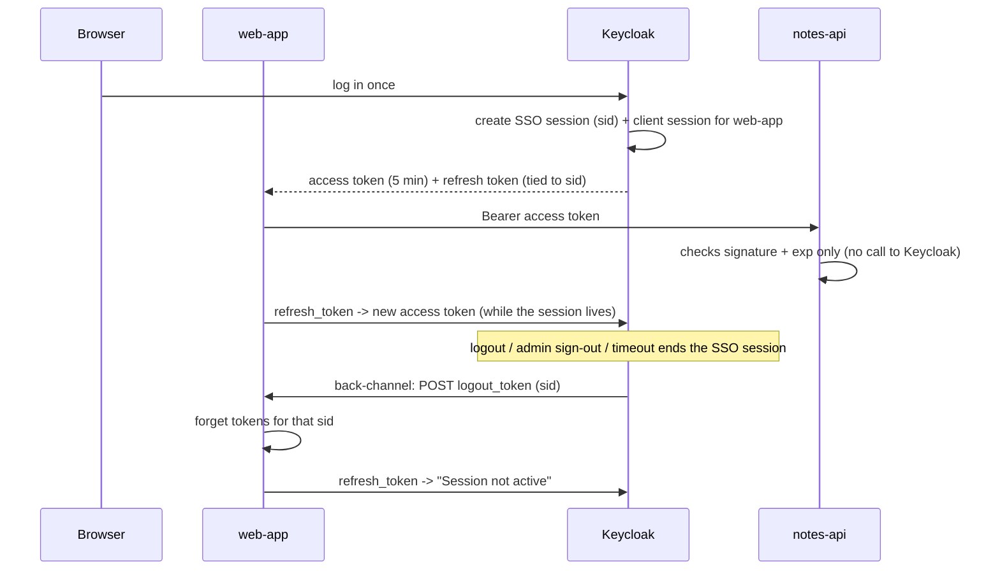

# Module 12: Sessions and logout (how long a login lasts, and how to end it)

**You'll learn:** the SSO session vs the client session, the realm timeouts (idle, max, access token lifespan), how refresh tokens work and what **Revoke Refresh Token** (rotation) changes, offline tokens, the **revocation** and **introspection** endpoints, the three kinds of logout (RP-initiated, front-channel, back-channel), how an admin signs people out, and why a JWT keeps working after logout.

**Before this:** [Module 11](11-client-scopes-and-mappers.md)

**Starting state:** the Level 1 end state ([`../catch-up.md`](../catch-up.md)), `notes-api` running on port 8001 ([Module 08](08-protect-a-python-api.md)) and `web-app` from [Module 09](09-python-web-app-login.md) on port 8000. `kcadm` alias logged in, `jwt_payload` helper from [Module 06](../level-1-basics/06-tokens.md).

---

## The idea in simple words

Think of a **theme park**.

- At the gate you show your ticket once and get a **wristband**. That's the **SSO session**: one per person per browser, kept by Keycloak.
- Each ride you go on writes "rode the roller coaster" on your wristband. Those are **client sessions**: one per app you used inside the SSO session.
- Each ride also gives you a **paper ride pass** that's good for 5 minutes. That's the **access token**. The ride operator just glances at the stamp on the paper; he does not phone the gate.
- When the pass runs out, you show your wristband and get a new pass. That's the **refresh token**.
- If you sit on a bench too long (idle) or the park closes (max), the wristband stops working.
- **Logout** cuts the wristband. But a paper pass you already hold still *looks* valid to a ride operator who only glances at the stamp, until its 5 minutes are over. That's the most important lesson of this module.



### Jargon table

| Word | Plain meaning | Example |
|---|---|---|
| **SSO session** | Keycloak's memory that "this browser/person is logged in". Has an id (`sid`) | `paKaSs33xRb2eKMCrsz4ZT__` |
| **Client session** | One app's entry inside an SSO session | `learning-cli` inside alice's session |
| **SSO Session Idle** | Session ends if nothing touches it for this long | 30 minutes (`1800`) |
| **SSO Session Max** | Session ends after this long, no matter what | 10 hours (`36000`) |
| **Access token lifespan** | How long an access token is good for | 5 minutes (`300`) |
| **Refresh token** | A ticket to get new tokens while the session lives | `typ: Refresh` |
| **Revoke Refresh Token** | Rotation: each refresh token may be used only once | `revokeRefreshToken=true` |
| **Offline token** | A refresh token tied to an **offline session** that survives logout and lives for days | `scope=offline_access`, `typ: Offline` |
| **Revocation endpoint** | "Please kill this token" (RFC 7009) | `POST .../revoke` |
| **Introspection endpoint** | "Is this token still alive?", asked by an API (RFC 7662) | `POST .../token/introspect` → `{"active":false}` |
| **RP-initiated logout** | The app (Relying Party) sends the browser to Keycloak's logout URL | `/logout?id_token_hint=...` |
| **Front-channel logout** | Keycloak tells other apps through the **browser** (hidden iframes) | needs the browser to be open |
| **Back-channel logout** | Keycloak calls each app **server to server** with a `logout_token` | `POST /backchannel-logout` |

---

## Hands-on

```bash
alias kcadm='docker exec keycloak /opt/keycloak/bin/kcadm.sh'
KC=http://localhost:8180
T=$KC/realms/learning/protocol/openid-connect
AID=$(kcadm get users -r learning -q username=alice -q exact=true --fields id --format csv --noquotes)
```

### Step 1. Read the realm timeouts

**Why:** every other behaviour in this module comes from these numbers.

**Click path:** Realm settings → **Sessions** tab (SSO Session Idle / Max, Offline Session Idle) and **Tokens** tab (Access Token Lifespan, Revoke Refresh Token).

```bash
kcadm get realms/learning --fields ssoSessionIdleTimeout,ssoSessionMaxLifespan,accessTokenLifespan,revokeRefreshToken,refreshTokenMaxReuse,offlineSessionIdleTimeout
```

```json
{
  "revokeRefreshToken" : false,
  "refreshTokenMaxReuse" : 0,
  "accessTokenLifespan" : 300,
  "ssoSessionIdleTimeout" : 1800,
  "ssoSessionMaxLifespan" : 36000,
  "offlineSessionIdleTimeout" : 2592000
}
```

All in seconds: idle **30 min**, max **10 h**, access token **5 min**, offline idle **30 days**, rotation **off**. These are the defaults; we never changed them.

### Step 2. Log in and look at the session

**Why:** to see that one login = one SSO session with an id, and that the refresh token is tied to it.

```bash
curl -s $T/token -d grant_type=password -d client_id=learning-cli \
  -d username=alice -d password=alice123 -d scope=openid > login.json
jq '{expires_in, refresh_expires_in, token_type, session_state, scope}' login.json
jwt_payload $(jq -r .refresh_token login.json) | jq '{typ, exp, iat, sid, azp}'
kcadm get users/$AID/sessions -r learning
```

```json
{
  "expires_in": 300,
  "refresh_expires_in": 1800,
  "token_type": "Bearer",
  "session_state": "paKaSs33xRb2eKMCrsz4ZT__",
  "scope": "openid profile email"
}
{
  "typ": "Refresh",
  "exp": 1791313594,
  "iat": 1791311794,
  "sid": "paKaSs33xRb2eKMCrsz4ZT__",
  "azp": "learning-cli"
}
[ {
  "id" : "paKaSs33xRb2eKMCrsz4ZT__",
  "username" : "alice",
  "userId" : "5aa6155e-d489-4918-b323-3f491ddd7ca0",
  "ipAddress" : "192.168.65.1",
  "start" : 1791311794000,
  "lastAccess" : 1791311794000,
  "rememberMe" : false,
  "clients" : {
    "7213e4f4-493c-4cf1-940c-6a730db37cd0" : "learning-cli"
  },
  "transientUser" : false
} ]
```

Read it: the access token lives 300 s; the refresh token lives 1800 s (= SSO Session Idle, `exp - iat = 1800`). `session_state`, the refresh token's `sid` and the session `id` are the **same** value. `clients` lists the client sessions inside it. Every successful refresh pushes the idle clock back to 30 minutes, but never past the 10-hour max.

**Click path:** Realm → **Sessions** (left menu) lists every session; Users → alice → **Sessions** tab shows hers. Clients → learning-cli → **Sessions** tab shows the sessions of one app.

### Step 3. Refresh, and turn on rotation

**Why:** a stolen refresh token is worse than a stolen access token (it keeps minting new ones). Rotation limits the damage.

With the default (rotation off), use the refresh token from Step 2 twice:

```bash
R1=$(jq -r .refresh_token login.json)
curl -s $T/token -d grant_type=refresh_token -d client_id=learning-cli -d refresh_token=$R1 > r.json
jq '{expires_in, refresh_expires_in, session_state}' r.json
R2=$(jq -r .refresh_token r.json); [ "$R1" = "$R2" ] && echo same || echo "new refresh token"
# use the OLD one again
curl -s $T/token -d grant_type=refresh_token -d client_id=learning-cli -d refresh_token=$R1 \
  | jq -c '{has_access_token: (.access_token != null), error}'
```

```text
{
  "expires_in": 300,
  "refresh_expires_in": 1800,
  "session_state": "paKaSs33xRb2eKMCrsz4ZT__"
}
new refresh token
{"has_access_token":true,"error":null}
```

You get a new refresh token every time, but the old one **still works**. Now turn rotation on (**Realm settings → Tokens → Revoke Refresh Token: On**, Max reuse 0) and replay like a thief would:

```bash
kcadm update realms/learning -s revokeRefreshToken=true -s refreshTokenMaxReuse=0
login() { curl -s $T/token -d grant_type=password -d client_id=learning-cli -d username=alice -d password=alice123 -d scope=openid; }
refresh() { curl -s $T/token -d grant_type=refresh_token -d client_id=learning-cli -d refresh_token=$1; }
login > r0.json; R0=$(jq -r .refresh_token r0.json)
refresh $R0 > r1.json; jq -c '{got_new_tokens: (.access_token != null)}' r1.json
echo "-- thief replays R0"; refresh $R0; echo
echo "-- honest app uses R1"; refresh $(jq -r .refresh_token r1.json); echo
kcadm update realms/learning -s revokeRefreshToken=false
```

```text
{"got_new_tokens":true}
-- thief replays R0
{"error":"invalid_grant","error_description":"Maximum allowed refresh token reuse exceeded"}
-- honest app uses R1
{"error":"invalid_grant","error_description":"Session doesn't have required client"}
```

Keycloak saw an old refresh token come back, assumed theft, and **killed that client session**: the thief is stopped, and the honest app must log in again. That's the deal with rotation. (We switched it back off at the end, so later modules behave as before.) If your app has two threads refreshing at the same moment, rotation will log users out by accident; refresh in one place only.

### Step 4. Offline tokens

**Why:** some jobs must keep working when nobody is logged in (a nightly sync on a phone). An **offline token** is a refresh token tied to an *offline session* that ignores logout of the normal session and lives 30 days idle.

Ask for the `offline_access` scope (it's an optional scope on every client, and every user has the `offline_access` role through `default-roles-learning`):

```bash
curl -s $T/token -d grant_type=password -d client_id=learning-cli -d username=alice -d password=alice123 \
  -d "scope=openid offline_access" > off.json
jq '{expires_in, refresh_expires_in, scope}' off.json
O=$(jq -r .refresh_token off.json); jwt_payload $O | jq '{typ, exp, sid}'
```

```json
{
  "expires_in": 300,
  "refresh_expires_in": 2592000,
  "scope": "openid offline_access profile email"
}
{
  "typ": "Offline",
  "exp": 1793903830,
  "sid": "-wPXQ5KY9g83i2lhXg0AYQdJ"
}
```

Now log in normally too, sign out the **normal** session as admin, and try both refresh tokens:

```bash
CLI=$(kcadm get clients -r learning -q clientId=learning-cli --fields id --format csv --noquotes)
curl -s $T/token -d grant_type=password -d client_id=learning-cli -d username=alice -d password=alice123 -d scope=openid > n.json
S=$(jq -r .session_state n.json); echo "normal session $S"
kcadm delete sessions/$S -r learning
refresh $(jq -r .refresh_token n.json) | jq -c '{error, error_description}'
refresh $O | jq -c '{expires_in, refresh_expires_in, has_access: (.access_token!=null)}'
```

```text
normal session ddCWfW74Afv8BinrqktVlQ2-
{"error":"invalid_grant","error_description":"Session not active"}
{"expires_in":300,"refresh_expires_in":2592000,"has_access":true}
```

The offline token survived. That's its whole point, and its whole danger: treat it like a password. List them with `kcadm get users/$AID/offline-sessions/$CLI -r learning` (the user's **Sessions** tab in the console shows them too). Kill one with the revocation endpoint (next step). Note: **Users → alice → Sign out** (`kcadm create users/$AID/logout -r learning`) also ended alice's offline token in our test: the refresh then failed with `invalid_grant`.

### Step 5. The revocation endpoint

**Why:** the app's "Sign me out of this device" button. The app (not the browser) tells Keycloak to kill a token.

```bash
curl -s -w '%{http_code}\n' $T/revoke -d client_id=learning-cli -d token=$O
refresh $O | jq -c '{error, error_description}'
```

```text
200
{"error":"invalid_grant","error_description":"Offline user session not found"}
```

A confidential client also sends its secret (`-u web-app:web-app-secret`). Revoking a normal refresh token ends that session the same way. For a CLI there is also the logout endpoint, which takes the refresh token and answers **204**:

```bash
login > l.json
curl -s -w '%{http_code}\n' $T/logout -d client_id=learning-cli -d refresh_token=$(jq -r .refresh_token l.json)
refresh $(jq -r .refresh_token l.json); echo
```

```text
204
{"error":"invalid_grant","error_description":"Session not active"}
```

### Step 6. Introspection: ask Keycloak "is this token still alive?"

**Why:** `notes-api` checks tokens locally (signature + `exp`). That's fast but blind to logout. Introspection asks Keycloak, so it **does** see logout. Only confidential clients may call it, so `notes-api` needs a secret.

**Click path:** Clients → notes-api → Settings → **Client authentication: On** → Credentials tab.

```bash
NID=$(kcadm get clients -r learning -q clientId=notes-api --fields id --format csv --noquotes)
kcadm update clients/$NID -r learning -s publicClient=false -s secret=notes-api-secret
kcadm get clients/$NID -r learning --fields clientId,publicClient,secret
```

```json
{
  "clientId" : "notes-api",
  "secret" : "notes-api-secret",
  "publicClient" : false
}
```

Get a fresh token and introspect it as `notes-api`:

```bash
login > i.json; A=$(jq -r .access_token i.json)
curl -s $T/token/introspect -u notes-api:notes-api-secret -d token=$A \
  | jq '{active, username, azp, aud, exp, sid, scope, resource_access}'
```

```json
{
  "active": true,
  "username": "alice",
  "azp": "learning-cli",
  "aud": [
    "notes-api",
    "account"
  ],
  "exp": 1791312117,
  "sid": "wavRd6W_6J1oehxfw9FtS-yg",
  "scope": "openid profile email",
  "resource_access": {
    "account": {
      "roles": [
        "manage-account",
        "manage-account-links",
        "view-profile"
      ]
    },
    "notes-api": {
      "roles": [
        "notes:read",
        "notes:write"
      ]
    }
  }
}
```

Wrong secret, garbage token, and a public client:

```bash
curl -s -w '\n%{http_code}\n' $T/token/introspect -u notes-api:wrong -d token=$A
curl -s $T/token/introspect -u notes-api:notes-api-secret -d token=hello; echo
curl -s $T/token/introspect -d client_id=learning-cli -d token=$A; echo
```

```text
{"error":"invalid_client","error_description":"Client authentication failed."}
401
{"active":false}
{"error":"invalid_request","error_description":"Client not allowed."}
```

### Step 7. The big one: the JWT outlives the logout

**Why:** to see with your own eyes that logout does **not** stop an access token that is already out there.

```bash
R=$(jq -r .refresh_token i.json)
echo "== API before"; curl -s -w '\n%{http_code}\n' localhost:8001/notes -H "Authorization: Bearer $A"
echo "== revoke refresh token"; curl -s -w '%{http_code}\n' $T/revoke -d client_id=learning-cli -d token=$R -d token_type_hint=refresh_token
echo "== refresh now"; refresh $R; echo
echo "== introspect access"; curl -s $T/token/introspect -u notes-api:notes-api-secret -d token=$A | jq -c '{active}'
echo "== API after"; curl -s -w '\n%{http_code}\n' localhost:8001/notes -H "Authorization: Bearer $A"
kcadm get users/$AID/sessions -r learning --fields id,clients
```

```text
== API before
{"user":"alice","notes":["buy milk","learn keycloak"]}
200
== revoke refresh token
200
== refresh now
{"error":"invalid_grant","error_description":"Session not active"}
== introspect access
{"active":false}
== API after
{"user":"alice","notes":["buy milk","learn keycloak"]}
200
[ ]
```

The session is gone, Keycloak says `active: false`, and **`notes-api` still answers 200**, because it only checks the signature and `exp`. It will keep saying 200 until `exp` (up to 5 minutes). Ways to live with this:

1. **Short access tokens** (5 minutes is a good default; 1–2 minutes for very sensitive APIs).
2. **Introspect** on sensitive actions (delete account, pay money). It costs one call to Keycloak per request, so cache the answer for a few seconds at most.
3. **Back-channel logout** to your own apps, so they drop their tokens immediately (next step).
4. Keep tokens on the **server** (like `web-app` does), never in browser JavaScript, so there are fewer copies to leak.

### Step 8. RP-initiated logout (the app's "Log out" link)

**Why:** clearing your app's cookie is not enough; the SSO session would log the user straight back in. `web-app`'s `/logout` (Module 09) already sends the browser to Keycloak's logout URL:

```text
http://localhost:8180/realms/learning/protocol/openid-connect/logout?id_token_hint=eyJ...(the ID token)&post_logout_redirect_uri=http%3A%2F%2Flocalhost%3A8000%2F&state=PLgmVx21ltP0pRWA09fn
```

`id_token_hint` proves which session to end (so Keycloak doesn't ask "Do you want to log out?"); `post_logout_redirect_uri` must be in the client's **Valid post logout redirect URIs**. Keycloak ends the SSO session, then answers `302 http://localhost:8000/?state=...`.

**Front-channel** logout (the default switch *Front channel logout: On* on new clients) means Keycloak then loads each other app's logout URL in hidden iframes of the **browser**. It fails silently if third-party cookies are blocked or the tab is closed. **Back-channel** is server to server, so it doesn't care about the browser. We use back-channel.

### Step 9. Back-channel logout to a FastAPI endpoint

**Why:** when alice logs out anywhere (another app, the admin, a timeout... see the trap), `web-app` should forget her tokens right away.

Add this to `web-app/main.py` from Module 09. First, the new imports. Replace the import block at the top with:

```python
# secrets makes random ids; time tells us when tokens expire
import secrets
import time
# parse_qs reads a form body like "logout_token=eyJ..."
from urllib.parse import parse_qs

# httpx calls the notes-api for us
import httpx
# PyJWT checks the signature of the logout token Keycloak sends us
import jwt
# Authlib's ready-made OAuth/OIDC client for Starlette and FastAPI
from authlib.integrations.starlette_client import OAuth, OAuthError
# FastAPI pieces: the app, the incoming request, and three kinds of answers
from fastapi import FastAPI, Request
from fastapi.responses import HTMLResponse, RedirectResponse, Response
# Keeps a small signed cookie per browser (needs the itsdangerous package)
from starlette.middleware.sessions import SessionMiddleware
```

Right below `token_store = {}`, add:

```python
# Downloads and caches Keycloak's public keys (used for logout tokens)
jwks_client = jwt.PyJWKClient(ISSUER + "/protocol/openid-connect/certs")
```

And at the end of the file, the endpoint:

```python
@app.post("/backchannel-logout")
async def backchannel_logout(request: Request):
    # Keycloak POSTs a form with one field: logout_token=<signed JWT>
    body = await request.body()
    form = parse_qs(body.decode())
    # Take the token out of the form
    logout_token = form["logout_token"][0]
    # Pick the right public key, then check signature, issuer and audience (us)
    signing_key = jwks_client.get_signing_key_from_jwt(logout_token)
    claims = jwt.decode(logout_token, signing_key.key, algorithms=["RS256"], audience=CLIENT_ID, issuer=ISSUER)
    # Show what Keycloak told us. sid = the Keycloak SSO session that just ended
    print("back-channel logout token:", claims)
    # Collect our logins that belong to that SSO session
    ended = []
    for session_id in token_store:
        # The ID token claims (userinfo) carry the same sid
        if token_store[session_id]["userinfo"].get("sid") == claims["sid"]:
            ended.append(session_id)
    # Forget them: the next request from that browser is "not logged in"
    for session_id in ended:
        del token_store[session_id]
    print("removed", len(ended), "login(s)")
    # 200 tells Keycloak "done"
    return Response(status_code=200)
```

`pyjwt[crypto]` is already in the project (Module 09's `uv add`). Restart: `uv run uvicorn main:app --port 8000`.

Now tell Keycloak where to call. Keycloak runs **inside Docker**, so `localhost` there is the container itself. Docker Desktop gives containers the name **`host.docker.internal`** for your Mac/PC.

**Click path:** Clients → web-app → Settings → *Logout settings*: **Front channel logout: Off**, **Backchannel logout URL** `http://host.docker.internal:8000/backchannel-logout`, **Backchannel logout session required: On**.

```bash
WID=$(kcadm get clients -r learning -q clientId=web-app --fields id --format csv --noquotes)
kcadm update clients/$WID -r learning \
  -s 'attributes."backchannel.logout.url"=http://host.docker.internal:8000/backchannel-logout' \
  -s 'attributes."backchannel.logout.session.required"=true' -s frontchannelLogout=false
kcadm get clients -r learning -q clientId=web-app \
  | jq '.[0] | {frontchannelLogout, a: (.attributes | with_entries(select(.key|test("logout"))))}'
```

```json
{
  "frontchannelLogout": false,
  "a": {
    "backchannel.logout.url": "http://host.docker.internal:8000/backchannel-logout",
    "backchannel.logout.session.required": "true",
    "post.logout.redirect.uris": "http://localhost:8000/"
  }
}
```

Log in as alice at <http://localhost:8000> in your browser. Then, as the admin, sign out her session (**Sessions** → ⋮ → **Sign out**):

```bash
kcadm get users/$AID/sessions -r learning --fields id
SID=$(kcadm get users/$AID/sessions -r learning --fields id --format csv --noquotes)
kcadm delete sessions/$SID -r learning
```

```json
[ {
  "id" : "L4hADyBBhxHt1sbt5iCY9LA8"
} ]
```

The `web-app` terminal, at that same second:

```text
back-channel logout token: {'exp': 1791312000, 'iat': 1791311880, 'jti': '8fd2b538-3dd7-05fa-5f46-c7c255740987', 'iss': 'http://localhost:8180/realms/learning', 'aud': 'web-app', 'sub': '5aa6155e-d489-4918-b323-3f491ddd7ca0', 'typ': 'Logout', 'sid': 'L4hADyBBhxHt1sbt5iCY9LA8', 'events': {'http://schemas.openid.net/event/backchannel-logout': {}}}
removed 1 login(s)
INFO:     127.0.0.1:57251 - "POST /backchannel-logout HTTP/1.1" 200 OK
```

Reload the page: `Not logged in.`; open `/notes`: `307` to `/login`. The `logout_token` is a signed JWT with `typ: Logout`, the `sid` of the ended session, and an `events` claim that marks it as a back-channel logout (it never has a `nonce`).

When alice clicks **Log out** in `web-app` itself (Step 8), Keycloak sends the same call; then the log says `removed 0 login(s)`, because the app already forgot her.

### Step 10. Admin sign-out of everyone

**Click path:** Realm → **Sessions** → **Sign out all active sessions** (top right ⋮). Per user: Users → alice → ⋮ → **Sign out**.

```bash
kcadm get clients/$CLI/user-sessions -r learning | jq -c '.[] | {username, id}'
kcadm create logout-all -r learning
kcadm get clients/$CLI/user-sessions -r learning
```

```text
{"username":"bob","id":"3msjPjSi0vYamev1ArXqwLzl"}
{"username":"bob","id":"tLFRc-bHU_tkGnlJO5zUhiye"}
[ ]
```

Use this after a leak. (Apps with a back-channel URL should get a `logout_token` for each session, like in Step 9; not verified here: needs a logged-in `web-app` user during `logout-all`.)

---

## The one trap

**Logout ends the session, not the tokens already handed out.** Step 7 showed it: session gone, introspection says `active: false`, and the API still says 200 until `exp`. If you need "logged out means locked out *now*", you need short access tokens plus introspection (or back-channel logout to your own apps). And remember the Docker detail: the back-channel URL must be reachable **from the Keycloak container** (`host.docker.internal`, not `localhost`), otherwise Keycloak logs a failed call and your app never hears about the logout.

---

## Check yourself

1. Alice logs into `web-app` and `other-app` in one browser. How many SSO sessions and how many client sessions?
<details><summary>Answer</summary>One SSO session (one <code>sid</code>), with two client sessions inside it.</details>

2. The access token lifespan is 5 minutes and SSO Session Idle is 30 minutes. Alice's app refreshes every 4 minutes for 12 hours. What happens?
<details><summary>Answer</summary>Each refresh resets the idle clock, so idle never hits; but SSO Session Max (10 h) ends the session, and the next refresh fails with <code>invalid_grant</code>. She must log in again.</details>

3. With **Revoke Refresh Token** on, someone replays an old refresh token. What happens to the thief, and to the real app?
<details><summary>Answer</summary>The thief gets "Maximum allowed refresh token reuse exceeded". Keycloak also kills that client session, so the real app's next refresh fails too, and the user must log in again.</details>

4. Why can't `learning-cli` call the introspection endpoint?
<details><summary>Answer</summary>It is a public client with no secret, and introspection needs an authenticated (confidential) client: "Client not allowed."</details>

5. Alice logged out 1 minute ago. Her old access token still works at `notes-api`. Bug?
<details><summary>Answer</summary>No. <code>notes-api</code> checks tokens locally, so the token is valid until <code>exp</code>. Use short lifespans, introspection for sensitive calls, or back-channel logout.</details>

---

## Try this

1. Set Access Token Lifespan to 60 seconds (`kcadm update realms/learning -s accessTokenLifespan=60`), repeat Step 7 and count how long the API keeps saying 200. Put it back to `300`.
2. Change the back-channel URL to `http://localhost:8000/backchannel-logout` and sign alice out again. Nothing reaches `web-app`. Why? (Keycloak's `localhost` is its own container.) Look in `docker logs keycloak` for a warning about the failed call.
3. Add an optional `/notes-strict` route to `notes-api` that calls introspection with `notes-api:notes-api-secret` before answering, and confirm it answers 401 right after logout while `/notes` still answers 200.
