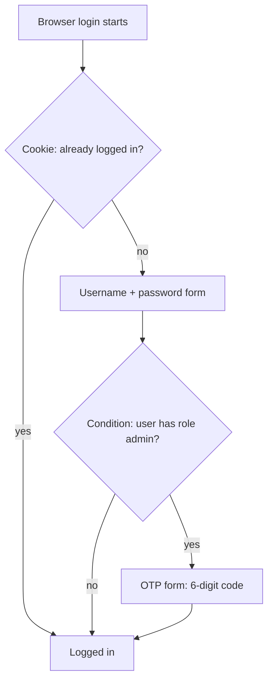

# Module 13: Authentication flows and MFA

**You'll learn:** what an authentication flow is, the built-in flows, executions and their requirements (Required / Alternative / Disabled / Conditional), how to copy a flow and switch it on, one-time codes (OTP) as a second factor, OTP **only for admins**, passkeys (overview), password policies, brute-force protection, required actions, and step-up login (overview).

**Before this:** [Module 12](../level-2-apps/12-sessions-and-logout.md).

**Starting state:** the Level 1 baseline (realm `learning`, alice in `admins`, bob in `staff`, clients `learning-cli`, `web-app`, `notes-api`). Behind? Run [`../catch-up.md`](../catch-up.md).

---

## The idea in simple words

Think of the security desk at an office building. The desk follows a **checklist**:

1. "Do you already have a visitor badge from this morning?" If yes, walk in.
2. If not: "Name and password, please."
3. "You're a manager? Then also show me the code on your phone."

Keycloak calls this checklist an **authentication flow**. It is a recipe of small steps. Each step is one check (a cookie, a password form, a code). Each step has a rule: **must** happen, **one of these** is enough, **skip**, or **only if** something is true.

You can't edit Keycloak's built-in recipes, but you can **copy** one, change the copy, and tell the realm "use my copy for browser logins". That's how you add a second factor ("MFA") for some or all users.

The other things in this module protect the password step itself: rules for good passwords (**password policy**) and slowing down people who guess passwords (**brute-force detection**).



---

## Jargon table

| Word | Plain meaning | Example |
|---|---|---|
| Authentication flow | A recipe of login steps | `browser`, `direct grant` |
| Execution (step) | One step in a flow | "Username Password Form" |
| Sub-flow | A small recipe inside a bigger one | "forms" inside `browser` |
| Authenticator | The Java code behind a step | `auth-otp-form` |
| Requirement | The rule for a step | Required, Alternative, Disabled, Conditional |
| Required | This step must succeed | Password form |
| Alternative | One of the alternatives at this level is enough | Cookie **or** the forms |
| Disabled | Step is switched off | Kerberos |
| Conditional | A sub-flow that runs only if its conditions are true | "Conditional 2FA" |
| Condition | A yes/no check inside a conditional sub-flow | "Condition - user role" |
| Binding | Telling the realm which flow to use for what | browser flow = `browser-with-otp` |
| MFA / 2FA | Multi-/two-factor: something you know + something you have | Password + phone code |
| OTP | One-time password: a code that works once | `822816` |
| TOTP | Time-based OTP: new code every 30 seconds from a shared secret | Google Authenticator |
| Required action | A task the user must finish at login | Set up OTP, change password |
| Password policy | Rules a new password must pass | At least 12 characters |
| Brute force | Guessing passwords again and again | 1000 tries per minute |
| Passkey / WebAuthn | Login with a device key (Touch ID, YubiKey) instead of a typed secret | Face ID on a phone |
| ACR / LoA | "How strong was this login?" as a number or name | `acr: "1"` |

---

## Hands-on

Set up your terminal (same as earlier modules):

```bash
alias kcadm='docker exec keycloak /opt/keycloak/bin/kcadm.sh'
kcadm config credentials --server http://localhost:8080 --realm master --user admin --password admin
```

### Step 1. See the built-in flows

**Why:** before changing anything, see which recipes exist.

**Click path:** realm `learning` → **Authentication** → **Flows** tab.

```bash
kcadm get authentication/flows -r learning --fields alias,builtIn,topLevel,providerId --format csv
```

```
"browser",true,true,"basic-flow"
"direct grant",true,true,"basic-flow"
"registration",true,true,"basic-flow"
"reset credentials",true,true,"basic-flow"
"clients",true,true,"client-flow"
"first broker login",true,true,"basic-flow"
"docker auth",true,true,"basic-flow"
```

| Flow | Used when |
|---|---|
| `browser` | Someone logs in through the login page (web-app, account console) |
| `direct grant` | An app sends username + password to the token endpoint (`learning-cli`, labs only) |
| `registration` | A new user fills in the "Register" form ([Module 15](15-themes-and-emails.md)) |
| `reset credentials` | "Forgot password?" ([Module 15](15-themes-and-emails.md)) |
| `first broker login` | Someone logs in with another provider for the first time ([Module 14](14-brokering-and-federation.md)) |
| `clients` | A **client** (not a user) proves who it is, e.g. with its secret |
| `docker auth` | Docker registry logins (rare) |

### Step 2. Look inside the browser flow

**Why:** to see steps, levels and requirements.

**Click path:** **Flows** → click `browser`.

```bash
kcadm get authentication/flows/browser/executions -r learning \
  --fields displayName,requirement,level,providerId --format csv
```

```
"Cookie","ALTERNATIVE",0,"auth-cookie"
"Kerberos","DISABLED",0,"auth-spnego"
"Identity Provider Redirector","ALTERNATIVE",0,"identity-provider-redirector"
"Organization","ALTERNATIVE",0,
"Browser - Conditional Organization","CONDITIONAL",1,
"Condition - user configured","REQUIRED",2,"conditional-user-configured"
"Organization Identity-First Login","ALTERNATIVE",2,"organization"
"forms","ALTERNATIVE",0,
"Username Password Form","REQUIRED",1,"auth-username-password-form"
"Browser - Conditional 2FA","CONDITIONAL",1,
"Condition - user configured","REQUIRED",2,"conditional-user-configured"
"Condition - credential","REQUIRED",2,"conditional-credential"
"OTP Form","ALTERNATIVE",2,"auth-otp-form"
"WebAuthn Authenticator","DISABLED",2,"webauthn-authenticator"
"Recovery Authentication Code Form","DISABLED",2,"auth-recovery-authn-code-form"
```

How to read it: `level` is the indent. At level 0 there are four **alternatives**: Cookie, Identity Provider Redirector, Organization, and `forms`. The first one that works wins. Inside `forms` the password form is **required**, then comes a **conditional** sub-flow "Conditional 2FA". Out of the box, it asks for OTP **only if the user already set one up**. Nobody is forced to set one up.

### Step 3. Copy the browser flow

**Why:** built-in flows can't be edited. You work on a copy.

**Click path:** **Flows** tab → on the `browser` row, click the **⋮** (kebab) menu → **Duplicate** → name `browser-with-otp` → Duplicate.

```bash
kcadm create authentication/flows/browser/copy -r learning -s newName=browser-with-otp
```

```
Created new copy with id 'e539c1a1-0a75-45c3-a1ea-6cbe4c91061f'
```

### Step 4. Make OTP required for users with the role `admin`

**Why:** we want: alice (role `admin`) **must** use OTP; bob (role `user` only) doesn't. If an admin has no OTP yet, Keycloak makes them set it up.

**Click path:** open `browser-with-otp`. In the sub-flow **browser-with-otp Browser - Conditional 2FA**:
1. Delete **Condition - user configured** and **Condition - credential** (trash icon).
2. Click **+** (Add) on the sub-flow row → **Add condition** → **Condition - user role** → set it to **Required**, click its ⚙ (settings), alias `only-admins`, role `admin`, Save.
3. Set **OTP Form** to **Required**.

With the CLI, each step has an ID that differs on your machine, so first make a tiny helper that finds a step **inside the 2FA sub-flow** by name:

```bash
exec_id() {
  kcadm get authentication/flows/browser-with-otp/executions -r learning \
    | jq -r --arg n "$1" '(map(.displayName) | index("browser-with-otp Browser - Conditional 2FA")) as $start
        | [.[$start:][] | select(.displayName == $n)][0].id'
}
```

Now change the sub-flow (spaces in the sub-flow name are written as `%20` in the URL):

```bash
# 1. remove the two old conditions
kcadm delete authentication/executions/$(exec_id "Condition - user configured") -r learning
kcadm delete authentication/executions/$(exec_id "Condition - credential") -r learning

# 2. add "Condition - user role"
kcadm create "authentication/flows/browser-with-otp%20Browser%20-%20Conditional%202FA/executions/execution" \
  -r learning -s provider=conditional-user-role

# 3. condition first (priority 10) and Required; OTP Form second (priority 20) and Required
COND=$(exec_id "Condition - user role")
OTP=$(exec_id "OTP Form")
kcadm update authentication/flows/browser-with-otp/executions -r learning \
  -b "{\"id\":\"$COND\",\"requirement\":\"REQUIRED\",\"priority\":10}"
kcadm update authentication/flows/browser-with-otp/executions -r learning \
  -b "{\"id\":\"$OTP\",\"requirement\":\"REQUIRED\",\"priority\":20}"

# 4. tell the condition which role to look for
kcadm create authentication/executions/$COND/config -r learning \
  -s alias=only-admins -s config.condUserRole=admin -s config.negate=false
```

```
Created new execution with id '17387585-31dd-4b62-b10b-7c5ef2aacff6'
Created new config with id '7bafc21e-5054-4099-ba93-0051aa27a0d2'
```

(The deletes and updates print nothing when they work.)

Check the result:

```bash
kcadm get authentication/flows/browser-with-otp/executions -r learning \
  --fields displayName,requirement,level --format csv
```

```
"Cookie","ALTERNATIVE",0
"Kerberos","DISABLED",0
"Identity Provider Redirector","ALTERNATIVE",0
"browser-with-otp Organization","ALTERNATIVE",0
"browser-with-otp Browser - Conditional Organization","CONDITIONAL",1
"Condition - user configured","REQUIRED",2
"Organization Identity-First Login","ALTERNATIVE",2
"browser-with-otp forms","ALTERNATIVE",0
"Username Password Form","REQUIRED",1
"browser-with-otp Browser - Conditional 2FA","CONDITIONAL",1
"Condition - user role","REQUIRED",2
"OTP Form","REQUIRED",2
"WebAuthn Authenticator","DISABLED",2
"Recovery Authentication Code Form","DISABLED",2
```

The role condition also counts roles that come **through a group**: alice gets `admin` from the group `admins`.

### Step 5. Bind the flow

**Why:** a copied flow does nothing until the realm uses it.

**Click path:** **Authentication** → **Flows** tab → on the `browser-with-otp` row, click the **⋮** (kebab) menu → **Bind flow** → choose **Browser flow** → Save.

```bash
kcadm update realms/learning -s browserFlow=browser-with-otp
kcadm get realms/learning --fields browserFlow
```

```
{
  "browserFlow" : "browser-with-otp"
}
```

### Step 6. Prove it: bob gets in, alice must set up OTP (with Python)

**Why:** you could do this with a phone app (Google Authenticator, Microsoft Authenticator, FreeOTP). Here a small Python "robot browser" plays both the browser **and** the phone, so you can watch every page.

How TOTP works: during setup Keycloak shows a **secret** (as a QR code, or as text). Your phone stores it. Every 30 seconds, phone and Keycloak both compute `code = HMAC(secret, current time / 30)` and keep 6 digits. Same secret + same clock = same code. Nothing is sent over the network to the phone.

Make the project:

```bash
uv init mfa-lab && cd mfa-lab
uv add httpx pyotp
uv pip list | grep -Ei 'httpx|pyotp'
```

```
httpx             0.28.1
pyotp             2.10.0
```

Create `otp_robot.py`:

```python
# otp_robot.py
# A tiny "robot browser". It logs in to Keycloak the same way a person
# does in a real browser, and prints every page Keycloak shows.
# Usage:  uv run otp_robot.py alice alice123

# sys lets us read the username and password from the command line.
import sys
# re finds small pieces of text inside an HTML page.
import re
# html turns "&amp;" back into "&" inside links.
import html
# pathlib reads and writes the small file where we keep the OTP secret.
import pathlib

# httpx sends the HTTP requests (like a browser does).
import httpx
# pyotp computes 6-digit codes, exactly like Google Authenticator does.
import pyotp

# Where our realm lives.
REALM_URL = "http://localhost:8180/realms/learning"
# The address web-app gets the user back on after login (Module 09).
APP_CALLBACK = "http://localhost:8000/auth/callback"

# Keycloak marks its cookies "Secure". httpx will not send Secure cookies
# over plain http, so we keep the cookies ourselves in a normal dict.
cookies = {}
# One client for every request. We follow redirects ourselves.
client = httpx.Client(follow_redirects=False)


def remember_cookies(response):
    # A response can set several cookies: look at every Set-Cookie header.
    for header in response.headers.get_list("set-cookie"):
        # "NAME=VALUE;Path=/;Secure" -> keep only "NAME=VALUE".
        name_and_value = header.split(";")[0]
        # Split at the first "=" only (values may contain "=").
        name, value = name_and_value.split("=", 1)
        # Save or overwrite the cookie in our jar.
        cookies[name] = value


def cookie_header():
    # Build the "a=1; b=2" text a browser puts in its Cookie header.
    parts = []
    for name in cookies:
        parts.append(name + "=" + cookies[name])
    return "; ".join(parts)


def send(method, url, form=None):
    # Send one request with our cookies attached.
    headers = {"Cookie": cookie_header()}
    response = client.request(method, url, data=form, headers=headers)
    # Keep any new cookies Keycloak gives us, then hand back the response.
    remember_cookies(response)
    return response


def follow_keycloak_redirects(response):
    # Keep following redirects while they point back into Keycloak.
    while response.status_code == 302:
        # Where does Keycloak want us to go next?
        location = response.headers["location"]
        # A redirect to our app means the login is finished: stop here.
        if location.startswith(APP_CALLBACK):
            return response
        # Otherwise open the next Keycloak page.
        response = send("GET", location)
    return response


def find(pattern, text):
    # Look for the pattern; give back None if it is not there.
    match = re.search(pattern, text)
    if match is None:
        return None
    # Return the captured part, with "&amp;" turned into "&".
    return html.unescape(match.group(1))


def secret_file(username):
    # Each user's OTP secret is stored in its own small file.
    return pathlib.Path(username + "-totp-secret.txt")


# Read who we log in as from the command line.
username = sys.argv[1]
password = sys.argv[2]

# 1. Open the login page, like clicking "Log in" in web-app.
#    These are the normal Authorization Code + PKCE parameters (Module 07).
params = {
    "client_id": "web-app",
    "response_type": "code",
    "scope": "openid",
    "redirect_uri": APP_CALLBACK,
    "state": "robot-state",
    "code_challenge": "Hn2Bft0bsy_Mr0Gnrm6yvEwF7uZn3ZYcJ9SmRUQwSRs",
    "code_challenge_method": "S256",
}
login_url = REALM_URL + "/protocol/openid-connect/auth?" + str(httpx.QueryParams(params))
page = send("GET", login_url)

# 2. Type username and password, press "Sign In".
form_url = find(r'<form[^>]*action="([^"]+)"', page.text)
page = send("POST", form_url, {"username": username, "password": password})
page = follow_keycloak_redirects(page)

# 3. React to whatever Keycloak shows next. Stop after 5 pages, just in case.
for step in range(5):
    # A redirect back to the app means success. The app would now swap the code.
    if page.status_code == 302:
        print("DONE: back at the app with a code ->", page.headers["location"][:80], "...")
        break

    # Every Keycloak page names its template, e.g. "login-login-otp".
    page_id = find(r'data-page-id="([^"]+)"', page.text)
    print("Keycloak shows page:", page_id)

    if page_id == "login-login-config-totp":
        # First time: Keycloak wants us to set up an authenticator app.
        # Click "Unable to scan?" to see the secret as text instead of a QR code.
        manual_link = find(r'href="([^"]+)" id="mode-manual"', page.text)
        page = send("GET", manual_link)
        # Read the secret, e.g. "MVEF KUCC GNGX ...", and drop the spaces.
        shown_secret = find(r'id="kc-totp-secret-key">([^<]+)<', page.text)
        secret = shown_secret.replace(" ", "")
        print("  secret shown to the user:", shown_secret)
        # Save it: from now on this file is our "phone".
        secret_file(username).write_text(secret)
        # Our "phone" computes the code for the current 30 seconds.
        code = pyotp.TOTP(secret).now()
        print("  code from our robot phone:", code)
        # Send the code back, plus the form's hidden secret field and a device name.
        form_url = find(r'<form[^>]*action="([^"]+)"', page.text)
        hidden_secret = find(r'name="totpSecret" value="([^"]+)"', page.text)
        form = {"totp": code, "totpSecret": hidden_secret, "userLabel": "robot-phone"}
        page = send("POST", form_url, form)
        page = follow_keycloak_redirects(page)

    elif page_id == "login-login-otp":
        # Keycloak asks for the 6-digit code: our "phone" computes it.
        secret = secret_file(username).read_text()
        code = pyotp.TOTP(secret).now()
        print("  code from our robot phone:", code)
        # Type the code into the form and press "Sign In".
        form_url = find(r'<form[^>]*action="([^"]+)"', page.text)
        page = send("POST", form_url, {"otp": code})
        page = follow_keycloak_redirects(page)

    else:
        # Any other page (for example an error): print its message and stop.
        message = find(r'kc-feedback-text">([^<]+)<', page.text)
        if message is None:
            message = "(no message found)"
        # strip() removes the spaces and new lines around the text.
        print("  message:", message.strip())
        break
```

Run it for bob, then alice:

```bash
uv run otp_robot.py bob bob123
uv run otp_robot.py alice alice123
```

```
DONE: back at the app with a code -> http://localhost:8000/auth/callback?state=robot-state&session_state=ba1au6gSGw9J ...
Keycloak shows page: login-login-config-totp
  secret shown to the user: G55H K6JQ IF4V C6SW ORJT S3CV HB3X ASDZ
  code from our robot phone: 822816
DONE: back at the app with a code -> http://localhost:8000/auth/callback?state=robot-state&session_state=UWRQW45BKk1_ ...
```

Bob went straight through. Alice (role `admin`) was sent to the **Configure OTP** page (that's the required action `CONFIGURE_TOTP`), the robot read the secret, made a code, and finished. Keycloak now stores an OTP credential for alice:

```bash
AID=$(kcadm get users -r learning -q username=alice --fields id --format csv --noquotes)
kcadm get users/$AID/credentials -r learning --fields type,userLabel
```

```
[ {
  "type" : "password"
}, {
  "type" : "otp",
  "userLabel" : "robot-phone"
} ]
```

Wait at least 30 seconds (a new code window), then log alice in again:

```bash
uv run otp_robot.py alice alice123
```

```
Keycloak shows page: login-login-otp
  code from our robot phone: 844161
DONE: back at the app with a code -> http://localhost:8000/auth/callback?state=robot-state&session_state=q2lvtCDenDVT ...
```

This time Keycloak asks for the code (`login-login-otp`) instead of setup. With a real browser you see the same pages: open `http://localhost:8180/realms/learning/account`, log in as alice, and type the code from your phone app.

### Step 7. OTP and the password grant

**Why:** the `direct grant` flow (used by `learning-cli`) has its own conditional OTP: once a user **has** OTP, the password alone is not enough there either.

Make a tiny "phone" script, `code_now.py`:

```python
# code_now.py - print the current 6-digit code for a user (our "phone").
# Usage:  uv run code_now.py alice

# sys reads the username from the command line.
import sys
# pathlib reads the secret file that otp_robot.py saved.
import pathlib

# pyotp computes time-based codes (TOTP).
import pyotp

# Which user's secret should we use?
username = sys.argv[1]
# Read the secret we saved while setting up OTP.
secret = pathlib.Path(username + "-totp-secret.txt").read_text()
# Make a TOTP calculator: 6 digits, 30-second windows, SHA1 (Keycloak's defaults).
totp = pyotp.TOTP(secret)
# Print the code for the current 30-second window.
print(totp.now())
```

Wait 30 seconds after the last login, then:

```bash
TOKEN_URL=http://localhost:8180/realms/learning/protocol/openid-connect/token

# 1. password only
curl -s $TOKEN_URL -d client_id=learning-cli -d grant_type=password \
  -d username=alice -d password=alice123 | jq

# 2. password + code (the form field is called "totp")
CODE=$(uv run code_now.py alice); echo "CODE=$CODE"
curl -s $TOKEN_URL -d client_id=learning-cli -d grant_type=password \
  -d username=alice -d password=alice123 -d totp=$CODE | jq '{token_type, expires_in}'

# 3. the same code again
curl -s $TOKEN_URL -d client_id=learning-cli -d grant_type=password \
  -d username=alice -d password=alice123 -d totp=$CODE | jq
```

```
{
  "error": "invalid_grant",
  "error_description": "Invalid user credentials"
}
CODE=737210
{
  "token_type": "Bearer",
  "expires_in": 300
}
{
  "error": "invalid_grant",
  "error_description": "Invalid user credentials"
}
```

The third call fails because a code **can't be used twice** (`otpPolicyCodeReusable` is `false`). That's why you had to wait 30 seconds between logins. The OTP settings live in **Authentication** → **Policies** → **OTP Policy**:

```bash
kcadm get realms/learning --fields otpPolicyType,otpPolicyAlgorithm,otpPolicyDigits,otpPolicyPeriod,otpPolicyCodeReusable
```

```
{
  "otpPolicyType" : "totp",
  "otpPolicyAlgorithm" : "HmacSHA1",
  "otpPolicyDigits" : 6,
  "otpPolicyPeriod" : 30,
  "otpPolicyCodeReusable" : false
}
```

### Step 8. Passkeys and WebAuthn (overview)

*(Not verified here: needs a real authenticator such as Touch ID, Windows Hello, a phone, or a YubiKey.)*

**WebAuthn** lets the browser prove the user holds a private key that never leaves their device. A **passkey** is a WebAuthn key that can replace the password completely. It can't be phished: the key only works on the real site's address.

Where it lives in 26.8 (labels seen in the admin console):
- **Realm settings** → **Login** → **Enable Passkeys** (on/off).
- **Authentication** → **Policies** → **WebAuthn Policy** and **WebAuthn Passwordless Policy**.
- In a flow, the steps **WebAuthn Authenticator** (as 2nd factor) or **WebAuthn Passwordless Authenticator**; required actions **Webauthn Register** / **Webauthn Register Passwordless** (see the list in step 11).

To use WebAuthn as a second factor instead of OTP, in your copied flow you would set **WebAuthn Authenticator** to Required (or Alternative next to OTP Form). Browsers allow WebAuthn on `http://localhost`, so you can try it with Touch ID on your Mac.

### Step 9. Password policy

**Why:** stop weak passwords before they are saved.

**Click path:** **Authentication** → **Policies** → **Password policy** → **Add policy** (Minimum length 12, Digits 1, Not username, Not recently used 3) → Save.

```bash
kcadm update realms/learning -s 'passwordPolicy=length(12) and digits(1) and notUsername and passwordHistory(3)'
kcadm get realms/learning --fields passwordPolicy
```

```
{
  "passwordPolicy" : "length(12) and digits(1) and notUsername and passwordHistory(3)"
}
```

Now try to set bad passwords. Even the admin must obey the policy:

```bash
kcadm set-password -r learning --username bob --new-password short1
kcadm set-password -r learning --username bob --new-password bobbobbobbob
kcadm set-password -r learning --username bob --new-password bob-is-great-2026
kcadm set-password -r learning --username bob --new-password bob-is-great-2026
```

```
Invalid password: minimum length 12. [invalidPasswordMinLengthMessage]
Invalid password: must contain at least 1 numerical digits. [invalidPasswordMinDigitsMessage]
Invalid password: must not be equal to any of last 3 passwords. [invalidPasswordHistoryMessage]
```

The third command worked silently; the fourth failed because of `passwordHistory(3)`. To see `notUsername` fail, the username must itself pass the other rules:

```bash
kcadm create users -r learning -s username=charlie2026x -s enabled=true
kcadm set-password -r learning --username charlie2026x --new-password charlie2026x
```

```
Created new user with id 'be7e8288-6957-41d7-9a7b-79f4c88d3b99'
Invalid password: must not be equal to the username. [invalidPasswordNotUsernameMessage]
```

Clean up: remove the test user, remove the policy, and give bob his old password back (the rest of the course expects `bob123`):

```bash
kcadm delete users/$(kcadm get users -r learning -q username=charlie2026x --fields id --format csv --noquotes) -r learning
kcadm update realms/learning -s 'passwordPolicy=""'
kcadm set-password -r learning --username bob --new-password bob123 && echo ok
```

```
ok
```

Note the `""`: `-s 'passwordPolicy='` (nothing after `=`) does **not** clear the policy; the empty JSON string does.

### Step 10. Brute-force detection

**Why:** without it, an attacker can try thousands of passwords. With it, Keycloak locks the account for a while after N failures.

**Click path:** **Realm settings** → **Security defenses** → **Brute force detection** → Brute Force Mode **Lockout temporarily**, Max login failures `3`, Wait increment `1` minute, Max wait `5` minutes → Save.

```bash
kcadm update realms/learning -s bruteForceProtected=true -s failureFactor=3 \
  -s waitIncrementSeconds=60 -s maxFailureWaitSeconds=300
kcadm get realms/learning --fields bruteForceProtected,failureFactor,waitIncrementSeconds,maxFailureWaitSeconds
```

```
{
  "bruteForceProtected" : true,
  "maxFailureWaitSeconds" : 300,
  "waitIncrementSeconds" : 60,
  "failureFactor" : 3
}
```

Guess bob's password wrong 3 times (2 seconds apart), then use the **right** password:

```bash
for i in 1 2 3; do
  curl -s $TOKEN_URL -d client_id=learning-cli -d grant_type=password -d username=bob -d password=wrong-guess
  echo; sleep 2
done
uv run otp_robot.py bob bob123
```

```
{"error":"invalid_grant","error_description":"Invalid user credentials"}
{"error":"invalid_grant","error_description":"Invalid user credentials"}
{"error":"invalid_grant","error_description":"Invalid user credentials"}
Keycloak shows page: login-login
  message: Invalid username or password.
```

The correct password is refused too, with the **same** message: Keycloak doesn't tell an attacker "this account is locked". The admin can see it (**Users** → bob shows a "temporarily locked" switch):

```bash
BID=$(kcadm get users -r learning -q username=bob --fields id --format csv --noquotes)
kcadm get attack-detection/brute-force/users/$BID -r learning
```

```
{
  "failedLoginNotBefore" : 1791311375,
  "numFailures" : 3,
  "numTemporaryLockouts" : 1,
  "disabled" : true,
  "numSecondaryAuthFailures" : 0,
  "lastIPFailure" : "192.168.65.1",
  "lastFailure" : 1791311315870
}
```

The server log names the real reason (`docker logs keycloak`):

```
2026-10-06 18:10:06,035 WARN  [org.keycloak.events] (executor-thread-1) type="LOGIN_ERROR", realmId="44205878-729e-4e7b-a0e9-86baceec7b7d", realmName="learning", clientId="learning-cli", userId="91419e1b-0e19-459d-b8dd-6fc874f87cc9", ipAddress="192.168.65.1", error="user_temporarily_disabled", auth_method="openid-connect", grant_type="password", client_auth_method="client-secret", username="bob"
```

Unlock bob now instead of waiting a minute (admin console: switch the lock off on bob's page):

```bash
kcadm delete attack-detection/brute-force/users/$BID -r learning
kcadm get attack-detection/brute-force/users/$BID -r learning --fields disabled,numFailures
uv run otp_robot.py bob bob123
```

```
{
  "numFailures" : 0,
  "disabled" : false
}
DONE: back at the app with a code -> http://localhost:8000/auth/callback?state=robot-state&session_state=Sdjm5CqNScNT ...
```

Extra fact: Keycloak also locks if two failures come **less than 1 second apart** ("Quick login check milliseconds" = 1000). That's why the loop sleeps 2 seconds. Without the sleep you'd see a lock after only 2 failures.

### Step 11. Required actions

**Why:** a required action is a task the user must finish at the next login: set up OTP (you saw it), change password, verify email, accept terms, etc.

**Click path:** **Authentication** → **Required actions** tab.

```bash
kcadm get authentication/required-actions -r learning --fields alias,name,enabled,defaultAction --format csv
```

```
"TERMS_AND_CONDITIONS","Terms and Conditions",false,false
"UPDATE_PROFILE","Update Profile",true,false
"VERIFY_EMAIL","Verify Email",true,false
"CONFIGURE_TOTP","Configure OTP",true,false
"UPDATE_PASSWORD","Update Password",true,false
"delete_account","Delete Account",false,false
"UPDATE_EMAIL","Update Email",false,false
"webauthn-register","Webauthn Register",true,false
"webauthn-register-passwordless","Webauthn Register Passwordless",true,false
"VERIFY_PROFILE","Verify Profile",true,false
"delete_credential","Delete Credential",true,false
"idp_link","Linking Identity Provider",true,false
"CONFIGURE_RECOVERY_AUTHN_CODES","Recovery Authentication Codes",true,false
"update_user_locale","Update User Locale",true,false
```

`defaultAction=true` would give that action to **every new user**. Give bob one by hand (**Users** → bob → **Required user actions**):

```bash
kcadm update users/$BID -r learning -s 'requiredActions=["UPDATE_PASSWORD"]'
curl -s $TOKEN_URL -d client_id=learning-cli -d grant_type=password -d username=bob -d password=bob123; echo
uv run otp_robot.py bob bob123
kcadm update users/$BID -r learning -s 'requiredActions=[]'
```

```
{"error":"invalid_grant","error_description":"Account is not fully set up"}
Keycloak shows page: login-login-update-password
  message: You need to change your password to activate your account.
```

The password grant can't show a page, so it just refuses. The browser flow shows the "update password" page. The last command removed the action again.

### Step 12. Step-up authentication and ACR (overview)

*(Overview only; not set up in this module.)*

Sometimes one page needs a **stronger** login than the rest: "view orders" is fine with a password, "send money" needs OTP. That's **step-up**. Keycloak's tools:

- Every token has an `acr` claim ("Authentication Context Class Reference"): how strong this login was.
- **Realm settings** → **General** → **ACR to LoA Mapping**: names → numbers, e.g. `silver` → 1, `gold` → 2 (LoA = Level of Authentication).
- In a copied browser flow, sub-flows with **Condition - Level of Authentication** (level 1: password; level 2: password + OTP).
- The app asks for the level: add `acr_values=gold` (or the `claims` parameter) to the login URL, then checks `acr` in the ID token. If the user is at level 1, Keycloak asks only for the missing step.

What `acr` looks like today (a normal password login):

```bash
TOKEN=$(curl -s $TOKEN_URL -d client_id=learning-cli -d grant_type=password -d username=bob -d password=bob123 | jq -r .access_token)
jwt_payload "$TOKEN" | jq '{acr}'
```

```
{
  "acr": "1"
}
```

Details: the "Step-up authentication" section of the [Server Administration Guide](https://www.keycloak.org/docs/latest/server_admin/#_step-up-flow).

### Step 13. Leave the realm as later modules expect

The next modules use alice in the browser without OTP. Switch the realm back to the built-in flow (your `browser-with-otp` stays, ready to bind again):

```bash
kcadm update realms/learning -s browserFlow=browser
kcadm get realms/learning --fields browserFlow
```

```
{
  "browserFlow" : "browser"
}
```

Brute-force detection stays on: that's a good default.

---

## The one trap

**Locking yourself out with a flow change.** If you make OTP required for everybody and bind it to the **`master`** realm, or to the realm where your only admin lives, a mistake can lock out every admin. Rules: never experiment on `master`; change a **copy**, bind it, and test in a **private window** while you keep another admin session open; unbinding (set the binding back to `browser`) fixes it at once. Second trap: forgetting that a Required step with no matching user setup (an OTP form for a user without OTP) turns into a required action, so users get a setup screen they didn't expect.

---

## Check yourself

1. In the browser flow, Cookie and `forms` are both Alternative. What does that mean in plain words?
2. Why did bob not see an OTP page after step 5, but alice did?
3. Why did the third token request in step 7 fail although the code was correct?
4. Bob was locked. Why did Keycloak answer "Invalid username or password" and not "account locked"?
5. You want every new user to change their password on first login. Which setting do you use?

<details>
<summary>Answers</summary>

1. One of them is enough: if the login cookie is valid you're in; otherwise Keycloak runs the forms.
2. The conditional sub-flow only runs when "Condition - user role" is true. Alice has the `admin` role (via group `admins`); bob only has `user`.
3. OTP codes can't be reused (`otpPolicyCodeReusable=false`). A stolen code that was already used is worthless.
4. So an attacker can't learn which usernames exist or that their guessing worked. The admin sees the lock in the brute-force status and the log.
5. Make `UPDATE_PASSWORD` a **default action** in **Authentication** → **Required actions** (or give it to users one by one).

</details>

---

## Try this

1. Set the role condition's **negate** to `true` (in its ⚙ settings). Bind `browser-with-otp` again and run the robot for alice and bob. Who is asked for OTP now?
2. Delete alice's OTP credential (**Users** → alice → **Credentials** → delete `robot-phone`) and run the robot again. Which page comes back?
3. Change the OTP policy to 8 digits. Does `pyotp.TOTP(secret).now()` still work? (Hint: `pyotp.TOTP(secret, digits=8)`.)
