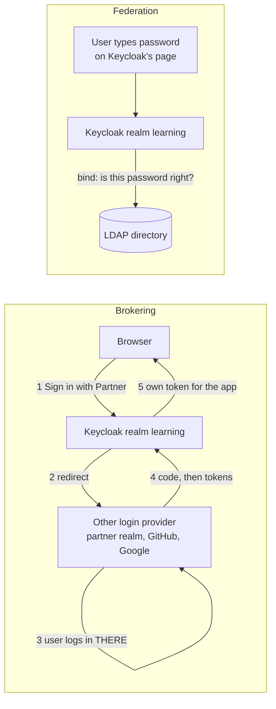

# Module 14: Brokering and federation (log in with another provider, users from LDAP)

**You'll learn:** what identity brokering is ("Sign in with GitHub / Google / your partner company"), how to connect a second Keycloak realm as a login provider, what "first broker login" does, identity provider mappers, and user federation: reading users and groups from an LDAP directory, syncing them, and logging in as an LDAP user.

**Before this:** [Module 13](13-authentication-flows-and-mfa.md).

**Starting state:** the Level 1 baseline (realm `learning`, users `alice`/`bob`, clients `learning-cli`, `web-app`, `notes-api`, roles and groups; see [`../catch-up.md`](../catch-up.md)). The realm uses the normal `browser` flow (end of Module 13).

---

## The idea in simple words

Two ways to get people into your building without giving each one a new badge:

1. **Brokering = a trusted visitor desk.** A visitor from a partner company shows **their own company's badge**. Your front desk phones the partner desk ("is this really Pat?"), the partner says yes, and your desk prints a local visitor badge. Your desk **never sees Pat's password**; the partner checks it. "Sign in with Google" works the same way.
2. **Federation = reading the HR filing cabinet.** The company already has a cabinet (LDAP or Active Directory) with every employee and their password. Instead of copying people by hand, your desk **looks people up in the cabinet** and asks the cabinet to check the password.



The big difference: with brokering the user types the password **on the other provider's page**. With federation the user types it **on Keycloak's page**, and Keycloak checks it against LDAP.

---

## Jargon table

| Word | Plain meaning | Example |
|---|---|---|
| Identity provider (IdP) | Another system that can say "this is Pat" | GitHub, Google, realm `partner` |
| Identity brokering | Keycloak sends the user to an IdP and trusts its answer | "Sign in with Partner Company" button |
| Broker | Keycloak in the middle | Realm `learning` |
| First broker login | What happens the first time someone arrives from an IdP: create or link a local user | Review-profile page, then a new user `pat` |
| Federated identity | The link "local user ↔ user at the IdP" | `pat` in `learning` ↔ user id `3e26...` in `partner` |
| IdP mapper | A rule that changes the local user when they come from an IdP | "Everyone from partner gets role `user`" |
| `kc_idp_hint` | URL parameter that skips the Keycloak page and goes straight to one IdP | `&kc_idp_hint=partner` |
| User federation | Keycloak reads users from an outside store | LDAP, Active Directory |
| LDAP | A protocol and database for company directories (people, groups) | OpenLDAP, Active Directory |
| DN | Distinguished name: the full "address" of an LDAP entry | `uid=carol,ou=people,dc=example,dc=org` |
| Bind | Logging in to LDAP with a DN and password | How Keycloak checks Carol's password |
| Edit mode | Who may change LDAP data: `READ_ONLY`, `WRITABLE`, `UNSYNCED` | `READ_ONLY` |
| Sync | Copy users or groups from LDAP into Keycloak's database | "2 imported users" |

---

## Hands-on

Set up your terminal (same as earlier modules):

```bash
alias kcadm='docker exec keycloak /opt/keycloak/bin/kcadm.sh'
kcadm config credentials --server http://localhost:8080 --realm master --user admin --password admin

jwt_payload() {
  echo "$1" | jq -R 'split(".")[1] | gsub("-";"+") | gsub("_";"/")
    | . + ("=" * ((4 - length % 4) % 4)) | @base64d | fromjson'
}
```

### Part A: Brokering

#### Step 1. "Sign in with GitHub" (read only; not verified here)

*(Not verified here: needs a real GitHub OAuth app with a client ID and secret. The steps follow the [Keycloak server admin guide](https://www.keycloak.org/docs/latest/server_admin/#_identity_broker).)*

1. In GitHub: **Settings** → **Developer settings** → **OAuth Apps** → **New OAuth App**. Homepage URL `http://localhost:8180`, **Authorization callback URL** `http://localhost:8180/realms/learning/broker/github/endpoint`. Copy the client ID and generate a client secret.
2. In Keycloak: **Identity providers** → **GitHub** → paste client ID and secret → **Add**.

The same as a command (the create call itself was run here with fake values and accepted; a real login needs real values):

```bash
kcadm create identity-provider/instances -r learning -s alias=github -s providerId=github \
  -s enabled=true -s config.clientId=YOUR_GITHUB_CLIENT_ID \
  -s config.clientSecret=YOUR_GITHUB_CLIENT_SECRET -s config.syncMode=IMPORT
```

```
Created new instance with id 'github'
```

Google is the same idea: create an "OAuth client ID" (type Web application) in the Google Cloud console, with redirect URI `http://localhost:8180/realms/learning/broker/google/endpoint`, then **Identity providers** → **Google**. Delete the fake one before you go on: `kcadm delete identity-provider/instances/github -r learning`.

We can't log in to GitHub here, so we build our own "GitHub": a second realm.

#### Step 2. Create the partner company (realm `partner`)

**Why:** realm `partner` will play the outside provider. It has its own user `pat` and a client `learning-broker` that represents *our* Keycloak.

**Click path:** realm dropdown → **Create realm** `partner`; **Users** → Add `pat`; **Clients** → Create `learning-broker` (Client authentication **On**, Standard flow only, Valid redirect URI below).

```bash
kcadm create realms -s realm=partner -s enabled=true
kcadm create users -r partner -s username=pat -s enabled=true -s email=pat@partner.example \
  -s emailVerified=true -s firstName=Pat -s lastName=Partner
kcadm set-password -r partner --username pat --new-password pat123
kcadm create clients -r partner -s clientId=learning-broker -s publicClient=false \
  -s secret=learning-broker-secret -s standardFlowEnabled=true -s directAccessGrantsEnabled=false \
  -s 'redirectUris=["http://localhost:8180/realms/learning/broker/partner/endpoint"]'
```

```
Created new realm with id 'partner'
Created new user with id '3e26654e-6c69-446f-8b12-5fcfb0115736'
Created new client with id 'b36dbad6-1563-4227-91e6-6e58a0a27b02'
```

The redirect URI is the broker's "return door": `/realms/<broker realm>/broker/<idp alias>/endpoint`.

#### Step 3. Tell `learning` to trust `partner`

**Why:** realm `learning` needs the partner's addresses and the client secret.

**Click path:** realm `learning` → **Identity providers** → **OpenID Connect v1.0** → alias `partner`, display name `Partner Company`, paste the discovery URL `http://localhost:8180/realms/partner/.well-known/openid-configuration`, client ID/secret → **Add**.

```bash
kcadm create identity-provider/instances -r learning \
  -s alias=partner -s providerId=oidc -s enabled=true \
  -s 'displayName=Partner Company' \
  -s config.issuer=http://localhost:8180/realms/partner \
  -s config.authorizationUrl=http://localhost:8180/realms/partner/protocol/openid-connect/auth \
  -s config.logoutUrl=http://localhost:8180/realms/partner/protocol/openid-connect/logout \
  -s config.tokenUrl=http://localhost:8080/realms/partner/protocol/openid-connect/token \
  -s config.jwksUrl=http://localhost:8080/realms/partner/protocol/openid-connect/certs \
  -s config.useJwksUrl=true -s config.validateSignature=true \
  -s config.disableUserInfo=true \
  -s config.clientId=learning-broker -s config.clientSecret=learning-broker-secret \
  -s config.clientAuthMethod=client_secret_post \
  -s 'config.defaultScope=openid profile email' \
  -s config.pkceEnabled=true -s config.pkceMethod=S256 \
  -s config.syncMode=IMPORT
```

```
Created new instance with id 'partner'
```

**Why two hostnames?** The **browser** uses `localhost:8180` (your Mac's port). The **token** and **keys** calls are made by Keycloak itself, from inside the container, where Keycloak listens on `localhost:8080`. With a real provider (GitHub, another company) both are the same public address, and the discovery URL fills everything in.

`disableUserInfo=true`: Keycloak takes the user's name and email from the ID token instead of calling the userinfo address. On the first try we left it on; the userinfo call failed with `Invalid token issuer. Expected 'http://localhost:8080/realms/partner'` because of the two hostnames. In real life (one public address) you can leave userinfo on.

#### Step 4. Add an IdP mapper: everyone from partner gets role `user`

**Why:** people from outside should get a known starting role, without an admin clicking.

**Click path:** **Identity providers** → `partner` → **Mappers** → **Add mapper** → type **Hardcoded Role**, name `partner-users-get-user-role`, role `user`, sync mode **Inherit**.

```bash
kcadm create identity-provider/instances/partner/mappers -r learning \
  -s name=partner-users-get-user-role -s identityProviderAlias=partner \
  -s identityProviderMapper=oidc-hardcoded-role-idp-mapper \
  -s config.syncMode=INHERIT -s config.role=user
kcadm get identity-provider/instances/partner/mappers -r learning
```

```
Created new mapper with id '397e4a13-66b8-4be9-964a-ac96b27575c3'
[ {
  "id" : "397e4a13-66b8-4be9-964a-ac96b27575c3",
  "name" : "partner-users-get-user-role",
  "identityProviderAlias" : "partner",
  "identityProviderMapper" : "oidc-hardcoded-role-idp-mapper",
  "config" : {
    "syncMode" : "INHERIT",
    "role" : "user"
  }
} ]
```

Other mapper types: **Attribute Importer** (copy a claim into a user attribute), **Claim to Role** (role only if a claim has a value), **Username Template Importer** (e.g. `${ALIAS}.${CLAIM.preferred_username}`).

#### Step 5. Always show the review page on first broker login

**Why:** the **first broker login** flow runs the first time a person arrives from an IdP. By default its "Review Profile" step only appears when data is missing. We switch it to always show, so you can see it.

**Click path:** **Authentication** → `first broker login` → ⚙ next to **Review Profile** → Update profile on first login **on**.

```bash
kcadm get authentication/flows/first%20broker%20login/executions -r learning \
  --fields displayName,requirement,level --format csv
```

```
"Review Profile","REQUIRED",0
"User creation or linking","REQUIRED",0
"Create User If Unique","ALTERNATIVE",1
"Handle Existing Account","ALTERNATIVE",1
"Confirm link existing account","REQUIRED",2
"Account verification options","REQUIRED",2
"Verify existing account by Email","ALTERNATIVE",3
"Verify Existing Account by Re-authentication","ALTERNATIVE",3
"Username Password Form for identity provider reauthentication","REQUIRED",4
"First broker login - Conditional 2FA","CONDITIONAL",4
"Condition - user configured","REQUIRED",5
"Condition - credential","REQUIRED",5
"OTP Form","ALTERNATIVE",5
"WebAuthn Authenticator","DISABLED",5
"Recovery Authentication Code Form","DISABLED",5
"First Broker Login - Conditional Organization","CONDITIONAL",0
"Condition - user configured","REQUIRED",1
"Organization Member Onboard","REQUIRED",1
```

Read it as: review the profile; then **create** a new user if the username/email is free, otherwise **link** to the existing account after the person proves they own it (email link or their password).

```bash
CID=$(kcadm get authentication/flows/first%20broker%20login/executions -r learning \
  | jq -r '.[] | select(.displayName=="Review Profile") | .authenticationConfig')
kcadm update authentication/config/$CID -r learning -s 'config."update.profile.on.first.login"=on'
kcadm get authentication/config/$CID -r learning
```

```
{
  "id" : "844680f0-50e5-4c61-ba8d-92514b5033e3",
  "alias" : "review profile config",
  "config" : {
    "update.profile.on.first.login" : "on"
  }
}
```

(Before the update the value was `missing`.)

#### Step 6. Log in to `learning` as pat from partner

**Why:** to watch the whole broker dance.

Open a **private window** at `http://localhost:8180/realms/learning/account`. These are the pages we saw (text of each page, captured from a real browser):

```
1. http://localhost:8180/realms/learning/protocol/openid-connect/auth
   LEARNING
   Sign in to your account
   Username or email
   Password
   Sign In
   or
   Sign in with Partner Company        <- click this

2. http://localhost:8180/realms/partner/protocol/openid-connect/auth
   PARTNER
   Sign in to your account             <- pat / pat123 here, on PARTNER's page

3. http://localhost:8180/realms/learning/login-actions/first-broker-login
   LEARNING
   Update Account Information
   Username *  Email *  First name *  Last name *
   (filled in: pat, pat@partner.example, Pat, Partner)  <- click Submit

4. http://localhost:8180/realms/learning/account
   Pat Partner
   Personal info ...
```

Notice the realm name at the top of page 2: **PARTNER**. The password went to the partner, never to `learning`.

#### Step 7. Look at what Keycloak created

**Click path:** **Users** → `pat` → **Identity provider links** tab; **Role mapping** tab.

```bash
PID=$(kcadm get users -r learning -q username=pat --fields id --format csv --noquotes)
kcadm get users -r learning -q username=pat --fields username,email,emailVerified,firstName,lastName
kcadm get users/$PID/federated-identity -r learning
kcadm get users -r partner -q username=pat --fields id,username
kcadm get users/$PID/credentials -r learning
kcadm get-roles -r learning --uusername pat --fields name --format csv
```

```
[ {
  "username" : "pat",
  "firstName" : "Pat",
  "lastName" : "Partner",
  "email" : "pat@partner.example",
  "emailVerified" : false
} ]
[ {
  "identityProvider" : "partner",
  "userId" : "3e26654e-6c69-446f-8b12-5fcfb0115736",
  "userName" : "pat"
} ]
[ {
  "id" : "3e26654e-6c69-446f-8b12-5fcfb0115736",
  "username" : "pat"
} ]
[ ]
"user"
"default-roles-learning"
```

- The federated identity's `userId` is pat's ID **in the partner realm**: that's the link.
- Credentials are empty `[ ]`: `learning` stores **no password** for pat.
- `user` is assigned directly: that's our hardcoded-role mapper (`default-roles-learning` doesn't contain `user`).

The events (**Events** → **User events**, after turning on **Realm settings** → **Events** → Save events), newest first:

```bash
kcadm get events -r learning -q max=10 | jq -c '.[] | {type, identity_provider: .details.identity_provider, username: .details.username}'
```

```
{"type":"CODE_TO_TOKEN","identity_provider":null,"username":null}
{"type":"LOGIN","identity_provider":"partner","username":"pat"}
{"type":"REGISTER","identity_provider":"partner","username":"pat"}
{"type":"UPDATE_PROFILE","identity_provider":"partner","username":null}
{"type":"IDENTITY_PROVIDER_FIRST_LOGIN","identity_provider":"partner","username":null}
```

#### Step 8. Skip the Keycloak page with `kc_idp_hint`

**Why:** an app for partner staff can send people straight to the partner login.

```bash
curl -s -o /dev/null -w '%{http_code} %{redirect_url}\n' "http://localhost:8180/realms/learning/protocol/openid-connect/auth?client_id=web-app&response_type=code&scope=openid&redirect_uri=http://localhost:8000/auth/callback&code_challenge=abcdefghijabcdefghijabcdefghijabcdefghij123&code_challenge_method=S256&kc_idp_hint=partner" | cut -c1-120
```

```
303 http://localhost:8180/realms/learning/broker/partner/login?session_code=Gv_GaZPYRiz_Cd5slxgwnr9tEekzwQ8-XukWVx-LLCk&
```

### Part B: User federation with LDAP

#### Step 9. Put Keycloak and an LDAP server on one Docker network

**Why:** containers find each other **by name** only on a shared user-made network. Your `keycloak` container was started without one, so you start it again **with the same volume** (your realms are kept in `keycloak-data`).

```bash
docker network create kc-lab
docker rm -f keycloak
docker run -d --name keycloak --network kc-lab -p 8180:8080 \
  -v keycloak-data:/opt/keycloak/data \
  -e KC_BOOTSTRAP_ADMIN_USERNAME=admin -e KC_BOOTSTRAP_ADMIN_PASSWORD=admin \
  quay.io/keycloak/keycloak:26.8.0 start-dev
docker run -d --name ldap --network kc-lab -p 1389:389 \
  -e LDAP_ORGANISATION="Example Org" -e LDAP_DOMAIN=example.org -e LDAP_ADMIN_PASSWORD=admin \
  osixia/openldap:1.5.0
```

Wait ~20 seconds, log `kcadm` in again (the old login belonged to the removed container), then check:

```bash
kcadm config credentials --server http://localhost:8080 --realm master --user admin --password admin
docker logs ldap 2>&1 | tail -1
docker exec keycloak bash -c 'echo > /dev/tcp/ldap/389 && echo ldap-ok'
```

```
6ac53b48 slapd starting
ldap-ok
```

Inside the network Keycloak reaches LDAP at `ldap:389`. From your Mac it's `localhost:1389` (for tools like Apache Directory Studio). Your realms survived because the data lives in the volume, not in the container.

#### Step 10. Fill the directory: two people, two groups

**Why:** a real company directory already has this. Passwords in LDAP are stored as **hashes** (`{SSHA}`), never as plain text. Make the hashes first:

```bash
docker exec ldap slappasswd -s carol123
docker exec ldap slappasswd -s dave123
```

```
{SSHA}FtbuAhzK42G6+7sGsyGdyGCSPAfaxHXk
{SSHA}RalMX4Wj9yL3tmkdVSnwlb7oPPLCXlX0
```

Create `company.ldif` with **your** two hashes:

```
# Two folders ("organizational units"): one for people, one for groups.
dn: ou=people,dc=example,dc=org
objectClass: organizationalUnit
ou: people

dn: ou=groups,dc=example,dc=org
objectClass: organizationalUnit
ou: groups

# Carol, a developer. userPassword is a hash, never the plain password.
dn: uid=carol,ou=people,dc=example,dc=org
objectClass: inetOrgPerson
uid: carol
cn: Carol Chen
givenName: Carol
sn: Chen
mail: carol@example.org
userPassword: {SSHA}FtbuAhzK42G6+7sGsyGdyGCSPAfaxHXk

# Dave, from operations.
dn: uid=dave,ou=people,dc=example,dc=org
objectClass: inetOrgPerson
uid: dave
cn: Dave Diaz
givenName: Dave
sn: Diaz
mail: dave@example.org
userPassword: {SSHA}RalMX4Wj9yL3tmkdVSnwlb7oPPLCXlX0

# Group "developers" with Carol in it.
dn: cn=developers,ou=groups,dc=example,dc=org
objectClass: groupOfNames
cn: developers
member: uid=carol,ou=people,dc=example,dc=org

# Group "ops" with Dave in it.
dn: cn=ops,ou=groups,dc=example,dc=org
objectClass: groupOfNames
cn: ops
member: uid=dave,ou=people,dc=example,dc=org
```

```bash
docker exec -i ldap ldapadd -x -H ldap://localhost -D cn=admin,dc=example,dc=org -w admin < company.ldif
docker exec ldap ldapwhoami -x -H ldap://localhost -D uid=carol,ou=people,dc=example,dc=org -w carol123
ldapsearch -x -H ldap://localhost:1389 -D cn=admin,dc=example,dc=org -w admin \
  -b ou=groups,dc=example,dc=org -LLL cn member
```

```
adding new entry "ou=people,dc=example,dc=org"

adding new entry "ou=groups,dc=example,dc=org"

adding new entry "uid=carol,ou=people,dc=example,dc=org"

adding new entry "uid=dave,ou=people,dc=example,dc=org"

adding new entry "cn=developers,ou=groups,dc=example,dc=org"

adding new entry "cn=ops,ou=groups,dc=example,dc=org"

dn:uid=carol,ou=people,dc=example,dc=org
dn: ou=groups,dc=example,dc=org

dn: cn=ops,ou=groups,dc=example,dc=org
cn: ops
member: uid=dave,ou=people,dc=example,dc=org

dn: cn=developers,ou=groups,dc=example,dc=org
cn: developers
member: uid=carol,ou=people,dc=example,dc=org
```

`ldapwhoami` printing Carol's DN means the bind (password check) worked. That's exactly what Keycloak will do.

#### Step 11. Add the LDAP provider (vendor Other, READ_ONLY)

**Click path:** **User federation** → **Add Ldap providers**. Vendor **Other**; Connection URL `ldap://ldap:389` → **Test connection**; Bind DN `cn=admin,dc=example,dc=org`, Bind credentials `admin` → **Test authentication**; Edit mode **READ_ONLY**; Users DN `ou=people,dc=example,dc=org`; Username / RDN attribute `uid`; UUID attribute `entryUUID`; User object classes `inetOrgPerson`; Search scope **One Level** → Save.

```bash
kcadm create testLDAPConnection -r learning -s action=testAuthentication -s connectionUrl=ldap://ldap:389 \
  -s authType=simple -s 'bindDn=cn=admin,dc=example,dc=org' -s bindCredential=admin; echo "exit=$?"
REALM_ID=$(kcadm get realms/learning --fields id --format csv --noquotes)
kcadm create components -r learning \
  -s name=company-ldap -s providerId=ldap \
  -s providerType=org.keycloak.storage.UserStorageProvider -s parentId=$REALM_ID \
  -s 'config.enabled=["true"]' \
  -s 'config.vendor=["other"]' \
  -s 'config.connectionUrl=["ldap://ldap:389"]' \
  -s 'config.authType=["simple"]' \
  -s 'config.bindDn=["cn=admin,dc=example,dc=org"]' \
  -s 'config.bindCredential=["admin"]' \
  -s 'config.editMode=["READ_ONLY"]' \
  -s 'config.usersDn=["ou=people,dc=example,dc=org"]' \
  -s 'config.userObjectClasses=["inetOrgPerson"]' \
  -s 'config.usernameLDAPAttribute=["uid"]' \
  -s 'config.rdnLDAPAttribute=["uid"]' \
  -s 'config.uuidLDAPAttribute=["entryUUID"]' \
  -s 'config.searchScope=["1"]' \
  -s 'config.importEnabled=["true"]' \
  -s 'config.syncRegistrations=["false"]'
LDAP_ID=$(kcadm get components -r learning -q name=company-ldap --fields id --format csv --noquotes)
kcadm get components -r learning -q parent=$LDAP_ID --fields name,providerId --format csv
```

```
exit=0
Created new component with id 'HhT6YZnnTcGYXSFollqusg'
"first name","user-attribute-ldap-mapper"
"username","user-attribute-ldap-mapper"
"creation date","user-attribute-ldap-mapper"
"Kerberos principal attribute mapper","kerberos-principal-attribute-mapper"
"email","user-attribute-ldap-mapper"
"modify date","user-attribute-ldap-mapper"
"last name","user-attribute-ldap-mapper"
```

Keycloak added default **LDAP mappers**: each says "this LDAP attribute → this Keycloak field".

#### Step 12. Sync users, then add the group mapper

**Click path:** `company-ldap` → **Action** → **Sync all users**. Then **Mappers** tab → **Add mapper** → type **group-ldap-mapper**, name `ldap-groups`, LDAP Groups DN `ou=groups,dc=example,dc=org`, Mode **READ_ONLY** → Save → **Sync LDAP groups to Keycloak**.

```bash
kcadm create "user-storage/$LDAP_ID/sync?action=triggerFullSync" -r learning -o
kcadm get users -r learning --fields username,email,federationLink --format csv
kcadm create components -r learning \
  -s name=ldap-groups -s providerId=group-ldap-mapper \
  -s providerType=org.keycloak.storage.ldap.mappers.LDAPStorageMapper -s parentId=$LDAP_ID \
  -s 'config."groups.dn"=["ou=groups,dc=example,dc=org"]' \
  -s 'config."group.name.ldap.attribute"=["cn"]' \
  -s 'config."group.object.classes"=["groupOfNames"]' \
  -s 'config."membership.ldap.attribute"=["member"]' \
  -s 'config."membership.attribute.type"=["DN"]' \
  -s 'config."membership.user.ldap.attribute"=["uid"]' \
  -s 'config.mode=["READ_ONLY"]' \
  -s 'config."user.roles.retrieve.strategy"=["LOAD_GROUPS_BY_MEMBER_ATTRIBUTE"]' \
  -s 'config."preserve.group.inheritance"=["false"]' \
  -s 'config."groups.path"=["/"]'
GROUP_MAPPER_ID=$(kcadm get components -r learning -q name=ldap-groups --fields id --format csv --noquotes)
kcadm create "user-storage/$LDAP_ID/mappers/$GROUP_MAPPER_ID/sync?direction=fedToKeycloak" -r learning -o
kcadm get groups -r learning --fields name --format csv
kcadm get users/$(kcadm get users -r learning -q username=carol --fields id --format csv --noquotes)/groups -r learning --fields name,path
```

(These outputs are from a second, clean run, so the provider ID differs from step 11.)

```
{
  "ignored" : false,
  "added" : 2,
  "updated" : 0,
  "removed" : 0,
  "failed" : 0,
  "status" : "2 imported users, 0 updated users"
}
"alice","alice@example.com",
"bob","bob@example.com",
"carol","carol@example.org","a5Wxr_YTT1mzgaUNnGNEpA"
"dave","dave@example.org","a5Wxr_YTT1mzgaUNnGNEpA"
"pat","pat@partner.example",
Created new component with id '5c591dbc-2220-442e-8d86-a888e176253b'
{
  "ignored" : false,
  "added" : 2,
  "updated" : 0,
  "removed" : 0,
  "failed" : 0,
  "status" : "2 imported groups, 0 updated groups, 0 removed groups"
}
"admins"
"developers"
"ops"
"staff"
[ {
  "name" : "developers",
  "path" : "/developers"
} ]
```

`federationLink` tells you who owns the user: carol and dave belong to the LDAP provider; alice, bob and pat don't. The LDAP groups are now normal Keycloak groups, so you can give them roles.

#### Step 13. Log in as Carol and read the token

**Why:** prove the whole chain: LDAP password check → group → role → token.

```bash
kcadm add-roles -r learning --gname developers --cclientid notes-api --rolename notes:read
T=http://localhost:8180/realms/learning/protocol/openid-connect/token
TOKEN=$(curl -s $T -d client_id=learning-cli -d grant_type=password \
  -d username=carol -d password=carol123 | jq -r .access_token)
jwt_payload "$TOKEN" | jq '{iss, preferred_username, email, name, resource_access}'
curl -s $T -d client_id=learning-cli -d grant_type=password -d username=carol -d password=wrong; echo
```

```
{
  "iss": "http://localhost:8180/realms/learning",
  "preferred_username": "carol",
  "email": "carol@example.org",
  "name": "Carol Chen Chen",
  "resource_access": {
    "notes-api": {
      "roles": [
        "notes:read"
      ]
    },
    "account": {
      "roles": [
        "manage-account",
        "manage-account-links",
        "view-profile"
      ]
    }
  }
}
{"error":"invalid_grant","error_description":"Invalid user credentials"}
```

`notes:read` came from the LDAP group `developers`. But look: **"Carol Chen Chen"**. With vendor **Other**, the default `first name` mapper reads `cn` (the full name "Carol Chen"), and the last name adds "Chen" again. Fix the mapper to read `givenName`:

**Click path:** `company-ldap` → **Mappers** → `first name` → LDAP attribute `givenName` → Save → **Action** → **Sync all users**.

```bash
FN_ID=$(kcadm get components -r learning -q parent=$LDAP_ID -q "name=first name" --fields id --format csv --noquotes)
kcadm update components/$FN_ID -r learning -s 'config."ldap.attribute"=["givenName"]'
kcadm create "user-storage/$LDAP_ID/sync?action=triggerFullSync" -r learning -o
TOKEN=$(curl -s $T -d client_id=learning-cli -d grant_type=password \
  -d username=carol -d password=carol123 | jq -r .access_token)
jwt_payload "$TOKEN" | jq '{preferred_username, name, given_name, family_name}'
```

```
{
  "ignored" : false,
  "added" : 0,
  "updated" : 2,
  "removed" : 0,
  "failed" : 0,
  "status" : "0 imported users, 2 updated users"
}
{
  "preferred_username": "carol",
  "name": "Carol Chen",
  "given_name": "Carol",
  "family_name": "Chen"
}
```

#### Step 14. Where does Carol's password live?

```bash
CID=$(kcadm get users -r learning -q username=carol --fields id --format csv --noquotes)
kcadm get users/$CID/credentials -r learning
kcadm set-password -r learning --username carol --new-password other123
```

```
[ {
  "type" : "password",
  "createdDate" : -1,
  "federationLink" : "a5Wxr_YTT1mzgaUNnGNEpA"
} ]
Can't reset password as account is read only
```

The password is **only in LDAP**. Keycloak keeps a copy of the profile (name, email, groups) but checks every password by **binding** to LDAP. Prove it by changing the password in LDAP only:

```bash
docker exec ldap ldappasswd -x -H ldap://localhost -D cn=admin,dc=example,dc=org -w admin \
  -s carol-new-456 uid=carol,ou=people,dc=example,dc=org; echo "exit=$?"
curl -s $T -d client_id=learning-cli -d grant_type=password -d username=carol -d password=carol123 | jq -c '.error // "got tokens"'
curl -s $T -d client_id=learning-cli -d grant_type=password -d username=carol -d password=carol-new-456 | jq -c '.error // "got tokens"'
docker exec ldap ldappasswd -x -H ldap://localhost -D cn=admin,dc=example,dc=org -w admin \
  -s carol123 uid=carol,ou=people,dc=example,dc=org
```

```
exit=0
"invalid_grant"
"got tokens"
```

The new password worked at once, no sync needed. (The last command sets it back to `carol123`.)

Compare: alice's password hash lives in **Keycloak's** database; pat's lives at the **partner**; carol's lives in **LDAP**.

#### Step 15. Kerberos and Active Directory (notes; not verified here)

*(Not verified here: needs an Active Directory domain or a Kerberos KDC.)*

- **Active Directory** is Microsoft's LDAP server. Same steps, but pick vendor **Active Directory**: username attribute `sAMAccountName` (or `userPrincipalName`), UUID `objectGUID`, user object classes `person, organizationalPerson, user`. Use `ldaps://...:636` (TLS) in real life, because the bind sends the password.
- **WRITABLE** edit mode lets Keycloak change passwords in AD; AD only accepts password changes over LDAPS.
- **Kerberos / SPNEGO** gives "already logged in to Windows → no login page". It needs a service principal `HTTP/keycloak.company.com@REALM`, a keytab file in the container, the **Kerberos** execution set to Alternative in the browser flow, and browsers configured to trust the host.

#### Step 16. Clean up the LDAP users (do this before Level 4)

**Why:** Level 4 creates a **local** user called `carol` and sets her password. A read-only LDAP `carol` would block that (`Can't reset password as account is read only`). Do the **Try this** experiments below first if you want them, then remove the LDAP provider. Keycloak deletes the users it imported from that provider. The LDAP groups stay as normal Keycloak groups, so delete those too. The partner realm and `pat` can stay; nothing later depends on them.

**Click path:** **User federation** → `company-ldap` → **⋮** → **Delete**. Then **Groups** → delete `developers` and `ops`.

```bash
T=http://localhost:8180/realms/learning/protocol/openid-connect/token
LDAP_ID=$(kcadm get components -r learning -q name=company-ldap --fields id --format csv --noquotes)
kcadm delete components/$LDAP_ID -r learning
for GROUP_NAME in developers ops; do
  GROUP_ID=$(kcadm get groups -r learning -q search=$GROUP_NAME -q exact=true --fields id --format csv --noquotes)
  kcadm delete groups/$GROUP_ID -r learning
done
kcadm get users -r learning -q username=carol -q exact=true
kcadm get users -r learning -q username=dave -q exact=true
kcadm get groups -r learning --fields name --format csv
curl -s $T -d client_id=learning-cli -d grant_type=password -d username=carol -d password=carol123; echo
docker stop ldap
```

```
[ ][ ]"admins"
"staff"
{"error":"invalid_grant","error_description":"Invalid user credentials"}
ldap
```

The two empty lists `[ ][ ]` are the carol and dave searches: both users are gone. Only `admins` and `staff` remain. carol can't log in any more. Keep the `kc-lab` network: Module 15 uses it. `docker start ldap` brings the directory back if you want to repeat Part B.

(Verified on a separate clean run of steps 9–12, so this output has no `partner` realm in it.)

---

## The one trap

**Thinking the LDAP sync copies passwords, or that READ_ONLY users can change their password in Keycloak.** Sync copies names, emails and group membership only; every login still asks LDAP. If LDAP is down, LDAP users **can't log in** (while local users like alice still can). In READ_ONLY mode "Forgot password" and admin password resets fail for LDAP users; change passwords in the directory. And for brokering: a mismatch between the URL the browser uses and the URL in the IdP settings (`issuer`, redirect URI) is the number-one cause of "Unexpected error when authenticating with identity provider". Read the Keycloak log; it names the exact URL.

---

## Check yourself

1. With brokering, on whose page does pat type the password? And with federation, on whose page does carol type it?
2. pat has no credentials in realm `learning`. How does Keycloak know it's really pat?
3. What does the `federationLink` field on a user tell you?
4. You add carol to `ops` in LDAP. When does Keycloak see it?
5. Why did the token say "Carol Chen Chen" at first?

<details>
<summary>Answers</summary>

1. pat types it on the **partner** realm's page; carol types it on **Keycloak's** (`learning`) page, and Keycloak checks it against LDAP.
2. The partner sends signed tokens. Keycloak checks the signature with the partner's public keys (`jwksUrl`), and the federated identity link maps the partner's user ID to the local `pat`.
3. Which user federation provider owns the user (here the LDAP provider's ID). Empty = a normal local user.
4. After the next group sync (button, or a periodic sync you can enable in the provider settings).
5. With vendor Other the default `first name` mapper reads `cn` (full name). We pointed it at `givenName`.

</details>

---

## Try this

1. Change the hardcoded role mapper's sync mode to **Force**, give it role `admin` instead, and log in as pat again (log out first). Does pat get `admin` on the second login? Change it back right away.
2. Stop the LDAP server (`docker stop ldap`) and try to get a token for carol, then for alice. Start it again (`docker start ldap`).
3. Add `&kc_idp_hint=partner` to the login URL of `web-app` from Module 07 and open it in a private window. Which page do you see first?
