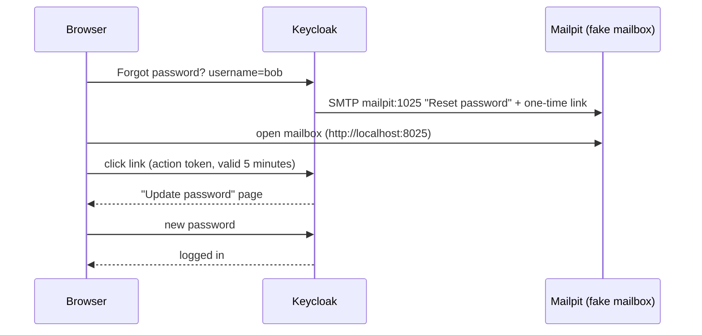

# Module 15: Themes and emails (verify email, forgot password, a branded login page)

**You'll learn:** how to let Keycloak send email (with a fake mailbox, Mailpit), the verify-email and forgot-password flows from start to end, turning self-registration on and off, the four theme types, building a small custom login theme (CSS + texts), switching off the theme cache while you work, languages (localization), and where Keycloakify fits.

**Before this:** [Module 14](14-brokering-and-federation.md).

**Starting state:** the Level 1 baseline (realm `learning`, alice and bob with emails `alice@example.com` / `bob@example.com`; see [`../catch-up.md`](../catch-up.md)), and your `keycloak` container on the Docker network `kc-lab` from Module 14, step 9. (The `partner` button and the LDAP users from Module 14 may show up in outputs; they don't matter here.)

---

## The idea in simple words

- **Email** is Keycloak's **post office**. To prove that an address belongs to you, Keycloak posts a letter with a one-time link; clicking it is like signing for the letter. "Forgot password" is the same trick: only the owner of the mailbox gets the link. In this lab the post office delivers to a **fake mailbox** (Mailpit) that catches every letter, so nothing reaches the real internet.
- A **theme** is the building's **paint and signs**. The rooms (login logic) stay the same; you change colours, logo and wording. You don't rebuild the building: you say "like the normal one (the **parent**), but with green doors and my own welcome sign".



---

## Jargon table

| Word | Plain meaning | Example |
|---|---|---|
| SMTP | The protocol for sending email | Keycloak → `mailpit:1025` |
| Mailpit | A fake mail server with a web inbox, for testing | UI and API on `http://localhost:8025` |
| Action token | The signed one-time key inside an email link | `.../action-token?key=eyJhbGciOi...` |
| Verify email | Required action: click a link to prove the address is yours | `emailVerified: true` afterwards |
| Execute actions email | Admin sends a user a link to do tasks (set password, verify email...) | "Update Your Account" email |
| Self-registration | A "Register" link on the login page | `registrationAllowed=true` |
| Theme | Templates, CSS, images and texts that draw Keycloak's pages | `keycloak.v2`, `learning-theme` |
| Theme type | Which pages a theme draws | `login`, `account`, `email`, `admin` |
| Parent theme | The theme you inherit from; you override only what you change | `parent=keycloak.v2` |
| Message bundle | A file of `key=text` lines per language | `messages_de.properties` |
| Theme cache | Keycloak keeps theme files in memory; off in `start-dev` | `--spi-theme--cache-themes=false` |
| Localization | Showing pages in the user's language | `ui_locales=de` |

---

## Hands-on

Set up your terminal (same as earlier modules):

```bash
alias kcadm='docker exec keycloak /opt/keycloak/bin/kcadm.sh'
kcadm config credentials --server http://localhost:8080 --realm master --user admin --password admin
```

### Part A: Email

#### Step 1. Start the fake mailbox on the same network

**Why:** Keycloak must reach the mail server by name (`mailpit`), so it joins `kc-lab`. Port 8025 is the web inbox, 1025 the SMTP door.

```bash
docker run -d --name mailpit --network kc-lab -p 8025:8025 -p 1025:1025 axllent/mailpit:v1.31.4
docker exec keycloak bash -c 'echo > /dev/tcp/mailpit/1025 && echo mail-ok'
curl -s http://localhost:8025/api/v1/info | jq -r .Version
```

```
mail-ok
v1.31.4
```

Open `http://localhost:8025` in your browser: an empty inbox.

#### Step 2. Give the realm its SMTP settings

**Click path:** realm `learning` → **Realm settings** → **Email** tab → From `keycloak@learning.local`, From display name `Learning Keycloak`, Host `mailpit`, Port `1025`, Encryption off, Authentication off → Save.

```bash
kcadm update realms/learning -s 'smtpServer={"host":"mailpit","port":"1025","from":"keycloak@learning.local","fromDisplayName":"Learning Keycloak","auth":"false","ssl":"false","starttls":"false"}'
kcadm get realms/learning | jq .smtpServer
```

```
{
  "starttls": "false",
  "port": "1025",
  "auth": "false",
  "host": "mailpit",
  "from": "keycloak@learning.local",
  "fromDisplayName": "Learning Keycloak",
  "ssl": "false"
}
```

(`kcadm get ... --fields smtpServer` shows `{ }` for this field; use `jq` as above.)

#### Step 3. Send a test email

**Why:** the **Test connection** button sends a mail to **the admin who clicks it**. Our `admin` user has no email address yet, so the first try failed:

```bash
kcadm create testSMTPConnection -r learning -s host=mailpit -s port=1025 -s from=keycloak@learning.local -s auth=false; echo "exit=$?"
```

```
Failed to send email
exit=1
```

Give admin an address (**master** realm → **Users** → admin → Email), then try again:

```bash
ADMIN_ID=$(kcadm get users -r master -q username=admin --fields id --format csv --noquotes)
kcadm update users/$ADMIN_ID -r master -s email=admin@learning.local
kcadm create testSMTPConnection -r learning -s host=mailpit -s port=1025 -s from=keycloak@learning.local -s auth=false; echo "exit=$?"
curl -s http://localhost:8025/api/v1/messages | jq '{total, messages: [.messages[] | {From: .From.Address, To: [.To[].Address], Subject}]}'
```

```
exit=0
{
  "total": 1,
  "messages": [
    {
      "From": "keycloak@learning.local",
      "To": [
        "admin@learning.local"
      ],
      "Subject": "[KEYCLOAK] - SMTP test message"
    }
  ]
}
```

#### Step 4. A small Python mailbox reader

**Why:** you'll read several emails; a script is faster than clicking. It prints the newest email and saves the link inside it.

```bash
uv init mail-lab && cd mail-lab && uv add httpx
```

`read_mail.py` (full file):

```python
# read_mail.py - show the newest email in Mailpit and the link inside it.
# Usage:  uv run read_mail.py

# re finds the link inside the email text.
import re

# httpx talks to Mailpit's small web API.
import httpx

# Mailpit's web UI and API run on port 8025.
MAILPIT = "http://localhost:8025"

# Ask Mailpit for the list of messages (newest first).
response = httpx.get(MAILPIT + "/api/v1/messages")
messages = response.json()["messages"]

# No email yet? Say so and stop.
if len(messages) == 0:
    print("The mailbox is empty.")
    raise SystemExit

# Take the newest message from the list.
newest = messages[0]
print("From:   ", newest["From"]["Address"])
print("To:     ", newest["To"][0]["Address"])
print("Subject:", newest["Subject"])

# The list only has a summary; fetch the full message by its ID.
full = httpx.get(MAILPIT + "/api/v1/message/" + newest["ID"]).json()
# The plain-text version of the email body.
text = full["Text"]

# Find the first http(s) link in the text.
match = re.search(r"https?://\S+", text)
if match is None:
    print("No link found in this email.")
else:
    link = match.group(0)
    # Links are long: print the start, save the whole link to a file.
    print("Link:   ", link[:70] + "...")
    with open("last-link.txt", "w") as file:
        file.write(link)
    print("(full link saved to last-link.txt)")
```

#### Step 5. Self-registration with email verification

**Why:** let a new person sign up, and only trust the email address once they click the link.

**Click path:** **Realm settings** → **Login** tab → **User registration** On, **Forgot password** On, **Verify email** On.

```bash
kcadm update realms/learning -s registrationAllowed=true -s verifyEmail=true -s resetPasswordAllowed=true
kcadm get realms/learning --fields registrationAllowed,verifyEmail,resetPasswordAllowed,loginWithEmailAllowed
```

```
{
  "registrationAllowed" : true,
  "verifyEmail" : true,
  "loginWithEmailAllowed" : true,
  "resetPasswordAllowed" : true
}
```

In a private window open `http://localhost:8180/realms/learning/account`. Pages we saw (text captured from a real browser):

```
1. Sign in to your account ... Forgot Password? ... New user? Register      <- click Register
2. Register: Username *  Email *  First name *  Last name *                 <- erin, erin@example.com, Erin, Evans
3. Email verification
   You need to verify your email address to activate your account.
   An email with instructions to verify your email address has been sent to your address erin@example.com.
```

No password field on the register page! When **Verify email** is on, Keycloak 26 asks for the password only **after** the email is verified (safer: nobody can create a usable account with someone else's address). Now read the mailbox:

```bash
uv run read_mail.py
```

```
From:    keycloak@learning.local
To:      erin@example.com
Subject: Verify email
Link:    http://localhost:8180/realms/learning/login-actions/action-token?key=e...
(full link saved to last-link.txt)
```

Paste the full link (`cat last-link.txt`) into the **same** private window. Keycloak shows **Update password: You need to change your password to activate your account.** Set `erin12345`. You land in the account console as Erin Evans. Check:

```bash
kcadm get users -r learning -q username=erin --fields username,email,emailVerified,requiredActions
curl -s http://localhost:8180/realms/learning/protocol/openid-connect/token -d client_id=learning-cli \
  -d grant_type=password -d username=erin -d password=erin12345 | jq -c '.error // "got tokens"'
```

```
[ {
  "username" : "erin",
  "email" : "erin@example.com",
  "emailVerified" : true,
  "requiredActions" : [ ]
} ]
"got tokens"
```

#### Step 6. Forgot password

**Why:** the owner of the mailbox can get back in without an admin.

In a private window, open the login page → **Forgot Password?** → username `bob` → Submit. Keycloak answers *"You should receive an email shortly with further instructions."* It says that even for unknown usernames, so attackers can't test which accounts exist. (We checked: submitting `nobody-here` showed the same sentence, and no email was sent.)

```bash
uv run read_mail.py
```

```
From:    keycloak@learning.local
To:      bob@example.com
Subject: Reset password
Link:    http://localhost:8180/realms/learning/login-actions/action-token?key=e...
(full link saved to last-link.txt)
```

The email body:

```
Someone just requested to change your Learning account's credentials. If this was you, click on the link below to reset them.

http://localhost:8180/realms/learning/login-actions/action-token?key=...

This link and code will expire within 5 minutes.

If you don't want to reset your credentials, just ignore this message and nothing will be changed.
```

Open the link → **Update password** page → set `bob123` (keep the course password) → you're in as Bob Jones. The events (**Events** → **User events**; turn on saving in **Realm settings** → **Events** first), newest first:

```bash
kcadm get events -r learning -q max=12 | jq -c '.[] | {type, user: .details.username, email: .details.email}'
```

```
{"type":"CODE_TO_TOKEN","user":null,"email":null}
{"type":"LOGIN","user":"bob","email":null}
{"type":"UPDATE_CREDENTIAL","user":"bob","email":null}
{"type":"UPDATE_PASSWORD","user":"bob","email":null}
{"type":"SEND_RESET_PASSWORD","user":"bob","email":"bob@example.com"}
{"type":"LOGIN","user":"erin","email":null}
{"type":"CODE_TO_TOKEN","user":null,"email":null}
{"type":"LOGIN","user":"erin","email":null}
{"type":"UPDATE_CREDENTIAL","user":"erin","email":null}
{"type":"UPDATE_PASSWORD","user":"erin","email":null}
{"type":"VERIFY_EMAIL","user":"erin","email":"erin@example.com"}
{"type":"SEND_VERIFY_EMAIL","user":"erin","email":"erin@example.com"}
```

#### Step 7. Admin-sent emails, and registration off

**Why:** admins can send "please do X" links (**Users** → erin → **Credentials** → **Credential reset**), and most company realms don't allow strangers to register.

```bash
EID=$(kcadm get users -r learning -q username=erin --fields id --format csv --noquotes)
kcadm update users/$EID/execute-actions-email -r learning -b '["UPDATE_PASSWORD"]'; echo "exit=$?"
curl -s http://localhost:8025/api/v1/messages | jq -c '.messages[] | {To: .To[0].Address, Subject}'
kcadm update realms/learning -s registrationAllowed=false
curl -s "http://localhost:8180/realms/learning/protocol/openid-connect/auth?client_id=web-app&response_type=code&scope=openid&redirect_uri=http%3A%2F%2Flocalhost%3A8000%2Fauth%2Fcallback&code_challenge=Hn2Bft0bsy_Mr0Gnrm6yvEwF7uZn3ZYcJ9SmRUQwSRs&code_challenge_method=S256" | grep -c 'kc-registration'
```

```
exit=0
{"To":"erin@example.com","Subject":"Update Your Account"}
{"To":"bob@example.com","Subject":"Reset password"}
{"To":"erin@example.com","Subject":"Verify email"}
{"To":"admin@learning.local","Subject":"[KEYCLOAK] - SMTP test message"}
0
```

`0`: the **Register** link is gone from the login page.

### Part B: Themes

#### Step 8. The four theme types

**Click path:** **Realm settings** → **Themes** tab.

| Type | Draws | Typical change |
|---|---|---|
| `login` | Login, register, OTP, reset-password pages | Logo, colours, texts |
| `account` | The account console (`/realms/learning/account`) | Usually left alone |
| `email` | The emails from Part A | Subjects, footer, logo |
| `admin` | The admin console | Almost never |

Built-in themes: `base` (raw templates, no styling), `keycloak` (older look; also the default **email** theme) and `keycloak.v2` (the current login look, based on PatternFly 5).

#### Step 9. Write a small login theme

**Why:** we only change a few things; everything else comes from the parent.

Make this folder layout in `~/keycloak-lab/themes`:

```
learning-theme/
  login/
    theme.properties
    resources/css/learning.css
    messages/messages_en.properties
    messages/messages_de.properties
```

`login/theme.properties`:

```properties
# Start from Keycloak's normal login theme and change only a few things.
parent=keycloak.v2
# Load the parent's stylesheet first, then ours on top of it.
styles=css/styles.css css/learning.css
```

`login/resources/css/learning.css`:

```css
/* learning.css: our small changes on top of keycloak.v2 */

/* Make the Sign In button green (our "brand colour"). */
#kc-login {
  background-color: #2e7d32;
}

/* Make the realm name at the top bigger and green too. */
#kc-header-wrapper {
  color: #66bb6a;
  font-size: 2rem;
}
```

`login/messages/messages_en.properties`:

```properties
# Replace the heading above the login form.
loginAccountTitle=Welcome to Learning Co. Please sign in
```

`login/messages/messages_de.properties`:

```properties
# The same heading in German.
loginAccountTitle=Willkommen bei Learning Co. Bitte melden Sie sich an
```

How did we know the key is `loginAccountTitle`? The parent's `login.ftl` prints `${msg("loginAccountTitle")}`, and the base English file says `loginAccountTitle=Sign in to your account`. To browse the originals, copy the theme jar out: `docker cp keycloak:/opt/keycloak/lib/lib/main/org.keycloak.keycloak-themes-26.8.0.jar .` and unzip it.

#### Step 10. Mount the themes folder and restart Keycloak

**Why:** Keycloak loads folder themes from `/opt/keycloak/themes`. The container must be recreated to add a mount; the volume keeps your data.

```bash
docker rm -f keycloak
docker run -d --name keycloak --network kc-lab -p 8180:8080 \
  -v keycloak-data:/opt/keycloak/data \
  -v "$HOME/keycloak-lab/themes:/opt/keycloak/themes" \
  -e KC_BOOTSTRAP_ADMIN_USERNAME=admin -e KC_BOOTSTRAP_ADMIN_PASSWORD=admin \
  quay.io/keycloak/keycloak:26.8.0 start-dev
sleep 20; docker logs keycloak 2>&1 | grep started | cut -c1-200
kcadm config credentials --server http://localhost:8080 --realm master --user admin --password admin
kcadm get serverinfo | jq '.themes.login[].name'
```

```
2026-10-06 18:24:14,601 INFO  [io.quarkus] (main) Keycloak 26.8.0 on JVM (powered by Quarkus 3.40.1) started in 2.704s. Listening on: http://0.0.0.0:8080
Logging into http://localhost:8080 as user admin of realm master
"keycloak"
"keycloak.v2"
"learning-theme"
```

#### Step 11. Select the theme and prove it with curl

**Click path:** **Realm settings** → **Themes** → Login theme `learning-theme` → Save.

```bash
kcadm update realms/learning -s loginTheme=learning-theme
kcadm get realms/learning --fields loginTheme
AUTH="http://localhost:8180/realms/learning/protocol/openid-connect/auth?client_id=web-app&response_type=code&scope=openid&redirect_uri=http%3A%2F%2Flocalhost%3A8000%2Fauth%2Fcallback&code_challenge=Hn2Bft0bsy_Mr0Gnrm6yvEwF7uZn3ZYcJ9SmRUQwSRs&code_challenge_method=S256"
curl -s "$AUTH" | grep -E 'Welcome to Learning|stylesheet' | sed 's/^ *//'
```

```
{
  "loginTheme" : "learning-theme"
}
<link href="/resources/y8vzj/common/keycloak/vendor/patternfly-v5/patternfly.min.css" rel="stylesheet" />
<link href="/resources/y8vzj/common/keycloak/vendor/patternfly-v5/patternfly-addons.css" rel="stylesheet" />
<link href="/resources/y8vzj/login/learning-theme/css/styles.css" rel="stylesheet" />
<link href="/resources/y8vzj/login/learning-theme/css/learning.css" rel="stylesheet" />
Welcome to Learning Co. Please sign in
```

Our CSS is loaded after the parent's, and our heading replaced "Sign in to your account". (`styles.css` is found in the parent; a theme looks up missing files in its parent.)

#### Step 12. Theme cache: edit without restarting

**Why:** while you design, you want changes to show at once. `start-dev` already **switches the theme cache off**. Change the English heading to `Hello from Learning Co. Please sign in`, save, and reload:

```bash
curl -s "$AUTH" | grep 'Learning Co' | sed 's/^ *//'
```

```
Hello from Learning Co. Please sign in
```

No restart needed. Put the old text back afterwards. In production mode (`start`) themes **are** cached; for a test server running `start`, add `--spi-theme--cache-themes=false --spi-theme--cache-templates=false` while you design, and remove them for real use.

#### Step 13. Languages (localization)

**Click path:** **Realm settings** → **Localization** → Internationalization **On**, supported locales `en`, `de`, default `en` → Save.

```bash
kcadm update realms/learning -s internationalizationEnabled=true -s 'supportedLocales=["en","de"]' -s defaultLocale=en
kcadm get realms/learning --fields internationalizationEnabled,supportedLocales,defaultLocale
curl -s "$AUTH&ui_locales=de" | grep -E 'Learning Co|Passwort vergessen' | sed 's/^ *//'
curl -s -H 'Accept-Language: de' "$AUTH" | grep 'Learning Co' | sed 's/^ *//'
```

```
{
  "internationalizationEnabled" : true,
  "supportedLocales" : [ "de", "en" ],
  "defaultLocale" : "en"
}
Willkommen bei Learning Co. Bitte melden Sie sich an
<a href="/realms/learning/login-actions/reset-credentials?client_id=web-app&amp;tab_id=z-od1QOdjv0&amp;client_data=eyJydSI6Imh0dHA6Ly9sb2NhbGhvc3Q6ODAwMC9hdXRoL2NhbGxiYWNrIiwicnQiOiJjb2RlIn0">Passwort vergessen?</a>
Willkommen bei Learning Co. Bitte melden Sie sich an
```

The language comes from `ui_locales` (sent by the app) or the browser's `Accept-Language`. Our German heading came from our theme; "Passwort vergessen?" came from the parent's German file. The page now also has a language menu ("German (Deutsch)").

Admins can also override single texts **without a theme**: **Localization** → **Realm overrides**.

```bash
kcadm create localization/de -r learning -b '{"doLogIn":"Jetzt anmelden"}'
kcadm get localization/de -r learning
curl -s "$AUTH&ui_locales=de" | grep -A2 'id="kc-login"' | sed 's/^ *//'
```

```
{
  "doLogIn" : "Jetzt anmelden"
}
<button class="pf-v5-c-button pf-m-primary pf-m-block" name="login" id="kc-login"
type="submit" >
Jetzt anmelden
```

#### Step 14. An email theme: nicer subjects

**Why:** the same parent trick works for emails. Add to `learning-theme`:

`email/theme.properties`:

```properties
# Start from Keycloak's normal email theme.
parent=keycloak
```

`email/messages/messages_en.properties`:

```properties
# Nicer subject lines for our emails.
emailVerificationSubject=Learning Co.: please confirm your email
passwordResetSubject=Learning Co.: reset your password
```

**Click path:** **Realm settings** → **Themes** → Email theme `learning-theme` → Save. Then **Users** → bob → **Send verify email**.

```bash
kcadm update realms/learning -s emailTheme=learning-theme
kcadm get realms/learning --fields loginTheme,emailTheme
BID=$(kcadm get users -r learning -q username=bob --fields id --format csv --noquotes)
kcadm update users/$BID/send-verify-email -r learning; echo "exit=$?"
curl -s http://localhost:8025/api/v1/messages | jq -c '.messages[0] | {To: .To[0].Address, Subject}'
```

```
{
  "loginTheme" : "learning-theme",
  "emailTheme" : "learning-theme"
}
exit=0
{"To":"bob@example.com","Subject":"Learning Co.: please confirm your email"}
```

#### Step 15. Bigger changes: Keycloakify (overview)

*(Overview only; not verified here.)*

CSS and texts get you far. To change the **layout**, you would copy `.ftl` (FreeMarker) templates from the parent and edit them, and then re-check them after every Keycloak upgrade. Teams that want a fully custom look often use **[Keycloakify](https://www.keycloakify.dev/)**: you write the login pages in React, and it builds a theme `.jar` that you drop into `/opt/keycloak/providers`. Packaging any theme as a jar (instead of a mounted folder) is also how you ship it to production.

---

## The one trap

**Email links that point to the wrong address, and secrets in the wrong place.** The links in emails use the address the request came in on (here `localhost:8180`). Behind a proxy or in production you must set the hostname (Module 17), or users get links to an internal name they can't open. Also: a real SMTP server needs a username and password; set them in **Realm settings** → **Email** (Authentication on, and TLS on), never in the theme. And remember: with **Verify email** on, users can't finish logging in until they click the link, so turn it on only after SMTP works.

---

## Check yourself

1. Why did the first "test connection" fail even though Mailpit was running?
2. Why was there no password field on the register page?
3. What happens if someone types an unknown username on the "Forgot password" page?
4. Which line in `theme.properties` lets our theme be only four small files?
5. A customer says the login page is German but they wanted English. Name two places the language can come from.

<details>
<summary>Answers</summary>

1. The test email goes to the admin who runs it, and `admin` had no email address.
2. With **Verify email** on, Keycloak 26 asks for the password only after the email is verified.
3. The same "You should receive an email shortly" message, and no email is sent. This hides which usernames exist.
4. `parent=keycloak.v2`: everything we don't define comes from the parent.
5. The app's `ui_locales` parameter and the browser's `Accept-Language` header (also the user's saved locale and the language menu choice).

</details>

---

## Try this

1. Override `doLogIn=Let me in` in `messages_en.properties` and reload the login page. No restart.
2. Add a logo: put `logo.png` in `login/resources/img/` and in `learning.css` set `#kc-header-wrapper { background: url(../img/logo.png) no-repeat; }`.
3. Set **Verify email** on and create a user as admin with an email but `emailVerified=false`. Log in as them. Which page appears, and which email lands in Mailpit?
