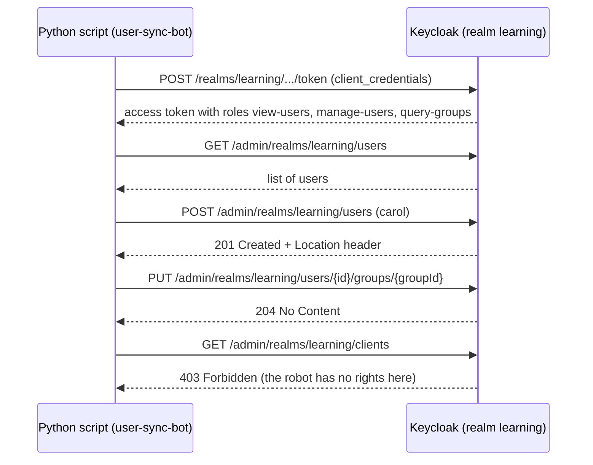

# Module 16: Drive Keycloak from code (Admin API and realm-as-code)

**You'll learn:** how to get an admin token, why a small robot client with only the rights it needs beats using the master `admin`, a Python script that lists users, creates a user without making duplicates, and puts them in a group, the same steps with `kcadm`, partial export compared with full export (and why full export needs the server stopped), importing a realm at startup, and your choices for keeping Keycloak config in Git.

**Before this:** [Module 15](../level-3-login-experience/15-themes-and-emails.md) (any Level 3 module is fine; this one only needs Level 1).

**Starting state:** the Level 1 baseline in realm `learning` (alice, bob, groups `admins`/`staff`, clients `learning-cli`, `web-app`, `notes-api`). Behind? Run [`../catch-up.md`](../catch-up.md). Keycloak container `keycloak` on port `8180` with the `keycloak-data` volume, and the `kcadm` alias logged in. If you did Module 14, make sure you did its **Step 16** (the LDAP `carol` must be gone, because this module creates a local `carol`).

---

## The idea in simple words

So far you clicked buttons in the admin console. Everything the console does, it does by calling a **web API** on Keycloak: "create user", "add to group", and so on. Your own programs can call the same API.

Think of an office building:

- The **master admin** has the master key. It opens every door in every building (every realm).
- A **robot janitor** gets a key that only opens the supply rooms in *one* building.

When you write a script that creates users, give it the janitor key, not the master key. If the script leaks, the damage stays small. This is called **least privilege**.

Second idea: **realm-as-code**. Instead of clicking, you keep your realm's setup in files (JSON, Terraform, scripts) in Git. Then you can rebuild Keycloak exactly, review changes in pull requests, and copy the setup from test to production.



---

## Jargon table

| Word | Plain meaning | Example |
|---|---|---|
| Admin REST API | Web addresses for managing Keycloak, used by the console and by scripts | `GET /admin/realms/learning/users` |
| `admin-cli` | A built-in public client in `master` that admin tools log in with | `client_id=admin-cli` |
| Service account | A hidden "user" that belongs to a client, so a program can log in as itself | `service-account-user-sync-bot` |
| `realm-management` | A built-in client in every realm that holds the admin roles for that realm | roles `view-users`, `manage-users` |
| Least privilege | Give only the rights a job needs, nothing more | robot can manage users but not clients |
| Idempotent | Running it twice gives the same result as running it once | "create carol if missing" |
| Partial export | Export from a running server; no users, secrets hidden | `POST /admin/realms/learning/partial-export` |
| Full export | Export everything (users, password hashes, secrets); server must be stopped | `kc.sh export` |
| Import at startup | Keycloak reads realm JSON files when it starts | `--import-realm` |
| Config-as-code | Your Keycloak setup lives in files in Git | Terraform, keycloak-config-cli |

---

## Hands-on

### Step 1: The quick way: an admin token from `master`

**Why:** to see that the admin API is just HTTP plus a token. The master `admin` user logs in through the public client `admin-cli` in realm `master`.

```bash
curl -s -X POST http://localhost:8180/realms/master/protocol/openid-connect/token \
  -d grant_type=password -d client_id=admin-cli \
  -d username=admin -d password=admin \
  | jq '{token_type, expires_in, access_token: (.access_token[0:40]+"...")}'
```

```json
{
  "token_type": "Bearer",
  "expires_in": 60,
  "access_token": "eyJhbGciOiJSUzI1NiIsInR5cCIgOiAiSldUIiwi..."
}
```

Note the token lives only **60 seconds**: master admin tokens are kept short on purpose. This token can do *anything in every realm*. Fine for you at a terminal. Wrong for a script that runs on a server every night.

### Step 2: Create a robot with only the rights it needs

**Why:** least privilege. We make a confidential client `user-sync-bot` **inside `learning`**, turn on its service account, and give it three roles from the `realm-management` client:

| Role | Lets the robot |
|---|---|
| `view-users` | read users |
| `manage-users` | create/change users and their group membership |
| `query-groups` | look up groups by name |

Console: realm `learning` → **Clients** → **Create client** → Client ID `user-sync-bot` → Next → **Client authentication** ON, tick only **Service accounts roles** → Save. Then **Credentials** tab for the secret, and **Service accounts roles** tab → **Assign role** → filter by clients → pick the three `realm-management` roles.

CLI (we set a fixed secret so the lab is repeatable):

```bash
kcadm create clients -r learning -s clientId=user-sync-bot -s publicClient=false \
  -s secret=user-sync-bot-secret -s serviceAccountsEnabled=true \
  -s standardFlowEnabled=false -s directAccessGrantsEnabled=false

kcadm add-roles -r learning --uusername service-account-user-sync-bot \
  --cclientid realm-management \
  --rolename view-users --rolename manage-users --rolename query-groups

kcadm get-roles -r learning --uusername service-account-user-sync-bot \
  --cclientid realm-management --fields name
```

```
Created new client with id '3e5b0cd4-e823-4f64-8d9f-12d81060518a'
[ {
  "name" : "view-users"
}, {
  "name" : "query-groups"
}, {
  "name" : "manage-users"
} ]
```

### Step 3: Prove the robot can do its job, and only its job

**Why:** always test both sides: allowed things work, forbidden things fail.

```bash
jwt_payload() {
  echo "$1" | jq -R 'split(".")[1] | gsub("-";"+") | gsub("_";"/")
    | . + ("=" * ((4 - length % 4) % 4)) | @base64d | fromjson'
}

BOT_TOKEN=$(curl -s -X POST http://localhost:8180/realms/learning/protocol/openid-connect/token \
  -d grant_type=client_credentials -d client_id=user-sync-bot \
  -d client_secret=user-sync-bot-secret | jq -r .access_token)

jwt_payload "$BOT_TOKEN" | jq '{iss, azp, resource_access}'
```

```json
{
  "iss": "http://localhost:8180/realms/learning",
  "azp": "user-sync-bot",
  "resource_access": {
    "realm-management": {
      "roles": [
        "manage-users",
        "view-users",
        "query-groups",
        "query-users"
      ]
    },
    "account": {
      "roles": [
        "manage-account",
        "manage-account-links",
        "view-profile"
      ]
    }
  }
}
```

(`query-users` appeared by itself: `view-users` is a *composite* role that includes it.)

Allowed: list users.

```bash
curl -s http://localhost:8180/admin/realms/learning/users \
  -H "Authorization: Bearer $BOT_TOKEN" | jq '[.[] | {username, email, enabled}]'
```

```json
[
  {
    "username": "alice",
    "email": "alice@example.com",
    "enabled": true
  },
  {
    "username": "bob",
    "email": "bob@example.com",
    "enabled": true
  }
]
```

Forbidden: list clients.

```bash
curl -s -i http://localhost:8180/admin/realms/learning/clients \
  -H "Authorization: Bearer $BOT_TOKEN" | sed -n '1p;$p'
```

```
HTTP/1.1 403 Forbidden
{"error":"HTTP 403 Forbidden"}
```

The robot also cannot touch any other realm, because its token was issued by `learning`.

### Step 4: The Python script

**Why:** in your company you'll write scripts like this to sync users from HR, clean up old accounts, or set up a new team.

```bash
uv init kc-admin-scripts
cd kc-admin-scripts
uv add httpx
```

Create `sync_users.py`:

```python
# sync_users.py - talk to the Keycloak Admin REST API as the "user-sync-bot" robot.
import httpx

# Where Keycloak lives and which realm we manage.
KEYCLOAK_URL = "http://localhost:8180"
REALM = "learning"

# The robot's own login details (a confidential client with a service account).
CLIENT_ID = "user-sync-bot"
CLIENT_SECRET = "user-sync-bot-secret"


def get_admin_token():
    # The normal token endpoint of OUR realm (not master).
    token_url = KEYCLOAK_URL + "/realms/" + REALM + "/protocol/openid-connect/token"
    # client_credentials = "I am a program, here is my secret, give me a token".
    form = {
        "grant_type": "client_credentials",
        "client_id": CLIENT_ID,
        "client_secret": CLIENT_SECRET,
    }
    # Send the form and stop with an error if Keycloak says no.
    response = httpx.post(token_url, data=form)
    response.raise_for_status()
    # We only need the access token string.
    return response.json()["access_token"]


def list_users(client):
    # GET /admin/realms/<realm>/users returns a list of user objects.
    response = client.get("/users")
    response.raise_for_status()
    users = response.json()
    # Print one line per user.
    for user in users:
        print("user:", user["username"], "|", user.get("email"))


def find_user_id(client, username):
    # exact=true means "carol" must not also match "carol2".
    params = {"username": username, "exact": "true"}
    response = client.get("/users", params=params)
    response.raise_for_status()
    found = response.json()
    # Empty list means the user does not exist yet.
    if len(found) == 0:
        return None
    return found[0]["id"]


def create_user_if_missing(client, username, email, first_name, last_name):
    # Idempotent: look first, create only when missing. Safe to run many times.
    existing_id = find_user_id(client, username)
    if existing_id is not None:
        print("exists already:", username, existing_id)
        return existing_id
    # The JSON body is a "UserRepresentation".
    new_user = {
        "username": username,
        "email": email,
        "firstName": first_name,
        "lastName": last_name,
        "enabled": True,
        "emailVerified": True,
    }
    # 201 Created means it worked; the new id is at the end of the Location header.
    response = client.post("/users", json=new_user)
    response.raise_for_status()
    location = response.headers["Location"]
    new_id = location.split("/")[-1]
    print("created:", username, new_id)
    return new_id


def find_group_id(client, group_name):
    # Search groups by name; the search is "contains", so we check exact match.
    response = client.get("/groups", params={"search": group_name})
    response.raise_for_status()
    for group in response.json():
        if group["name"] == group_name:
            return group["id"]
    raise RuntimeError("group not found: " + group_name)


def add_user_to_group(client, user_id, group_name):
    # Adding to a group twice is harmless: Keycloak answers 204 both times.
    group_id = find_group_id(client, group_name)
    response = client.put("/users/" + user_id + "/groups/" + group_id)
    response.raise_for_status()
    print("in group:", group_name, "status", response.status_code)


def main():
    # Get a fresh token every run; it lives only a few minutes.
    token = get_admin_token()
    # One client object with the base URL and the Authorization header preset.
    admin_base = KEYCLOAK_URL + "/admin/realms/" + REALM
    headers = {"Authorization": "Bearer " + token}
    with httpx.Client(base_url=admin_base, headers=headers) as client:
        list_users(client)
        carol_id = create_user_if_missing(
            client, "carol", "carol@example.com", "Carol", "White"
        )
        add_user_to_group(client, carol_id, "staff")


main()
```

Run it **twice**:

```bash
uv run sync_users.py
uv run sync_users.py
```

```
user: alice | alice@example.com
user: bob | bob@example.com
created: carol 7fd31018-f8bc-4b60-917d-07f63d7db70d
in group: staff status 204
```

```
user: alice | alice@example.com
user: bob | bob@example.com
user: carol | carol@example.com
exists already: carol 7fd31018-f8bc-4b60-917d-07f63d7db70d
in group: staff status 204
```

The second run changed nothing. That is what **idempotent** means, and it's the most important property of any setup script: you can run it again after a crash without fear. Carol has no password yet; that's fine (later modules give her one).

Verified with Python 3.12.13 and httpx 0.28.1.

### Step 5: The same with `kcadm`

**Why:** for one-off jobs in a terminal, `kcadm` is shorter. It calls the same API.

```bash
kcadm get users -r learning --fields username,email
kcadm create users -r learning -s username=carol -s enabled=true
kcadm get users -r learning -q username=dave -q exact=true
```

```
[ {
  "username" : "alice",
  "email" : "alice@example.com"
}, {
  "username" : "bob",
  "email" : "bob@example.com"
}, {
  "username" : "carol",
  "email" : "carol@example.com"
} ]
User exists with same username
[ ]
```

`kcadm create` is **not** idempotent: the second "create carol" fails (exit code 1). In scripts, check first (like the Python code) or ignore that one error on purpose.

Group membership with `kcadm` (what Level 1 used):

```bash
USER_ID=$(kcadm get users -r learning -q username=carol -q exact=true --fields id --format csv --noquotes)
GROUP_ID=$(kcadm get groups -r learning -q search=staff --fields id --format csv --noquotes)
kcadm update users/$USER_ID/groups/$GROUP_ID -r learning -s realm=learning -s userId=$USER_ID -s groupId=$GROUP_ID -n
```

### Step 6: Partial export (server keeps running)

**Why:** a quick snapshot of a realm's setup, for example to compare test and prod.

Console: realm `learning` → **Realm settings** → top-right **Action** menu → **Partial export** → tick groups/roles and clients → Export.

API (needs an admin token; the robot can't do it, it has no rights on clients):

```bash
ADMIN_TOKEN=$(curl -s -X POST http://localhost:8180/realms/master/protocol/openid-connect/token \
  -d grant_type=password -d client_id=admin-cli -d username=admin -d password=admin | jq -r .access_token)

curl -s -X POST "http://localhost:8180/admin/realms/learning/partial-export?exportClients=true&exportGroupsAndRoles=true" \
  -H "Authorization: Bearer $ADMIN_TOKEN" -o partial.json

jq '{realm, users: (.users|length), groups: [.groups[].name], clients: [.clients[].clientId],
     webapp_secret: (.clients[]|select(.clientId=="web-app")|.secret)}' partial.json
```

```json
{
  "realm": "learning",
  "users": 1,
  "groups": [
    "admins",
    "staff"
  ],
  "clients": [
    "account",
    "account-console",
    "admin-cli",
    "broker",
    "learning-cli",
    "notes-api",
    "realm-management",
    "security-admin-console",
    "user-sync-bot",
    "web-app"
  ],
  "webapp_secret": "**********"
}
```

Two things to notice:

1. **Secrets are masked** as `**********`. If you import this file somewhere, `web-app` gets no working secret: you must set it again. That's a safety feature, not a bug.
2. **Real users are not included.** The one "user" is `service-account-user-sync-bot`, the robot's hidden user (it holds the robot's roles).

The `kcadm` form passes the options as query parameters:

```bash
kcadm create realms/learning/partial-export -r learning -q exportClients=true -q exportGroupsAndRoles=true -o | jq -c '{realm, n: (.clients|length)}'
```

```
{"realm":"learning","n":10}
```

### Step 7: Full export: you must stop the server first

**Why:** a full export includes users, password hashes and real secrets. It's what you'd use to move a whole realm. It runs `kc.sh export`, which starts a *second* Keycloak process against the same database.

First, see what happens if you try while the server is running. The dev database (H2) is a single file that only one process may open:

```bash
docker exec keycloak /opt/keycloak/bin/kc.sh export --dir /tmp/exp --realm learning
```

```
ERROR: Failed to start server in (nonserver) mode
ERROR: Failed to obtain JDBC connection
ERROR: Database may be already in use: "/opt/keycloak/data/h2/keycloakdb.mv.db". Possible solutions: close all other connection(s); use the server mode [90020-240]
ERROR: The file is locked: /opt/keycloak/data/h2/keycloakdb.mv.db [2.4.240/7]
```

(Shortened: the real output also prints many startup lines and Java stack traces; these are the last lines.)

The correct way: stop the server, run a one-off container on the same volume, start the server again:

```bash
mkdir -p export && chmod 777 export   # the container user must be able to write here
docker stop keycloak
docker run --rm -v keycloak-data:/opt/keycloak/data -v "$PWD/export":/export \
  quay.io/keycloak/keycloak:26.8.0 export --dir /export --realm learning --users realm_file
docker start keycloak
```

```
... KC-SERVICES0034: Export of realm 'learning' requested.
... Exporting into directory /export
... Realm 'learning' - data exported
... KC-SERVICES0035: Export finished successfully
```

```bash
jq '{realm, users: [.users[].username],
     webapp_secret: (.clients[]|select(.clientId=="web-app")|.secret),
     alice_cred_type: (.users[]|select(.username=="alice")|.credentials[0].type)}' export/learning-realm.json
```

```json
{
  "realm": "learning",
  "users": [
    "alice",
    "bob",
    "carol",
    "service-account-user-sync-bot"
  ],
  "webapp_secret": "web-app-secret",
  "alice_cred_type": "password"
}
```

Real secret, real users, password hashes. **Treat this file like a password**: never commit it to Git as-is.

`--users realm_file` puts users inside the realm file. Other choices: `different_files` (users in separate files, good for big realms) or `skip`.

In production with PostgreSQL there's no file lock, but the official advice is the same: run export/import while the cluster is stopped, so nobody changes data during the copy.

### Step 8: Import at startup

**Why:** a brand-new Keycloak that comes up with your realm already inside. Great for test environments and CI.

Any `*.json` in `/opt/keycloak/data/import` is imported when you start with `--import-realm`. We start a throwaway second Keycloak (port 8181, no volume) to prove it:

```bash
docker run -d --name keycloak-copy -p 8181:8080 \
  -v "$PWD/export":/opt/keycloak/data/import \
  -e KC_BOOTSTRAP_ADMIN_USERNAME=admin -e KC_BOOTSTRAP_ADMIN_PASSWORD=admin \
  quay.io/keycloak/keycloak:26.8.0 start-dev --import-realm

docker logs keycloak-copy 2>&1 | grep -i import
```

```
... Importing from directory /opt/keycloak/bin/../data/import
... KC-SERVICES0030: Full model import requested. Strategy: IGNORE_EXISTING
... Realm 'learning' imported
... KC-SERVICES0032: Import finished successfully
```

Alice can log in there with her old password:

```bash
curl -s -X POST http://localhost:8181/realms/learning/protocol/openid-connect/token \
  -d grant_type=password -d client_id=learning-cli -d username=alice -d password=alice123 \
  | jq '{token_type, expires_in}'
docker rm -f keycloak-copy
```

```json
{
  "token_type": "Bearer",
  "expires_in": 300
}
```

`Strategy: IGNORE_EXISTING` means: if the realm already exists, leave it alone. So `--import-realm` is for **first boot**, not for pushing updates to a live realm. For updates you need one of the tools below.

### Step 9: Choose a config-as-code tool

| Option | What it is | Good | Not so good |
|---|---|---|---|
| **Realm JSON + `--import-realm`** | The files from Step 7/8 | Built in, zero tools | Only on first boot; huge noisy files; secrets inside |
| **keycloak-config-cli** (by adorsys) | Reads realm JSON/YAML and *makes Keycloak match it* through the admin API; runs as a Docker job | Same JSON format as exports; can update a live realm; supports variables for secrets | Extra tool; must match your Keycloak version |
| **Terraform provider** `keycloak/keycloak` | Terraform resources like `keycloak_openid_client`. Maintained under the Keycloak GitHub org since v5 (it used to be `mrparkers/keycloak`) | `terraform plan` shows the diff before applying; great if your company already uses Terraform | You learn Terraform; state file holds secrets; not every Keycloak feature has a resource |
| **Plain scripts** (Python + admin API, or `kcadm`) | Like Step 4 | Total control; same language as your services | You must write the "check, then create or update" logic yourself for everything |

A common company setup: Terraform or keycloak-config-cli for realms, clients, roles (reviewed in pull requests), and a Python script for user/group syncing. Users usually come from a company directory ([Module 14](../level-3-login-experience/14-brokering-and-federation.md)), not from Git.

(The two third-party tools were not run here; their names and roles are from their official project pages.)

---

## The one trap

**Using the master `admin` account in scripts and services.** It's the easiest thing to copy-paste, and it's a key to every realm. If that script's config leaks, an attacker owns your whole Keycloak. Always: a client **in the realm you manage**, service account on, only the `realm-management` roles it needs. Second trap: committing a full export (with password hashes and secrets) to Git.

---

## Check yourself

1. Why does the robot get a `403` on `/clients` but a `200` on `/users`?
2. What does "idempotent" mean, and which line in the script makes it idempotent?
3. You export with **Partial export** and import into a new server. Why does `web-app` login fail there?
4. Why does `kc.sh export` fail while the dev server is running?
5. Does `--import-realm` update a realm that already exists?

<details>
<summary>Answers</summary>

1. Its token only carries `view-users`, `manage-users`, `query-groups` (and `query-users`) from `realm-management`. Listing clients needs `view-clients`.
2. Running it twice gives the same end result. `find_user_id(...)` is checked before `POST /users`; adding to a group is naturally repeatable (`PUT` returns 204 every time).
3. Partial export masks secrets as `**********`. Set the client secret again after import.
4. The H2 database file is locked by the running server ("The file is locked"). Export starts a second Keycloak on the same database.
5. No. The log says `Strategy: IGNORE_EXISTING`: existing realms are skipped.

</details>

---

## Try this

1. Remove `manage-users` from the robot (`kcadm remove-roles ... --rolename manage-users`) and delete carol in the console. Run the script: which call fails, and with which status code?
2. Extend the script: read users from a small CSV file (`username,email,group`) and sync them all, with a plain `for` loop.
3. Do a partial export *without* `exportClients=true` and compare the size with `wc -c`.

Next: [Module 17: Running Keycloak in production](17-production.md).
