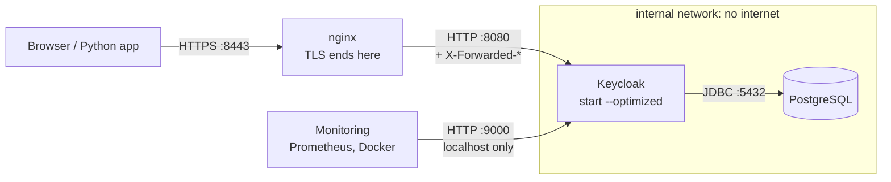

# Module 17: Running Keycloak in production

**You'll learn:** the difference between `start-dev` and `start`, build-time vs runtime options, an optimized Docker image, PostgreSQL, the public hostname, TLS (HTTPS) at a reverse proxy, health checks and metrics on the management port, a full working `docker-compose.yml` (Keycloak + Postgres + nginx), and the ideas behind clustering, backups, upgrades and sizing.

**Before this:** [Module 16](16-admin-api-and-realm-as-code.md).

**Starting state:** nothing needed in your lab `keycloak` container. This module builds a **separate** stack in its own folder; your lab keeps running on `8180`. (Need the Level 1 realm later? [`../catch-up.md`](../catch-up.md).)

---

## The idea in simple words

`start-dev` is a **practice kitchen at home**: one cook, no locks on the doors, the fridge (database) is a single file, and if the cook leaves, the food is gone. Perfect for learning.

Production is a **restaurant**: a real fridge (PostgreSQL), a front door with a guard (a reverse proxy doing HTTPS), a fixed address on the sign (hostname), health inspections (health checks), and several cooks who share the work (cluster).

`kc.sh start` refuses to run until you've set up the restaurant properly. That's a feature: it stops you from shipping the practice kitchen by mistake.



---

## Jargon table

| Word | Plain meaning | Example |
|---|---|---|
| Dev mode | `start-dev`: HTTP allowed, H2 file DB, caches local, theme caching off | your lab |
| Production mode | `start`: needs a hostname and HTTPS (or a proxy), expects a real DB | this module |
| Build-time option | Baked in by `kc.sh build`; changing it needs a new build | `KC_DB`, `KC_HEALTH_ENABLED`, `KC_METRICS_ENABLED` |
| Runtime option | Read every time the server starts | `KC_DB_URL`, `KC_HOSTNAME`, passwords |
| Optimized image | A Docker image where `kc.sh build` already ran, started with `--optimized` | faster, predictable startup |
| Reverse proxy | A server in front that receives traffic and passes it on | nginx, Traefik, a cloud load balancer |
| TLS termination | The proxy does HTTPS; behind it, plain HTTP on a private network | nginx holds the certificate |
| `X-Forwarded-*` headers | Notes the proxy adds: "the visitor used https, host X, port Y" | `X-Forwarded-Proto: https` |
| Hostname | The public URL Keycloak puts in tokens (`iss`) and links | `https://localhost:8443` |
| Management port | Separate port 9000 for health and metrics, keep it private | `/health/ready`, `/metrics` |
| Readiness | "I'm ready for traffic" (DB reachable, started) | `/health/ready` |
| Liveness | "I'm alive, don't restart me" | `/health/live` |
| Infinispan | Keycloak's built-in shared cache between nodes | sessions, realm cache |
| Cluster / HA | Several Keycloak nodes acting as one; if one dies others continue | 2–3 nodes, same DB |

---

## Hands-on

### Step 1: See `start` refuse to run without setup

**Why:** the errors teach you what production needs.

```bash
docker run --rm quay.io/keycloak/keycloak:26.8.0 start
```

```
Changes detected in configuration. Updating the server image.
WARNING: Usage of the default value for the db option in the production profile is deprecated. Please explicitly set the db instead.
WARNING: With HTTPS not enabled, `proxy-headers` unset, and `hostname-strict=false`, the server is running in an insecure context. ...
Key material not provided to setup HTTPS. Please configure your keys/certificates, or if HTTPS access is not needed see the `http-enabled` option. If you meant to start the server in development mode, see the `start-dev` command.
```

No HTTPS certificate, so no start. Allow plain HTTP (as you would behind a proxy) and it hits the next wall:

```bash
docker run --rm quay.io/keycloak/keycloak:26.8.0 start --http-enabled=true 2>&1 | grep ERROR
```

```
ERROR: Failed to start server in (production) mode
ERROR: Failed to start quarkus
ERROR: hostname is not configured; either configure hostname, or set hostname-strict to false
```

Production needs: **a database choice, HTTPS (or a proxy), and a hostname.** We'll give it all three.

### Step 2: Build-time vs runtime options

**Why:** Keycloak starts fast because it "pre-compiles" itself for your settings. Some settings change *what gets compiled*, so they're **build-time**.

| Build-time (need `kc.sh build`) | Runtime (any start) |
|---|---|
| `KC_DB` (which database type) | `KC_DB_URL`, `KC_DB_USERNAME`, `KC_DB_PASSWORD` |
| `KC_HEALTH_ENABLED`, `KC_METRICS_ENABLED` | `KC_HOSTNAME`, `KC_PROXY_HEADERS`, `KC_HTTP_ENABLED` |
| `KC_FEATURES` (turn features on/off) | `KC_LOG_LEVEL`, bootstrap admin |
| custom providers in `/opt/keycloak/providers` | |

Rule: **build once in the image, configure at runtime with env vars.** Every option has three spellings: `--db-url` (flag), `KC_DB_URL` (env var), `db-url=` (in `conf/keycloak.conf`).

What happens if you change a build-time option at runtime on an optimized image (verified, see Step 3 for the image):

```bash
docker run --rm -e KC_DB=mysql my-keycloak start --optimized ...
```

```
The following build time options have values that differ from what is persisted - the new values will NOT be used until another build is run: kc.db
```

It's ignored with a warning. Your image's settings win.

### Step 3: The project folder

```bash
mkdir keycloak-prod && cd keycloak-prod
mkdir certs
```

**`Dockerfile`**: a two-stage build (build, then copy the result into a clean image):

```dockerfile
# Stage 1: "build" Keycloak once with the build-time options baked in.
FROM quay.io/keycloak/keycloak:26.8.0 AS builder
# Build-time options: which database driver, and turn on health + metrics endpoints.
ENV KC_DB=postgres
ENV KC_HEALTH_ENABLED=true
ENV KC_METRICS_ENABLED=true
RUN /opt/keycloak/bin/kc.sh build

# Stage 2: the small final image that only contains the built result.
FROM quay.io/keycloak/keycloak:26.8.0
COPY --from=builder /opt/keycloak/ /opt/keycloak/
ENTRYPOINT ["/opt/keycloak/bin/kc.sh"]
# --optimized = "trust the build above, don't rebuild at every start" (faster startup).
CMD ["start", "--optimized"]
```

You can check what got baked in:

```bash
docker build -q -t my-keycloak .
docker run --rm my-keycloak show-config | grep -E 'kc\.(db|health|metrics)'
```

```
	kc.health-enabled =  true (Persisted)
	kc.metrics-enabled =  true (Persisted)
	kc.db =  postgres (Persisted)
```

**A lab TLS certificate** (self-signed: your computer won't trust it automatically; in real life use your company CA or Let's Encrypt):

```bash
openssl req -x509 -newkey rsa:2048 -nodes -days 365 \
  -keyout certs/tls.key -out certs/tls.crt \
  -subj "/CN=localhost" -addext "subjectAltName=DNS:localhost"
```

**`nginx.conf`**: the front door. It speaks HTTPS outside and HTTP to Keycloak:

```nginx
# nginx = the "front door". It speaks HTTPS to browsers and plain HTTP to Keycloak.
server {
    listen 8443 ssl;
    server_name localhost;

    ssl_certificate     /etc/nginx/certs/tls.crt;
    ssl_certificate_key /etc/nginx/certs/tls.key;

    # Keycloak sends big headers (cookies, tokens); give them room.
    proxy_buffer_size   128k;
    proxy_buffers       4 256k;

    location / {
        proxy_pass http://keycloak:8080;
        # Tell Keycloak who the real visitor is and which address they typed.
        proxy_set_header Host              $host;
        proxy_set_header X-Forwarded-For   $proxy_add_x_forwarded_for;
        proxy_set_header X-Forwarded-Proto $scheme;
        proxy_set_header X-Forwarded-Host  $host;
        proxy_set_header X-Forwarded-Port  $server_port;
    }
}
```

**`docker-compose.yml`**:

```yaml
services:
  postgres:
    image: postgres:16
    environment:
      POSTGRES_DB: keycloak
      POSTGRES_USER: keycloak
      POSTGRES_PASSWORD: change-me-db-password
    volumes:
      - pgdata:/var/lib/postgresql/data
    networks: [backend]
    healthcheck:
      test: ["CMD-SHELL", "pg_isready -U keycloak -d keycloak"]
      interval: 5s
      retries: 10

  keycloak:
    build: .
    depends_on:
      postgres:
        condition: service_healthy
    environment:
      # Runtime options: where the database is and how to log in to it.
      KC_DB_URL: jdbc:postgresql://postgres:5432/keycloak
      KC_DB_USERNAME: keycloak
      KC_DB_PASSWORD: change-me-db-password
      # The public address people use (through nginx).
      KC_HOSTNAME: https://localhost:8443
      # Trust X-Forwarded-* headers from nginx, and allow plain HTTP behind it.
      KC_PROXY_HEADERS: xforwarded
      KC_HTTP_ENABLED: "true"
      # First admin user (change it, then remove these two lines).
      KC_BOOTSTRAP_ADMIN_USERNAME: admin
      KC_BOOTSTRAP_ADMIN_PASSWORD: change-me-admin-password
    ports:
      # Management port (health + metrics). Only on this machine, never public.
      - "127.0.0.1:9000:9000"
    networks: [backend, frontend]

  nginx:
    image: nginx:alpine
    depends_on: [keycloak]
    volumes:
      - ./nginx.conf:/etc/nginx/conf.d/default.conf:ro
      - ./certs:/etc/nginx/certs:ro
    ports:
      - "8443:8443"
    networks: [frontend]

networks:
  frontend: {}
  backend:
    # internal: no route to the outside world. Only Keycloak can reach Postgres.
    internal: true

volumes:
  pgdata: {}
```

Why each piece:

| Setting | Why |
|---|---|
| `KC_HOSTNAME: https://localhost:8443` | **Hostname v2** (Keycloak 25+): one full URL. It becomes the `iss` in every token. All your services must use this exact address |
| `KC_PROXY_HEADERS: xforwarded` | Believe the `X-Forwarded-*` headers. **Only** set this when a proxy is really in front, or anyone could fake the headers |
| `KC_HTTP_ENABLED: "true"` | Keycloak itself speaks HTTP; nginx does the HTTPS |
| Keycloak has **no** `8080` port published | The only way in from outside is nginx. Nobody can skip the HTTPS door |
| Postgres has no ports, and `backend` is `internal` | The database is reachable only by Keycloak |
| Management port on `127.0.0.1` only | Health and metrics are for your monitoring, not the internet |

Use HTTPS directly in Keycloak instead of a proxy? Possible: `KC_HTTPS_CERTIFICATE_FILE` and `KC_HTTPS_CERTIFICATE_KEY_FILE`, port 8443. Most companies terminate TLS at a proxy or load balancer, so we show that.

### Step 4: Bring it up

```bash
docker compose up -d --build
docker compose ps --format 'table {{.Service}}\t{{.Status}}\t{{.Ports}}'
```

```
SERVICE    STATUS                    PORTS
keycloak   Up 9 seconds              127.0.0.1:9000->9000/tcp
nginx      Up 9 seconds              0.0.0.0:8443->8443/tcp, [::]:8443->8443/tcp
postgres   Up 15 seconds (healthy)   5432/tcp
```

Keycloak's log shows production mode and that it created the database tables:

```bash
docker compose logs keycloak | grep -E 'started in|Profile prod|database schema'
```

```
keycloak-1  | ... Keycloak 26.8.0 on JVM (powered by Quarkus 3.40.1) started in 1.866s. Listening on: http://0.0.0.0:8080. Management interface listening on http://0.0.0.0:9000.
keycloak-1  | ... Profile prod activated. 
keycloak-1  | ... Initializing database schema. Using changelog META-INF/jpa-changelog-master.xml
```

### Step 5: Health checks

**Why:** Docker, Kubernetes or a load balancer asks these addresses to decide "send traffic?" (ready) and "restart it?" (live).

```bash
curl -s localhost:9000/health/ready | jq
curl -s localhost:9000/health/live | jq -c
```

```json
{
  "status": "UP",
  "checks": [
    {
      "name": "Graceful Shutdown",
      "status": "UP"
    },
    {
      "name": "Keycloak database connections async health check",
      "status": "UP"
    },
    {
      "name": "Keycloak Initialized",
      "status": "UP"
    },
    {
      "name": "Keycloak cluster health check",
      "status": "UP"
    }
  ]
}
```

```
{"status":"UP","checks":[]}
```

While Keycloak was still starting, its log showed `Reporting health down status: {"status":"DOWN",...}`: that's readiness doing its job.

### Step 6: Through the proxy: the issuer

**Why:** the most important check. The `issuer` must be the **public HTTPS address**, because that's what every Python service will compare `iss` against.

```bash
curl -s --cacert certs/tls.crt https://localhost:8443/realms/master/.well-known/openid-configuration \
  | jq '{issuer, token_endpoint}'
```

```json
{
  "issuer": "https://localhost:8443/realms/master",
  "token_endpoint": "https://localhost:8443/realms/master/protocol/openid-connect/token"
}
```

`--cacert certs/tls.crt` tells curl to trust our self-signed certificate. Without it:

```bash
curl -sS https://localhost:8443/realms/master
```

```
curl: (60) SSL certificate problem: self signed certificate
More details here: https://curl.se/docs/sslcerts.html
```

(Python's `httpx` behaves the same: pass `verify="certs/tls.crt"`. Never use `verify=False` outside a lab.)

A token through the front door works:

```bash
curl -s --cacert certs/tls.crt -X POST https://localhost:8443/realms/master/protocol/openid-connect/token \
  -d grant_type=password -d client_id=admin-cli \
  -d username=admin -d password=change-me-admin-password | jq '{token_type, expires_in}'
```

```json
{
  "token_type": "Bearer",
  "expires_in": 60
}
```

And the backend network really has no internet (a test container on that network can reach Postgres, but not the world):

```bash
docker run --rm --network keycloak-prod_backend alpine sh -c \
  'nc -zv -w 2 postgres 5432; wget -q -T 3 -O /dev/null http://example.com && echo internet-ok || echo no-internet'
```

```
postgres (172.22.0.2:5432) open
wget: bad address 'example.com'
no-internet
```

(The network name is `<folder name>_backend`.)

### Step 7: Metrics

```bash
curl -s localhost:9000/metrics | grep -E '^keycloak' | head -3
```

```
keycloak_session_expiration_task_seconds_max 0.0
keycloak_session_expiration_task_seconds_bucket{le="0.001"} 0.0
keycloak_session_expiration_task_seconds_bucket{le="0.001048576"} 0.0
```

This is the **Prometheus** text format. Your company's Prometheus scrapes this address every few seconds; Grafana draws graphs. Module 20 adds login counters.

### Step 8: Backups

**Why:** everything (realms, users, sessions) lives in Postgres. Back up the **database**, not the container.

```bash
docker compose exec -T postgres pg_dump -U keycloak -d keycloak -Fc > keycloak-backup.dump
ls -la keycloak-backup.dump
docker compose exec -T postgres psql -U keycloak -d keycloak \
  -c "select count(*) as tables from information_schema.tables where table_schema='public';"
```

```
-rw-r--r-- 1 abhishekparashar wheel 236162 Oct  6 23:49 keycloak-backup.dump
 tables 
--------
    101
(1 row)
```

Restore is `pg_restore` into an empty database while Keycloak is stopped. Test your restore regularly; an untested backup is a hope, not a backup. Also keep your Git config-as-code (Module 16) and your TLS keys somewhere safe.

Clean up when done:

```bash
docker compose down -v   # -v also deletes the Postgres data volume
```

---

## Concepts you need to know (not run here)

### Clustering and high availability (HA)

- Run **2 or 3 Keycloak nodes** with the **same database** behind the load balancer. If one dies, the others keep serving.
- Nodes share fast caches with **Infinispan** (built in). In production mode the cache is `ispn` (clustered) by default; nodes find each other with the default stack **`jdbc-ping`**, which uses the shared database (so it works in Docker and Kubernetes without extra setup). Use `--cache-embedded-mtls-enabled` to encrypt traffic between nodes.
- **Sessions are stored in the database** by default since Keycloak 26 ("persistent user sessions"). So a full restart of all nodes doesn't log everyone out.
- **Sticky sessions are not required.** Any node can serve any request. Sticky routing (Keycloak can add a node hint to its cookie) only saves a little work.
- On Kubernetes, use the **Keycloak Operator**: it handles nodes, services and rolling restarts for you.

### Upgrades

1. Read the **release notes** and the **upgrading guide** for every version you skip. Look for removed options and changed defaults.
2. **Back up the database.**
3. Upgrade a **copy** first (restore the backup into a test environment, run the new image, run your login tests).
4. Change the image tag, rebuild your optimized image, start. **Database schema migration is automatic** at startup (the `Initializing database schema` / Liquibase lines you saw). There's no going back without the backup.
5. Upgrade often. Small steps are easy; jumping 10 versions is painful.

### Sizing (official starting points, 26.8 docs)

From the official guide *Concepts for sizing CPU and memory resources*:

| Load | Resource |
|---|---|
| Base memory per node (realm data + 10,000 sessions cached) | **1250 MB RAM** |
| Every **15 password logins per second** | 1 vCPU (password hashing is the expensive part) |
| Every **120 client-credentials grants per second** | 1 vCPU |
| Every **120 refresh-token requests per second** | 1 vCPU |
| Headroom for spikes, startup, failover | **+150 % CPU** |
| Database (Aurora PostgreSQL example), per 100 login/logout/refresh per second | 1400 write IOPS, 0.35–0.7 vCPU |

These are starting points; load test your own setup.

---

## The one trap

**Hostname and proxy headers that don't match reality.** If `KC_HOSTNAME` is wrong, or the proxy doesn't send `X-Forwarded-Proto: https`, Keycloak writes the wrong address into tokens and redirects: the browser bounces to `http://keycloak:8080/...`, and every API rejects tokens with an issuer mismatch. Always check the discovery `issuer` **through the proxy** (Step 6) after any change. And never set `KC_PROXY_HEADERS` when there's no proxy: then anyone can fake those headers.

---

## Check yourself

1. Name three things `start` needs that `start-dev` doesn't.
2. Is `KC_DB` build-time or runtime? And `KC_DB_URL`?
3. Why is port 8080 of Keycloak not published in the compose file?
4. What's the difference between `/health/ready` and `/health/live`?
5. Do you need sticky sessions for a 2-node cluster in Keycloak 26?

<details>
<summary>Answers</summary>

1. A hostname (or `hostname-strict=false`), HTTPS or `http-enabled` behind a proxy, and a real database (the default is deprecated in production).
2. `KC_DB` is build-time (needs `kc.sh build`). `KC_DB_URL` is runtime.
3. So nobody can bypass the nginx HTTPS front door and talk plain HTTP to Keycloak.
4. Ready = "send me traffic" (started, DB reachable). Live = "I'm not stuck; don't restart me".
5. No. Any node can serve any request; sessions are shared via the database and Infinispan.

</details>

---

## Try this

1. Remove `KC_PROXY_HEADERS` from the compose file, `docker compose up -d`, and fetch the admin console through `https://localhost:8443/admin/`. What breaks, and what does Keycloak's log say?
2. Stop Postgres (`docker compose stop postgres`) and watch `/health/ready` change. Start it again.
3. Add a second Keycloak service (`keycloak2`, same environment) and an nginx `upstream` with both. Log in, then stop one node: are you still logged in?

Next: [Module 18: Fine-grained authorization](18-authorization-services.md).
