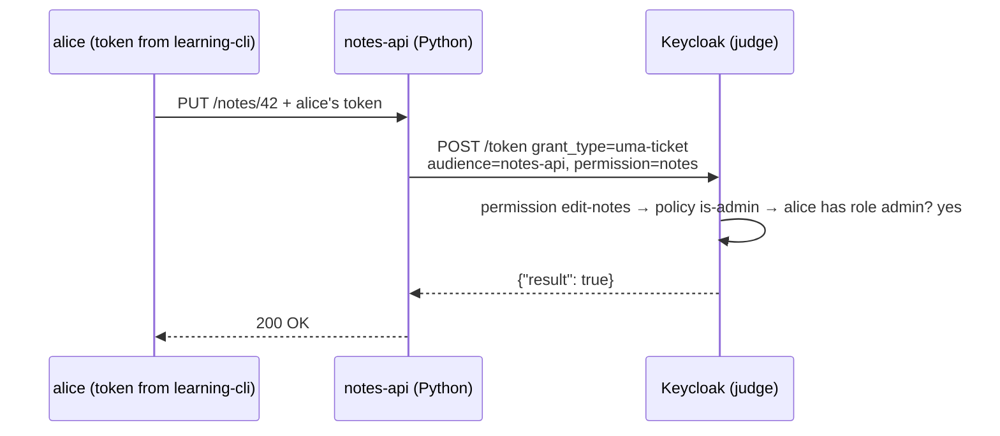

# Module 18: Fine-grained authorization (Authorization Services)

**You'll learn:** what Keycloak Authorization Services are, in plain words: resources, scopes, policies, permissions, decision strategies; how to switch them on for `notes-api`; how to ask Keycloak "may alice edit notes?" and get a yes/no, a list of permissions, or a special token (RPT); and when to use this instead of plain roles in the token or checks in your own code.

**Before this:** [Module 17](17-production.md) (only Level 1 is really needed).

**Starting state:** the Level 1 baseline (realm `learning`, alice in `admins` with realm roles `admin`+`user`, bob in `staff` with realm role `user`, client `notes-api`, client `learning-cli` with direct grants). Behind? Run [`../catch-up.md`](../catch-up.md). Lab container `keycloak` on `8180`, `kcadm` alias logged in.

---

## The idea in simple words

Until now, authorization worked like this: Keycloak puts **roles** in the token ("alice has `notes:write`"), and your Python API reads them and decides. Simple and fast. Keep using that for most things.

Authorization Services is a different idea: **Keycloak becomes the judge.** Your API asks: "Alice wants to *edit* the *notes*. Allowed?" Keycloak checks its rule book and answers yes or no.

A library analogy:

- **Resource**: a thing you protect. "The rare books room."
- **Scope**: an action on it. "read", "borrow".
- **Policy**: a condition about the person or the situation. "Is a staff member." "It's between 9 and 17 o'clock."
- **Permission**: glues them together. "To *borrow* from the *rare books room*, you must pass the policy *is a staff member*."

The rule book lives in Keycloak, so you can change rules without redeploying the API.



---

## Jargon table

| Word | Plain meaning | Example |
|---|---|---|
| Authorization Services | Keycloak's built-in rule engine for "may X do Y on Z?" | turned on per client |
| Resource server | The client (API) whose things are protected | `notes-api` |
| Resource | A protected thing (or a group of things) | `notes`, URI `/notes/*` |
| Scope (authorization) | An action on a resource. Not the same as OAuth `scope=openid` | `notes:view`, `notes:edit` |
| Policy | A yes/no condition | "user has realm role `admin`" |
| Permission | "Resource/scope X needs policies Y" | `edit-notes` → `is-admin` |
| Decision strategy | How to combine several answers | Unanimous, Affirmative, Consensus |
| UMA | "User-Managed Access", the standard behind the special grant type | `urn:ietf:params:oauth:grant-type:uma-ticket` |
| RPT | Requesting Party Token: an access token with the granted permissions inside | claim `authorization.permissions` |
| Policy enforcement mode | What happens when no permission matches a request | `ENFORCING` = deny |

### Policy types you can choose

| Policy type | Yes when... |
|---|---|
| **Role** | the user has a role (realm or client role) |
| **User** | the user is one of these named users |
| **Group** | the user is in a group (optionally its subgroups) |
| **Client** | the request comes from a given client |
| **Time** | now is inside a date/time window (office hours) |
| **Client scope** | the token has a given client scope |
| **Regex** | a claim matches a pattern |
| **Aggregated** | a combination of other policies (with its own decision strategy) |
| **JavaScript** | custom JS code. **Not available by default**: uploading scripts in the console is disabled; they must be deployed as a JAR. Avoid it |

### Permission types and decision strategies

| | Meaning |
|---|---|
| **Resource-based permission** | applies to the *whole resource*, all scopes |
| **Scope-based permission** | applies to specific scopes ("edit" only) |
| **Unanimous** | all policies must say yes (default) |
| **Affirmative** | at least one says yes |
| **Consensus** | more yes than no |

The decision strategy appears twice: inside a permission (combining its policies) and on the resource server (combining several permissions that match the same request).

---

## Hands-on

### Step 1: Turn on Authorization for `notes-api`

**Why:** Authorization Services only work on a **confidential** client with a **service account** (the API uses it to manage its own resources). Turning it on needs both.

Console: realm `learning` → **Clients** → `notes-api` → **Settings** → **Capability config**: Client authentication ON, **Authorization** ON (this also ticks Service accounts roles) → Save. A new **Authorization** tab appears.

```bash
NOTES_ID=$(kcadm get clients -r learning -q clientId=notes-api --fields id --format csv --noquotes)
echo $NOTES_ID
kcadm update clients/$NOTES_ID -r learning -s serviceAccountsEnabled=true -s authorizationServicesEnabled=true
kcadm get clients/$NOTES_ID/authz/resource-server/resource -r learning --fields name,uris
kcadm get clients/$NOTES_ID/authz/resource-server/policy -r learning --fields name,type
kcadm get clients/$NOTES_ID/authz/resource-server -r learning --fields policyEnforcementMode,decisionStrategy
```

```
eca55aa8-78bc-49b7-adb1-e72e46786be9
[ ]
[ ]
{
  "policyEnforcementMode" : "ENFORCING",
  "decisionStrategy" : "UNANIMOUS"
}
```

An empty rule book, set to **deny by default** (`ENFORCING`). (If you enable it in the console instead, Keycloak may create a "Default Resource" and "Default Permission" for you; delete them so you start clean.)

### Step 2: Scopes and the resource

**Why:** describe *what* is protected and *which actions* exist.

Console: `notes-api` → **Authorization** → **Scopes** → Create `notes:view`, `notes:edit`. Then **Resources** → Create: name `notes`, display name `All notes`, URI `/notes/*`, scopes `notes:view` and `notes:edit`.

```bash
RS=clients/$NOTES_ID/authz/resource-server
kcadm create $RS/scope -r learning -s name=notes:view
kcadm create $RS/scope -r learning -s name=notes:edit
kcadm create $RS/resource -r learning -s name=notes -s displayName="All notes" \
  -s 'uris=["/notes/*"]' -s 'scopes=[{"name":"notes:view"},{"name":"notes:edit"}]'
```

### Step 3: Two role-based policies

**Why:** policies are reusable conditions. Ours: "has realm role `user`" and "has realm role `admin`".

Console: **Authorization** → **Policies** → Create policy → **Role** → name `is-user`, add realm role `user` → Save. Same for `is-admin` with realm role `admin`.

```bash
USER_ROLE_ID=$(kcadm get roles/user -r learning --fields id --format csv --noquotes)
ADMIN_ROLE_ID=$(kcadm get roles/admin -r learning --fields id --format csv --noquotes)
kcadm create $RS/policy/role -r learning -s name=is-user -s 'roles=[{"id":"'$USER_ROLE_ID'","required":false}]'
kcadm create $RS/policy/role -r learning -s name=is-admin -s 'roles=[{"id":"'$ADMIN_ROLE_ID'","required":false}]'
```

### Step 4: Two scope-based permissions

**Why:** connect actions to conditions. View needs `is-user`. Edit needs `is-admin`.

Console: **Authorization** → **Permissions** → Create permission → **Scope-based** → name `view-notes`, resource `notes`, scope `notes:view`, policy `is-user`. Then `edit-notes`: scope `notes:edit`, policy `is-admin`.

```bash
kcadm create $RS/permission/scope -r learning -s name=view-notes \
  -s 'resources=["notes"]' -s 'scopes=["notes:view"]' -s 'policies=["is-user"]'
kcadm create $RS/permission/scope -r learning -s name=edit-notes \
  -s 'resources=["notes"]' -s 'scopes=["notes:edit"]' -s 'policies=["is-admin"]'
kcadm get $RS/permission -r learning --fields name,type,decisionStrategy
```

```
[ {
  "name" : "edit-notes",
  "type" : "scope",
  "decisionStrategy" : "UNANIMOUS"
}, {
  "name" : "view-notes",
  "type" : "scope",
  "decisionStrategy" : "UNANIMOUS"
} ]
```

The console also has an **Evaluate** tab: pick a user and see which permissions they'd get. Great for debugging.

### Step 5: Ask the judge with curl

**Why:** see the three answer styles. You always send the **user's** token as `Authorization: Bearer`, and ask the normal token endpoint with the special grant type.

```bash
TOKEN_URL=http://localhost:8180/realms/learning/protocol/openid-connect/token

for pair in alice:alice123 bob:bob123; do
  name=${pair%%:*}; pass=${pair#*:}
  USER_TOKEN=$(curl -s -X POST $TOKEN_URL -d grant_type=password -d client_id=learning-cli \
    -d username=$name -d password=$pass | jq -r .access_token)

  echo "== $name edit"
  curl -s -X POST $TOKEN_URL -H "Authorization: Bearer $USER_TOKEN" \
    -d grant_type=urn:ietf:params:oauth:grant-type:uma-ticket \
    -d audience=notes-api -d 'permission=notes#notes:edit' -d response_mode=decision
  echo
  echo "== $name all"
  curl -s -X POST $TOKEN_URL -H "Authorization: Bearer $USER_TOKEN" \
    -d grant_type=urn:ietf:params:oauth:grant-type:uma-ticket \
    -d audience=notes-api -d response_mode=permissions
  echo
done
```

```
== alice edit
{"result":true}
== alice all
[{"scopes":["notes:view","notes:edit"],"rsid":"0d749835-062e-44a6-a713-61c3fd59edc9","rsname":"notes"}]
== bob edit
{"error":"access_denied","error_description":"not_authorized"}
== bob all
[{"scopes":["notes:view"],"rsid":"0d749835-062e-44a6-a713-61c3fd59edc9","rsname":"notes"}]
```

| Parameter | Meaning |
|---|---|
| `audience=notes-api` | which resource server's rule book to use |
| `permission=notes#notes:edit` | the question: resource `#` scope. Leave it out to ask "everything" |
| `response_mode=decision` | just yes/no |
| `response_mode=permissions` | the list of what's allowed |
| (no `response_mode`) | a full token (RPT) with permissions inside |

A "no" is an HTTP **403** with `access_denied`, not a `{"result": false}`.

### Step 6: The RPT (token with permissions inside)

**Why:** some setups ask once, get an RPT, and send it to the API so the API doesn't need to call Keycloak on every request.

```bash
USER_TOKEN=$(curl -s -X POST $TOKEN_URL -d grant_type=password -d client_id=learning-cli \
  -d username=bob -d password=bob123 | jq -r .access_token)
RPT_RESPONSE=$(curl -s -X POST $TOKEN_URL -H "Authorization: Bearer $USER_TOKEN" \
  -d grant_type=urn:ietf:params:oauth:grant-type:uma-ticket -d audience=notes-api)
echo "$RPT_RESPONSE" | jq '{token_type, expires_in, upgraded}'
jwt_payload "$(echo $RPT_RESPONSE | jq -r .access_token)" | jq '{aud, azp, authorization}'
```

```json
{
  "token_type": "Bearer",
  "expires_in": 300,
  "upgraded": false
}
{
  "aud": "notes-api",
  "azp": "learning-cli",
  "authorization": {
    "permissions": [
      {
        "scopes": [
          "notes:view"
        ],
        "rsid": "0d749835-062e-44a6-a713-61c3fd59edc9",
        "rsname": "notes"
      }
    ]
  }
}
```

(`jwt_payload` is the helper from [Module 06](../level-1-basics/06-tokens.md).) Bob's RPT says: on `notes`, only `notes:view`.

### Step 7: Ask the judge from Python

**Why:** this is what your API's permission check looks like. Add to any `uv` project with `uv add httpx`.

`ask_keycloak.py`:

```python
# ask_keycloak.py - ask Keycloak "may this user do this?" (Authorization Services).
import httpx

# Same token endpoint as always; the special grant type makes it a "decision" question.
TOKEN_URL = "http://localhost:8180/realms/learning/protocol/openid-connect/token"
UMA_GRANT = "urn:ietf:params:oauth:grant-type:uma-ticket"


def get_user_token(username, password):
    # Lab shortcut: password grant via learning-cli (a real app gets this token from login).
    form = {
        "grant_type": "password",
        "client_id": "learning-cli",
        "username": username,
        "password": password,
    }
    response = httpx.post(TOKEN_URL, data=form)
    response.raise_for_status()
    return response.json()["access_token"]


def is_allowed(user_token, resource, scope):
    # The question: "resource#scope", e.g. "notes#notes:edit".
    form = {
        "grant_type": UMA_GRANT,
        "audience": "notes-api",
        "permission": resource + "#" + scope,
        "response_mode": "decision",
    }
    # We send the USER's token, so Keycloak judges this user.
    headers = {"Authorization": "Bearer " + user_token}
    response = httpx.post(TOKEN_URL, data=form, headers=headers)
    # 200 with {"result": true} means yes; 403 access_denied means no.
    if response.status_code == 200:
        return response.json()["result"]
    return False


def main():
    # Try both users against both scopes.
    people = [("alice", "alice123"), ("bob", "bob123")]
    for username, password in people:
        token = get_user_token(username, password)
        for scope in ["notes:view", "notes:edit"]:
            answer = is_allowed(token, "notes", scope)
            print(username, scope, "->", answer)


main()
```

```bash
uv run ask_keycloak.py
```

```
alice notes:view -> True
alice notes:edit -> True
bob notes:view -> True
bob notes:edit -> False
```

In a FastAPI app you'd call `is_allowed(token_from_request, "notes", "notes:edit")` inside the `PUT` route and return `403` when it's `False`. (Verified: Python 3.12.13, httpx 0.28.1.)

---

## When to use what

| Approach | How | Good for | Cost |
|---|---|---|---|
| **Roles in the token** (Modules 05, 08) | API reads `resource_access.notes-api.roles` | 90 % of cases: "can this person write notes at all?" | Changing rules may mean code changes; token grows with many roles |
| **Checks in your own code** | `if note.owner_id == user_id` | Rules about *your data* ("only the owner can delete *this* note") | Logic spread across services |
| **Keycloak Authorization Services** | API asks Keycloak (this module) | Central rules that change often, time/group/aggregated rules, many APIs sharing one rule book | Extra network call per decision (or RPT handling); Keycloak-specific; harder to debug |
| **Dedicated authorization system** (OpenFGA, SpiceDB, OPA) | API asks a separate service | Per-object sharing like Google Docs ("bob can edit doc 42") at large scale | Another system to run |

A practical default for your company: **roles in the token for coarse checks + owner checks in code**. Reach for Authorization Services when security/product wants to change rules without deploys, or you need central audit of decisions.

---

## The one trap

**Thinking the token "has" the permission.** A normal access token from login does *not* contain these permissions. You must **ask** (`uma-ticket` grant) every time, or get an RPT. Another classic: forgetting `audience=notes-api`, or asking with a token from a client that the user can't use. And a "no" is an HTTP 403 error, so code that only reads `["result"]` without checking the status code crashes.

---

## Check yourself

1. What is the difference between a policy and a permission?
2. Why did bob get `notes:view` but not `notes:edit`?
3. What does `response_mode=decision` return for "no"?
4. What must be true about `notes-api` before you can enable Authorization on it?
5. "Only the author of note 42 can delete it." Roles, Authorization Services, or app code?

<details>
<summary>Answers</summary>

1. A policy is a condition ("has role admin"). A permission links a resource/scope to one or more policies.
2. `view-notes` needs `is-user` (bob has realm role `user`); `edit-notes` needs `is-admin` (bob doesn't have `admin`).
3. HTTP 403 with `{"error":"access_denied","error_description":"not_authorized"}`.
4. Confidential (Client authentication ON) with a service account.
5. Usually app code (the owner lives in your database). Authorization Services *can* model per-user resources, but for this shape a simple check in code, or a tool like OpenFGA at scale, is clearer.

</details>

---

## Try this

1. Change `edit-notes` to use a **Group** policy for `admins` instead of the role policy. Same results?
2. Add a **Time** policy "only 09:00–17:00" and make `edit-notes` require both (`is-admin` AND time, decision strategy Unanimous). Ask at different times.
3. Use the **Evaluate** tab in the console for bob and compare with the curl output.

Next: [Module 19: Token exchange and organizations](19-token-exchange-and-organizations.md).
