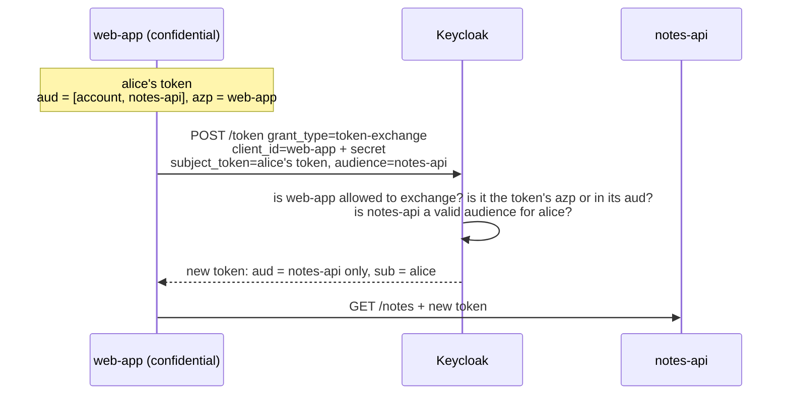

# Module 19: Token exchange and Organizations (multi-tenant)

**You'll learn:** standard token exchange (RFC 8693) in Keycloak 26: swapping alice's `web-app` token for a token aimed only at `notes-api`, who is allowed to exchange, and what the older "legacy" exchange did; then Organizations: one realm serving several customer companies, the `organization` claim in tokens, and how a Python API keeps each company's data apart.

**Before this:** [Module 18](18-authorization-services.md).

**Starting state:** the Level 1 baseline (alice/bob, `web-app` with secret `web-app-secret`, `notes-api` with client roles). Behind? Run [`../catch-up.md`](../catch-up.md). From [Module 16](16-admin-api-and-realm-as-code.md): client `user-sync-bot` (secret `user-sync-bot-secret`), used here only as the "wrong client" example. Lab container `keycloak` on `8180`, `kcadm` alias logged in, `jwt_payload` helper from [Module 06](../level-1-basics/06-tokens.md).

---

## The idea in simple words

### Token exchange

Alice logs in to the web app and gets a **key card for the whole building** (audience `account` and `notes-api`, lots of roles). The web app now needs to call `notes-api` for her. Handing the big card along is risky: if `notes-api` leaked it, it would work elsewhere too.

So the web app goes to the front desk: "Here is Alice's card. Please give me a card that **only opens the notes room**, still in Alice's name." That's **token exchange**: trade one token for another, narrower or for a different service, without Alice logging in again.



### Organizations

Your company sells software to other companies: Acme and Globex. Both use the same app and the same Keycloak realm. **Organizations** label users: "alice works for Acme", "bob works for Globex". The label goes into the token, and your API uses it to show each company only its own data. Each company is a **tenant**; this setup is **multi-tenancy**.

---

## Jargon table

| Word | Plain meaning | Example |
|---|---|---|
| Token exchange | Trade a token for another token | RFC 8693 |
| Subject token | The token you hand in | alice's `web-app` access token |
| Requester | The client doing the exchange (must log in with its secret) | `web-app` |
| Requested audience | Which service the new token is for | `audience=notes-api` |
| Downscoping | Getting a narrower token than the one you had | aud from `[account, notes-api]` to `notes-api` |
| Standard token exchange (V2) | Keycloak 26's supported, built-in exchange, switched on per client | capability "Standard token exchange" |
| Legacy token exchange (V1) | Older preview feature with extra tricks (external tokens, impersonation) | `--features=token-exchange` |
| Tenant | One customer company in a shared system | Acme |
| Organization | Keycloak's object for a tenant: name, alias, email domains, members, IdPs | `acme`, domain `acme.com` |
| `organization` claim | Token claim listing the user's organizations | `["acme"]` |
| Identity-first login | Login asks for the username/email first, then decides what's next | needed so Keycloak can route by domain |

---

## Hands-on: token exchange

### Step 1: A helper that logs in like a browser

**Why:** `web-app` has direct grants OFF (correctly), so we can't use the password grant to get *its* tokens. In Level 2 your FastAPI app did the real login. For this lab we fake the browser with curl: open the login page, post the form, take the code, exchange it with PKCE. **Lab only.**

Create `login_steps.sh`:

```bash
# shared part: open login page, send username+password, follow a 2nd password page if shown
KC=${KC:-http://localhost:8180}
USER_NAME=$1; USER_PASS=$2
JAR=$(mktemp)
VERIFIER=$(openssl rand -base64 48 | tr -d '=+/\n' | cut -c1-64)
CHALLENGE=$(printf '%s' "$VERIFIER" | openssl dgst -sha256 -binary | openssl base64 | tr '+/' '-_' | tr -d '=\n')
REDIRECT=http://localhost:8000/auth/callback
PAGE=$(curl -s -c "$JAR" -b "$JAR" "$KC/realms/learning/protocol/openid-connect/auth?client_id=web-app&response_type=code&scope=openid&redirect_uri=$REDIRECT&code_challenge=$CHALLENGE&code_challenge_method=S256")
LOCATION=""
for STEP in 1 2; do
  if [ -z "$LOCATION" ]; then
    FORM_URL=$(echo "$PAGE" | grep -o 'action="[^"]*"' | head -1 | sed 's/action="//; s/"$//; s/&amp;/\&/g')
    PAGE=$(curl -s -c "$JAR" -b "$JAR" -w '\nREDIRECT_TO=%{redirect_url}' --data-urlencode "username=$USER_NAME" --data-urlencode "password=$USER_PASS" "$FORM_URL")
    LOCATION=$(echo "$PAGE" | grep '^REDIRECT_TO=' | sed 's/^REDIRECT_TO=//')
  fi
done
CODE=$(echo "$LOCATION" | sed -n 's/.*[?&]code=\([^&]*\).*/\1/p')
rm -f "$JAR"
```

(The loop of 2 handles the "username first, password next" login page you'll meet once Organizations are on, later in this module.)

Create `login_as.sh`:

```bash
# login_as.sh USER PASS -> prints the token JSON web-app would receive (lab only: acts like a browser)
. "$(dirname "$0")/login_steps.sh"
curl -s -X POST "$KC/realms/learning/protocol/openid-connect/token" \
  -d grant_type=authorization_code -d client_id=web-app -d client_secret=web-app-secret \
  -d code="$CODE" -d redirect_uri=$REDIRECT -d code_verifier="$VERIFIER"
```

```bash
bash login_as.sh alice alice123 | jq '{token_type, scope}'
```

```json
{
  "token_type": "Bearer",
  "scope": "openid email profile"
}
```

### Step 2: Look at alice's `web-app` token

```bash
TOKEN_URL=http://localhost:8180/realms/learning/protocol/openid-connect/token
ALICE_WEB=$(bash login_as.sh alice alice123 | jq -r .access_token)
jwt_payload "$ALICE_WEB" | jq '{aud, azp}'
```

```json
{
  "aud": [
    "account",
    "notes-api"
  ],
  "azp": "web-app"
}
```

Two audiences: broader than `notes-api` needs.

### Step 3: Try to exchange (not allowed yet)

```bash
curl -s -X POST $TOKEN_URL \
  -d grant_type=urn:ietf:params:oauth:grant-type:token-exchange \
  -d client_id=web-app -d client_secret=web-app-secret \
  -d subject_token=$ALICE_WEB \
  -d subject_token_type=urn:ietf:params:oauth:token-type:access_token \
  -d audience=notes-api
```

```
{"error":"invalid_request","error_description":"Standard token exchange is not enabled for the requested client"}
```

Exchange is **off by default for every client**. Good.

### Step 4: Switch on "Standard token exchange" for `web-app`

Console: **Clients** → `web-app` → **Settings** → **Capability config** → tick **Standard Token Exchange** → Save.

```bash
WEB_ID=$(kcadm get clients -r learning -q clientId=web-app --fields id --format csv --noquotes)
kcadm update clients/$WEB_ID -r learning -s 'attributes."standard.token.exchange.enabled"=true'
```

Same request again:

```bash
RESULT=$(curl -s -X POST $TOKEN_URL \
  -d grant_type=urn:ietf:params:oauth:grant-type:token-exchange \
  -d client_id=web-app -d client_secret=web-app-secret \
  -d subject_token=$ALICE_WEB \
  -d subject_token_type=urn:ietf:params:oauth:token-type:access_token \
  -d audience=notes-api)
echo "$RESULT" | jq 'del(.access_token)'
jwt_payload "$(echo $RESULT | jq -r .access_token)" | jq '{aud, azp, sub, resource_access}'
```

```json
{
  "issued_token_type": "urn:ietf:params:oauth:token-type:access_token",
  "expires_in": 300,
  "refresh_expires_in": 0,
  "token_type": "Bearer",
  "not-before-policy": 0,
  "session_state": "aseqbLElOTRhmOVmEyUJJZjd",
  "scope": "openid email profile"
}
{
  "aud": "notes-api",
  "azp": "web-app",
  "sub": "41469991-82f5-4595-a73f-6fcb45e9bc54",
  "resource_access": {
    "notes-api": {
      "roles": [
        "notes:read",
        "notes:write"
      ]
    }
  }
}
```

Before → after:

| Claim | Before | After |
|---|---|---|
| `aud` | `["account", "notes-api"]` | `"notes-api"` |
| `azp` | `web-app` | `web-app` (still: who asked) |
| `sub` | alice | alice (same person) |
| `resource_access` | roles for `notes-api` and `account` | only `notes-api` roles |

No refresh token (`refresh_expires_in: 0`): by default the exchanged token is just a short-lived access token.

### Step 5: Who may exchange? (the rules, tested)

**Rule 1: the requester must be connected to the subject token.** The official rule: the requesting client must be in the subject token's **audience**. In this test Keycloak also accepted `web-app` because it is the token's **`azp`** (the client the token was issued to). Any *other* client is refused. We temporarily enable exchange on the robot from Module 16 and try:

```bash
BOT_ID=$(kcadm get clients -r learning -q clientId=user-sync-bot --fields id --format csv --noquotes)
kcadm update clients/$BOT_ID -r learning -s 'attributes."standard.token.exchange.enabled"=true'

curl -s -X POST $TOKEN_URL \
  -d grant_type=urn:ietf:params:oauth:grant-type:token-exchange \
  -d client_id=user-sync-bot -d client_secret=user-sync-bot-secret \
  -d subject_token=$ALICE_WEB \
  -d subject_token_type=urn:ietf:params:oauth:token-type:access_token \
  -d audience=notes-api

kcadm update clients/$BOT_ID -r learning -s 'attributes."standard.token.exchange.enabled"=false'
```

```
{"error":"access_denied","error_description":"Client is not within the token audience"}
```

So a stolen token can't be "upgraded" by just any client. For a chain like `web-app → notes-api → another-api`, `notes-api` can exchange tokens whose `aud` contains `notes-api` (it needs its own secret and the capability turned on).

**Rule 2: the target audience must make sense for the user.** Keycloak only issues an audience the user could normally get (via roles or audience mappers):

```bash
curl -s -X POST $TOKEN_URL \
  -d grant_type=urn:ietf:params:oauth:grant-type:token-exchange \
  -d client_id=web-app -d client_secret=web-app-secret \
  -d subject_token=$ALICE_WEB \
  -d subject_token_type=urn:ietf:params:oauth:token-type:access_token \
  -d audience=user-sync-bot
```

```
{"error":"invalid_request","error_description":"Requested audience not available: user-sync-bot"}
```

### Legacy token exchange (V1), briefly

Before Keycloak 26.2 there was only a **preview** feature (`--features=token-exchange`) using fine-grained admin permissions. It could also:

- exchange an **external** token (e.g. from Google) for a Keycloak token, or the reverse;
- **impersonate**: get a token for *another* user.

These are powerful and easy to misuse. They still exist only in the legacy feature. For "service calls service for the user", use the standard V2 shown above. (Legacy was not run here.)

---

## Hands-on: Organizations

### Step 6: Turn on Organizations and create two

Console: **Realm settings** → **General** → **Organizations** ON → Save. Then the new **Organizations** menu → **Create organization**: name `Acme`, alias `acme`, domain `acme.com`. Same for `Globex` / `globex` / `globex.com`.

```bash
kcadm update realms/learning -s organizationsEnabled=true
kcadm create organizations -r learning -s name=Acme -s alias=acme -s 'domains=[{"name":"acme.com"}]'
kcadm create organizations -r learning -s name=Globex -s alias=globex -s 'domains=[{"name":"globex.com"}]'
kcadm get organizations -r learning --fields id,name,alias
```

```
Created new organization with id 'e33f70b2-9804-4082-9ab1-f43e4bf1c260'
Created new organization with id 'cbb1ab79-6845-42a5-9611-3175e13ad2b0'
[ {
  "id" : "e33f70b2-9804-4082-9ab1-f43e4bf1c260",
  "name" : "Acme",
  "alias" : "acme"
}, {
  "id" : "cbb1ab79-6845-42a5-9611-3175e13ad2b0",
  "name" : "Globex",
  "alias" : "globex"
} ]
```

### Step 7: Add members

Console: **Organizations** → `Acme` → **Members** → **Add member** → alice. `Globex` → bob.

The API takes the user's id as a JSON string body:

```bash
ALICE_ID=$(kcadm get users -r learning -q username=alice -q exact=true --fields id --format csv --noquotes)
BOB_ID=$(kcadm get users -r learning -q username=bob -q exact=true --fields id --format csv --noquotes)
kcadm create organizations/e33f70b2-9804-4082-9ab1-f43e4bf1c260/members -r learning -b "\"$ALICE_ID\""
kcadm create organizations/cbb1ab79-6845-42a5-9611-3175e13ad2b0/members -r learning -b "\"$BOB_ID\""
kcadm get organizations/e33f70b2-9804-4082-9ab1-f43e4bf1c260/members -r learning --fields username,membershipType
```

```
Created new member with id '41469991-82f5-4595-a73f-6fcb45e9bc54'
Created new member with id '7ee08041-a99f-4750-b712-80b87cafdf57'
[ {
  "username" : "alice",
  "membershipType" : "UNMANAGED"
} ]
```

(Use your own organization ids from Step 6.) `UNMANAGED` = added by an admin. `MANAGED` members are created through the organization's own identity provider and belong to it.

### Step 8: The `organization` claim

**Why:** the API needs to know the tenant. Keycloak adds a client scope `organization`; when enabled on the realm it's an **optional** scope on clients, so you must ask for it.

```bash
kcadm get clients/$(kcadm get clients -r learning -q clientId=learning-cli --fields id --format csv --noquotes)/optional-client-scopes -r learning --fields name | jq -c '[.[].name]'
```

```
["address","phone","offline_access","organization","microprofile-jwt"]
```

```bash
for pair in alice:alice123 bob:bob123; do
  T=$(curl -s -X POST $TOKEN_URL -d grant_type=password -d client_id=learning-cli \
    -d username=${pair%%:*} -d password=${pair#*:} -d "scope=openid organization" | jq -r .access_token)
  jwt_payload "$T" | jq -c '{preferred_username, scope, organization}'
done

# without asking for the scope:
T=$(curl -s -X POST $TOKEN_URL -d grant_type=password -d client_id=learning-cli \
  -d username=alice -d password=alice123 | jq -r .access_token)
jwt_payload "$T" | jq -c '{preferred_username, scope, organization}'
```

```
{"preferred_username":"alice","scope":"openid email profile organization","organization":["acme"]}
{"preferred_username":"bob","scope":"openid email profile organization","organization":["globex"]}
{"preferred_username":"alice","scope":"email profile","organization":null}
```

No `scope=organization` → no claim. In `web-app` (Authlib), add `organization` to the `scope` string. The claim is a **list**: a user can belong to several organizations. (The mapper can also add org ids and attributes; see the `organization` client scope's mapper settings.)

### Step 9: Keep tenants apart in a Python API

**Why:** this is the whole point. The tenant must come from the **verified token**, never from a URL parameter or form field the user can change.

In a `uv` project: `uv add httpx "pyjwt[crypto]"`. `tenant_notes.py`:

```python
# tenant_notes.py - each company (organization) sees only its own notes.
import httpx
import jwt

ISSUER = "http://localhost:8180/realms/learning"
TOKEN_URL = ISSUER + "/protocol/openid-connect/token"
JWKS_URL = ISSUER + "/protocol/openid-connect/certs"

# Pretend database: every note belongs to exactly one organization (tenant).
NOTES = [
    {"org": "acme", "text": "Acme launch plan"},
    {"org": "acme", "text": "Acme salaries"},
    {"org": "globex", "text": "Globex secret formula"},
]

# Downloads Keycloak's public keys once and caches them.
jwks_client = jwt.PyJWKClient(JWKS_URL)


def get_token(username, password):
    # Lab shortcut. Note scope "organization": without it there is no organization claim.
    form = {
        "grant_type": "password",
        "client_id": "learning-cli",
        "username": username,
        "password": password,
        "scope": "openid organization",
    }
    response = httpx.post(TOKEN_URL, data=form)
    response.raise_for_status()
    return response.json()["access_token"]


def tenant_of(token):
    # ALWAYS verify first; never trust an unverified claim for data access.
    key = jwks_client.get_signing_key_from_jwt(token)
    claims = jwt.decode(
        token, key.key, algorithms=["RS256"], audience="notes-api", issuer=ISSUER
    )
    # The claim is a list, because one user may belong to several organizations.
    orgs = claims.get("organization", [])
    # Our simple rule: exactly one organization, otherwise refuse.
    if len(orgs) != 1:
        raise PermissionError("expected exactly one organization, got " + str(orgs))
    return orgs[0]


def notes_for(token):
    # The tenant comes from the TOKEN, never from a URL or form field the user controls.
    org = tenant_of(token)
    visible = []
    for note in NOTES:
        if note["org"] == org:
            visible.append(note["text"])
    return org, visible


def main():
    people = [("alice", "alice123"), ("bob", "bob123")]
    for username, password in people:
        token = get_token(username, password)
        org, visible = notes_for(token)
        print(username, "is in", org, "and sees", visible)


main()
```

```bash
uv run tenant_notes.py
```

```
alice is in acme and sees ['Acme launch plan', 'Acme salaries']
bob is in globex and sees ['Globex secret formula']
```

In a real database, every table gets an `org` (tenant) column and **every** query filters on it (`WHERE org = :org`). Some teams add database-level row security as a safety net. (Verified: Python 3.12.13, PyJWT 2.15.1, httpx 0.28.1.)

### Step 10: Login per organization (brief)

With Organizations on, the login page becomes **identity-first**: it asks for the username/email first, then the password on a second page. You'll notice this in the browser now (and it's why `login_steps.sh` loops twice). Keycloak looks at the email domain: if `acme.com` is linked to an identity provider (e.g. Acme's own Azure AD, set up as in [Module 14](../level-3-login-experience/14-brokering-and-federation.md)) on the organization, the user is sent straight there. Each customer brings its own login, while your apps keep one realm and one `web-app` client. (Per-org IdP redirect not verified here: needs a second IdP.)

---

## The one trap

**Token exchange:** enabling it on a public or widely shared client. Only confidential, trusted backends should exchange, and only for the audiences they truly call. **Organizations:** taking the tenant from the request (`?org=acme`) instead of from the verified token, or forgetting `scope=organization` and then treating "no claim" as "all tenants". Missing claim must mean **deny**.

---

## Check yourself

1. What did token exchange change in alice's token, and what stayed the same?
2. Why did `user-sync-bot` get `Client is not within the token audience`?
3. Is token exchange on by default for a client?
4. alice's token has no `organization` claim. Two possible reasons?
5. Why must the tenant come from the verified token?

<details>
<summary>Answers</summary>

1. `aud` shrank to `notes-api` and only `notes-api` roles remained. `sub` (alice) and `azp` (web-app) stayed.
2. The bot is neither in the subject token's `aud` nor its `azp`; Keycloak refuses to let unrelated clients trade someone's token.
3. No. You must tick "Standard Token Exchange" (attribute `standard.token.exchange.enabled`).
4. She isn't a member of any organization, or the client didn't request `scope=organization` (it's optional).
5. Anything the user sends (URL, body) can be changed by them; the token is signed by Keycloak and can't be changed without breaking the signature.

</details>

---

## Try this

1. Add alice to `Globex` too. Run `tenant_notes.py`: what happens, and how would you let her pick a tenant safely?
2. Exchange alice's token with `audience=notes-api` and then call your Level 2 notes API with the new token. Does it accept it?
3. Try `requested_token_type=urn:ietf:params:oauth:token-type:refresh_token` in the exchange. What does Keycloak say? (Hint: there's a client setting for allowing refresh tokens in exchange.)

Next: [Module 20: Events, monitoring and hardening](20-events-monitoring-and-hardening.md).
