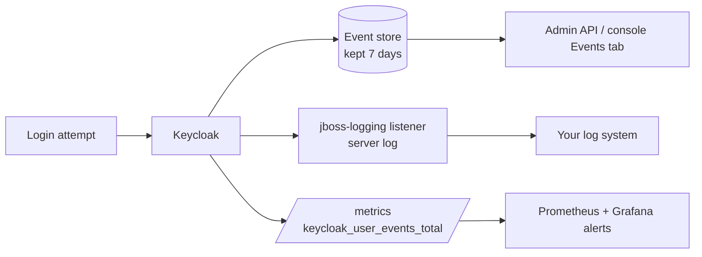

# Module 20: Events, monitoring and hardening

**You'll learn:** user events vs admin events, how to turn them on and keep them for a while, reading them through the admin API (a real `LOGIN` and `LOGIN_ERROR`), event listeners and the log, Prometheus metrics for logins, and a hardening checklist you can apply today: brute-force protection, password policy, short tokens, HTTPS, rotating signing keys (with the JWKS showing two keys) and client secrets.

**Before this:** [Module 19](19-token-exchange-and-organizations.md).

**Starting state:** the Level 1 baseline. Behind? Run [`../catch-up.md`](../catch-up.md). From [Module 16](16-admin-api-and-realm-as-code.md): user `carol` (no password yet) and client `user-sync-bot`. Lab container `keycloak` on `8180`, `kcadm` alias logged in.

---

## The idea in simple words

A building has a **visitor log at the door** ("Alice came in at 9:02", "someone tried Bob's badge with the wrong PIN") and a **maintenance log** ("the manager changed the lock on room 4"). Keycloak has both:

- **User events**: things users do: log in, fail to log in, log out, change password.
- **Admin events**: things admins (or admin scripts) change: create a user, edit a client.

Both are **off by default**. Turn them on, or you're blind when something goes wrong.

**Hardening** means locking the doors you don't use and making the ones you use stronger: limit wrong-password attempts, require good passwords, short-lived tokens, HTTPS everywhere, change the keys from time to time.



---

## Jargon table

| Word | Plain meaning | Example |
|---|---|---|
| User event | Something a user did | `LOGIN`, `LOGIN_ERROR`, `LOGOUT` |
| Admin event | A change made through the admin API/console | `UPDATE USER` |
| Event expiration | How long stored events are kept | `604800` seconds = 7 days |
| Event listener | Code that receives every event | `jboss-logging` writes them to the log |
| Metrics | Numbers that monitoring tools graph | `keycloak_user_events_total` |
| Prometheus | Popular tool that collects metrics by scraping `/metrics` | |
| Brute-force protection | Lock an account for a while after too many wrong passwords | `failureFactor=5` |
| Password policy | Rules for new passwords | `length(12) and notUsername` |
| Key rotation | Start signing with a new key, keep the old one for checking for a while | new `rsa-generated` provider |
| Active / passive key | Active signs new tokens; passive only verifies old ones | `status: PASSIVE` |
| CVE | A publicly known security bug with an ID | `CVE-2024-xxxx` |

---

## Hands-on

### Step 1: Turn on user and admin events

**Why:** you can't investigate what you didn't record.

Console: realm `learning` → **Realm settings** → **Events** tab → **User events settings**: Save events ON, Expiration 7 days → Save. **Admin events settings**: Save events ON, Include representation ON → Save.

```bash
kcadm update realms/learning -s eventsEnabled=true -s eventsExpiration=604800 \
  -s adminEventsEnabled=true -s adminEventsDetailsEnabled=true
kcadm get events/config -r learning \
  --fields eventsEnabled,eventsExpiration,eventsListeners,adminEventsEnabled,adminEventsDetailsEnabled
```

```json
{
  "eventsEnabled" : true,
  "eventsExpiration" : 604800,
  "eventsListeners" : [ "jboss-logging" ],
  "adminEventsEnabled" : true,
  "adminEventsDetailsEnabled" : true
}
```

`eventsExpiration` is in seconds; without it events pile up in the database forever. "Include representation" stores the changed object in admin events (handy, but it can contain personal data).

### Step 2: Make some events

```bash
TOKEN_URL=http://localhost:8180/realms/learning/protocol/openid-connect/token
curl -s -X POST $TOKEN_URL -d grant_type=password -d client_id=learning-cli \
  -d username=alice -d password=alice123 | jq -c 'keys'
curl -s -X POST $TOKEN_URL -d grant_type=password -d client_id=learning-cli \
  -d username=alice -d password=WRONG; echo
CAROL_ID=$(kcadm get users -r learning -q username=carol -q exact=true --fields id --format csv --noquotes)
kcadm update users/$CAROL_ID -r learning -s firstName=Caroline
```

```
["access_token","expires_in","not-before-policy","refresh_expires_in","refresh_token","scope","session_state","token_type"]
{"error":"invalid_grant","error_description":"Invalid user credentials"}
```

### Step 3: Read user events

Console: **Events** (left menu) → **User events** tab. API:

```bash
kcadm get events -r learning --fields time,type,clientId,ipAddress,error,details
```

```json
[ {
  "time" : 1791310081521,
  "type" : "LOGIN_ERROR",
  "clientId" : "learning-cli",
  "ipAddress" : "192.168.65.1",
  "error" : "invalid_user_credentials",
  "details" : { }
}, {
  "time" : 1791310081464,
  "type" : "LOGIN",
  "clientId" : "learning-cli",
  "ipAddress" : "192.168.65.1",
  "details" : { }
} ]
```

The full error event, filtered by type:

```bash
kcadm get events -r learning -q type=LOGIN_ERROR -q max=1
```

```json
[ {
  "id" : "32307f6a-0147-4d75-8c3c-4febc09eeecc",
  "time" : 1791310081521,
  "type" : "LOGIN_ERROR",
  "realmId" : "c13de6eb-145c-449c-bf5d-4907ae41e84d",
  "clientId" : "learning-cli",
  "userId" : "41469991-82f5-4595-a73f-6fcb45e9bc54",
  "ipAddress" : "192.168.65.1",
  "error" : "invalid_user_credentials",
  "details" : {
    "auth_method" : "openid-connect",
    "grant_type" : "password",
    "client_auth_method" : "client-secret",
    "username" : "alice"
  }
} ]
```

Notice: the **user** sees only the vague `Invalid user credentials` (so attackers learn nothing), while the **event** says exactly what went wrong. That's why events are the first place to look when debugging (see [Module 22](22-troubleshooting.md)). `192.168.65.1` is Docker Desktop's address for your Mac. Useful filters: `-q user=<id>`, `-q client=<clientId>`, `-q dateFrom=2026-10-01`, `-q max=50`. Plain REST: `GET /admin/realms/learning/events?type=LOGIN_ERROR`.

### Step 4: Read admin events

```bash
kcadm get admin-events -r learning -q max=1 \
  | jq '.[0] | del(.representation) + {representation: (.representation|fromjson|{username, firstName})}'
```

```json
{
  "id": "e3a47d1a-ee4b-4696-94ac-f09e3ca3191d",
  "time": 1791310082623,
  "realmId": "c13de6eb-145c-449c-bf5d-4907ae41e84d",
  "authDetails": {
    "realmId": "f3b6651d-a39c-44b3-9685-975219177d23",
    "clientId": "a848442c-b73b-417b-9b6e-0d207dc6680e",
    "userId": "8d8d494b-0ecc-4005-994c-3abec673c00b",
    "ipAddress": "127.0.0.1"
  },
  "operationType": "UPDATE",
  "resourceType": "USER",
  "resourcePath": "users/7fd31018-f8bc-4b60-917d-07f63d7db70d",
  "representation": {
    "username": "carol",
    "firstName": "Caroline"
  }
}
```

`authDetails` says **who** made the change: the `master` realm's admin user, through `admin-cli`, from `127.0.0.1` (kcadm runs inside the container). Perfect for "who changed this client's redirect URIs?!".

### Step 5: Event listeners: events in the log

**Why:** the database keeps events for a week; your company's log system (Loki, ELK, Splunk, CloudWatch) keeps them longer and can alert. The `jboss-logging` listener, on by default, writes every event to Keycloak's log:

```bash
docker logs keycloak 2>&1 | grep 'type="LOGIN_ERROR"' | tail -1
```

```
2026-10-06 18:08:01,523 WARN  [org.keycloak.events] (executor-thread-1) type="LOGIN_ERROR", realmId="c13de6eb-145c-449c-bf5d-4907ae41e84d", realmName="learning", clientId="learning-cli", userId="41469991-82f5-4595-a73f-6fcb45e9bc54", ipAddress="192.168.65.1", error="invalid_user_credentials", auth_method="openid-connect", grant_type="password", client_auth_method="client-secret", username="alice"
```

Errors are logged at `WARN`, successes at `DEBUG` (so you don't see `LOGIN` lines by default). Want events sent somewhere else, like a webhook? That's a custom listener: [Module 21](21-extending-keycloak.md).

### Step 6: Metrics for logins (Prometheus)

**Why:** a graph of "failed logins per minute" with an alert catches attacks and outages early.

You need: metrics on, user event metrics on, and the management port **9000** published. Recreate the lab container (same volume, nothing lost):

```bash
docker rm -f keycloak
docker run -d --name keycloak -p 8180:8080 -p 9000:9000 \
  -v keycloak-data:/opt/keycloak/data \
  -e KC_BOOTSTRAP_ADMIN_USERNAME=admin -e KC_BOOTSTRAP_ADMIN_PASSWORD=admin \
  quay.io/keycloak/keycloak:26.8.0 start-dev \
  --metrics-enabled=true --event-metrics-user-enabled=true
```

Then one good and one bad admin login, and read the counter:

```bash
kcadm config credentials --server http://localhost:8080 --realm master --user admin --password admin
kcadm config credentials --server http://localhost:8080 --realm master --user admin --password wrong
curl -s localhost:9000/metrics | grep -E '^keycloak_user_events'
```

```
Logging into http://localhost:8080 as user admin of realm master
Invalid user credentials [invalid_grant]
keycloak_user_events_total{error="invalid_user_credentials",event="login",realm="master"} 1.0
keycloak_user_events_total{error="",event="login",realm="master"} 1.0
```

(Verified on a fresh container, so only these two logins were counted.)

| Option | Meaning |
|---|---|
| `--metrics-enabled` | `/metrics` on port 9000 (build-time option; `start-dev` rebuilds for you) |
| `--event-metrics-user-enabled` | count user events (needs the `user-event-metrics` feature, on by default in 26.8) |
| `--event-metrics-user-events=login,logout` | only count these (fewer metrics) |
| `--event-metrics-user-tags=realm,clientId` | add labels; default only `realm`, to keep the number of series small |

A good first Prometheus alert: `rate(keycloak_user_events_total{event="login",error!=""}[5m])` suddenly much higher than usual.

### Step 7: Brute-force protection and password policy

Console: **Realm settings** → **Security defenses** → **Brute force detection** → Lockout temporarily, Max login failures 5. **Authentication** → **Policies** → **Password policy** → add Minimum length 12, Not username, Not email.

```bash
kcadm update realms/learning -s bruteForceProtected=true -s failureFactor=5 \
  -s waitIncrementSeconds=60 -s maxFailureWaitSeconds=900 \
  -s 'passwordPolicy="length(12) and notUsername and notEmail"' \
  -s accessTokenLifespan=300 -s sslRequired=external
kcadm get realms/learning --fields bruteForceProtected,failureFactor,passwordPolicy,accessTokenLifespan,sslRequired
```

```json
{
  "accessTokenLifespan" : 300,
  "sslRequired" : "external",
  "bruteForceProtected" : true,
  "failureFactor" : 5,
  "passwordPolicy" : "length(12) and notUsername and notEmail"
}
```

The policy applies to **new** passwords:

```bash
kcadm set-password -r learning --username carol --new-password short
```

```
Invalid password: minimum length 12. [invalidPasswordMinLengthMessage]
```

Existing passwords (alice123, bob123) still work; users are not forced to change them.

Now hammer carol's account with wrong passwords, fast:

```bash
for i in 1 2 3 4 5 6; do
  curl -s -X POST $TOKEN_URL -d grant_type=password -d client_id=learning-cli \
    -d username=carol -d password=nope$i; echo
done
kcadm get attack-detection/brute-force/users/$CAROL_ID -r learning
kcadm get events -r learning -q user=$CAROL_ID | jq -c '.[] | {type, error}'
```

```
{"error":"invalid_grant","error_description":"Invalid user credentials"}
{"error":"invalid_grant","error_description":"Invalid user credentials"}
{"error":"invalid_grant","error_description":"Invalid user credentials"}
{"error":"invalid_grant","error_description":"Invalid user credentials"}
{"error":"invalid_grant","error_description":"Invalid user credentials"}
{"error":"invalid_grant","error_description":"Invalid user credentials"}
{
  "failedLoginNotBefore" : 1791310171,
  "numFailures" : 2,
  "numTemporaryLockouts" : 0,
  "disabled" : true,
  "numSecondaryAuthFailures" : 0,
  "lastIPFailure" : "192.168.65.1",
  "lastFailure" : 1791310111236
}
{"type":"LOGIN_ERROR","error":"user_temporarily_disabled"}
{"type":"LOGIN_ERROR","error":"user_temporarily_disabled"}
{"type":"LOGIN_ERROR","error":"user_temporarily_disabled"}
{"type":"LOGIN_ERROR","error":"user_temporarily_disabled"}
{"type":"USER_DISABLED_BY_TEMPORARY_LOCKOUT","error":null}
{"type":"LOGIN_ERROR","error":"invalid_user_credentials"}
{"type":"LOGIN_ERROR","error":"invalid_user_credentials"}
```

Read the events bottom-up (newest first): two wrong passwords, then **locked** already. Why after 2, not 5? The **quick login check**: two failures less than a second apart look like a robot, so Keycloak locks at once (default wait 1 minute). The caller still sees only `Invalid user credentials`; it can't tell the account is locked. Unlock early: console user → **Unlock**, or:

```bash
kcadm delete attack-detection/brute-force/users/$CAROL_ID -r learning
```

### Step 8: Rotate the realm signing key

**Why:** if a private key ever leaks, attackers can make valid tokens. Rotating regularly limits the damage. The trick: APIs cache the JWKS, so the **old public key must stay published** until all old tokens have expired.

Before:

```bash
curl -s http://localhost:8180/realms/learning/protocol/openid-connect/certs | jq -c '.keys[] | {kid, alg, use}'
```

```
{"kid":"AOiMD_mXAtripTWb9QiFzhWDd_pyRwA8j2Nqzb0gs4A","alg":"RSA-OAEP","use":"enc"}
{"kid":"fYoRZ2F8KZ7Y4ZdZ_zimZQPRhiiiJz9fAN79QDIZgIk","alg":"RS256","use":"sig"}
```

Add a new RSA key with a **higher priority** (highest active key signs). Console: **Realm settings** → **Keys** → **Add providers** → **rsa-generated** → name `rsa-2026-10`, priority `200` → Save.

```bash
REALM_ID=$(kcadm get realms/learning --fields id --format csv --noquotes)
kcadm create components -r learning -s name=rsa-2026-10 -s providerId=rsa-generated \
  -s providerType=org.keycloak.keys.KeyProvider -s parentId=$REALM_ID \
  -s 'config.priority=["200"]' -s 'config.keySize=["2048"]' -s 'config.algorithm=["RS256"]'
curl -s http://localhost:8180/realms/learning/protocol/openid-connect/certs | jq -c '.keys[] | {kid, alg, use}'
```

```
Created new component with id '6a86d3ab-424f-4cb7-abf3-9144202e8eab'
{"kid":"mHs3PS0TjnXnYXQc6ubft72ECVkq9SvKJnhT_H-VtB4","alg":"RS256","use":"sig"}
{"kid":"AOiMD_mXAtripTWb9QiFzhWDd_pyRwA8j2Nqzb0gs4A","alg":"RSA-OAEP","use":"enc"}
{"kid":"fYoRZ2F8KZ7Y4ZdZ_zimZQPRhiiiJz9fAN79QDIZgIk","alg":"RS256","use":"sig"}
```

**Two signing keys** in the JWKS now. New tokens use the new `kid`:

```bash
T=$(curl -s -X POST $TOKEN_URL -d grant_type=password -d client_id=learning-cli \
  -d username=bob -d password=bob123 | jq -r .access_token)
echo "$T" | cut -d. -f1 | base64 -d 2>/dev/null; echo
```

```
{"alg":"RS256","typ" : "JWT","kid" : "mHs3PS0TjnXnYXQc6ubft72ECVkq9SvKJnhT_H-VtB4"}
```

Next, make the old key **passive** (verifies, no longer signs). Later (after the longest token/session lifetime) delete it.

```bash
OLD_PROVIDER=$(kcadm get keys -r learning | jq -r '.keys[] | select(.kid=="fYoRZ2F8KZ7Y4ZdZ_zimZQPRhiiiJz9fAN79QDIZgIk") | .providerId')
kcadm update components/$OLD_PROVIDER -r learning -s 'config.active=["false"]'
kcadm get keys -r learning | jq -c '.keys[] | select(.algorithm=="RS256") | {kid, status}'
curl -s http://localhost:8180/realms/learning/protocol/openid-connect/certs | jq -c '[.keys[] | select(.use=="sig") | .kid]'
```

```
{"kid":"mHs3PS0TjnXnYXQc6ubft72ECVkq9SvKJnhT_H-VtB4","status":"ACTIVE"}
{"kid":"fYoRZ2F8KZ7Y4ZdZ_zimZQPRhiiiJz9fAN79QDIZgIk","status":"PASSIVE"}
["mHs3PS0TjnXnYXQc6ubft72ECVkq9SvKJnhT_H-VtB4","fYoRZ2F8KZ7Y4ZdZ_zimZQPRhiiiJz9fAN79QDIZgIk"]
```

The passive key is still published, so tokens signed with it keep verifying. Your Python APIs that use `PyJWKClient` pick the key by `kid` automatically; PyJWT re-fetches the JWKS when it sees an unknown `kid`.

### Step 9: Rotate a client secret

Console: **Clients** → `user-sync-bot` → **Credentials** → **Regenerate**.

```bash
BOT_ID=$(kcadm get clients -r learning -q clientId=user-sync-bot --fields id --format csv --noquotes)
kcadm create clients/$BOT_ID/client-secret -r learning -o | jq '{type, value: (.value[0:6]+"...")}'
```

```json
{
  "type": "secret",
  "value": "w2UxhS..."
}
```

The old secret stops working **immediately**, so deploy the new secret to the service at the same moment. (Keycloak 26 can also keep the old secret valid for a grace period via the "client secret rotation" client policy; not shown here.) Back to the lab secret so Module 16's script still works:

```bash
kcadm update clients/$BOT_ID -r learning -s secret=user-sync-bot-secret
```

---

## Hardening checklist

| # | Do this | Why |
|---|---|---|
| 1 | **Never put apps in `master`.** Use `master` only for Keycloak admins | `master` admins control every realm |
| 2 | **Restrict the admin console**: separate admin hostname on an internal network (`KC_HOSTNAME_ADMIN`), or block `/admin` at the proxy for the public | The console is a juicy target |
| 3 | **Turn off unused flows per client**: direct grants off, implicit off, service accounts only where needed | Each flow is an attack surface; the password grant is deprecated |
| 4 | **Exact redirect URIs**, no `*` wildcards | Wildcards let attackers steal codes ([Module 22](22-troubleshooting.md)) |
| 5 | **PKCE S256** on every client using the code flow | Stops stolen authorization codes being used |
| 6 | **Short access tokens** (5 min), sensible SSO session idle/max | A leaked token dies soon |
| 7 | **Brute-force protection** on | Slows password guessing |
| 8 | **Password policy** (length ≥ 12, not username/email; consider `passwordBlacklist`); better: **MFA** ([Module 13](../level-3-login-experience/13-authentication-flows-and-mfa.md)) | Weak passwords are the #1 way in |
| 9 | **HTTPS only**: `sslRequired=external` at least (`all` in production), HTTPS at the proxy | Tokens and passwords must never travel in clear text |
| 10 | **Rotate realm keys** and **client secrets** on a schedule | Limits the damage of a leak |
| 11 | **Events on** with expiration; ship logs; alert on spikes of `LOGIN_ERROR` | Detect attacks |
| 12 | **Least-privilege admin clients** ([Module 16](16-admin-api-and-realm-as-code.md)) | A leaked script secret stays small |
| 13 | **Management port 9000 private** | Metrics reveal internals |
| 14 | **Keep Keycloak up to date**: watch the Keycloak blog/GitHub security advisories for CVEs; upgrade within weeks, not years ([Module 17](17-production.md)) | Old versions have known holes |

---

## The one trap

**Turning on events and never looking at them, or forgetting expiration.** Events without expiration fill the database; events without alerts help only after the damage. Set an expiration, ship them to your log system, and add one alert on failed logins.

---

## Check yourself

1. Which kind of event records "someone changed `web-app`'s redirect URIs"?
2. A user says "I can't log in", but the API response only says `Invalid user credentials`. Where do you find the real reason?
3. Why did carol get locked after only 2 wrong passwords when `failureFactor` is 5?
4. Why must the old signing key stay published after rotation?
5. Which option adds login counters to `/metrics`?

<details>
<summary>Answers</summary>

1. An admin event (`operationType: UPDATE`, `resourceType: CLIENT`).
2. In user events (`error`, e.g. `user_temporarily_disabled`, `invalid_user_credentials`) or the server log (`jboss-logging`).
3. The quick login check: two failures within a second triggered an immediate temporary lockout.
4. Tokens signed with it are still in use (and APIs have the JWKS cached). Without the public key they'd all fail verification.
5. `--event-metrics-user-enabled=true` (with `--metrics-enabled=true`).

</details>

---

## Try this

1. Turn on **Permanent lockout** in brute force settings, lock carol, and check her user in the console.
2. Change `accessTokenLifespan` to 60 and decode a new token: what's `exp - iat`?
3. Delete the passive key provider, then try to verify a token issued before the rotation with your Python verifier from Module 06. Which error do you get?

Next: [Module 21: Extending Keycloak](21-extending-keycloak.md).
