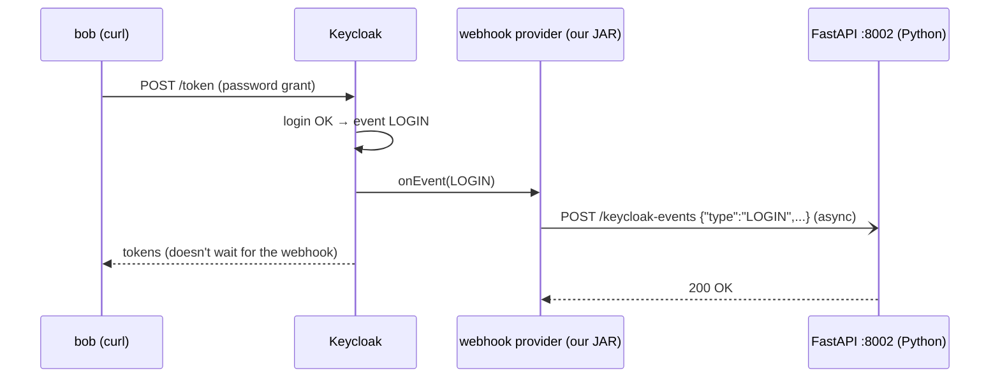

# Module 21: Extending Keycloak (SPIs and a tiny Java plugin)

**You'll learn:** what an SPI is, the common kinds of Keycloak extensions, how a plugin gets into Keycloak (a JAR in `/opt/keycloak/providers`), and you'll build and run a real **event listener** in Java that sends every login event to a **Python FastAPI** webhook. Plus: when an extension is worth it, and the alternatives.

**Before this:** [Module 20](20-events-monitoring-and-hardening.md).

**Starting state:** the Level 1 baseline with **user events turned on** in realm `learning` (Module 20, Step 1). Behind? Run [`../catch-up.md`](../catch-up.md), then `kcadm update realms/learning -s eventsEnabled=true`. You need Docker; you do **not** need Java or Maven installed (we build inside a Maven container).

---

## The idea in simple words

Keycloak is like a **power strip**. It has sockets of different shapes:

- an "event" socket (something happened),
- a "login step" socket (ask the user for something during login),
- a "token claim" socket (add something to tokens),
- a "where do users live" socket (users in an old database),
- a "look and feel" socket (themes).

Each socket shape is an **SPI** (Service Provider Interface): a contract that says "if your plug looks like this, I'll use it". Keycloak's own features are plugs in these sockets too. You can add your own plug: a **provider**, packaged as a Java **JAR** file.

You don't need Java to *use* Keycloak. Everything in Modules 01–20 needed none. You only write a plugin when no built-in feature, setting, or API can do the job.



---

## Jargon table

| Word | Plain meaning | Example |
|---|---|---|
| SPI | A "socket shape": a Java interface Keycloak calls | `EventListenerProvider` |
| Provider | Your plug: a class implementing the SPI | `WebhookListener` |
| Provider factory | Creates providers; has the provider's id and reads its settings | `WebhookListenerFactory`, id `webhook` |
| `META-INF/services` file | A text file telling Java "this JAR has a factory for that SPI" | `org.keycloak.events.EventListenerProviderFactory` |
| JAR | A zip of compiled Java classes | `webhook-listener-1.0.0.jar` |
| Maven | Java's build tool (like `uv` + a build step) | `mvn package` |
| `provided` dependency | "Compile against it, but don't bundle it; Keycloak already has it" | `keycloak-server-spi` |
| Webhook | An HTTP endpoint that receives notifications | `POST /keycloak-events` |
| Internal SPI | An SPI Keycloak may change between versions without notice | event listener SPI (you'll see a warning) |

### Common extension types

| Type (SPI) | What you can do | Example |
|---|---|---|
| **Event listener** | React to user/admin events | send logins to Kafka/Slack/a webhook, audit to a SIEM |
| **Authenticator** | A new step in the login flow | "check employee is on shift", custom OTP |
| **Protocol mapper** | Put computed claims into tokens | add `department` from an HR API |
| **User storage (federation)** | Users from your own legacy database | old MySQL `users` table, no migration |
| **Required action** | A task users must do after login | "accept new terms" with custom logic |
| **Theme** | Look and feel (FreeMarker templates, CSS; no Java needed) | company-branded login page ([Module 15](../level-3-login-experience/15-themes-and-emails.md)) |
| **REST endpoint** | Add your own HTTP endpoints under the realm | custom admin report |

---

## Hands-on

### Step 1: The Python webhook receiver

**Why:** start with the side you know. It just prints what it receives.

```bash
uv init kc-webhook
cd kc-webhook
uv add fastapi uvicorn
```

`main.py`:

```python
# main.py - a tiny web server that receives Keycloak events.
from fastapi import FastAPI, Request

app = FastAPI()


# Keycloak's extension POSTs JSON to this address.
@app.post("/keycloak-events")
async def receive_event(request: Request):
    # Read the JSON body that Java sent.
    event = await request.json()
    # Print it so we can see it arrive.
    print("got event:", event["type"], "user:", event["userId"], "error:", event["error"])
    # Answer 200 OK so Keycloak's log says the webhook worked.
    return {"ok": True}
```

Run it on port 8002 in its own terminal and leave it running. `0.0.0.0` so the Keycloak container can reach it:

```bash
uv run uvicorn main:app --host 0.0.0.0 --port 8002
```

```
INFO:     Started server process [97995]
INFO:     Waiting for application startup.
INFO:     Application startup complete.
INFO:     Uvicorn running on http://0.0.0.0:8002 (Press CTRL+C to quit)
```

From inside Docker, your Mac is reachable as `host.docker.internal` (Docker Desktop). On Linux add `--add-host=host.docker.internal:host-gateway` to `docker run`.

### Step 2: The Java project

In a new folder (not inside the Python one):

```
webhook-listener/
├── pom.xml
└── src/main/
    ├── java/com/example/webhook/
    │   ├── WebhookListenerFactory.java
    │   └── WebhookListener.java
    └── resources/META-INF/services/
        └── org.keycloak.events.EventListenerProviderFactory
```

**`pom.xml`**: the Java version of `pyproject.toml`:

```xml
<?xml version="1.0" encoding="UTF-8"?>
<project xmlns="http://maven.apache.org/POM/4.0.0"
         xmlns:xsi="http://www.w3.org/2001/XMLSchema-instance"
         xsi:schemaLocation="http://maven.apache.org/POM/4.0.0 http://maven.apache.org/xsd/maven-4.0.0.xsd">
  <modelVersion>4.0.0</modelVersion>

  <!-- The name of our little plugin. -->
  <groupId>com.example</groupId>
  <artifactId>webhook-listener</artifactId>
  <version>1.0.0</version>
  <packaging>jar</packaging>

  <properties>
    <!-- Keycloak 26 runs on Java 21, so we compile for Java 21. -->
    <maven.compiler.release>21</maven.compiler.release>
    <!-- MUST match the Keycloak server version. -->
    <keycloak.version>26.8.0</keycloak.version>
    <project.build.sourceEncoding>UTF-8</project.build.sourceEncoding>
  </properties>

  <dependencies>
    <!-- "provided" = Keycloak already has these inside; do not bundle them. -->
    <dependency>
      <groupId>org.keycloak</groupId>
      <artifactId>keycloak-server-spi</artifactId>
      <version>${keycloak.version}</version>
      <scope>provided</scope>
    </dependency>
    <dependency>
      <groupId>org.keycloak</groupId>
      <artifactId>keycloak-server-spi-private</artifactId>
      <version>${keycloak.version}</version>
      <scope>provided</scope>
    </dependency>
    <!-- Keycloak core: has the settings helper org.keycloak.Config. -->
    <dependency>
      <groupId>org.keycloak</groupId>
      <artifactId>keycloak-core</artifactId>
      <version>${keycloak.version}</version>
      <scope>provided</scope>
    </dependency>
    <!-- The logging library Keycloak itself uses. -->
    <dependency>
      <groupId>org.jboss.logging</groupId>
      <artifactId>jboss-logging</artifactId>
      <version>3.6.1.Final</version>
      <scope>provided</scope>
    </dependency>
  </dependencies>
</project>
```

**`src/main/resources/META-INF/services/org.keycloak.events.EventListenerProviderFactory`**: one line, the full class name of our factory. This is how Keycloak *finds* the plug:

```
com.example.webhook.WebhookListenerFactory
```

**`WebhookListenerFactory.java`**: created once at startup:

```java
package com.example.webhook;

import java.net.http.HttpClient;

import org.keycloak.Config;
import org.keycloak.events.EventListenerProvider;
import org.keycloak.events.EventListenerProviderFactory;
import org.keycloak.models.KeycloakSession;
import org.keycloak.models.KeycloakSessionFactory;

// The FACTORY: Keycloak creates it once at startup.
// It reads the settings and hands out a small "provider" object per request.
public class WebhookListenerFactory implements EventListenerProviderFactory {

    // Where we send events. Can be changed with --spi-events-listener--webhook--url=...
    private String url;

    // One shared HTTP client for the whole server (cheap to reuse).
    private HttpClient httpClient;

    // Called once at startup with this provider's settings.
    @Override
    public void init(Config.Scope config) {
        url = config.get("url", "http://host.docker.internal:8002/keycloak-events");
        // HTTP/1.1 keeps it simple (no "upgrade to HTTP/2" attempt that small servers warn about).
        httpClient = HttpClient.newBuilder()
                .version(HttpClient.Version.HTTP_1_1)
                .build();
    }

    // Called for every request that produces events.
    @Override
    public EventListenerProvider create(KeycloakSession session) {
        return new WebhookListener(httpClient, url);
    }

    // The name you pick in the realm's "Event listeners" list.
    @Override
    public String getId() {
        return "webhook";
    }

    // Nothing to do after all factories are ready.
    @Override
    public void postInit(KeycloakSessionFactory factory) {
    }

    // Nothing to clean up at shutdown.
    @Override
    public void close() {
    }
}
```

**`WebhookListener.java`**: called for every event:

```java
package com.example.webhook;

import java.net.URI;
import java.net.http.HttpClient;
import java.net.http.HttpRequest;
import java.net.http.HttpResponse;

import org.jboss.logging.Logger;
import org.keycloak.events.Event;
import org.keycloak.events.EventListenerProvider;
import org.keycloak.events.admin.AdminEvent;

// The PROVIDER: Keycloak calls onEvent(...) every time something happens to a user.
public class WebhookListener implements EventListenerProvider {

    private static final Logger LOG = Logger.getLogger(WebhookListener.class);

    private final HttpClient httpClient;
    private final String url;

    public WebhookListener(HttpClient httpClient, String url) {
        this.httpClient = httpClient;
        this.url = url;
    }

    // A user event happened (LOGIN, LOGIN_ERROR, LOGOUT, ...).
    @Override
    public void onEvent(Event event) {
        // Build a tiny JSON text by hand (keeps the example free of extra libraries).
        String json = "{"
                + "\"type\":\"" + event.getType() + "\","
                + "\"realmId\":\"" + event.getRealmId() + "\","
                + "\"clientId\":\"" + event.getClientId() + "\","
                + "\"userId\":\"" + event.getUserId() + "\","
                + "\"error\":\"" + event.getError() + "\","
                + "\"time\":" + event.getTime()
                + "}";

        HttpRequest request = HttpRequest.newBuilder(URI.create(url))
                .header("Content-Type", "application/json")
                .POST(HttpRequest.BodyPublishers.ofString(json))
                .build();

        // sendAsync = do not make the user's login wait for our webhook.
        httpClient.sendAsync(request, HttpResponse.BodyHandlers.discarding())
                .whenComplete((response, error) -> {
                    if (error != null) {
                        LOG.warnf("webhook failed: %s", error.toString());
                    } else {
                        LOG.infof("webhook sent %s -> HTTP %d", event.getType(), response.statusCode());
                    }
                });
    }

    // Admin events (someone changed the realm). We ignore them in this example.
    @Override
    public void onEvent(AdminEvent event, boolean includeRepresentation) {
    }

    @Override
    public void close() {
    }
}
```

Reading it as a Python developer: `implements` ≈ "this class follows that interface"; `@Override` ≈ "this replaces a method from the interface"; `sendAsync` ≈ `asyncio.create_task(client.post(...))` without awaiting. (Building JSON by string concatenation is fine for these simple ids; a real plugin would use a JSON library so quotes are escaped.)

### Step 3: Build the JAR (no Java install needed)

**Why:** Maven downloads the Keycloak libraries and compiles. The `keycloak-m2` volume caches downloads for next time.

```bash
cd webhook-listener
docker run --rm -v "$PWD":/project -v keycloak-m2:/root/.m2 -w /project \
  maven:3.9-eclipse-temurin-21 mvn -B package 2>&1 | grep -E 'Building jar|BUILD|Total time'
unzip -l target/webhook-listener-1.0.0.jar | grep -E 'class|services'
```

```
[INFO] Building jar: /project/target/webhook-listener-1.0.0.jar
[INFO] BUILD SUCCESS
[INFO] Total time:  0.871 s
        0  10-06-2026 18:14   META-INF/services/
       43  10-06-2026 18:14   META-INF/services/org.keycloak.events.EventListenerProviderFactory
     2175  10-06-2026 18:17   com/example/webhook/WebhookListenerFactory.class
     4712  10-06-2026 18:17   com/example/webhook/WebhookListener.class
```

(The very first build takes longer: it downloads Maven plugins and Keycloak jars.)

### Step 4: Put the JAR into Keycloak

**Why:** Keycloak loads providers from `/opt/keycloak/providers` during its **build** step. `start-dev` rebuilds automatically on start; in production you `COPY` the JAR into your image *before* `kc.sh build` ([Module 17](17-production.md)).

Recreate the lab container with the JAR mounted (same volume, so your realm stays):

```bash
docker rm -f keycloak
docker run -d --name keycloak -p 8180:8080 \
  -v keycloak-data:/opt/keycloak/data \
  -v "$PWD/target/webhook-listener-1.0.0.jar:/opt/keycloak/providers/webhook-listener.jar" \
  -e KC_BOOTSTRAP_ADMIN_USERNAME=admin -e KC_BOOTSTRAP_ADMIN_PASSWORD=admin \
  quay.io/keycloak/keycloak:26.8.0 start-dev
docker logs keycloak 2>&1 | grep -iE 'webhook|custom providers'
```

```
Updating the configuration and installing your custom providers, if any. Please wait.
2026-10-06 18:16:36,972 WARN  [org.keycloak.services] (build-18) KC-SERVICES0047: webhook (com.example.webhook.WebhookListenerFactory) is implementing the internal SPI eventsListener. This SPI is internal and may change without notice
```

That warning is normal and honest: the event listener SPI is "internal", so after a Keycloak upgrade you must rebuild against the new version and retest. (If you added `-p 9000:9000` and the metrics flags in Module 20, keep them here too.)

Production Dockerfile version:

```dockerfile
FROM quay.io/keycloak/keycloak:26.8.0 AS builder
COPY webhook-listener-1.0.0.jar /opt/keycloak/providers/
RUN /opt/keycloak/bin/kc.sh build
```

### Step 5: Turn the listener on for the realm

Console: realm `learning` → **Realm settings** → **Events** → **Event listeners**: add `webhook` (keep `jboss-logging`) → Save.

```bash
kcadm config credentials --server http://localhost:8080 --realm master --user admin --password admin
kcadm update events/config -r learning -s 'eventsListeners=["jboss-logging","webhook"]'
kcadm get events/config -r learning --fields eventsListeners
```

```
Logging into http://localhost:8080 as user admin of realm master
{
  "eventsListeners" : [ "webhook", "jboss-logging" ]
}
```

(You log in again because the new container forgot the old `kcadm` login.)

### Step 6: Make events and watch them arrive in Python

```bash
curl -s -X POST http://localhost:8180/realms/learning/protocol/openid-connect/token \
  -d grant_type=password -d client_id=learning-cli -d username=bob -d password=bob123 | jq -c keys
curl -s -X POST http://localhost:8180/realms/learning/protocol/openid-connect/token \
  -d grant_type=password -d client_id=learning-cli -d username=bob -d password=oops; echo
```

```
["access_token","expires_in","not-before-policy","refresh_expires_in","refresh_token","scope","session_state","token_type"]
{"error":"invalid_grant","error_description":"Invalid user credentials"}
```

In the **uvicorn terminal**:

```
got event: LOGIN user: 7ee08041-a99f-4750-b712-80b87cafdf57 error: null
INFO:     127.0.0.1:56557 - "POST /keycloak-events HTTP/1.1" 200 OK
got event: LOGIN_ERROR user: 7ee08041-a99f-4750-b712-80b87cafdf57 error: invalid_user_credentials
INFO:     127.0.0.1:56557 - "POST /keycloak-events HTTP/1.1" 200 OK
```

In **Keycloak's log**:

```bash
docker logs keycloak 2>&1 | grep 'webhook sent'
```

```
2026-10-06 18:17:32,919 INFO  [com.example.webhook.WebhookListener] (ForkJoinPool.commonPool-worker-2) webhook sent LOGIN -> HTTP 200
2026-10-06 18:17:33,011 INFO  [com.example.webhook.WebhookListener] (ForkJoinPool.commonPool-worker-2) webhook sent LOGIN_ERROR -> HTTP 200
```

Java (inside Keycloak) → HTTP → Python. Your Python code can now post to Slack, write to a database, or trigger a workflow.

### Step 7: Configure the URL without changing code

Provider settings use the pattern `--spi-<spi-id>--<provider-id>--<setting>`. Our factory reads `url`:

```bash
# add to the end of the docker run command (instead of plain start-dev):
... quay.io/keycloak/keycloak:26.8.0 start-dev \
  --spi-events-listener--webhook--url=http://host.docker.internal:8002/wrong-path
```

After a login the log shows the new address was used (FastAPI has no such path):

```
2026-10-06 18:28:05,183 INFO  [com.example.webhook.WebhookListener] (ForkJoinPool.commonPool-worker-2) webhook sent LOGIN -> HTTP 404
```

The environment variable form is `KC_SPI_EVENTS_LISTENER__WEBHOOK__URL` (not run here; same option, env-var spelling). Recreate the container without the flag afterwards.

---

## Is an extension worth it?

| Need | First try (no Java) | Write an extension when... |
|---|---|---|
| React to logins/changes | Poll the events admin API from a Python job (Module 20) | You need it instantly, for every event |
| Send events to Kafka/HTTP | A well-maintained community event-listener extension (search "keycloak event listener webhook/kafka"; check it supports your exact Keycloak version) | Nothing fits, or policy forbids third-party JARs |
| Extra claim in tokens | Built-in mappers: user attribute, hardcoded claim, group membership, audience | The value must be computed or fetched elsewhere |
| Custom login step | Built-in flows: conditions, OTP, WebAuthn, required actions | Truly custom checks during login |
| Users in a legacy DB | Migrate them, or LDAP federation | The DB must stay the source of truth |
| Branding | Themes (FreeMarker/CSS) | (themes aren't Java anyway) |

The **cost**: you own Java code running *inside* your login server. A bug or slow call there can break logins for everyone (that's why we used `sendAsync`). Every Keycloak upgrade means rebuilding and retesting your JAR. Keep extensions tiny and few.

---

## The one trap

**Doing slow or failing work directly inside the provider.** If `onEvent` calls a slow webhook *synchronously*, every login waits for it; if it throws, logins can fail. Do the minimum inside Keycloak, send asynchronously, and let your Python service do the real work. Second trap: building against a different Keycloak version than the server runs. Keep `keycloak.version` equal to the server version.

---

## Check yourself

1. What is an SPI, in one sentence?
2. Which file tells Keycloak "this JAR contains an event listener factory"?
3. Why are the Keycloak dependencies `provided`?
4. Why `sendAsync` instead of `send`?
5. Name two ways to get Keycloak events into Python *without* writing Java.

<details>
<summary>Answers</summary>

1. A contract (Java interface) for a pluggable part of Keycloak; providers implement it.
2. `META-INF/services/org.keycloak.events.EventListenerProviderFactory`, containing the factory class name.
3. Keycloak already contains those libraries at runtime; bundling them would cause conflicts and a bigger JAR.
4. So the user's login doesn't wait for (or fail because of) the webhook.
5. Poll `GET /admin/realms/<realm>/events` with an admin-API client, or parse the `jboss-logging` event lines in your log pipeline. (Or install a maintained community listener.)

</details>

---

## Try this

1. Make `onEvent` skip everything except `LOGIN_ERROR` (`if (event.getType() != EventType.LOGIN_ERROR) return;`, import `org.keycloak.events.EventType`). Rebuild, recreate the container, test.
2. Stop the FastAPI server and log in. What does Keycloak's log say? Did the login still work?
3. Add admin events: send `event.getOperationType()` and `event.getResourcePath()` from the second `onEvent`, and change carol's name.

Next: [Module 22: Troubleshooting](22-troubleshooting.md).
