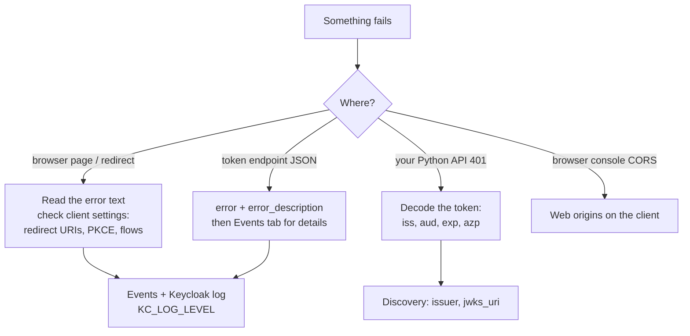

# Module 22: Troubleshooting (real errors, real fixes)

**You'll learn:** how to recognise and fix the errors you'll actually hit with Keycloak: bad redirect URI, client errors, `invalid_grant` in its many forms, accounts not fully set up, issuer and audience mismatches in Python, CORS, clock skew, disabled flows, missing PKCE, disabled users, and "HTTPS required". Each one: **symptom → why → fix**, reproduced for real. Then a debugging checklist.

**Before this:** [Module 21](21-extending-keycloak.md).

**Starting state:** the Level 1 baseline. Behind? Run [`../catch-up.md`](../catch-up.md). Also used: user `carol` ([Module 16](16-admin-api-and-realm-as-code.md)), client `user-sync-bot` (Module 16), the password policy from [Module 20](20-events-monitoring-and-hardening.md) (min length 12), the login helper scripts `login_steps.sh` / `login_as.sh` from [Module 19](19-token-exchange-and-organizations.md), and `check_token.py` (below). Lab container `keycloak` on `8180`, `kcadm` alias logged in.

---

## The idea in simple words

Keycloak errors look scary but they are **very precise**. Each one names the rule you broke. The trick is to know where to look:

1. **What the caller sees** (the error JSON or page): short, often vague on purpose, so attackers learn nothing.
2. **What Keycloak recorded** (events, log): the real reason.
3. **What's inside the token** (decode it): most API-side errors are a claim that doesn't match.

Like a doctor: symptom first, then tests, then the cause.



---

## Jargon table

| Word | Plain meaning | Example |
|---|---|---|
| `error` / `error_description` | The OAuth error code and a human hint | `invalid_grant` / `Code not valid` |
| `invalid_client` | Keycloak doesn't know this client (or can't authenticate it) | typo in `client_id` |
| `unauthorized_client` | Client known, but not allowed to do this | flow disabled for the client |
| `invalid_grant` | The thing you traded in (password, code, refresh token) is not acceptable | wrong password, used code |
| Required action | Something the user must do before getting tokens | `UPDATE_PASSWORD` |
| Issuer mismatch | Token's `iss` ≠ what the API expects | `127.0.0.1` vs `localhost` |
| Audience mismatch | Token's `aud` doesn't contain your API | `InvalidAudienceError` |
| CORS | Browser rule: JavaScript may only read responses from other origins if the server allows it | `Access-Control-Allow-Origin` |
| Clock skew | Two computers disagree on the time | token "not yet valid" |
| Leeway | Seconds of tolerance when checking `exp`/`iat` | `leeway=30` |
| `sslRequired` | Realm setting: when HTTPS is mandatory | `external` (default), `all`, `none` |

---

## Setup for this module

The token checker used by several sections. In a `uv` project with `uv add httpx "pyjwt[crypto]"`, create `check_token.py`:

```python
# check_token.py - verify a token the way an API does, and print the exact error if it fails.
# Usage: uv run check_token.py <token> [audience] [leeway_seconds]
import sys

import jwt

# What our API expects. These must match the token EXACTLY.
EXPECTED_ISSUER = "http://localhost:8180/realms/learning"
JWKS_URL = EXPECTED_ISSUER + "/protocol/openid-connect/certs"

# Read the inputs from the command line.
token = sys.argv[1]
audience = "notes-api"
if len(sys.argv) > 2:
    audience = sys.argv[2]
leeway = 0
if len(sys.argv) > 3:
    leeway = int(sys.argv[3])

# PyJWKClient downloads Keycloak's public keys and picks the one named in the token's "kid".
jwks_client = jwt.PyJWKClient(JWKS_URL)
signing_key = jwks_client.get_signing_key_from_jwt(token)

try:
    # decode() checks signature, exp, iat, iss and aud in one call.
    claims = jwt.decode(
        token,
        signing_key.key,
        algorithms=["RS256"],
        audience=audience,
        issuer=EXPECTED_ISSUER,
        leeway=leeway,
    )
    print("OK: token is valid for", claims["preferred_username"])
except jwt.PyJWTError as error:
    # Print the error class name: it tells you WHICH check failed.
    print("REJECTED:", type(error).__name__, "-", error)
```

Shell shortcuts used below:

```bash
TOKEN_URL=http://localhost:8180/realms/learning/protocol/openid-connect/token
AUTH_URL=http://localhost:8180/realms/learning/protocol/openid-connect/auth
```

(Verified: Python 3.12.13, PyJWT 2.15.1.)

---

## The errors

### 1. `Invalid parameter: redirect_uri`

**Symptom:** the browser shows a Keycloak page "We are sorry... Invalid parameter: redirect_uri" instead of the login form.

```bash
curl -s "$AUTH_URL?client_id=web-app&response_type=code&scope=openid&redirect_uri=http://localhost:3000/callback" \
  | grep -o 'Invalid parameter[^<]*'
curl -s -o /dev/null -w '%{http_code}\n' \
  "$AUTH_URL?client_id=web-app&response_type=code&scope=openid&redirect_uri=http://localhost:3000/callback"
```

```
Invalid parameter: redirect_uri
400
```

**Why:** the `redirect_uri` your app sent is not in the client's **Valid redirect URIs**. Keycloak compares exactly (scheme, host, port, path). `http://localhost:8000/auth/callback` ≠ `http://127.0.0.1:8000/auth/callback` ≠ `.../callback/`.

**Fix:** print the exact `redirect_uri` your app sends (it's in the browser's address bar on the error page) and add *that exact value* to the client. Don't "fix" it with `*`: wildcards let attackers send codes to their own pages. Keycloak deliberately shows an error page instead of redirecting, because redirecting to an unknown URL is exactly the attack.

### 2. `invalid_client` and `unauthorized_client`

```bash
echo "== wrong secret"
curl -s -X POST $TOKEN_URL -d grant_type=client_credentials -d client_id=user-sync-bot -d client_secret=wrong; echo
echo "== unknown client_id"
curl -s -X POST $TOKEN_URL -d grant_type=password -d client_id=learning-clii -d username=alice -d password=alice123; echo
echo "== client_credentials on a client without service account"
curl -s -X POST $TOKEN_URL -d grant_type=client_credentials -d client_id=web-app -d client_secret=web-app-secret; echo
```

```
== wrong secret
{"error":"unauthorized_client","error_description":"Invalid client or Invalid client credentials"}
== unknown client_id
{"error":"invalid_client","error_description":"Invalid client or Invalid client credentials"}
== client_credentials on a client without service account
{"error":"unauthorized_client","error_description":"Client not enabled to retrieve service account"}
```

**Why:** the first two have the same vague description on purpose (don't tell attackers whether the client exists). Note that in Keycloak 26.8 a **wrong secret** comes back as `unauthorized_client` and an **unknown client** as `invalid_client`. The third: the client exists, but the **Service accounts** capability is off.

**Fix:** check `client_id` spelling and realm; copy the secret again from **Clients → (client) → Credentials** (did someone regenerate it? see admin events); for client credentials, turn on **Service accounts roles**. In Python, check you send the secret where the client expects it (form body `client_secret` vs HTTP Basic auth; Authlib does Basic by default for `client_secret_basic`).

### 3. `Client not allowed for direct access grants`

```bash
curl -s -X POST $TOKEN_URL -d grant_type=password -d client_id=web-app -d client_secret=web-app-secret \
  -d username=alice -d password=alice123; echo
```

```
{"error":"unauthorized_client","error_description":"Client not allowed for direct access grants"}
```

**Why:** you used the password grant (`grant_type=password`), and the client has **Direct access grants** OFF. That's correct for `web-app`.

**Fix:** don't turn it on for real apps; the password grant is deprecated and skips MFA and the login page. Use the authorization code flow (Level 2). For labs, use a dedicated client like `learning-cli`.

### 4. `invalid_grant`: the many faces

**a) Wrong password**

```bash
curl -s -X POST $TOKEN_URL -d grant_type=password -d client_id=learning-cli \
  -d username=alice -d password=WRONG; echo
```

```
{"error":"invalid_grant","error_description":"Invalid user credentials"}
```

The event says which: `invalid_user_credentials`, `user_not_found`, `user_temporarily_disabled` ([Module 20](20-events-monitoring-and-hardening.md)).

**b) Code used twice / c) code expired / PKCE verifier wrong.** `get_code.sh` (next to `login_steps.sh` from Module 19) logs in like a browser and prints the code and PKCE verifier without exchanging them:

```bash
# get_code.sh USER PASS -> prints CODE=... and VERIFIER=... (lab only)
. "$(dirname "$0")/login_steps.sh"
echo "CODE=$CODE"
echo "VERIFIER=$VERIFIER"
```

```bash
exchange() {
  curl -s -X POST $TOKEN_URL -d grant_type=authorization_code -d client_id=web-app \
    -d client_secret=web-app-secret -d code="$CODE" \
    -d redirect_uri=http://localhost:8000/auth/callback -d code_verifier="$1"; echo
}

eval "$(bash get_code.sh alice alice123)"
echo "== wrong verifier"; exchange wrongverifierwrongverifierwrongverifierwrongverifier123
eval "$(bash get_code.sh alice alice123)"
echo "== no verifier"; exchange ""
eval "$(bash get_code.sh alice alice123)"
echo "== first use"; exchange "$VERIFIER" | jq -c keys
echo "== reuse"; exchange "$VERIFIER"
eval "$(bash get_code.sh alice alice123)"; sleep 65
echo "== expired (65s)"; exchange "$VERIFIER"
```

```
== wrong verifier
{"error":"invalid_grant","error_description":"PKCE verification failed: Code mismatch"}
== no verifier
{"error":"invalid_grant","error_description":"PKCE verification failed: Invalid code verifier"}
== first use
["access_token","expires_in","id_token","not-before-policy","refresh_expires_in","refresh_token","scope","session_state","token_type"]
== reuse
{"error":"invalid_grant","error_description":"Code not valid"}
== expired (65s)
{"error":"invalid_grant","error_description":"Code not valid"}
```

The events tell reuse/expiry apart from PKCE problems:

```bash
kcadm get events -r learning -q type=CODE_TO_TOKEN_ERROR -q max=4 | jq -c '.[] | {error, reason: .details.reason}'
```

```
{"error":"invalid_code","reason":null}
{"error":"invalid_code","reason":null}
{"error":"invalid_code_verifier","reason":"Invalid code verifier"}
{"error":"pkce_verification_failed","reason":"Code mismatch"}
```

**Why:** a code is **single use** and lives **60 seconds** by default (realm setting *Client login timeout*). PKCE: the verifier must be the one that produced the `code_challenge` at the start of login.

**Fix:** exchange the code right away and only once. Typical real causes: the browser hit the callback twice (refresh, double click, a prefetching browser extension); two app instances with separate session storage, so the verifier saved in the session isn't found (use a shared session store or sticky sessions in *your* app); a slow debugger breakpoint between redirect and exchange. For refresh tokens, `invalid_grant` + `Token is not active` / `Session not active` means the session ended (logout, idle timeout, admin revoked it): send the user to log in again.

### 5. `Account is not fully set up`

```bash
CAROL_ID=$(kcadm get users -r learning -q username=carol -q exact=true --fields id --format csv --noquotes)
kcadm delete attack-detection/brute-force/users/$CAROL_ID -r learning   # in case Module 20 locked her
kcadm set-password -r learning --username carol --new-password carol-long-pass1
kcadm update users/$CAROL_ID -r learning -s 'requiredActions=["UPDATE_PASSWORD"]'
curl -s -X POST $TOKEN_URL -d grant_type=password -d client_id=learning-cli \
  -d username=carol -d password=carol-long-pass1; echo
```

```
{"error":"invalid_grant","error_description":"Account is not fully set up"}
```

**Why:** carol has a **required action** pending (update password, verify email, configure OTP, accept terms). The browser login would show her that page; the password grant has no pages, so it just fails.

**Fix:** log in once through the browser to finish the action, or clear it (console: user → **Required user actions**):

```bash
kcadm update users/$CAROL_ID -r learning -s 'requiredActions=[]'
```

Also check the user profile: if the realm requires attributes (e.g. first/last name, email) the user lacks, Keycloak adds `VERIFY_PROFILE` and you get the same error.

### 6. User disabled

```bash
kcadm update users/$CAROL_ID -r learning -s enabled=false
curl -s -X POST $TOKEN_URL -d grant_type=password -d client_id=learning-cli \
  -d username=carol -d password=carol-long-pass1; echo
kcadm update users/$CAROL_ID -r learning -s enabled=true
curl -s -X POST $TOKEN_URL -d grant_type=password -d client_id=learning-cli \
  -d username=carol -d password=carol-long-pass1 | jq -c keys
```

```
{"error":"invalid_grant","error_description":"Account disabled"}
["access_token","expires_in","not-before-policy","refresh_expires_in","refresh_token","scope","session_state","token_type"]
```

**Why / fix:** an admin disabled the user (or an HR sync did). Brute-force lockouts look different: they still say `Invalid user credentials` to the caller, with `user_temporarily_disabled` in events. Fix: re-enable, or unlock in the console.

### 7. PKCE missing

```bash
curl -s -o /dev/null -w '%{http_code} %{redirect_url}\n' \
  "$AUTH_URL?client_id=web-app&response_type=code&scope=openid&redirect_uri=http://localhost:8000/auth/callback"
```

```
302 http://localhost:8000/auth/callback?error=invalid_request&error_description=Missing+parameter%3A+code_challenge_method&iss=http%3A%2F%2Flocalhost%3A8180%2Frealms%2Flearning
```

**Why:** `web-app` requires PKCE S256 (`pkce.code.challenge.method=S256`), and the request had no `code_challenge`. Here Keycloak *does* redirect back (the redirect URI is valid), with the error in the URL. Your callback route must handle `?error=...`, not just `?code=...`.

**Fix:** enable PKCE in your library (Authlib: `client_kwargs={"code_challenge_method": "S256"}`, Level 2).

### 8. Issuer mismatch (`InvalidIssuerError`)

**Symptom:** your Python API rejects tokens with "Invalid issuer", even though they look fine.

```bash
get_alice() {
  curl -s -X POST $1/realms/learning/protocol/openid-connect/token -d grant_type=password \
    -d client_id=learning-cli -d username=alice -d password=alice123 | jq -r .access_token
}
VIA_LOCALHOST=$(get_alice http://localhost:8180)
VIA_IP=$(get_alice http://127.0.0.1:8180)
jwt_payload "$VIA_LOCALHOST" | jq -c '{iss, aud}'
jwt_payload "$VIA_IP" | jq -c '{iss, aud}'
uv run check_token.py "$VIA_LOCALHOST"
uv run check_token.py "$VIA_IP"
```

```
{"iss":"http://localhost:8180/realms/learning","aud":["account","notes-api"]}
{"iss":"http://127.0.0.1:8180/realms/learning","aud":["account","notes-api"]}
OK: token is valid for alice
REJECTED: InvalidIssuerError - Invalid issuer
```

**Why:** in dev mode (no hostname set), Keycloak builds `iss` from **the address the client used**. Same server, same key, same user: different `iss`. The discovery document changes too:

```bash
for h in localhost 127.0.0.1; do
  curl -s http://$h:8180/realms/learning/.well-known/openid-configuration | jq -c '{issuer}'
done
```

```
{"issuer":"http://localhost:8180/realms/learning"}
{"issuer":"http://127.0.0.1:8180/realms/learning"}
```

In Docker/Kubernetes this bites as: the web app fetches tokens via `http://keycloak:8080` (container name) but the API expects `http://localhost:8180`.

**Fix:** set a fixed public hostname (`KC_HOSTNAME`, [Module 17](17-production.md)); then `iss` is always the same. Make every app and API use that one URL. (For internal back-channel calls there's `KC_HOSTNAME_BACKCHANNEL_DYNAMIC`, but the `iss` stays the public one.) Never "fix" it by turning off issuer checking.

### 9. Missing audience (`InvalidAudienceError`)

```bash
uv run check_token.py "$VIA_LOCALHOST" orders-api
```

```
REJECTED: InvalidAudienceError - Audience doesn't match
```

**Why:** the API expected `aud` to contain `orders-api`; the token has `["account","notes-api"]`. Keycloak only adds an API to `aud` when the user has one of its client roles (and the client's scope allows it) or an **audience mapper** adds it.

**Fix:** on the client that gets the token, add an audience mapper for the API ([Module 11](../level-2-apps/11-client-scopes-and-mappers.md)), or give the user a client role of the API, or use token exchange ([Module 19](19-token-exchange-and-organizations.md)). Don't remove the audience check: without it, a token meant for any other service would work on yours.

### 10. Clock skew (`ImmatureSignatureError` / `ExpiredSignatureError`)

**Symptom:** tokens fail "randomly" on one server only, right after being issued, or seem to expire early.

Simulated with a *negative* leeway: `-400` makes PyJWT act as if the API's clock were 400 seconds **behind** Keycloak's, so the token looks like it was issued in the future:

```bash
uv run check_token.py "$VIA_LOCALHOST" notes-api -400
```

```
REJECTED: ImmatureSignatureError - The token is not yet valid (iat)
```

(If the API's clock is **ahead**, you get `ExpiredSignatureError` early instead.)

**Why:** `iat`, `nbf` and `exp` are absolute times. If Keycloak and the API host disagree, checks fail.

**Fix:** run NTP time sync on every host (containers use the host's clock). Allow a small tolerance: `jwt.decode(..., leeway=30)`. Check quickly:

```bash
date -u; docker exec keycloak date -u
```

```
Tue Oct  6 18:30:09 UTC 2026
Tue Oct  6 06:30:09 PM UTC 2026
```

### 11. CORS errors

**Symptom:** in the browser console: *"Access to fetch at 'http://localhost:8180/...' from origin 'http://localhost:3000' has been blocked by CORS policy: No 'Access-Control-Allow-Origin' header..."*. The same request works with curl.

**Why:** browsers only let JavaScript read a response from another origin (scheme+host+port) if the server says so. Keycloak says so only for origins listed in the client's **Web origins**. curl doesn't care about CORS, which is why it "works in curl". Simulating the browser with curl and an `Origin` header (alice's token from `web-app`, whose web origin is `http://localhost:8000`):

```bash
ALICE_WEB=$(bash login_as.sh alice alice123 | jq -r .access_token)
for origin in http://localhost:8000 http://localhost:3000; do
  echo "== Origin $origin"
  curl -s -i http://localhost:8180/realms/learning/protocol/openid-connect/userinfo \
    -H "Authorization: Bearer $ALICE_WEB" -H "Origin: $origin" \
    | grep -iE '^(HTTP|access-control-allow-origin)'
done
```

```
== Origin http://localhost:8000
HTTP/1.1 200 OK
Access-Control-Allow-Origin: http://localhost:8000
== Origin http://localhost:3000
HTTP/1.1 403 Forbidden
```

**Fix:** add the exact frontend origin to **Web origins** (or `+` = "all origins of my redirect URIs"). No trailing slash, no path. Note: a server-side Python app (Authlib, FastAPI) never has CORS problems with Keycloak; CORS only matters for JavaScript running in a browser. If your *own* API gives CORS errors, that's your API's CORS config (FastAPI `CORSMiddleware`), not Keycloak.

### 12. `HTTPS required`

**Symptom:** a page "HTTPS required", or this JSON:

```bash
kcadm update realms/learning -s sslRequired=all
curl -s -X POST $TOKEN_URL -d grant_type=password -d client_id=learning-cli \
  -d username=alice -d password=alice123; echo
curl -s "$AUTH_URL?client_id=web-app&response_type=code&redirect_uri=http://localhost:8000/auth/callback" \
  | grep -oE 'HTTPS required' | head -1
kcadm update realms/learning -s sslRequired=external
```

```
{"error":"invalid_request","error_description":"HTTPS required"}
HTTPS required
```

**Why:** the realm's **Require SSL** (`sslRequired`):

| Value | HTTP allowed from... |
|---|---|
| `none` | everywhere (never in production) |
| `external` (default) | only private addresses: localhost, `10.x`, `172.16–31.x`, `192.168.x` |
| `all` | nowhere |

The classic case: your lab works on your laptop, then a colleague opens `http://<your-public-ip>:8180` and gets "HTTPS required", because they're "external". Or behind a proxy without `KC_PROXY_HEADERS`, Keycloak sees plain HTTP and thinks HTTPS is missing. (We simulated with `all` because from Docker Desktop your Mac always looks private, `192.168.65.1`.)

**Fix:** use HTTPS (Module 17). Behind a proxy: set `KC_PROXY_HEADERS=xforwarded` and make the proxy send `X-Forwarded-Proto: https`. Don't set `none` to make it go away. If you locked yourself out of `master` with `all` on plain HTTP: `kcadm` from inside the container (`localhost`) still works under `external`.

---

## Debugging checklist

1. **Read the full error.** `error` + `error_description`, or the text on the Keycloak page. It usually names the setting.
2. **Decode the token** (`jwt_payload`, [Module 06](../level-1-basics/06-tokens.md)): check `iss`, `aud`, `azp`, `exp`/`iat`, roles, `scope`. Most API 401s are visible here.
3. **Check discovery** from where your app runs: `curl <issuer>/.well-known/openid-configuration | jq '{issuer, jwks_uri}'`. Does `issuer` match `iss` and your API config, character for character?
4. **Events tab** (user events: `error` + `details.reason`; admin events: who changed what). Turn events on *before* you need them ([Module 20](20-events-monitoring-and-hardening.md)).
5. **Keycloak log**: `docker logs keycloak`. Event errors are `WARN` lines from `org.keycloak.events`.
6. **More logging** for one area, without drowning: `KC_LOG_LEVEL='INFO,org.keycloak.events:DEBUG'` (or `--log-level=...`). With it, successful logins appear too:

   ```bash
   docker run ... -e KC_LOG_LEVEL='INFO,org.keycloak.events:DEBUG' quay.io/keycloak/keycloak:26.8.0 start-dev
   docker logs keycloak 2>&1 | grep 'type="LOGIN"' | tail -1
   ```

   ```
   2026-10-06 18:30:01,990 DEBUG [org.keycloak.events] (executor-thread-1) type="LOGIN", realmId="c13de6eb-145c-449c-bf5d-4907ae41e84d", realmName="learning", clientId="learning-cli", userId="7ee08041-a99f-4750-b712-80b87cafdf57", sessionId="87Xilb6R_hLs3tz2UQcrKXx4", ipAddress="192.168.65.1", refresh_token_provider_id="default", auth_method="openid-connect", token_id="onrtro:7f1c2c8c-0a4b-3a1f-e766-...
   ```

   (Line cut at the end.) Other useful categories: `org.keycloak.authentication` (login flows), `org.keycloak.protocol.oidc` (OIDC requests). `DEBUG` for everything (`KC_LOG_LEVEL=DEBUG`) is very noisy; use it briefly.
7. **Compare client settings** with a working client: capabilities (flows), redirect URIs, web origins, PKCE, client scopes, mappers. `kcadm get clients -r learning -q clientId=web-app` dumps them all.
8. **Check time** on all hosts (`date -u`).
9. **Reproduce with curl** outside your app. If curl works and the app doesn't, the bug is in the app's config (URL, secret, redirect URI, session storage).
10. **Check the hostname** the browser, the app and the API each use to reach Keycloak. One URL everywhere.

---

## The one trap

**"Fixing" errors by switching off the check**: wildcard redirect URIs, `verify_aud: False`, no issuer check, `sslRequired=none`, direct grants on for the web app. The error goes away and a security hole appears. Every error in this module has a real fix; find the setting that doesn't match and make it match.

---

## Check yourself

1. Your Python API says `InvalidIssuerError`, but the token decodes fine. First two things you compare?
2. A user gets `Code not valid`. Name two possible causes.
3. Why does `web-app` login show an error *page* for a bad redirect URI, but redirect back with `?error=` when PKCE is missing?
4. "It works with curl but the browser says CORS." What do you check in Keycloak?
5. A colleague on another network gets "HTTPS required" and you don't. Why?

<details>
<summary>Answers</summary>

1. The token's `iss` and the API's expected issuer (and the discovery `issuer` from where the token was fetched). Usually a different hostname (`127.0.0.1` vs `localhost`, container name vs public name).
2. The code was already used (double callback), or it expired (> 60 s); also a different Keycloak hostname/realm or wrong client. PKCE problems have their own message.
3. With an unregistered redirect URI, Keycloak can't safely send anything there. With PKCE missing, the redirect URI is valid, so it reports the error to the app.
4. The client's **Web origins** must contain the page's exact origin (or `+`).
5. `sslRequired=external`: HTTP is allowed only from private addresses. Their requests come from a public IP.

</details>

---

## Try this

1. Point your Level 2 web app at `http://127.0.0.1:8180` instead of `localhost` and see which error appears first, and where.
2. Set the realm's **Client login timeout** to 10 seconds, then reproduce "Code not valid" with `sleep 12`.
3. Add `http://localhost:3000` to `web-app`'s Web origins and rerun the CORS test.

This is the last module. Back to the [course map](../README.md); build the capstone projects in [`../PROJECTS.md`](../PROJECTS.md).
